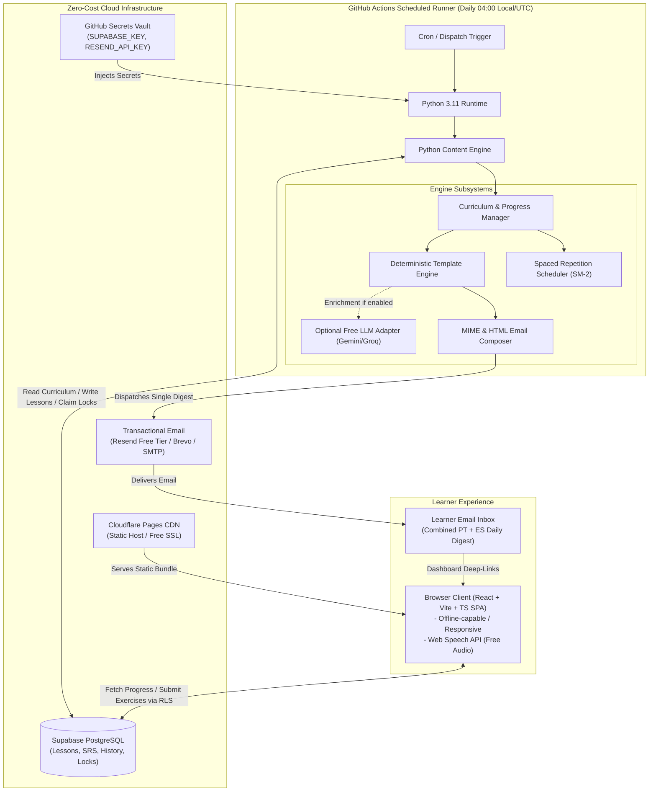
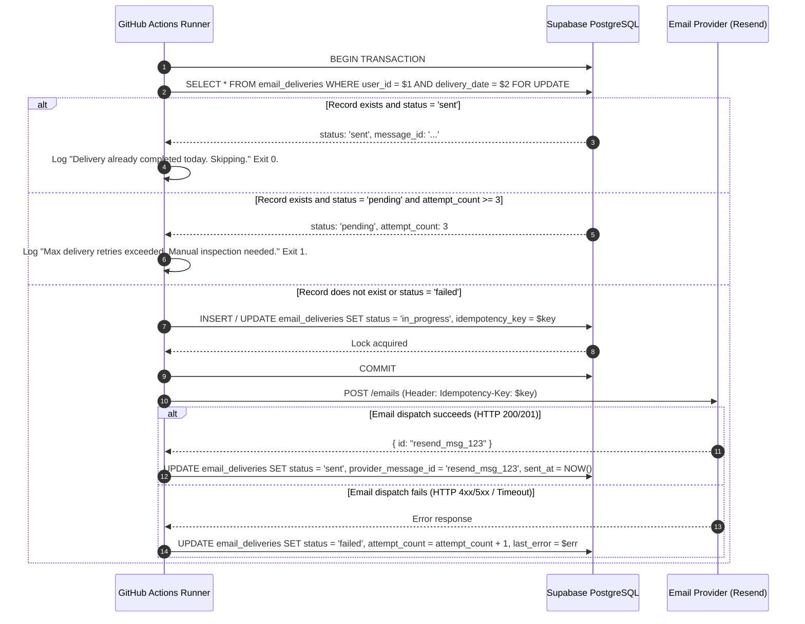
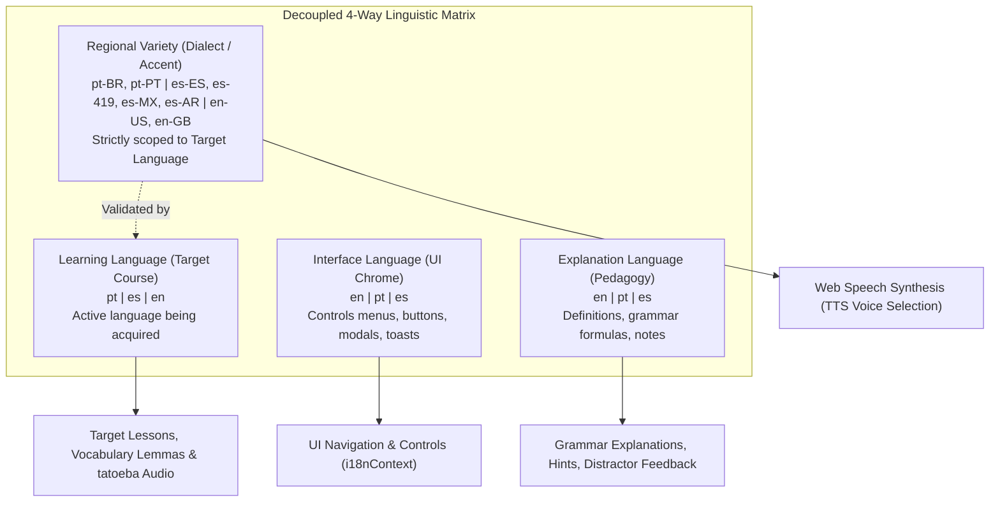

# Polyglot C1 Daily — Architecture Specification

## 1. System Overview & Core Principles

**Polyglot C1 Daily** is an automated, zero-cost, dual-track language learning platform designed to guide an independent learner from their current proficiency level to CEFR C1 in both **Portuguese** (Brazilian or European) and **Spanish** (Peninsular or Latin American).

### Core Architectural Principles
1. **Zero-Cost / Free-Tier Operational Guarantee**: The entire stack operates strictly within the perpetual free tiers of Supabase, Cloudflare Pages, and GitHub Actions. No paid subscriptions, paid domains, or credit card requirements are forced on the learner.
2. **AI-Independence & Deterministic Resilience**: Content generation, exercise verification, curriculum sequencing, and spaced repetition (SRS) function 100% deterministically using structured templates, grammatical rule matrices, and curated open datasets. Optional free-tier LLMs (e.g., Google Gemini Flash free tier or Groq free tier) act strictly as non-critical enrichment adapters with automatic fallback.
3. **Idempotent Automation**: Scheduled jobs running on GitHub Actions use database-backed idempotency locks to guarantee that daily lessons are never duplicated, failed steps can be re-run safely, and partial failures do not corrupt learner state.
4. **Separation of Privileged & Public Contexts**: The frontend is a static single-page application (SPA) accessing Supabase via limited Row-Level Security (RLS) policies. Content generation, curriculum progression, and email dispatch run exclusively in a secure, serverless automation environment (GitHub Actions runner) using Supabase service-role credentials.

---

## 2. High-Level Architectural Diagram



---

## 3. Subsystem Breakdown

### 3.1. Content Engine & Curriculum System (Python 3.11)
The engine executes daily via GitHub Actions. It is written in modular Python with strict typing (`pydantic` models) and zero heavyweight external dependencies.

- **Curriculum State Machine**: Tracks learner progression through CEFR stages ($A1 \rightarrow A2 \rightarrow B1 \rightarrow B2 \rightarrow C1$). Every language track operates independently with distinct curriculum nodes, vocabulary banks, and grammar competencies.
- **Deterministic Content Generator**:
  - Assembles lessons across 12 mandatory sections per language track.
  - Pulls pre-validated grammatical patterns, sentence structures, and lexical items from curated seed datasets (Tatoeba CC-BY, Wiktionary CC-BY-SA).
  - Generates deterministic exercises: Fill-in-the-blank (Cloze), Word Reordering, Multiple Choice, Error Correction, and C-Test passages.
- **Deterministic Answer Checking Engine**:
  - Implements accent-tolerant and punctuation-normalized pattern matching.
  - Supports multiple valid surface forms, pronoun variations (e.g., *tu* vs *você* in PT; *tú*, *vos*, *usted* in ES), and orthographic variants.
- **Spaced Repetition Engine (SuperMemo SM-2)**:
  - Schedules vocabulary and grammar reviews dynamically based on past learner performance ($q \in [0, 5]$).
  - Automatically injects overdue review items into Section 11 of the daily lesson.
- **Optional AI Adapter**:
  - Encapsulated behind an abstract base class `ContentEnricher`.
  - When enabled (`AI_PROVIDER=gemini` or `groq`), attempts to generate context-specific reading passages and conversational dialogues based on the day's grammar and vocabulary.
  - Enforces strict Pydantic JSON schema validation, 10-second request timeouts, and zero retries on model hallucination/schema mismatch.
  - **Graceful Fallback**: On any error, network timeout, rate limit (HTTP 429), or missing API key, the engine instantly falls back to curated deterministic templates without failing the workflow.

### 3.2. Email Delivery & Rendering Engine
- **Pluggable Adapter Interface (`EmailSender`)**:
  - `ResendSender`: Default implementation using Resend HTTPS API (100 free emails/day).
  - `BrevoSender`: Backup transactional provider (300 free emails/day).
  - `SmtpSender`: Fallback using standard TLS SMTP (e.g., Gmail App Password or personal mail server, eliminating third-party transactional quotas).
  - `MockSender`: File/Console logger for local testing and CI/CD validation.
- **Combined Daily Digest**:
  - Generates a single, responsive, high-fidelity HTML email containing both Portuguese and Spanish lessons.
  - Clean typographic hierarchy, dark-mode adaptive styling, and Collapsible/Accordion-friendly markup for answers and explanations.
  - Includes interactive deep-links to the web dashboard for each exercise.

### 3.3. Web Frontend (React 18 + Vite + TypeScript)
- Hosted on Cloudflare Pages as a static SPA.
- Direct communication with Supabase PostgreSQL via the Supabase JS SDK (`@supabase/supabase-js`) using the `anon` public key guarded by Row-Level Security (RLS).
- **Core Views**:
  1. *Daily Dashboard*: Overview of today's Portuguese and Spanish lessons, study time estimation, and completion status.
  2. *Interactive Lesson Viewer*: Step-by-step walkthrough of the 12 lesson components with instant exercise validation and audio pronunciation.
  3. *Audio / Speech Subsystem*: Uses the HTML5 **Web Speech API** (`window.speechSynthesis`) configured with native `pt-BR`, `pt-PT`, `es-ES`, and `es-419` voice profiles, plus Tatoeba native audio links. Zero paid TTS API needed.
  4. *Spaced Repetition Review Deck*: Flashcard interface for reviewing scheduled vocabulary and tricky grammar items.
  5. *Grammar & Syntax Bank*: Searchable repository of covered grammar rules with examples and user mastery scores.
  6. *Curriculum & Milestone Tracker*: Visual progress bar showing progression toward CEFR C1 sub-competencies.
  7. *Diagnostic Placement Test*: Interactive diagnostic module for learners starting above A1.
  8. *Learner Settings*: Switch regional varieties (PT-BR vs PT-PT, ES-ES vs ES-MX/LatAm), toggle study modes (Full 60m vs Compact 20m), configure target timezone.

### 3.4. Database Layer (Supabase PostgreSQL)
- Stores curriculum definitions, licensed reference materials, daily generated lessons, learner progress, SRS states, exercise attempts, and delivery logs.
- Schema migrations managed via declarative SQL scripts in `supabase/migrations/`.
- Strict database constraints guarantee idempotency and referential integrity.

---

## 4. Operational Mechanics

### 4.1. Non-AI Content Generation Mechanics
The system does not require an LLM to generate high-value, varied C1 material. It achieves this via:
1. **Grammar Matrix & Slot-Filling Templates**: C1 grammar structures (e.g., Portuguese personal infinitive, subjunctive future *quando você vier*, Spanish *subjuntivo en oraciones concesivas*, *conectores discursivos*) are defined with syntax frames, variable lexical slots, and semantic compatibility tags.
2. **Curated Open Corpus**: Sentence pairs with syntactic tags from Tatoeba (CC-BY 2.0 FR) and lexical definitions from Wiktionary (CC-BY-SA 3.0) seeded into PostgreSQL.
3. **Deterministic Cloze & C-Test Generators**: Algorithms select target lemmas based on frequency and difficulty, mask morphemes or inflected endings, and define exact deterministic answer sets including common regional synonyms.
4. **Dialogue & Reading Builders**: Realistic modular dialogues assembled from pragmatic functions (e.g., negotiating, academic debating, expressing nuance) curated by CEFR descriptors.

### 4.2. Duplicate Email Prevention & Idempotency
To prevent learner spam and wasteful API consumption during retries or concurrent workflow triggers, the system implements a 3-tier idempotency mechanism:



- **Unique Database Constraint**: `email_deliveries` has a composite primary key / unique index on `(user_id, delivery_date)`.
- **Provider-Level Idempotency**: HTTP requests to Resend include the header `Idempotency-Key: polyglot-{user_id}-{YYYY-MM-DD}`. If Resend receives duplicate requests due to network timeouts, it returns the existing message ID without re-sending.

### 4.3. Failure Recovery & Self-Healing
- **Workflow Step Isolation**: Lesson generation and email dispatch are decoupled. If email delivery fails, the generated lesson remains safely committed in `daily_lessons`. A subsequent workflow dispatch will detect the existing lesson and proceed directly to email delivery without re-generating content.
- **Workflow Run Concurrency Control**: GitHub Actions configuration includes:
  ```yaml
  concurrency:
    group: daily-polyglot-execution
    cancel-in-progress: false
  ```
  This ensures that if a manual workflow is dispatched while a scheduled run is in progress, the second run queues rather than executing simultaneously.
- **Diagnostic Logging & Artifact Archiving**: Every workflow run exports a structured JSON log artifact detailing curriculum node IDs, lexical items chosen, exercise checks, and provider HTTP response headers.
- **Dashboard Failure Alerting**: If `email_deliveries` indicates `failed` for today's date, the frontend dashboard displays an informative warning banner: *"Today's email delivery encountered an issue. Your lesson is intact below; you can complete it here on the dashboard."*

### 4.4. Four-Way Decoupled Language Architecture & Regional Invariants
The system enforces strict separation across four distinct linguistic dimensions, preventing cross-conflation between application chrome, target acquisition, pedagogical explanations, and dialectal specialization:



#### 1. Dimension Definitions & Responsibilities
- **Interface Language (`interface_language`)**: Determines the language of the UI chrome (navigation bar, button labels, settings, modal titles, error/success toasts). Supported: `en` (English), `pt` (Portuguese), `es` (Spanish). Persisted independently in browser storage and user settings without altering active course progress or lesson payloads.
- **Learning Language (`learning_language` / `target_language`)**: The target language actively being acquired by the learner (`pt`, `es`, or `en`). Controls curriculum progression, CEFR tracking, Tatoeba corpus queries, Wiktionary extraction, and SM-2 flashcard intervals.
- **Explanation Language (`explanation_language`)**: The pedagogical meta-language utilized for grammatical analysis, structural formulas, definitions, distractor feedback, and false-friend alerts. Fully selectable per course (e.g., learning Spanish explained in Portuguese, or learning Portuguese explained in English).
- **Regional Variety (`regional_variety` / `regional_variant`)**: Dialectal/accent specialization strictly bound to the target learning language:
  - **Portuguese (`pt`)**:
    - `pt-BR` (Brazilian): Focuses on *você/vocês*, proclitic pronoun placement (*me dá*, *estou fazendo* with gerund), distinct C1 idioms, Brazilian spelling conventions (Acordo Ortográfico).
    - `pt-PT` (European): Focuses on *tu/você*, enclitic/mesoclitic pronoun placement (*dá-me*, *estou a fazer* with preposition + infinitive), distinct vocabulary (*comboio*, *autocarro*, *pequeno-almoço*).
  - **Spanish (`es`)**:
    - `es-ES` (Peninsular): Pronoun *vosotros*, *pretérito perfecto compuesto* for recent past, Peninsular idioms and lexicon (*ordenador*, *coche*, *aparcar*).
    - `es-419` / `es-MX` (Latin American): Pronoun *ustedes*, *pretérito indefinido*, Latin American vocabulary (*computadora*, *carro*, *estacionar*).
    - `es-AR` (Rioplatense): Pronoun *vos*, *voseo* conjugation, distinct intonation.
  - **English (`en`)**:
    - `en-US` (American English): Pronunciation and orthography (*color*, *analyze*).
    - `en-GB` (British English): Received Pronunciation and orthography (*colour*, *analyse*).
  - `all` (Neutral / Standard cross-regional).

#### 2. Cross-Layer Validation & Invariants
- **Backend Pydantic Validation**: In `engine/models/lesson.py`, `DailyLessonPayload` includes a Pydantic `model_validator(mode="after")` that evaluates `is_valid_regional_variety_for_language(target_language, regional_variety)`. Any mismatched dialect (e.g. attempting to assign `pt-BR` to English or `es-ES` to Portuguese) immediately raises a `ValidationError`.
- **Frontend Normalization**: In `frontend/src/lib/languages/languageMatrix.ts`, `enforceRegionalVariety(language, candidate)` verifies validity and falls back deterministically to `DEFAULT_REGIONAL_VARIETY[language]` if an incompatible dialect is provided.
- **Audio Scoping Isolation**: In `frontend/src/services/speech.ts`, speech synthesis and speech recognition locale queries strictly evaluate `(learning_language, regional_variety)` (e.g. `pt-BR`, `es-ES`, `en-US`), completely isolated from the user's interface language or explanation language.

---

## 5. Free-Tier Service Matrix & Constraints Verification

| Service | Component | Perpetual Free Tier Allowance | Critical Constraint & Mitigation |
| :--- | :--- | :--- | :--- |
| **Supabase** | Database (PostgreSQL) | 2 free projects, 500 MB database, 50k MAUs. | **7-day inactivity pause**: Free databases pause if no SQL queries occur for 7 days. *Mitigation*: Daily GitHub Actions job queries and writes to the DB daily, preventing inactivity pause during active learning. Added documented manual resume procedure. |
| **Cloudflare Pages** | Frontend Web Hosting | Unlimited bandwidth, 500 builds/month, free HTTPS/custom domains. | Single concurrent build. Builds complete in ~45 seconds. Perfectly adequate for personal and static deployment. |
| **GitHub Actions** | Automation & Runner | 2,000 minutes/month (private repo) or unlimited (public repo). | **60-day scheduled workflow pause on repo inactivity**: GitHub disables scheduled jobs if the repo has no commits for 60 days. *Mitigation*: Engine logs a reminder at day 45, or workflow can be re-enabled with one click in the GitHub UI. Daily 2-minute run consumes ~60 minutes/month. |
| **Resend** | Transactional Email | 100 emails/day, 3,000 emails/month. | **Domain Requirement**: `onboarding@resend.dev` only delivers to the Resend account owner's email address. To send to arbitrary third-party emails, a custom domain is needed. *Mitigation*: For single learner use, registering the Resend account with the learner's personal email works without a paid domain. Pluggable SMTP adapter provided as fallback. |
| **Web Speech API** | Spoken Audio & TTS | 100% Free (Client-side native browser engine). | Voice quality and availability depends on user device and OS. Supported on all modern Chrome, Safari, Edge, Firefox browsers. Audio links to Tatoeba native recordings provided for deterministic offline playback. |
| **Google Gemini API** *(Optional)* | Content Enrichment | Free tier (15 RPM, 1,500 RPD on Flash models, no credit card required). | Rate limits or schema variations. *Mitigation*: Purely optional; strict circuit-breaker and deterministic fallback. |

---

## 7. Current Implementation State & Interface Architecture (Audit Update)

### 7.1. Audited Component Reality
As of October 2026, the architecture implements a decoupled dual-layer model:
1. **Automation & Backend Layer (`engine/`)**:
   - Implemented in Python 3.12 with Pydantic v2 schemas.
   - 28 unit tests passing with 0 warnings.
   - Capable of generating deterministic 12-section daily lessons, managing curriculum progression, calculating SM-2 reviews, checking exercise distractors, detecting Spanish-Portuguese false friends, and scoring diagnostic tests.
   - Ready to be orchestrated via GitHub Actions cron and connected to Supabase PostgreSQL.
2. **Interactive Learner Dashboard (`frontend/`)**:
   - Implemented in React 19, TypeScript, Vite, and Tailwind CSS v4.
   - Tested with Vitest (13 passing unit tests) and verified with production build (`tsc -b && vite build` in <1s).
   - Currently operates offline-first using `StorageService` (`localStorage`) and `ClientLessonGenerator` with bundled seed data.
   - Web Speech API integration provides native TTS audio for both Portuguese and Spanish varieties.

### 7.2. Client/Server Duality & Data Synchronization
To guarantee zero-cost static deployment to Cloudflare Pages while supporting automated daily emails from GitHub Actions, the architecture supports two operating modes:

```mermaid
flowchart LR
    subgraph ClientExecution["Static Client (Cloudflare Pages)"]
        BrowserUI["React SPA"] --> LocalStorage[("Browser localStorage")]
        BrowserUI --> TSGen["ClientLessonGenerator (TypeScript)"]
        BrowserUI --> TSSRS["SRSService (TypeScript SM-2)"]
    end

    subgraph ServerExecution["Daily Automation (GitHub Actions)"]
        GHA["Daily Cron Runner"] --> PyEngine["PolyglotEngine (Python)"]
        PyEngine --> PySRS["SM2Calculator (Python)"]
        PyEngine --> EmailAdapter["Resend / SMTP Adapter"]
    end

    subgraph RemoteSync["Shared Cloud State (Supabase PostgreSQL)"]
        Supabase[("Supabase PostgreSQL DB\n(Lessons, SRS, History, Locks)")]
    end

    BrowserUI -.->|Async Sync via @supabase/supabase-js (Prompt 7)| Supabase
    PyEngine <-->|Read / Write via Supabase Repository| Supabase
    EmailAdapter -->|Delivers Digest| LearnerInbox["Learner Email Inbox"]
```

1. **Standalone Offline Mode**: The React SPA operates immediately with zero backend configuration, storing lesson progress and SRS flashcard states in browser `localStorage`.
2. **Cloud-Synchronized Mode**: When Supabase credentials (`VITE_SUPABASE_URL` and `VITE_SUPABASE_ANON_KEY`) are present, `StorageService` synchronizes local progress with the remote PostgreSQL database via Row-Level Security, allowing GitHub Actions daily emails to reflect words practiced on the web app.

---

## 8. Identified Missing Requirements & Architectural Gaps

1. **Diagnostic Placement Criteria**: The spec requires avoiding beginner assumptions if the user has prior knowledge, but does not define how placement is determined.
   *Resolution*: A 25-question adaptive diagnostic assessment covering A1 to B2 grammar and lexical recognition is defined. It calculates a starting CEFR curriculum index without forcing the user through redundant beginner lessons.
2. **Audio/Pronunciation Delivery Mechanism**: The spec specifies listening and speaking practice without paid AI or continuous backend servers.
   *Resolution*: Implemented via dual zero-cost mechanisms: (1) native MP3 audio clips directly linked from Tatoeba open recordings, and (2) client-side HTML5 Web Speech Synthesis and Speech Recognition APIs in the frontend.
3. **Email Size & Formatting Constraints**: Large daily emails containing 12 sections across 2 languages can trigger Gmail's clipping threshold (102 KB).
   *Resolution*: HTML email template optimized with concise summary cards, collapsible answer sections, and "Practice Online" deep links. CSS is inlined and minified to keep the total email payload below 75 KB.
4. **Offline Capability & Progress Sync**: Mobile learners studying during commutes need lesson access without active network.
   *Resolution*: The React SPA integrates a lightweight Service Worker for caching lesson content and storing pending exercise results in `localStorage` / `IndexedDB`, synchronizing with Supabase when online.
5. **Data Export & Privacy**: Learners must own their learning history.
   *Resolution*: Included a 1-click JSON/CSV export feature in the frontend settings to download complete vocabulary history, exercise attempts, and SRS logs.
