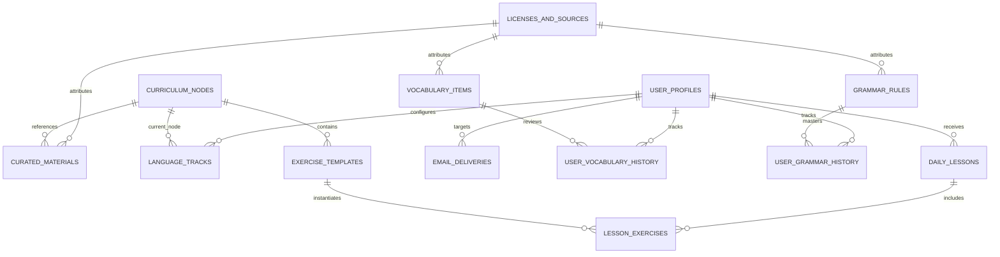

# Polyglot C1 Daily — Data Model & Schema Specification

## 1. Overview & Database Architecture

Polyglot C1 Daily uses **Supabase PostgreSQL 15+**. The schema is designed for strong consistency, deterministic spaced repetition (SRS), rigorous tracking of licensing attribution, and strict idempotency for daily automated runs.

### Key Database Conventions
- **Identifiers**: UUID v4 for primary keys (`gen_random_uuid()`).
- **Timestamps**: All timestamps stored with timezone (`TIMESTAMPTZ`), defaulting to `CURRENT_TIMESTAMP`.
- **JSON Validation**: Structured lesson content payloads are stored in PostgreSQL `JSONB` columns with schema structure enforced by Python Pydantic models on insertion and TypeScript interfaces on client consumption.
- **Idempotency Keys**: Unique database constraints enforce single daily lesson generation and single email delivery per user per day.

---

## 2. Entity-Relationship Diagram (ERD)



---

## 3. Detailed Table Specifications & SQL DDL

### 3.1. Licensing & Attribution (`licenses_and_sources`)
Stores legal attribution and terms required by open educational datasets (e.g., Tatoeba CC-BY 2.0 FR, Wiktionary CC-BY-SA 3.0).

```sql
CREATE TABLE public.licenses_and_sources (
    id UUID PRIMARY KEY DEFAULT gen_random_uuid(),
    source_name VARCHAR(120) NOT NULL,
    source_url TEXT NOT NULL,
    license_type VARCHAR(64) NOT NULL,  -- 'CC-BY-2.0-FR', 'CC-BY-SA-3.0', 'Public Domain', 'Original'
    attribution_text TEXT NOT NULL,
    terms_url TEXT,
    imported_at TIMESTAMPTZ NOT NULL DEFAULT CURRENT_TIMESTAMP
);

CREATE INDEX idx_licenses_source_name ON public.licenses_and_sources(source_name);
```

### 3.2. User Profiles & Configuration (`user_profiles`)
Manages the learner's settings, preferred delivery time, timezone, and study mode.

```sql
CREATE TABLE public.user_profiles (
    id UUID PRIMARY KEY DEFAULT gen_random_uuid(),
    auth_user_id UUID UNIQUE,           -- Optional reference to supabase auth.users
    email VARCHAR(255) NOT NULL UNIQUE,
    full_name VARCHAR(100) NOT NULL,
    timezone VARCHAR(64) NOT NULL DEFAULT 'UTC', -- e.g., 'America/Sao_Paulo', 'Europe/Madrid'
    preferred_delivery_hour_utc SMALLINT NOT NULL DEFAULT 4, -- 04:00 UTC
    study_mode VARCHAR(20) NOT NULL DEFAULT 'full', -- 'full' (60m) or 'compact' (20m)
    diagnostic_completed BOOLEAN NOT NULL DEFAULT FALSE,
    is_active BOOLEAN NOT NULL DEFAULT TRUE,
    created_at TIMESTAMPTZ NOT NULL DEFAULT CURRENT_TIMESTAMP,
    updated_at TIMESTAMPTZ NOT NULL DEFAULT CURRENT_TIMESTAMP
);
```

### 3.3. Language Tracks (`language_tracks`)
Maintains independent progress states for Portuguese and Spanish.

```sql
CREATE TABLE public.language_tracks (
    id UUID PRIMARY KEY DEFAULT gen_random_uuid(),
    user_id UUID NOT NULL REFERENCES public.user_profiles(id) ON DELETE CASCADE,
    language_code VARCHAR(10) NOT NULL,          -- 'pt' or 'es'
    regional_variety VARCHAR(20) NOT NULL,       -- 'pt-BR', 'pt-PT', 'es-ES', 'es-419'
    current_cefr_level VARCHAR(5) NOT NULL DEFAULT 'A1', -- 'A1', 'A2', 'B1', 'B2', 'C1'
    target_cefr_level VARCHAR(5) NOT NULL DEFAULT 'C1',
    current_curriculum_node_id UUID,             -- references curriculum_nodes(id)
    streak_days INTEGER NOT NULL DEFAULT 0,
    total_lessons_completed INTEGER NOT NULL DEFAULT 0,
    created_at TIMESTAMPTZ NOT NULL DEFAULT CURRENT_TIMESTAMP,
    updated_at TIMESTAMPTZ NOT NULL DEFAULT CURRENT_TIMESTAMP,
    CONSTRAINT uq_user_language UNIQUE (user_id, language_code)
);
```

### 3.4. Curriculum Nodes (`curriculum_nodes`)
Defines the sequential syllabus from A1 through C1 competencies based on CEFR Can-Do descriptors.

```sql
CREATE TABLE public.curriculum_nodes (
    id UUID PRIMARY KEY DEFAULT gen_random_uuid(),
    language_code VARCHAR(10) NOT NULL,          -- 'pt' or 'es'
    cefr_level VARCHAR(5) NOT NULL,              -- 'A1', 'A2', 'B1', 'B2', 'C1'
    sequence_order INTEGER NOT NULL,             -- Ordering within level
    title VARCHAR(200) NOT NULL,
    slug VARCHAR(200) NOT NULL,
    skill_category VARCHAR(50) NOT NULL,         -- 'grammar', 'discourse', 'pragmatics', 'lexicon'
    can_do_statement TEXT NOT NULL,
    regional_relevance VARCHAR(20) DEFAULT 'all', -- 'all', 'pt-BR', 'pt-PT', 'es-ES', 'es-419'
    prerequisite_node_id UUID REFERENCES public.curriculum_nodes(id),
    is_consolidation_review BOOLEAN NOT NULL DEFAULT FALSE,
    created_at TIMESTAMPTZ NOT NULL DEFAULT CURRENT_TIMESTAMP,
    CONSTRAINT uq_lang_level_seq UNIQUE (language_code, cefr_level, sequence_order)
);

CREATE INDEX idx_curriculum_lookup ON public.curriculum_nodes(language_code, cefr_level, sequence_order);
```

### 3.5. Curated Vocabulary Lexicon (`vocabulary_items`)
Stores core and advanced C1 lexical items with collocations, register, and licensing.

```sql
CREATE TABLE public.vocabulary_items (
    id UUID PRIMARY KEY DEFAULT gen_random_uuid(),
    language_code VARCHAR(10) NOT NULL,          -- 'pt' or 'es'
    lemma VARCHAR(120) NOT NULL,
    part_of_speech VARCHAR(30) NOT NULL,         -- 'noun', 'verb', 'adjective', 'collocation', 'idiom'
    cefr_level VARCHAR(5) NOT NULL,              -- 'A1' through 'C1'
    definition_en TEXT NOT NULL,
    definition_target TEXT NOT NULL,
    phonetic_ipa VARCHAR(120),
    regional_tags TEXT[] DEFAULT ARRAY['all']::TEXT[],
    example_sentence_target TEXT NOT NULL,
    example_sentence_en TEXT NOT NULL,
    audio_url TEXT,                              -- Direct URL to Tatoeba / Wikimedia public audio
    curriculum_node_id UUID REFERENCES public.curriculum_nodes(id),
    license_id UUID NOT NULL REFERENCES public.licenses_and_sources(id),
    created_at TIMESTAMPTZ NOT NULL DEFAULT CURRENT_TIMESTAMP
);

CREATE INDEX idx_vocab_lookup ON public.vocabulary_items(language_code, cefr_level, lemma);
```

### 3.6. Grammar Rules Bank (`grammar_rules`)
Detailed grammatical concepts, morphological inflection rules, and common learner traps.

```sql
CREATE TABLE public.grammar_rules (
    id UUID PRIMARY KEY DEFAULT gen_random_uuid(),
    language_code VARCHAR(10) NOT NULL,
    rule_code VARCHAR(60) NOT NULL UNIQUE,       -- e.g., 'PT_SUBJ_FUT_01', 'ES_SUBJ_CONCESSIVE'
    cefr_level VARCHAR(5) NOT NULL,
    title VARCHAR(200) NOT NULL,
    category VARCHAR(60) NOT NULL,              -- 'subjunctive', 'pronoun_placement', 'prepositions'
    explanation_markdown TEXT NOT NULL,
    structural_formula TEXT NOT NULL,            -- e.g., 'Se / Quando + Verbo Infinitivo Pessoal'
    examples JSONB NOT NULL,                     -- Array of {target: str, en: str, note: str}
    common_errors JSONB NOT NULL,                -- Array of {incorrect: str, correct: str, reason: str}
    regional_notes JSONB,                        -- Variations between PT-BR/PT-PT or ES-ES/ES-419
    license_id UUID NOT NULL REFERENCES public.licenses_and_sources(id),
    curriculum_node_id UUID REFERENCES public.curriculum_nodes(id),
    created_at TIMESTAMPTZ NOT NULL DEFAULT CURRENT_TIMESTAMP
);

CREATE INDEX idx_grammar_lookup ON public.grammar_rules(language_code, cefr_level);
```

### 3.7. Deterministic Exercise Templates (`exercise_templates`)
Templates for auto-generating deterministic exercises and validating answers without AI.

```sql
CREATE TABLE public.exercise_templates (
    id UUID PRIMARY KEY DEFAULT gen_random_uuid(),
    curriculum_node_id UUID NOT NULL REFERENCES public.curriculum_nodes(id),
    language_code VARCHAR(10) NOT NULL,
    exercise_type VARCHAR(40) NOT NULL,          -- 'cloze', 'multiple_choice', 'reorder', 'error_correction', 'c_test'
    prompt_text TEXT NOT NULL,
    context_passage TEXT,
    target_slot_index INTEGER,                   -- For cloze masking
    acceptable_solutions TEXT[] NOT NULL,        -- Array of valid normalized strings
    distractors TEXT[],                          -- For multiple choice
    explanation TEXT NOT NULL,
    difficulty SMALLINT NOT NULL DEFAULT 3,      -- 1 (easiest) to 5 (most advanced)
    license_id UUID NOT NULL REFERENCES public.licenses_and_sources(id),
    created_at TIMESTAMPTZ NOT NULL DEFAULT CURRENT_TIMESTAMP
);

CREATE INDEX idx_exercise_node ON public.exercise_templates(curriculum_node_id, exercise_type);
```

### 3.8. Curated Materials & Passages (`curated_materials`)
Reading comprehension texts, natural dialogues, and listening transcripts with CEFR ratings.

```sql
CREATE TABLE public.curated_materials (
    id UUID PRIMARY KEY DEFAULT gen_random_uuid(),
    curriculum_node_id UUID NOT NULL REFERENCES public.curriculum_nodes(id),
    language_code VARCHAR(10) NOT NULL,
    material_type VARCHAR(40) NOT NULL,          -- 'reading_passage', 'conversation_script', 'listening_transcript'
    title VARCHAR(200) NOT NULL,
    content_target TEXT NOT NULL,
    content_en TEXT,
    vocabulary_glossary JSONB,                   -- Array of {term: str, definition: str}
    comprehension_questions JSONB NOT NULL,      -- Array of {question: str, options: [], answer_idx: int, explanation: str}
    speaking_prompt TEXT,
    writing_prompt TEXT,
    audio_url TEXT,
    license_id UUID NOT NULL REFERENCES public.licenses_and_sources(id),
    created_at TIMESTAMPTZ NOT NULL DEFAULT CURRENT_TIMESTAMP
);
```

### 3.9. Daily Generated Lessons (`daily_lessons`)
Holds the compiled daily lesson payload across all 12 sections.

```sql
CREATE TABLE public.daily_lessons (
    id UUID PRIMARY KEY DEFAULT gen_random_uuid(),
    user_id UUID NOT NULL REFERENCES public.user_profiles(id) ON DELETE CASCADE,
    language_track_id UUID NOT NULL REFERENCES public.language_tracks(id) ON DELETE CASCADE,
    lesson_date DATE NOT NULL,
    curriculum_node_id UUID NOT NULL REFERENCES public.curriculum_nodes(id),
    study_mode VARCHAR(20) NOT NULL DEFAULT 'full',
    estimated_minutes SMALLINT NOT NULL DEFAULT 50,
    status VARCHAR(30) NOT NULL DEFAULT 'generated', -- 'generated', 'partially_completed', 'completed'
    content_payload JSONB NOT NULL,             -- Full compiled lesson schema (12 sections)
    completed_sections TEXT[] DEFAULT ARRAY[]::TEXT[],
    is_review_day BOOLEAN NOT NULL DEFAULT FALSE,
    created_at TIMESTAMPTZ NOT NULL DEFAULT CURRENT_TIMESTAMP,
    completed_at TIMESTAMPTZ,
    CONSTRAINT uq_user_track_date UNIQUE (user_id, language_track_id, lesson_date)
);

CREATE INDEX idx_lessons_user_date ON public.daily_lessons(user_id, lesson_date DESC);
```

### 3.10. Exercise Attempts & Results (`lesson_exercises`)
Tracks learner responses, accuracy, and error frequency.

```sql
CREATE TABLE public.lesson_exercises (
    id UUID PRIMARY KEY DEFAULT gen_random_uuid(),
    lesson_id UUID NOT NULL REFERENCES public.daily_lessons(id) ON DELETE CASCADE,
    exercise_template_id UUID NOT NULL REFERENCES public.exercise_templates(id),
    user_id UUID NOT NULL REFERENCES public.user_profiles(id) ON DELETE CASCADE,
    submitted_answer TEXT,
    is_correct BOOLEAN,
    attempt_count INTEGER NOT NULL DEFAULT 0,
    time_spent_seconds INTEGER DEFAULT 0,
    feedback_notes TEXT,
    completed_at TIMESTAMPTZ,
    CONSTRAINT uq_lesson_exercise UNIQUE (lesson_id, exercise_template_id)
);

CREATE INDEX idx_exercise_attempts ON public.lesson_exercises(user_id, is_correct);
```

### 3.11. Spaced Repetition (SRS) Vocabulary History (`user_vocabulary_history`)
Implements SuperMemo SM-2 algorithm for vocabulary retention.

```sql
CREATE TABLE public.user_vocabulary_history (
    id UUID PRIMARY KEY DEFAULT gen_random_uuid(),
    user_id UUID NOT NULL REFERENCES public.user_profiles(id) ON DELETE CASCADE,
    vocabulary_item_id UUID NOT NULL REFERENCES public.vocabulary_items(id) ON DELETE CASCADE,
    repetition_count INTEGER NOT NULL DEFAULT 0,
    ease_factor NUMERIC(4, 2) NOT NULL DEFAULT 2.50, -- SM-2 default ease factor
    interval_days INTEGER NOT NULL DEFAULT 0,
    next_review_date DATE NOT NULL DEFAULT CURRENT_DATE,
    last_reviewed_at TIMESTAMPTZ,
    lapse_count INTEGER NOT NULL DEFAULT 0,
    history JSONB DEFAULT '[]'::JSONB,           -- Array of {date: str, grade: int, interval: int}
    created_at TIMESTAMPTZ NOT NULL DEFAULT CURRENT_TIMESTAMP,
    CONSTRAINT uq_user_vocab UNIQUE (user_id, vocabulary_item_id)
);

CREATE INDEX idx_srs_due_review ON public.user_vocabulary_history(user_id, next_review_date);
```

### 3.12. Grammar Mastery History (`user_grammar_history`)
Tracks grammar understanding and targeted review frequency.

```sql
CREATE TABLE public.user_grammar_history (
    id UUID PRIMARY KEY DEFAULT gen_random_uuid(),
    user_id UUID NOT NULL REFERENCES public.user_profiles(id) ON DELETE CASCADE,
    grammar_rule_id UUID NOT NULL REFERENCES public.grammar_rules(id) ON DELETE CASCADE,
    mastery_score NUMERIC(3, 2) NOT NULL DEFAULT 0.00, -- 0.00 to 1.00
    total_practices INTEGER NOT NULL DEFAULT 0,
    error_count INTEGER NOT NULL DEFAULT 0,
    last_reviewed_at TIMESTAMPTZ,
    created_at TIMESTAMPTZ NOT NULL DEFAULT CURRENT_TIMESTAMP,
    CONSTRAINT uq_user_grammar UNIQUE (user_id, grammar_rule_id)
);

CREATE INDEX idx_user_grammar ON public.user_grammar_history(user_id, mastery_score);
```

### 3.13. Email Deliveries & Idempotency Tracking (`email_deliveries`)
Manages delivery locks, provider response IDs, and failure recovery.

```sql
CREATE TABLE public.email_deliveries (
    id UUID PRIMARY KEY DEFAULT gen_random_uuid(),
    idempotency_key VARCHAR(120) NOT NULL UNIQUE, -- 'polyglot-{user_id}-{YYYY-MM-DD}'
    user_id UUID NOT NULL REFERENCES public.user_profiles(id) ON DELETE CASCADE,
    delivery_date DATE NOT NULL,
    provider VARCHAR(40) NOT NULL DEFAULT 'resend', -- 'resend', 'brevo', 'smtp', 'mock'
    provider_message_id VARCHAR(150),
    status VARCHAR(30) NOT NULL DEFAULT 'pending', -- 'pending', 'in_progress', 'sent', 'failed'
    attempt_count INTEGER NOT NULL DEFAULT 0,
    last_error TEXT,
    payload_size_bytes INTEGER,
    sent_at TIMESTAMPTZ,
    created_at TIMESTAMPTZ NOT NULL DEFAULT CURRENT_TIMESTAMP,
    updated_at TIMESTAMPTZ NOT NULL DEFAULT CURRENT_TIMESTAMP,
    CONSTRAINT uq_user_delivery_date UNIQUE (user_id, delivery_date)
);

CREATE INDEX idx_email_status ON public.email_deliveries(status, delivery_date);
```

### 3.14. Minimal Daily Reading Assignments (`lesson_assignments`)
Tracks authentic daily Wikipedia reading assignments without bloating PostgreSQL storage with full article texts. Full extracts are fetched on demand and cached ephemerally.

```sql
CREATE TABLE public.lesson_assignments (
    id UUID PRIMARY KEY DEFAULT gen_random_uuid(),
    user_id UUID NOT NULL REFERENCES public.user_profiles(id) ON DELETE CASCADE,
    language VARCHAR(10) NOT NULL,
    assignment_date DATE NOT NULL,
    article_id VARCHAR(50) NOT NULL,
    article_title VARCHAR(255) NOT NULL,
    article_url TEXT NOT NULL,
    revision_id VARCHAR(50),
    cefr_level VARCHAR(5) NOT NULL DEFAULT 'B2',
    topic_category VARCHAR(50) NOT NULL DEFAULT 'General',
    status VARCHAR(30) NOT NULL DEFAULT 'assigned',
    completed_at TIMESTAMPTZ,
    created_at TIMESTAMPTZ NOT NULL DEFAULT CURRENT_TIMESTAMP,
    CONSTRAINT uq_user_lang_assignment_date UNIQUE (user_id, language, assignment_date)
);

CREATE INDEX idx_assignments_user_date ON public.lesson_assignments(user_id, assignment_date DESC);
CREATE INDEX idx_assignments_article ON public.lesson_assignments(article_id);
```

---

## 4. Idempotency & Database Integrity Controls

1. **Unique Constraints**:
   - `uq_user_delivery_date`: Only one email record can exist per user per date.
   - `uq_user_track_date`: Only one lesson can exist per user per language track per date.
   - `uq_user_language`: A user can only have one active configuration per language track.
2. **Transaction Locking**:
   - Before email sending, the Python engine opens a transaction with `SELECT ... FOR UPDATE` on `email_deliveries`. If the status is `'sent'`, execution terminates immediately with code 0.
3. **Data Cascades**:
   - Deleting a `user_profiles` row automatically cleans up all associated lessons, SRS history, and delivery records via `ON DELETE CASCADE`.
   - Seed datasets (`licenses_and_sources`, `curriculum_nodes`, `vocabulary_items`, `grammar_rules`) use `RESTRICT` to prevent accidental deletion of referenced educational assets.
