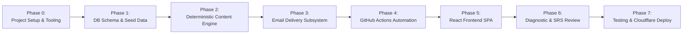

# Polyglot C1 Daily — Phased Implementation Plan

## 1. Executive Summary & Phased Roadmap

This document outlines the step-by-step implementation plan for **Polyglot C1 Daily**. The plan prioritizes building a reliable, AI-independent core first, followed by database persistence, email automation, interactive frontend features, and deployment to free-tier cloud infrastructure.

---

## 2. Detailed Work Breakdown Structure (WBS)

### Phase 0: Project Scaffolding, Tooling & Environment Configuration
**Goal**: Establish a reproducible multi-language project repository with strict type checking, linting, and testing pipelines.

- **Task 0.1: Repository Structure & Environment Setup**
  - Setup unified monorepo directory layout:
    - `/frontend`: React 18, Vite, TypeScript, Tailwind CSS.
    - `/engine`: Python 3.11 content engine, curriculum management, and email dispatchers.
    - `/supabase`: SQL migrations, seeds, and schema configuration.
    - `/.github/workflows`: Scheduled daily automation and CI pipelines.
  - Setup `.gitignore`, `.env.example`, `.editorconfig`.
  - Pin Python dependencies via `engine/requirements.txt` (`pydantic>=2.0`, `requests>=2.31`, `jinja2>=3.1`, `python-dotenv>=1.0`, `pytest>=8.0`).
- **Task 0.2: Verification**
  - Run `npm test` and `pytest` skeletons; ensure zero configuration warnings.

---

### Phase 1: Database Schema, Migrations & Curated Content Datasets
**Goal**: Implement the complete PostgreSQL data model and seed it with open-source licensed educational data for Portuguese and Spanish.

- **Task 1.1: Migration Scripts Creation**
  - Write declarative Supabase SQL migrations in `supabase/migrations/`:
    - `001_initial_schema.sql`: Tables, indexes, unique constraints, and foreign keys defined in [DATA_MODEL.md](file:///C:/Users/vinod/OneDrive/Desktop/language-learning/DATA_MODEL.md).
    - `002_rls_policies.sql`: Row-level security policies defined in [SECURITY.md](file:///C:/Users/vinod/OneDrive/Desktop/language-learning/SECURITY.md).
- **Task 1.2: Open Dataset Curation & Legal Attribution**
  - Extract and format initial sentence pairs and vocabulary from Tatoeba (CC-BY 2.0 FR) and Wiktionary (CC-BY-SA 3.0):
    - Portuguese: 200 core C1 vocabulary lemmas, collocations, idiomatic expressions, regional markers (PT-BR vs PT-PT).
    - Spanish: 200 core C1 vocabulary lemmas, discourse connectors, subjunctive structures, regional markers (ES-ES vs ES-419).
  - Seed legal attribution metadata in `licenses_and_sources`.
- **Task 1.3: Curriculum Node Definitions**
  - Define initial syllabus nodes for A1 through C1 competencies:
    - Portuguese: Personal infinitive, future subjunctive (*quando puder*), indirect speech sequence of tenses, formal epistolary connectors.
    - Spanish: Subjunctive in relative clauses, conditional hypothesis (*si hubiera sabido... habría/hubiera*), nuance markers (*por mucho que*, *a no ser que*).
- **Task 1.4: Verification**
  - Run migrations against Supabase local CLI / test database. Verify all tables, constraints, foreign keys, and indexes are intact.

---

### Phase 2: Python Deterministic Content Generation Engine
**Goal**: Build a standalone Python engine that generates 12-section daily lessons without any AI dependency.

- **Task 2.1: Domain Models & Schema Validation**
  - Implement Pydantic models in `engine/models/`:
    - `LessonPayload`, `VocabularyItem`, `GrammarRule`, `Exercise`, `ReadingPassage`, `ConversationScript`, `SpeakingPrompt`, `WritingAssignment`.
- **Task 2.2: Curriculum & SRS State Evaluator**
  - Implement `CurriculumManager`: selects the next uncompleted node for each language track.
  - Implement `SRSScheduler`: queries `user_vocabulary_history` for items where `next_review_date <= CURRENT_DATE` using the SM-2 algorithm.
- **Task 2.3: Deterministic Template Engine**
  - Implement `DeterministicLessonGenerator`:
    - Section 1: Dynamic Learning Objectives based on node Can-Do statement.
    - Section 2: 12 Vocabulary Items (6 new lemmas + 6 review/collocations) with phonetic IPA, definitions, and contextual examples.
    - Section 3: Grammar concept explanation with structural formula and regional difference callouts.
    - Section 4: Reading comprehension passage with 3 deterministic questions.
    - Section 5: Pragmatic dialogue script with role annotations.
    - Section 6: Spoken interaction prompts with model pronunciation guide.
    - Section 7: C1 writing assignment with argumentation structure and stylistic rubric.
    - Section 8: Listening practice transcript with link to Tatoeba native audio recording.
    - Section 9: 6 Deterministic Exercises (Cloze, Reorder, Error Correction, Multiple Choice).
    - Section 10: Complete answer key with grammatical explanations.
    - Section 11: Spaced repetition review deck.
    - Section 12: Curated further-reading external links (podcasts, cultural articles, grammar compendiums).
- **Task 2.4: Deterministic Answer Validator**
  - Implement `ExerciseChecker`: Normalizes punctuation, diacritics, casing, and whitespace; matches learner input against acceptable solution sets.
- **Task 2.5: Optional AI Adapter (Gemini / Free API)**
  - Implement `OptionalAIEngine`: Pluggable enricher that optionally generates dynamic reading passages if an API key is provided, guarded by circuit breaker and strict fallback to deterministic templates.
- **Task 2.6: Verification**
  - Unit tests verifying:
    - Complete 12-section lesson compiles successfully without AI.
    - Deterministic exercise checks correctly accept valid answers and reject incorrect ones.
    - Fallback triggers cleanly when AI adapter raises an exception.

---

### Phase 3: Daily Email Delivery Engine & Pluggable Adapters
**Goal**: Format and send the combined Portuguese & Spanish daily digest with bulletproof duplicate prevention.

- **Task 3.1: Responsive HTML & Plaintext Email Templates**
  - Build Jinja2 email templates in `engine/templates/daily_digest.html` and `.txt`:
    - Visual separation of Portuguese and Spanish tracks.
    - Mobile-first responsive design, light/dark mode friendly.
    - Collapsible answers section.
    - Direct web links to the interactive dashboard.
    - Payload size budget strictly maintained under 75 KB to avoid Gmail clipping.
- **Task 3.2: Pluggable Email Sender Interface**
  - Abstract base class `EmailSender` with implementations:
    - `ResendSender`: Uses Resend HTTPS REST API.
    - `BrevoSender`: Uses Brevo API as alternate free transactional provider.
    - `SmtpSender`: Standard TLS SMTP (works with Gmail App Password or custom SMTP).
    - `MockSender`: Dumps rendered HTML to disk/stdout for automated testing.
- **Task 3.3: Idempotent Delivery Manager**
  - Implement `DeliveryManager`:
    - Checks `email_deliveries` using `(user_id, delivery_date)`.
    - If status is `sent`, logs and skips dispatch.
    - Sets status to `in_progress` with `idempotency_key = 'polyglot-{user_id}-{YYYY-MM-DD}'`.
    - Sends via active email provider with idempotency header.
    - Updates database record to `sent` on HTTP 200/201, or `failed` on error with error details.
- **Task 3.4: Verification**
  - Mock delivery unit tests verifying single-send enforcement during simulated duplicate calls.
  - HTML email rendering verification across desktop and mobile clients.

---

### Phase 4: GitHub Actions Daily Automation
**Goal**: Configure scheduled, unattended daily execution with comprehensive error handling and logging.

- **Task 4.1: Workflow Definition**
  - Create `.github/workflows/daily_polyglot.yml`:
    - Triggers: Cron schedule (`0 4 * * *` - 04:00 UTC) and `workflow_dispatch` (manual test/force run).
    - Concurrency lock (`group: daily-polyglot-execution`, `cancel-in-progress: false`).
    - Python environment caching (`pip-cache`).
    - Runs `python -m engine.main --date=$(date +%Y-%m-%d)`.
- **Task 4.2: Execution Diagnostic Logs & Artifact Upload**
  - Generates JSON summary report of the run (lessons generated, emails dispatched, execution time).
  - Uploads summary artifact via `actions/upload-artifact` with 7-day retention.
- **Task 4.3: Verification**
  - Trigger manual `workflow_dispatch` with `--dry-run` and verify successful completion, artifact creation, and absence of secret leakage.

---

### Phase 5: React Frontend Application (Vite + TypeScript + Tailwind)
**Goal**: Build a modern, responsive single-page web dashboard for interactive study, exercise completion, and speech practice.

- **Task 5.1: SPA Core & Supabase Integration**
  - Initialize Vite React TypeScript application.
  - Configure Supabase client with public anon key and typed database schemas.
  - Setup routing via React Router:
    - `/` : Daily Dashboard (today's lessons, streak, quick review).
    - `/lesson/:trackId/:date` : Interactive 12-section lesson viewer.
    - `/review` : Spaced repetition flashcard session.
    - `/grammar` : Searchable grammar & syntax repository.
    - `/diagnostic` : Placement assessment for new or returning learners.
    - `/settings` : Learner preferences (regional variety, study mode, timezone).
- **Task 5.2: Interactive Exercise Components**
  - Build interactive exercise UI with immediate client-side feedback:
    - `ClozeExercise.tsx`: Fill-in-the-blank with instant hint and verification.
    - `SentenceReorder.tsx`: Drag-and-drop or tap-to-order syntax puzzle.
    - `MultipleChoice.tsx`: Select best answer with grammatical justification.
    - `ErrorCorrection.tsx`: Find and fix subtle C1 mistakes.
- **Task 5.3: Speech & Audio Subsystem (Zero-Cost Web Speech API)**
  - Implement `AudioPronunciation`:
    - Plays native Tatoeba MP3 recordings where available.
    - Falls back to `window.speechSynthesis` with configured voice models for `pt-BR`, `pt-PT`, `es-ES`, `es-MX`.
    - Implements Web Speech Recognition (`webkitSpeechRecognition`) for spoken pronunciation practice with zero paid API tokens.
- **Task 5.4: Compact Study Mode Toggle**
  - Allows toggling between Full (60m) and Compact (20m) modes, filtering down to core vocabulary and exercises on busy days.
- **Task 5.5: Verification**
  - Run frontend build (`npm run build`). Verify zero TypeScript errors and small bundle footprint (<250 KB gzip).

---

### Phase 6: Diagnostic Placement Assessment & Spaced Repetition Integration
**Goal**: Enable learners to calibrate their starting level and continuously retain past learning through active review.

- **Task 6.1: Adaptive Diagnostic Placement Module**
  - Implement a 25-item diagnostic evaluation:
    - Calibrates initial proficiency level (A1, A2, B1, B2).
    - Automatically updates `language_tracks.current_cefr_level` and assigns the appropriate initial `current_curriculum_node_id`.
- **Task 6.2: Spaced Repetition (SM-2) Flashcard Interface**
  - Build interactive review deck with self-rating buttons ($q \in [0, 5]$: Again, Hard, Good, Easy).
  - Automatically recalculates interval, ease factor, and `next_review_date`, writing updates to `user_vocabulary_history`.
- **Task 6.3: Verification**
  - Test placement test scoring paths and verify correct node assignment in Supabase.
  - Test SM-2 calculation mathematics across successive review iterations.

---

### Phase 7: End-to-End Verification, Security Audit & Cloudflare Pages Deployment
**Goal**: Validate full end-to-end functionality, conduct security sweeps, and deploy live to Cloudflare Pages.

- **Task 7.1: Automated Test Suite Completion**
  - Unit tests for engine, curriculum, and exercise validation (`pytest`).
  - Frontend component tests (`vitest` + React Testing Library).
  - End-to-end integration test (`engine/tests/test_e2e_pipeline.py`) simulating complete daily workflow.
- **Task 7.2: Security & Zero-Cost Auditing**
  - Secret leak audit (`git grep` checks).
  - RLS policy validation (attempting unauthorized writes as anon user).
  - Free-tier verification check against current provider quotas.
- **Task 7.3: Cloudflare Pages Deployment & Documentation**
  - Setup Cloudflare Pages continuous deployment from GitHub repository.
  - Complete `README.md` with step-by-step setup instructions for free-tier services.
- **Task 7.4: Verification & Acceptance**
  - Validate all 12 criteria in `ENGINEERING_SPEC.md` Section 16.

---

## 3. Risk Assessment & Contingency Matrix

| Risk Event | Severity | Probability | Contingency / Mitigation Strategy |
| :--- | :--- | :--- | :--- |
| **Supabase pauses free DB after 7 days of inactivity** | Medium | Low | Daily GitHub Actions workflow queries the DB every morning, keeping it active automatically. If user pauses the workflow, documented 1-click unpause guide is provided in README. |
| **Resend free tier rejects non-account recipient** | High | Medium | Document that single-learner setup uses learner's Resend account email for free `onboarding@resend.dev` delivery. For arbitrary emails, provide seamless switch to SMTP (Gmail App Password) or Brevo. |
| **GitHub Actions disables scheduled cron after 60 days of repo inactivity** | Medium | Medium | Engine logs an advance alert when repository commit age exceeds 45 days. Workflow can be re-enabled with one click in GitHub Actions UI. |
| **Optional AI API encounters rate limit or outage** | Low | High | Circuit breaker immediately bypasses AI calls and generates standard deterministic lessons without breaking the daily run. |
| **Email provider downtime** | High | Low | If email dispatch fails, generated lesson remains safely persisted in `daily_lessons`. Frontend displays warning banner; manual `workflow_dispatch` can re-send email once provider is restored. |

---

## 4. Operational Answers & Core Mechanisms

### How the system functions without AI
- **Curriculum Matrix**: The syllabus from A1 to C1 is pre-defined with precise grammatical formulas, lexical target lists, and communicative functions.
- **Deterministic Templates**: Sentence patterns, cloze passages, and dialogues are populated from curated databases (Tatoeba, Wiktionary).
- **Rule-Based Exercise Checking**: Exact matching against arrays of acceptable inflections, accent-insensitive normalizations, and grammatical variations.
- **Native Browser Audio**: Pronunciation and listening practice utilize client-side Web Speech API and open audio recordings from Tatoeba.

### How duplicate emails are prevented
1. **Database Constraint**: `email_deliveries` enforces `UNIQUE(user_id, delivery_date)`.
2. **Transaction Locking**: Before sending, the engine executes `SELECT ... FOR UPDATE`. If status is `'sent'`, execution terminates with success without calling any API.
3. **Idempotency Keys**: Requests sent to transactional email providers carry an `Idempotency-Key` header (`polyglot-{user_id}-{YYYY-MM-DD}`), preventing duplicate sends at the HTTP network layer.

### How the system recovers from failures
- **Decoupled Workflow Steps**: Lesson compilation and email dispatch are distinct transactional units. A failure during email delivery does not lose the generated lesson.
- **Stateful Retries**: Subsequent runs check the existing state. If a lesson is already generated for today, the engine skips generation and proceeds directly to email delivery.
- **Dashboard Visibility**: Failed delivery attempts are recorded in `email_deliveries.last_error` and surfaced to the learner in the web dashboard banner.
