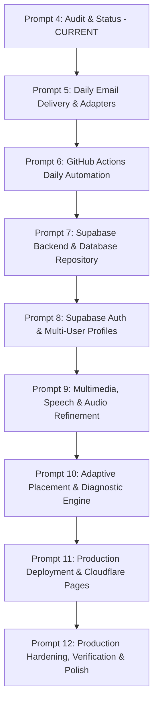

# Polyglot C1 Daily — Remaining Work & Roadmap (Prompts 5–12)

This document establishes the actionable, prioritized roadmap for completing the **Polyglot C1 Daily** application, preserving existing validated components and systematically implementing missing functionality across Prompts 5 through 12.

---

## Roadmap Overview

---

## Detailed Implementation Plan (Prompts 5–12)

### Prompt 5: Daily Email Delivery & Provider Adapters
**Objective**: Build the email delivery subsystem in Python to render and deliver combined Portuguese and Spanish daily lessons.
- **Components to Implement**:
  - `engine/email/adapter.py`: Abstract `EmailProviderAdapter` interface.
  - `engine/email/resend_adapter.py`: Concrete implementation using Resend HTTP API (`https://api.resend.com/emails`).
  - `engine/email/smtp_adapter.py`: Standard Python `smtplib` fallback for custom transactional SMTP relays.
  - `engine/email/templates/`:
    - Responsive HTML email template (`daily_lesson.html`) rendering:
      - Quick greeting & daily streak counter.
      - Portuguese section (vocabulary, grammar rule, reading excerpt, conversation snippet, false friend alert).
      - Spanish section (vocabulary, grammar rule, reading excerpt, conversation snippet, false friend alert).
      - Daily exercises with clickable reveal/answer links.
      - Web dashboard call-to-action button.
    - Plaintext fallback template (`daily_lesson.txt`) adhering to 72-character line wraps.
  - `engine/email/deduplication.py`: Delivery lock mechanism verifying if an email for the given user, date, and lesson hash was already recorded in the database.
- **Verification**:
  - Mocked test suite verifying HTML/text rendering and adapter fallback logic.
  - Verification of Resend free-tier terms (3,000 emails/month, 100 emails/day, verified sender requirement).

---

### Prompt 6: GitHub Actions Daily Automation & Orchestration
**Objective**: Automate daily lesson generation and email delivery via GitHub Actions cron.
- **Components to Implement**:
  - `.github/workflows/daily_polyglot.yml`:
    - Scheduled trigger: `cron: '0 4 * * *'` (04:00 UTC daily).
    - Manual trigger: `workflow_dispatch` with parameters (`test_user_id`, `force_regenerate`, `dry_run`).
    - Environment secrets: `SUPABASE_URL`, `SUPABASE_SERVICE_ROLE_KEY`, `RESEND_API_KEY`, `EMAIL_FROM_ADDRESS`.
  - `scripts/run_daily_batch.py`:
    - CLI runner executing the batch pipeline: query active learners, check deduplication log, generate Portuguese & Spanish lessons, render email, deliver, update user streaks and lesson histories.
  - Failure recovery & retry:
    - Automatic exponential backoff on transient network failures.
    - Dead-letter logging / GitHub workflow notification if a delivery fails after 3 retries.
- **Verification**:
  - Dry-run execution verifying zero side-effects when `--dry-run` flag is passed.
  - Document 60-day GitHub Actions inactivity auto-disable constraint and keep-alive strategy.

---

### Prompt 7: Supabase Backend & Database Repository
**Objective**: Connect the application to live Supabase PostgreSQL and synchronize state between frontend and backend.
- **Components to Implement**:
  - `engine/storage/supabase_repository.py`:
    - Python repository implementing `PolyglotRepository` backed by Supabase REST / PostgreSQL client (`supabase-py` or `httpx`).
    - Methods for querying user tracks, persisting lessons, logging attempts, and updating SRS states.
  - `frontend/src/services/supabaseClient.ts`:
    - Browser Supabase client initialization using `@supabase/supabase-js`.
    - Handles anon key authentication and public data fetching.
  - `frontend/src/services/syncService.ts`:
    - Hybrid offline-first synchronization: writes to `localStorage` immediately, asynchronously synchronizes with Supabase when online.
    - Resolves conflict using highest timestamp / highest streak.
- **Verification**:
  - Integration tests verifying migration execution and RLS policy enforcement.
  - Supabase free-tier pause mitigation (handling 7-day inactivity pause).

---

### Prompt 8: Supabase Auth & Multi-User Profiles
**Objective**: Implement user authentication, learner registration, and isolated learning tracks.
- **Components to Implement**:
  - Frontend Auth Pages / Modals:
    - Sign in / Sign up form (Email + Magic Link or password).
    - Forgot password & password reset flow.
  - User Profile & Settings Sync:
    - Multi-device sync: user preferences (variety, delivery hour, timezone, study mode) saved in Supabase `users` table.
    - Row-Level Security verification: ensure learners cannot read or modify another user's exercise attempts or SRS states.
- **Verification**:
  - Vitest authentication state tests.
  - Verify unauthorized access is blocked by RLS policies.

---

### Prompt 9: Multimedia, Speech & Audio Refinement
**Objective**: Enhance listening comprehension, pronunciation practice, and audio playback.
- **Components to Implement**:
  - `AudioButton` enhancement:
    - Priority order: 1) Native pre-recorded audio URL (Tatoeba CC-BY), 2) Web Speech API (`SpeechSynthesisUtterance`) with appropriate regional voice tag (`pt-BR`, `pt-PT`, `es-ES`, `es-MX`).
    - Speed control toggle (0.8x, 1.0x, 1.2x) for nuanced listening comprehension.
  - Speaking Practice Section:
    - Integrated browser Web Speech Recognition API (`webkitSpeechRecognition`) for spoken pronunciation evaluation where supported.
    - Fallback recording timer and prompt self-evaluation rubric.
  - Listening Comprehension Player:
    - Interactive audio tasks with hidden transcripts revealed upon question submission.
- **Verification**:
  - Test browser speech API fallback behavior when offline or when speech synthesis is unsupported.

---

### Prompt 10: Adaptive Placement & Diagnostic Engine
**Objective**: Wire diagnostic placement test to dynamically tailor learner curriculum and address weak areas.
- **Components to Implement**:
  - Wire `PlacementTestModal.tsx` to automatically trigger on initial signup if `diagnostic_completed` is false.
  - Backend and frontend score evaluation:
    - Compute score by CEFR level bands.
    - Set `current_cefr_level` and initialize `completed_curriculum_node_ids` up to the determined starting level.
  - Adaptive Weakness Remediation:
    - Analyze `exercise_attempts` for recurring error categories (e.g. `grammar_subjuntivo`, `false_friend_esquisito`).
    - Prioritize remedial review questions in daily lesson generation when accuracy on a skill drops below 70%.
- **Verification**:
  - End-to-end test of placement assessment placing a learner into B2 and confirming subsequent lessons start at B2.

---

### Prompt 11: Production Deployment & Cloudflare Pages
**Objective**: Configure continuous deployment of the static frontend to Cloudflare Pages.
- **Components to Implement**:
  - `frontend/public/_redirects`: SPA routing fallback rule (`/* /index.html 200`).
  - `frontend/public/_headers`: Security headers (Content-Security-Policy, X-Frame-Options, X-Content-Type-Options, Referrer-Policy).
  - GitHub Actions frontend deployment workflow: `.github/workflows/deploy_frontend.yml` (builds Vite static assets and deploys to Cloudflare Pages via GitHub Actions / Wrangler).
  - Production environment configuration docs: Cloudflare Pages build settings (`Root directory: frontend`, `Build command: npm run build`, `Output directory: dist`).
- **Verification**:
  - Verification of static bundle size, lighthouse performance score, and asset caching headers.

---

### Prompt 12: Production Hardening, Verification & Polish
**Objective**: Final comprehensive end-to-end verification, accessibility audit, security hardening, and documentation handoff.
- **Components to Implement**:
  - Full E2E smoke tests covering the complete daily learning flow:
    - User signs in -> takes diagnostic test -> placed in B1 -> completes Portuguese lesson -> submits exercises -> reviews flashcards in Practice -> reviews updated stats on Progress page -> checks Settings.
  - Accessibility audit (WCAG 2.1 AA compliance):
    - Keyboard navigation (Tab, Enter, Escape, Arrow keys).
    - Screen-reader ARIA attributes on tabs, buttons, audio toggles, and modals.
    - High contrast text ratios.
  - Rate limiting & security audit:
    - Sanitize all rendered user inputs against XSS.
    - Confirm zero credential leakage in build artifacts.
  - Final documentation handoff (`README.md`, `OPERATIONS_GUIDE.md`, `DISASTER_RECOVERY.md`).
- **Verification**:
  - Final sign-off against all criteria in `ENGINEERING_SPEC.md`.
