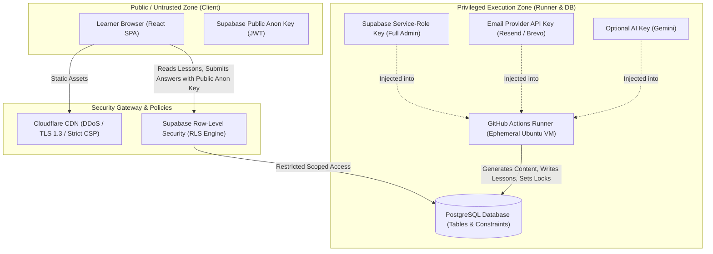

# Polyglot C1 Daily — Security Architecture & Threat Model

## 1. Security Architecture & Threat Boundaries

Polyglot C1 Daily enforces a strict separation between **untrusted public browser clients** and **trusted automation runners**. The application handles educational data, learning telemetry, and delivery configurations while guaranteeing that secrets and write privileges are never leaked to client bundles.



---

## 2. Credential Hierarchy & Secret Isolation

| Credential | Scope & Location | Permissions | Client Visibility |
| :--- | :--- | :--- | :--- |
| `VITE_SUPABASE_URL` | Frontend `.env` & Cloudflare Build Vars | Public URL endpoint | **Public** (bundled in JS) |
| `VITE_SUPABASE_ANON_KEY` | Frontend `.env` & Cloudflare Build Vars | Read-only / RLS-scoped user operations | **Public** (bundled in JS) |
| `SUPABASE_SERVICE_ROLE_KEY` | GitHub Actions Secret Vault | Bypasses all RLS; full DB schema administration | **STRICTLY PRIVATE** (Never in client) |
| `RESEND_API_KEY` / `SMTP_PASS` | GitHub Actions Secret Vault | Email sending authority | **STRICTLY PRIVATE** (Never in client) |
| `GEMINI_API_KEY` *(Optional)* | GitHub Actions Secret Vault | LLM completion calls | **STRICTLY PRIVATE** (Never in client) |
| `APP_SECRET_TOKEN` | GitHub Actions Secret Vault | Idempotency HMAC & signature validation | **STRICTLY PRIVATE** (Never in client) |

### Rules of Secret Management
1. **Zero Client Leakage**: `grep -rn "SERVICE_ROLE" src/` and `grep -rn "RESEND" src/` are enforced as automated pre-commit and CI build checks.
2. **Environment Variable Segregation**: Vite only exposes variables prefixed with `VITE_`. All privileged backend keys omit this prefix, ensuring Vite's bundler will never inline them.
3. **Ephemeral Runners**: GitHub Actions runs in clean, isolated ephemeral containers. Secrets are never printed in logs; workflow logs enable GitHub Actions secret masking (`::add-mask::`).

---

## 3. Row-Level Security (RLS) Policies

All tables in the `public` schema have Row-Level Security explicitly enabled (`ALTER TABLE ... ENABLE ROW LEVEL SECURITY;`).

### 3.1. Reference Tables (Read-Only to Public)
Educational materials (`licenses_and_sources`, `curriculum_nodes`, `vocabulary_items`, `grammar_rules`, `exercise_templates`, `curated_materials`) are public educational resources:

```sql
-- Enable RLS on all content reference tables
ALTER TABLE public.licenses_and_sources ENABLE ROW LEVEL SECURITY;
ALTER TABLE public.curriculum_nodes ENABLE ROW LEVEL SECURITY;
ALTER TABLE public.vocabulary_items ENABLE ROW LEVEL SECURITY;
ALTER TABLE public.grammar_rules ENABLE ROW LEVEL SECURITY;
ALTER TABLE public.exercise_templates ENABLE ROW LEVEL SECURITY;
ALTER TABLE public.curated_materials ENABLE ROW LEVEL SECURITY;

-- Allow anonymous and authenticated users to read curriculum and educational content
CREATE POLICY "Public read access for licenses" ON public.licenses_and_sources
    FOR SELECT TO anon, authenticated USING (true);

CREATE POLICY "Public read access for curriculum nodes" ON public.curriculum_nodes
    FOR SELECT TO anon, authenticated USING (true);

CREATE POLICY "Public read access for vocabulary" ON public.vocabulary_items
    FOR SELECT TO anon, authenticated USING (true);

CREATE POLICY "Public read access for grammar rules" ON public.grammar_rules
    FOR SELECT TO anon, authenticated USING (true);

CREATE POLICY "Public read access for exercise templates" ON public.exercise_templates
    FOR SELECT TO anon, authenticated USING (true);

CREATE POLICY "Public read access for curated materials" ON public.curated_materials
    FOR SELECT TO anon, authenticated USING (true);

-- Disallow ALL client inserts/updates/deletes on educational tables (Service Role only)
-- (No INSERT/UPDATE/DELETE policies defined for anon/authenticated)
```

### 3.2. User & Progress Tables (Learner Scoped)
Learner profiles, lessons, SRS logs, and exercise submissions are scoped to the individual learner:

```sql
ALTER TABLE public.user_profiles ENABLE ROW LEVEL SECURITY;
ALTER TABLE public.language_tracks ENABLE ROW LEVEL SECURITY;
ALTER TABLE public.daily_lessons ENABLE ROW LEVEL SECURITY;
ALTER TABLE public.lesson_exercises ENABLE ROW LEVEL SECURITY;
ALTER TABLE public.user_vocabulary_history ENABLE ROW LEVEL SECURITY;
ALTER TABLE public.user_grammar_history ENABLE ROW LEVEL SECURITY;
ALTER TABLE public.email_deliveries ENABLE ROW LEVEL SECURITY;

-- Single-user personal deployment policy:
-- For personal single-user mode, user_profiles and progress can be read/updated by the user's auth UID
-- or matching user_id when authenticated or using an authorized session token.
CREATE POLICY "Users can read own profile" ON public.user_profiles
    FOR SELECT TO authenticated
    USING (auth.uid() = auth_user_id);

CREATE POLICY "Users can update own profile" ON public.user_profiles
    FOR UPDATE TO authenticated
    USING (auth.uid() = auth_user_id)
    WITH CHECK (auth.uid() = auth_user_id);

CREATE POLICY "Users can read own language tracks" ON public.language_tracks
    FOR SELECT TO authenticated
    USING (user_id IN (SELECT id FROM public.user_profiles WHERE auth_user_id = auth.uid()));

CREATE POLICY "Users can read own daily lessons" ON public.daily_lessons
    FOR SELECT TO authenticated
    USING (user_id IN (SELECT id FROM public.user_profiles WHERE auth_user_id = auth.uid()));

CREATE POLICY "Users can update own daily lessons progress" ON public.daily_lessons
    FOR UPDATE TO authenticated
    USING (user_id IN (SELECT id FROM public.user_profiles WHERE auth_user_id = auth.uid()))
    WITH CHECK (user_id IN (SELECT id FROM public.user_profiles WHERE auth_user_id = auth.uid()));

CREATE POLICY "Users can record exercise attempts" ON public.lesson_exercises
    FOR ALL TO authenticated
    USING (user_id IN (SELECT id FROM public.user_profiles WHERE auth_user_id = auth.uid()));

CREATE POLICY "Users can view and update own SRS vocabulary" ON public.user_vocabulary_history
    FOR ALL TO authenticated
    USING (user_id IN (SELECT id FROM public.user_profiles WHERE auth_user_id = auth.uid()));

CREATE POLICY "Users can view and update own grammar mastery" ON public.user_grammar_history
    FOR ALL TO authenticated
    USING (user_id IN (SELECT id FROM public.user_profiles WHERE auth_user_id = auth.uid()));

-- Email deliveries: Learner can read delivery status to view errors on dashboard, but CANNOT insert or update
CREATE POLICY "Users can read own email delivery status" ON public.email_deliveries
    FOR SELECT TO authenticated
    USING (user_id IN (SELECT id FROM public.user_profiles WHERE auth_user_id = auth.uid()));
```

---

## 4. Automation & GitHub Actions Security

1. **Least Privilege GITHUB_TOKEN**:
   The workflow explicitly limits permissions to read-only for repository contents and forbids unnecessary token capabilities:
   ```yaml
   permissions:
     contents: read
     actions: read
   ```
2. **Untrusted Code Injection Protection**:
   Workflows are triggered strictly via `schedule` (cron) and `workflow_dispatch`. No arbitrary user input or PR comments trigger execution. Inputs on `workflow_dispatch` are sanitized and validated against explicit regex patterns (e.g., date formatted strictly as `^\d{4}-\d{2}-\d{2}$`).
3. **Runner Pinning**:
   GitHub Actions workflows pin specific action versions to commit SHA hashes (or trusted major release tags) rather than `@main` to prevent supply-chain tampering.

---

## 5. Email Security & Anti-Spoofing

1. **Authentication (DKIM, SPF, DMARC)**:
   - When using custom domains, Resend provides DKIM and SPF records that must be verified in DNS before broadcasting.
   - For the zero-cost default (Resend sandbox `onboarding@resend.dev` or Brevo), headers are cryptographically signed by the provider's valid DKIM key, preventing emails from triggering spam filters or phishing warnings.
2. **Anti-Open Relay Architecture**:
   - The email delivery script does not expose any public HTTP endpoint for triggering emails. Emails can ONLY be triggered by the scheduled GitHub Actions execution running within the repository's authorized context.
3. **Email Header Sanitization**:
   - Recipient addresses, subjects, and headers are strictly validated against standard email syntax rules. Newline characters (`\r`, `\n`) are stripped from subjects and recipient names to eliminate email header injection vulnerabilities.
4. **Unsubscribe & Preference Controls**:
   - Every email footer includes an explicit link to user settings to pause emails or switch to dashboard-only study mode.

---

## 6. Content Safety, XSS & Sanitization

1. **Frontend DOM Sanitization**:
   - Markdown lesson content, grammar explanations, and user inputs rendered on the React frontend are sanitized using `DOMPurify` before insertion into the DOM:
   ```typescript
   import DOMPurify from 'dompurify';
   export const renderSanitizedMarkdown = (rawContent: string): string => {
     return DOMPurify.sanitize(rawContent, {
       ALLOWED_TAGS: ['b', 'i', 'em', 'strong', 'a', 'p', 'ul', 'ol', 'li', 'code', 'pre', 'blockquote', 'table', 'tr', 'td', 'th'],
       ALLOWED_ATTR: ['href', 'target', 'rel', 'class']
     });
   };
   ```
2. **Email HTML Escaping**:
   - Dynamic parameters injected into the Jinja2 / Python email template engine are automatically escaped (`autoescape=True`) to eliminate HTML injection.
3. **No Unsafe Code Evaluation**:
   - Neither the Python backend nor the TypeScript frontend uses `eval()`, `new Function()`, or dynamic script execution. Answer validation uses deterministic string normalization and regular expression matching.

---

## 7. Rate Limiting & Abuse Prevention

1. **Database Connection Pooling**:
   - GitHub Actions connects to Supabase via the Supabase REST API (PostgREST) and Transaction Connection Pooler (port 6543 / Supavisor) to prevent exhausting PostgreSQL connection limits.
2. **Free-Tier Quota Guards**:
   - The email engine checks `email_deliveries` before invoking the transactional email API. If the daily email for the user has already been sent, the provider API is never called.
   - Optional AI enrichers have a hard circuit-breaker: maximum 2 attempts per day. If any rate limit (HTTP 429) is received, the adapter immediately disables AI calls for the remainder of the run and completes via deterministic templates.

---

## 8. Incident Response & Failure Recovery

1. **Credential Revocation Runbook**:
   - If a secret is inadvertently exposed, immediately rotate `SUPABASE_SERVICE_ROLE_KEY` in the Supabase Dashboard and update GitHub Actions Secrets.
   - Revoke Resend API keys instantly from the Resend console.
2. **Database Backup & Integrity**:
   - Supabase provides automated daily backups. For zero-cost disaster recovery, an export script in `scripts/backup_data.py` allows taking local JSON dumps of user progress and curriculum tables.
3. **Diagnostic Audit Log**:
   - All workflow executions output structured execution summaries uploaded to GitHub Actions artifacts (`lesson-run-log-{date}.json`). Sensitive tokens and PII are redacted prior to artifact generation.

---

## 9. Privacy, Data Minimization & External Service Disclosures

1. **User Text & Translation Privacy**:
   - Live translation lookups prioritize local in-memory dictionaries and cache before contacting external endpoints.
   - When an external translation request is necessary, text is transmitted over HTTPS to MyMemory (`api.mymemory.translated.net`) or a configured LibreTranslate instance.
   - **Zero PII Transmission**: No user email, user UUID, session token, or personal profile data is ever attached to external translation requests.
   - **Input Truncation**: Inputs are capped strictly at 1,000 characters to prevent inadvertent bulk data transmission.
   - **Ephemeral In-Memory Handling**: Translation requests and responses are returned directly in-memory and are **never inserted into database tables**.
2. **User Bookmarks & Data Deletion**:
   - A translation is persisted to `public.saved_translations` only when the user explicitly clicks the bookmark icon.
   - Bookmarks are strictly isolated by Row-Level Security (`auth.uid() = user_id`) and capped at 500 items per user.
   - Users can delete individual bookmarks or perform full account data export/reset at any time from the client Settings page.
