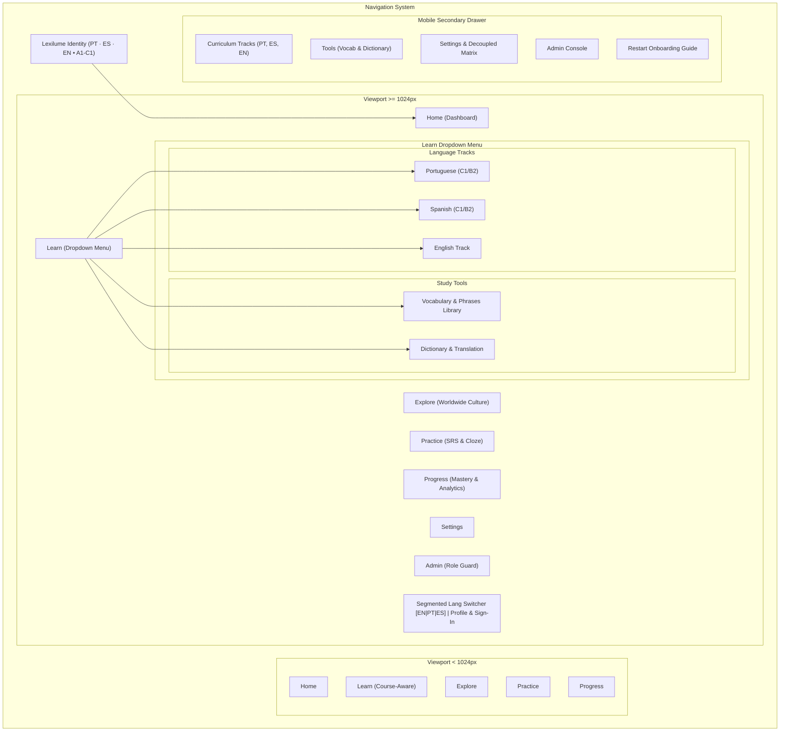

# Lexilume — UI/UX and Design System Documentation

> **Document:** Design System, Tokens, Navigation Architecture, and Component Catalog  
> **Repository:** `VINODH0101/language-learning` (Lexilume — Illuminate Your Words)  
> **Scope:** Visual design tokens, navigation, layout hierarchy, page visual architecture, component inventory, and responsive behavior.  

---

## 1. Design System & Tokens

Lexilume is built on a dark-first, typography-focused aesthetic tailored for cognitive clarity during dense linguistic study. It utilizes **Tailwind CSS v4** with design tokens declared in component classes and base styles in `frontend/src/index.css`.

### 1.1 Color Palette & Semantic Tokens

| Category | Tailwind Class | Hex / Value | Semantic Role |
| :--- | :--- | :--- | :--- |
| **Canvas Background** | `bg-slate-950` | `#020617` | Global viewport background; eliminates screen glare during long reading sessions. |
| **Surface Level 1 (Cards)** | `bg-slate-900` | `#0f172a` | Container surface for lesson cards, exercise prompts, and modal bodies. |
| **Surface Level 2 (Subtle)** | `bg-slate-900/60` | Semi-transparent | Nested containers, list rows, inactive tabs, and input wrappers. |
| **Surface Level 3 (Hover)** | `bg-slate-800` | `#1e293b` | Interactive hover states, elevated dropdown panels, and toast backgrounds. |
| **Border Default** | `border-slate-800` | `#1e293b` | Structural dividers, card borders, and table borders. |
| **Border Active / Focus** | `border-slate-700` | `#334155` | Card hover accent, input focus state. |
| **Primary Accent (Indigo)** | `bg-indigo-600` / `text-indigo-400` | `#4f46e5` / `#818cf8` | Primary CTA buttons, active tab underlines, progress bars, and lemma badges. |
| **Success Accent (Emerald)** | `bg-emerald-600` / `text-emerald-400` | `#059669` / `#34d399` | Correct answer feedback, streak indicators, and mastered items. |
| **Warning Accent (Amber)** | `bg-amber-600` / `text-amber-400` | `#d97706` / `#fbbf24` | Review-due items, streak freeze reminders, and near-mastery alerts. |
| **Error / Distractor (Rose)** | `bg-rose-600` / `text-rose-400` | `#e11d48` / `#f43f5e` | Distractor explanation badges, lapse penalties, and validation errors. |
| **Text Primary** | `text-slate-100` | `#f1f5f9` | H1/H2 headlines, lemma titles, and primary reading body text. |
| **Text Muted** | `text-slate-400` | `#94a3b8` | Subtitles, metadata badges, grammar explanations, and timestamps. |
| **Text Dimmed** | `text-slate-500` | `#64748b` | Breadcrumb separators, copyright footers, and secondary attributions. |

### 1.2 Typography & Scale

- **Font Family:** Declared in `frontend/src/index.css`: `system-ui, -apple-system, BlinkMacSystemFont, 'Segoe UI', Roboto, Oxygen, Ubuntu, Cantarell, sans-serif`.
- **Dynamic Font Scaling:** Supported directly via `localStorage.getItem('polyglot_font_size')` and controlled via the navigation bar:
  - `normal`: Root font size `16px` (Standard desktop/mobile).
  - `large`: Root font size `17px` (+6.25% reading legibility boost).
  - `xlarge`: Root font size `18.5px` (+15.6% high-accessibility scale).
- **Type Hierarchy:**
  - `H1`: `text-xl sm:text-2xl md:text-3xl font-bold tracking-tight text-slate-100`
  - `H2`: `text-lg sm:text-xl font-semibold text-slate-100`
  - `H3`: `text-base font-semibold text-slate-100`
  - `Body`: `text-sm sm:text-base leading-relaxed text-slate-300`
  - `Captions & Tags`: `text-xs font-medium uppercase tracking-wide text-slate-400`

### 1.3 Layout Containers & Spacing
- **Container Maximum Width:** `max-w-7xl mx-auto px-4 sm:px-6 lg:px-8`
- **Page Header Spacing:** `space-y-4 border-b border-slate-800 pb-5 mb-6`
- **Mobile Safe Area Inset:** Global `<main>` layout applies `pb-24 lg:pb-8` to ensure that fixed mobile bottom navigation never occludes buttons or form controls.
- **Horizontal Overflow Suppression:** Explicitly set on `html, body, #root` via `overflow-x: hidden; max-width: 100vw; width: 100%`.

---

## 2. Navigation Architecture

The navigation system features a dual-mode responsive layout: single-line compact header on desktop (`>= 1024px`) and an accessible fixed 5-icon bottom bar on mobile (`< 1024px`).

---

## 3. Component Inventory Table

| Component Name | Primary Purpose | Used By | Key Props & Inputs | User Actions | Source File |
| :--- | :--- | :--- | :--- | :--- | :--- |
| `Navigation` | Global desktop header & mobile dock | `App.tsx` | `activeTab`, `streakDays`, `onSelectTab`, `onOpenAuth` | Tab switch, font scale, drawer open, auth open | `frontend/src/components/common/Navigation.tsx` |
| `PageHeader` | Unified title, metadata & CTA header | All Page views | `title`, `description`, `targetLanguage`, `primaryAction` | Primary/secondary action click, breadcrumb nav | `frontend/src/components/common/PageHeader.tsx` |
| `Breadcrumbs` | Hierarchical navigational trail | `PageHeader` | `items: BreadcrumbItem[]` | Click breadcrumb link | `frontend/src/components/common/Breadcrumbs.tsx` |
| `Button` | Standardized styled button | Global | `variant`, `size`, `icon`, `disabled` | Click handler | `frontend/src/components/common/Button.tsx` |
| `Card` | Uniform dark surface container | Global | `title`, `subtitle`, `action`, `hoverable` | Click handler (when hoverable) | `frontend/src/components/common/Card.tsx` |
| `Badge` | Colored metadata chip | Global | `variant`, `size`, `children` | Read-only | `frontend/src/components/common/Badge.tsx` |
| `ProgressBar` | Visual progress indicator | Dashboard, Progress | `value`, `max`, `color`, `showPercentage` | Read-only | `frontend/src/components/common/ProgressBar.tsx` |
| `AudioButton` | Speech synthesis pronunciation trigger | Vocabulary, Lesson, Culture | `text`, `language`, `size`, `rate` | Play audio via Web Speech API | `frontend/src/components/common/AudioButton.tsx` |
| `VocabularyCard` | Word card with IPA, translations, audio | `VocabularyPage`, `VocabularySection` | `entry: VocabularyEntry`, `explanationLanguage` | Audio play, toggle examples, bookmark word | `frontend/src/components/vocabulary/VocabularyCard.tsx` |
| `SentenceCard` | Everyday bilingual sentence row | `VocabularyPage` | `sentence: EverydaySentenceEntry`, `explanationLanguage` | Audio play, toggle translation | `frontend/src/components/vocabulary/SentenceCard.tsx` |
| `DownloadPdfDialog` | Study pack PDF customization modal | `VocabularyPage` | `isOpen`, `onClose`, `targetLang`, `explanationLang` | Configure filters, trigger `PdfService.generatePdf` | `frontend/src/components/vocabulary/DownloadPdfDialog.tsx` |
| `PracticeFlashcards` | 3D flip card vocabulary practice deck | `VocabularyPage` | `entries: VocabularyEntry[]`, `explanationLanguage` | Flip card, Next/Prev, mark known | `frontend/src/components/vocabulary/PracticeFlashcards.tsx` |
| `PracticeQuiz` | Multiple choice vocabulary quiz | `VocabularyPage` | `entries: VocabularyEntry[]`, `explanationLanguage` | Select option, view feedback, reset score | `frontend/src/components/vocabulary/PracticeQuiz.tsx` |
| `ReadingSection` | Section 4 Wikipedia passage & quiz | Language pages | `passage`, `questions`, `licenseAttribution` | Expand text, answer comprehension questions | `frontend/src/components/lesson/ReadingSection.tsx` |
| `ExerciseSection` | Section 8 Cloze & MC questions | Language pages | `exercises: ExercisePayload[]` | Check answers, view distractor feedback | `frontend/src/components/lesson/ExerciseSection.tsx` |
| `ArticleReaderModal` | Full-screen cultural immersion modal | `CultureExplorePage` | `article: CulturalArticle`, `isOpen`, `onClose` | Play audio, toggle glossary, answer quiz | `frontend/src/components/culture/ArticleReaderModal.tsx` |
| `FlashcardDeck` | SRS spaced repetition review session | `PracticePage` | `items: SRSItemState[]`, `onGrade` | Rate recall (Again, Hard, Good, Easy) | `frontend/src/components/practice/FlashcardDeck.tsx` |
| `PlacementTestModal` | 12-question diagnostic placement test | `ProgressPage`, `Onboarding` | `isOpen`, `onClose`, `onComplete` | Answer questions, calculate CEFR placement | `frontend/src/components/diagnostic/PlacementTestModal.tsx` |
| `GuidedOnboardingModal` | 3-step first-time learner setup | `App.tsx` | `isOpen`, `onClose`, `onStartLesson` | Select languages, choose goal, complete setup | `frontend/src/components/onboarding/GuidedOnboardingModal.tsx` |
| `AuthModal` | Sign In / Register / Reset password | `App.tsx` | `isOpen`, `onClose` | Authenticate via Supabase GoTrue | `frontend/src/components/auth/AuthModal.tsx` |

---

## 4. Responsive Behavior & Viewport Audit

| Viewport | Device Class | Layout Adaptation | Horizontal Overflow Status | Touch Targets |
| :--- | :--- | :--- | :--- | :--- |
| **360px** | Small Android (Galaxy S8) | Single-column cards; mobile top header + bottom dock; modal full-screen with scroll. | **PASS** (Zero document overflow; enforced via `max-w-100vw`). | `>= 44x44px` on all bottom navigation and primary actions. |
| **390px** | Modern Mobile (iPhone 13/14/15) | Single-column cards; comfortable card padding (`p-4`); floating action controls. | **PASS** (Zero document overflow). | `>= 44x44px` compliant. |
| **768px** | Tablet Portrait (iPad Mini/Air) | 2-column grid for courses and cultural cards; top mobile drawer preserved. | **PASS** (Zero document overflow). | Touch compliant. |
| **1024px** | Tablet Landscape / Laptop | Transition to single-line desktop header; Learn dropdown active; bottom dock hidden. | **PASS** (Zero navigation wrapping). | Click and pointer optimized. |
| **1280px** | Desktop Standard | 3-column grid for course overview; side-by-side exercise layout. | **PASS** (Zero document overflow). | Pointer optimized. |
| **1440px** | Widescreen Desktop | Centered container (`max-w-7xl`); balanced whitespace margins. | **PASS** (Zero document overflow). | Pointer optimized. |
