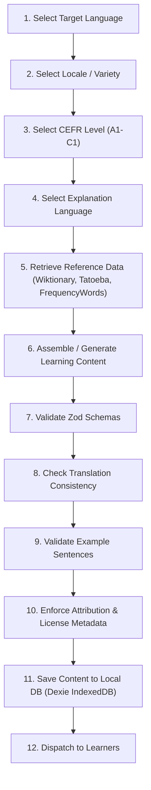

# Lexilume — Multilingual Learning Content Engine

> **Repository:** `VINODH0101/language-learning` (Lexilume — Illuminate Your Words)  
> **Status:** Unified Content Pipeline & Pedagogical Architecture  
> **Last Updated:** October 30, 2026

---

## 1. Architectural Overview

The **Multilingual Learning Content Engine** creates, validates, retrieves, and stores pedagogical material across all 13 supported languages:
`en` (English), `pt` (Portuguese), `es` (Spanish), `fr` (French), `de` (German), `it` (Italian), `ja` (Japanese), `ko` (Korean), `ru` (Russian), `nl` (Dutch), `zh` (Chinese), `tr` (Turkish), and `ta` (Tamil). **Hindi (`hi`) is strictly excluded**.

The engine strictly enforces **authentic linguistic pedagogy**: learning materials are never simplistic word-for-word translations of English, but are custom-tailored to the morphological, syntactic, and phonological nature of each target tongue.

---

## 2. The 12-Step Content Pipeline Workflow

Every learning item passes through the unified pipeline:

1. **Select Target Language**: Validates against the 13 supported languages.
2. **Select Locale / Variety**: Strictly binds regional variety to target language (e.g., `pt-BR` vs `pt-PT`; `es-ES` vs `es-419`/`es-MX`/`es-AR`).
3. **Select Learner CEFR Level**: Scopes vocabulary complexity, sentence length, and grammatical depth (`A1`, `A2`, `B1`, `B2`, `C1`).
4. **Select Explanation Language**: Respects pedagogical decoupling (`en`, `pt`, `es`).
5. **Retrieve Reference Data**: Queries Kaikki/Wiktionary, Tatoeba, wordfreq, Gutendex, or Gemini.
6. **Generate or Assemble Content**: Synthesizes vocabulary, grammar formulas, exercises, and reading texts.
7. **Validate Schemas**: Verifies records using runtime Zod schemas.
8. **Check Translation Consistency**: Prevents untranslated raw tokens from appearing as valid translations.
9. **Validate Examples**: Verifies contextual examples for minimum length, punctuation, and target lemma presence.
10. **Store Attribution**: Records author, source URL, license type (CC-BY, CC-BY-SA, Public Domain, Original-Curated).
11. **Save Content**: Persists locally to IndexedDB (`savedVocabulary`, `cachedLessons`) with offline availability.
12. **Make Available to Learners**: Serves items to active study sessions, review decks, and practice studios.

---

## 3. Supported Exercise Types (11 Types)

| Exercise Type | Identifier | Pedagogical Goal |
| :--- | :--- | :--- |
| **Multiple Choice** | `multiple_choice` | Recognition and distractor differentiation with explicit feedback explanations |
| **Fill in the Blank** | `cloze` | Morphology, conjugation, and case inflection in sentential context |
| **Sentence Ordering** | `reorder` | Syntactic mastery (e.g. German/Dutch V2, Japanese/Tamil SOV order) |
| **Translation** | `translation` | Contextual bilingual equivalence with multiple acceptable solution keys |
| **Matching** | `matching` | Collocation pairs, measure words to nouns, or antonym/synonym association |
| **Listening Comprehension** | `listening_comprehension` | Audio playback with comprehension questions |
| **Reading Comprehension** | `reading_comprehension` | Authentic reading passages with textual inference prompts |
| **Grammar Correction** | `grammar_correction` | Error identification and sentence rewriting |
| **Writing Response** | `writing_response` | Free-form production evaluated against linguistic rubrics |
| **Conversation Response** | `conversation_response` | Pragmatic dialogue reply selection based on politeness and register |
| **Pronunciation Practice** | `pronunciation_practice` | Speech synthesis listening and client-side speech recognition comparison |

---

## 4. Language-Specific Pedagogical Pillars

| Language | Code | Typology | Word Order | Core Linguistic Pillars |
| :--- | :--- | :--- | :--- | :--- |
| **German** | `de` | Fusional | V2 / SOV | 3 genders (`der/die/das`), 4 cases (Nom/Akk/Dat/Gen), separable prefix verbs, strict V2 position |
| **French** | `fr` | Fusional | SVO | Participle agreement with *être* and antecedent COD, Passé Composé vs Imparfait, Subjunctive triggers |
| **Italian** | `it` | Fusional | SVO | *Essere* vs *Avere* auxiliary selection, past participle concordance, combined clitic pronouns (*glielo*) |
| **Japanese** | `ja` | Agglutinative | SOV | Particles (*は/が*, *を/に/で/へ*), tripartite writing (Kanji, Hiragana, Katakana), politeness registers |
| **Korean** | `ko` | Agglutinative | SOV | Batchim-dependent particles (*은/는*, *이/가*), honorific markers, deferential vs polite speech levels |
| **Russian** | `ru` | Fusional | Flexible | 6 nominal cases, verbal aspect pairs (imperfective vs perfective), directed/undirected motion verbs |
| **Dutch** | `nl` | Fusional | V2 / SOV | V2 rule in main clauses with inversion, verb-final in subordinate clauses, *de*/*het* article genders |
| **Chinese** | `zh` | Isolating | SVO | 4 lexical tones + neutral tone, mandatory nominal classifiers (*个, 本, 张, 条*), aspect markers (*了, 过, 着*) |
| **Turkish** | `tr` | Agglutinative | SOV | 2-way and 4-way vowel harmony, agglutinative noun cases (*-de*, *-e*, *-den*, *-i*), absence of gender |
| **Tamil** | `ta` | Agglutinative | SOV | Agglutinative noun cases (*-ஐ*, *-க்கு*, *-இல்*), SOV sentence closure, formal vs colloquial diglossia |
| **Portuguese** | `pt` | Fusional | SVO | Dialect variation (*pt-BR* proclisis vs *pt-PT* enclisis), gerund vs *a + inf*, personal infinitive |
| **Spanish** | `es` | Fusional | SVO | Dialect variation (voseo, *ustedes* vs *vosotros*), subjunctive with negated opinion, *ser* vs *estar* |
| **English** | `en` | Fusional | SVO | Separable/inseparable phrasal verbs, critical Romance false friend warnings, perfect aspect |

---

## 5. Content Gap Registry Audit

In accordance with system principles, where open educational resources are emergent or insufficient for a language, the gap is recorded rather than fabricating coverage:

1. **Tamil (`ta`) Pronunciation**: Desktop browsers lack built-in Tamil TTS in older OS versions. *Mitigation:* Audio playback falls back to pre-recorded Tatoeba native clips.
2. **Tamil & Turkish False Friends**: Because Tamil (Dravidian) and Turkish (Turkic) are non-Indo-European languages, Romance false cognates do not apply. *Mitigation:* Pedagogical notes focus on case assimilation and register transfer instead of Latin false friends.
3. **Japanese & Korean False Friends**: Classical Latinate false friends are replaced with *Wasei-Eigo* (Japanese loanword shifts) and *Konglish* interference warnings.
4. **Chinese (`zh`) Tones**: Real-time pitch tracking requires native WASM audio worklets. *Mitigation:* Visual Pinyin tone diacritics and audio playback comparison are provided.
5. **Russian (`ru`) Stress**: Open web texts omit stress marks. *Mitigation:* Acute stress accents are systematically embedded in all A1–B1 learning records, while stripped for dictionary index search.
