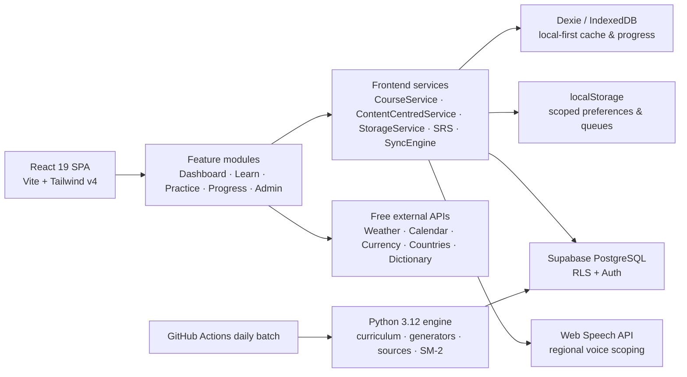
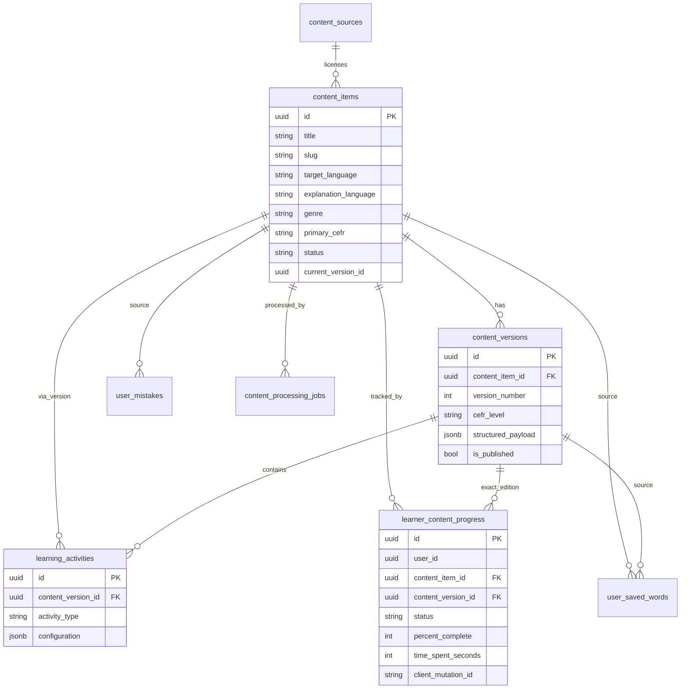

# Lexilume — Project Architecture & Data Model

> **Document:** End-to-end system architecture, language model, Home design, and persistence schema  
> **Repository:** `VINODH0101/language-learning` (Lexilume — Illuminate Your Words)  
> **Ground truth:** current `frontend/`, `engine/`, `supabase/migrations/`, and `AGENTS.md`  
> **Product language scope:** Portuguese (`pt`), English (`en`), Spanish (`es`) only.

---

## 1. Product Summary

Lexilume is a local-first multilingual learning platform. It combines:

- Authentic reading content with sentence/word glossing and comprehension activities.
- Deterministic daily lessons and daily poetry/dialogue editions.
- Personal vocabulary with SM-2 spaced repetition.
- A mistake notebook, progress analytics, and a placement diagnostic.
- An editorial admin desk for content ingestion, processing, review, publishing, and governance.
- Optional free external APIs (weather, calendar, currency, countries, dictionary) behind provider abstractions.
- Offline persistence via IndexedDB (Dexie) and tenant-scoped `localStorage`, with Supabase as the cloud mirror.

The product intentionally operates without mandatory paid AI services.

---

## 2. Core Invariants

1. **Language scope:** only Portuguese, English, and Spanish are learning/explanation languages.
2. **Four-way linguistic decoupling:** `interface_language`, `learning_language`, `explanation_language`, and `regional_variety` are independent. Regional variety is strictly bound to the learning language.
3. **Local-first:** core learning works offline. Supabase is an optional synchronization target.
4. **Tenant isolation:** storage keys, IndexedDB records, and sync-queue items are scoped by `user_id` (or `guest`).
5. **Zero-paid AI:** deterministic generators and open datasets are the baseline; optional AI is progressive enhancement only.
6. **Content integrity:** published `content_versions` are immutable; progress references the exact version.

---

## 3. System Topology



---

## 4. Frontend Architecture

### 4.1 App shell

| Concern | Location |
| :--- | :--- |
| Bootstrap & route rendering | `frontend/src/App.tsx` |
| Providers | `frontend/src/app/providers/AppProviders.tsx` |
| Global layout | `frontend/src/app/layouts/AppLayout.tsx` |
| Hash router + admin destination state | `frontend/src/app/router/useAppRouter.ts` |
| Navigation (learner + admin) | `frontend/src/components/common/Navigation.tsx` |
| Branding/logo | `frontend/src/config/branding.ts`, `frontend/src/components/common/Logo.tsx` |

Routes: `dashboard`, `learn`, `words`, `mistakes`, `vocabulary`, `explore`, `portuguese`, `spanish`, `english`, `translate`, `practice`, `progress`, `settings`, `admin`.

Admin destinations are encoded as `#admin/<destination>` and controlled by a single router-backed state.

### 4.2 Feature modules

| Feature | Responsibility |
| :--- | :--- |
| `features/dashboard` | Home orchestration, daily goal, Continue Learning, Today's Edition, vocabulary summary, recent activity |
| `features/learn` | Content catalog, reader, contextual lookup, activities |
| `features/course` | Unified course viewer for PT/EN/ES |
| `features/practice` | SRS review, mistake notebook, practice dashboards |
| `features/progress` | CEFR progress, diagnostics, retention analytics |
| `features/vocabulary` | Vocabulary catalog and study packs |
| `features/translation` | Bilingual dictionary and translation |
| `features/world` | Real-world learning (weather, calendar, currency, countries) |
| `features/admin` | Content studio, processing, review, settings, users, audit |
| `features/onboarding` | Guided setup and placement |

### 4.3 Service layer

| Service | Responsibility |
| :--- | :--- |
| `courseService` | Multi-course CRUD, active course, curriculum totals, tenant-scoped persistence |
| `contentCentredService` | Published content, versions, activities, learner progress, saved words, mistakes |
| `StorageService` | Tenant-scoped `localStorage` (settings, SRS mirror, activity events, active-time) |
| `localDb` (Dexie) | Offline cache, progress, SRS, mistakes, bookmarks, sync queue, API cache |
| `syncEngine` | Queued mutation replay, monotonic merge, truthful status |
| `srs` / `sm2` | Spaced-repetition scheduling |
| `dailyContentService` | Deterministic daily poetry/dialogue selection (published/active only) |
| `lessonGenerator` | Deterministic daily curriculum synthesis |
| `auth` | Supabase auth + guest mode + roles |
| `speech` | TTS voice resolution by learning language and regional variety |
| `pdfService` | Offline study-pack export |

### 4.4 Internationalization

- `frontend/src/i18n/` contains 15 interface translation locales and 11 namespaces.
- Interface locales control UI chrome only; they never change the learning or explanation language.
- Language display names are resolved through `frontend/src/lib/languages/languageMatrix.ts` so `pt-BR`, `pt-PT`, and Spanish variants localize correctly.

---

## 5. Home Page Composition & Redesign Decisions

Home is intentionally an editorial dashboard with six distinct learner needs:

1. **Personal Welcome** — orientation, active target language, explanation language.
2. **Continue Learning** — the primary action: resume unfinished content or start the daily curriculum.
3. **Today's Edition** — curated poetry, dialogue, and published stories (max 3 items).
4. **Vocabulary Summary** — genuine due-review count and recently saved words.
5. **Daily Learning Goal** — measured active study time only.
6. **Recently Learned** — recent activity history and a link to full Progress.

### 5.1 What is redundant vs. necessary

- **No entire section is unnecessary.** Each maps to a distinct learner question: where am I, what next, what to explore, what to review, how am I doing, what did I do.
- **Redundant data removed:** `WelcomeHeader` no longer receives unused `streakDays`/`dueSRSCount` props.
- **Duplicated language chrome reduced:** the Navigation header now shows the active target/explanation language context, so the Home masthead remains a welcome surface rather than a second navigation bar.
- **Empty history made compact:** the Recently Learned empty state is smaller and no longer dominates the fold.
- **Paired small panels:** Vocabulary Summary and Daily Learning Goal sit in a two-column desktop grid, shortening the page while keeping both sections and their actions.

### 5.2 Product-unique emphasis

- Continue Learning is the hero, with exact-version restoration and an honest recovery state.
- Today's Edition is a curated daily ritual that mixes poetry, dialogue, and authentic stories instead of an infinite feed.
- Daily poetry and daily dialogue are first-class editorial experiences, not generated filler.
- Measured active learning time (interaction-aware, idle-aware, midnight-safe) powers the goal instead of estimated study minutes.

---

## 6. Backend Engine (Python)

| Module | Responsibility |
| :--- | :--- |
| `engine/curriculum` | Syllabus graphs and progression |
| `engine/diagnostic` | Placement assessment |
| `engine/generators` | Deterministic lessons and false-friend content |
| `engine/srs` | SM-2 scheduling |
| `engine/sources` | Wiktionary, Tatoeba, Wikimedia, Wikipedia adapters |
| `engine/translation` | Provider abstraction, cache, quota guard |
| `engine/storage` | Repository interfaces and Supabase REST implementation |
| `engine/security` | Input sanitization, logging scrubber, email validation |
| `engine/email` | Delivery adapters and message composition |
| `scripts/` | Daily batch, retention cleanup, backup/restore |
| `.github/workflows/daily_polyglot.yml` | Scheduled daily generation |

---

## 7. Data Model

### 7.1 Content-centred core (migration 015)



Key invariants:
- `content_items.target_language` and `explanation_language` are restricted to `en | pt | es`.
- Progress is unique per `(user_id, content_item_id)` and stores the exact `content_version_id`.
- Mutations carry `client_mutation_id` for idempotent replay.

### 7.2 Learner vocabulary & review

| Table | Purpose |
| :--- | :--- |
| `user_saved_words` | Personal lexicon + full SM-2 state; unique on `(user_id, target_language, lemma, pos, explanation_language)` |
| `user_word_review_events` | Immutable review history with previous/new intervals and ease factors |
| `srs_items` | Legacy SRS mirror used for compatibility |
| `user_mistakes` | Mistake notebook with pedagogical explanations and remediation status |
| `saved_translations` | Saved bilingual lookups |
| `cultural_bookmarks` | Bookmarked cultural articles |

### 7.3 Learner identity, courses & progress

| Table | Purpose |
| :--- | :--- |
| `user_profiles` | Account, language matrix, onboarding, theme |
| `user_roles` | Role-based access (`user` / `admin`) |
| `user_courses` | Multi-course state: target, regional variant, CEFR, explanation language |
| `language_tracks` / `user_learning_tracks` | Legacy/aggregate track state |
| `curriculum_nodes` | Curriculum graph |
| `activeLessonProgress` (IndexedDB) | Daily curriculum progress |
| `learning_activity_events` | Unified activity history (poetry, dialogue, lesson, practice) |
| `exercise_attempts` | Exercise outcomes and accuracy |
| `diagnostics` | Placement results |

### 7.4 Legacy lesson model (still supported)

`daily_lessons`, `lesson_exercises`, `lesson_assignments`, `vocabulary_items`, `grammar_rules`, `exercise_templates`, `curated_materials`, `user_vocabulary_history`.

### 7.5 Admin & operations

| Table | Purpose |
| :--- | :--- |
| `content_review_items` | Moderation queue |
| `content_processing_jobs` | Durable pipeline stages, timings, retries |
| `admin_background_jobs` | Retryable background operations |
| `admin_audit_logs` | Immutable admin action trail |
| `daily_published_content` | Active/archived daily poems and dialogues |
| `email_deliveries` | Delivery log |
| `retention_cleanup_logs` | Retention automation log |
| `migration_exception_logs` | Migration diagnostics |

### 7.6 IndexedDB (Dexie) stores

`cachedLessons`, `activeLessonProgress`, `savedVocabulary`, `srsReviews`, `mistakeNotebook`, `syncQueue`, `culturalBookmarks`, `apiCache`, plus content-centred learner progress and saved-word stores.

### 7.7 LocalStorage key families (tenant-scoped)

- Preferences/settings: `polyglot_settings`, `polyglot_interface_lang`, theme, font size.
- Course state: `lexilume_courses_<user>`, `lexilume_active_course_<user>`.
- SRS/learning mirrors: `polyglot_srs_items`, `polyglot_exercise_attempts`, `polyglot_unified_activities`.
- Active reading time: `polyglot_study_seconds_<YYYY-MM-DD>`, `polyglot_study_minutes_<YYYY-MM-DD>`.
- Reading position: `lexilume_reading_pos_<item>_<version>`.
- Sync queue and API caches are stored in IndexedDB, with mutation metadata including `user_id`.

---

## 8. Key Data Flows

### 8.1 Active course & language context

`courseService.getActiveCourse()` → Navigation language context + Dashboard sections. Changing interface language never changes the course. Changing an explanation language updates the course only.

### 8.2 Home data orchestration

`DashboardView` resolves independently:
1. Continue Learning: unfinished published content → curriculum → CEFR-matched recommendation → empty.
2. Today's Edition: active daily poem/dialogue + up to three CEFR-matched published stories, excluding the Continue Learning item.
3. Vocabulary Summary: canonical identity (`target_language + NFC + lemma/term`) across saved words and SRS; due and saved are separate sets.
4. Daily Goal: measured active seconds for the learner's local date.
5. Recent Activity: progress + unified activity events within the local 7-day window.

A failure in one section does not block the others.

### 8.3 Active reading time

`ReaderView` starts only after interaction, pauses on idle/hidden/unmount, flushes locally first, syncs progress second, and attributes seconds to the correct local date across midnight.

### 8.4 Sync & idempotency

`SyncEngine` replays queued mutations with `client_mutation_id`. Content progress uses monotonic `max()` merging for percent/time to prevent regression and duplicate accumulation. RLS enforces tenant isolation server-side.

---

## 9. Recommendations & Decisions

1. **Keep the six Home sections** but treat Continue Learning and Today's Edition as the visual heroes; the other four are supporting context.
2. **Pair Vocabulary + Goal on desktop** to reduce scroll while keeping separate accessible regions.
3. **Compact empty states** instead of large empty cards (history).
4. **Keep learning languages to PT/EN/ES** across onboarding, course creation, practice, progress, navigation, and admin matrices. Do not reintroduce 13-language selectors.
5. **Keep interface translation locales** as UI chrome resources; they are not additional learning languages.
6. **Prefer measured time** and exact content versions over estimates or substitutions.
7. **Future candidates (not yet implemented):** a single “Today at a glance” summary (streak, due words, goal) to replace duplicated small stats; structured onboarding for daily poetry/dialogue; deeper pronunciation feedback.

---

## 10. Verification

```bash
npm --prefix frontend test
npm --prefix frontend run build
npm --prefix frontend run lint
python -m pytest tests/ -v   # only when Python files change
```

All commands must exit `0` before release, with known lint warnings treated separately from errors.
