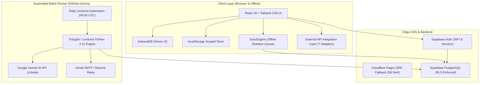
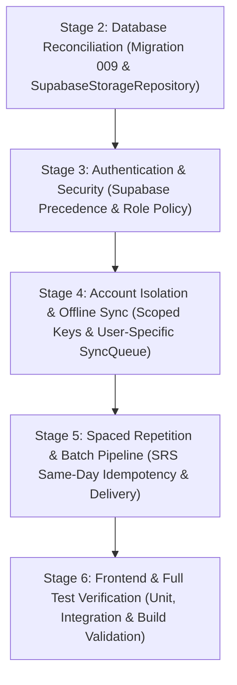

# Lexilume — Comprehensive Architecture & Security Audit

> **Product Name:** Lexilume  
> **Tagline:** Illuminate Your Words.  
> **Platform Description:** Multilingual language-learning application for vocabulary mastery, daily lessons, reading comprehension, translation, grammar, spaced repetition, and personalized language development (PT · ES · EN • CEFR A1–C1).  
> **Audit Date:** 2026-10-30  
> **Status:** Stage 1 Repository Discovery Complete — Verified Empirical Baseline

---

## 1. Architecture Overview

Lexilume operates as a local-first, serverless-capable multilingual learning platform combining a high-performance React 19 frontend with a robust Python 3.12 pedagogical batch engine and Supabase PostgreSQL backend.

---

## 2. Main Components and Responsibilities

| Component | Path | Responsibility | State / Persistence |
|---|---|---|---|
| **Frontend Root** | `frontend/src/App.tsx` | Main application shell, router, course initialization, and external API registry bootstrapping. | React State |
| **Navigation & Shell** | `frontend/src/components/common/Navigation.tsx` | Responsive header, course switcher, drawer, auth triggers, and sync indicator. | React State |
| **Authentication Service** | `frontend/src/services/auth.ts` | Supabase auth integration, user profile management, session persistence, role verification. | Supabase Auth / localStorage |
| **Local-First Storage** | `frontend/src/services/storage.ts` | Fast client-side storage for active track state, SRS flashcards, attempts, diagnostics. | localStorage / Memory |
| **IndexedDB Cache** | `frontend/src/services/localDb.ts` | Dexie v3 schema for cached lessons, active lesson progress, mistake notebook, sync queue, API cache. | IndexedDB |
| **Sync Engine** | `frontend/src/services/syncEngine.ts` | Manages offline mutation queue, network status change listeners, idempotent upserts. | IndexedDB & Supabase |
| **Spaced Repetition (Client)** | `frontend/src/services/srs.ts` | Client SM-2 scheduling, ease factor calculation, mastery status transitions. | Pure Computation |
| **Spaced Repetition (Python)** | `engine/srs/sm2.py`, `scheduler.py` | Python SM-2 engine, daily review queue prioritization, mastery sync. | Pure Computation |
| **Python Storage Repository** | `engine/storage/supabase_repository.py` | PostgREST client for database persistence with in-memory fallback. | Supabase PostgREST |
| **AI Lesson Generator** | `engine/generators/gemini_generator.py` | Google Gemini 1.5 Flash content generator with deterministic template fallbacks. | Generative Language API |
| **Batch Runner** | `scripts/run_daily_batch.py` | Scheduled daily workflow, learner loop, lesson generation, email rendering & dispatch. | CLI / GitHub Actions |
| **Connection Diagnostic** | `scripts/verify_connections.py` | Live health checker for Supabase, Gemini, SMTP, and external educational APIs. | CLI |

---

## 3. End-to-End Data Flows

### 3.1 Learner Study Flow
1. **Selection:** Learner selects target language (PT, ES, EN) and CEFR level (A1–C1).
2. **Retrieval:** `ClientLessonGenerator` checks `localDb.cachedLessons`; if absent, compiles deterministic syllabus node and caches for 30 days.
3. **Execution:** Learner completes sections (Vocabulary, Grammar, Reading, Conversation, Speaking, Writing, Exercises).
4. **Submission:** Exercise answers are normalized via `stringNormalizer`, checked against distractor feedback patterns, and saved to `localDb.mistakeNotebook`.
5. **Review Scheduling:** Recall ratings update vocabulary interval, ease factor, and mastery status (`presented` → `learning` → `reviewing` → `mastered`).
6. **Cloud Sync:** Mutation is enqueued in `localDb.syncQueue`; `SyncEngine` streams upserts to Supabase tables upon network availability.

### 3.2 Scheduled Batch Workflow Flow
1. **Trigger:** GitHub Actions cron triggers `0 4 * * *` (09:30 AM IST).
2. **Learner Discovery:** `scripts/run_daily_batch.py` queries `user_profiles` for active opted-in learners.
3. **Lesson Generation:** `PolyglotEngine` compiles dual-track daily lesson payloads (Portuguese & Spanish), utilizing `GeminiLessonGenerator` for dialogue turns.
4. **Email Rendering:** `DailyDigestComposer` renders responsive, lightweight HTML email (< 75 KB) with streak counters.
5. **Idempotency Guard:** `email_deliveries` checked for existing `(user_id, delivery_date, purpose)` ledger entry.
6. **Dispatch:** Dispatched via `SmtpAdapter` (STARTTLS port 587) or `ResendAdapter`.
7. **Ledger Update:** Delivery status recorded as `sent` with message ID.

---

## 4. Confirmed Defects (Ranked by Severity)

### [CRITICAL] 1. Database Schema Discrepancy Between Python Storage & SQL Migrations
- **Confirmed Location:** `engine/storage/supabase_repository.py` vs `supabase/migrations/001_initial_schema.sql` through `008_cultural_bookmarks_and_sync.sql`.
- **Defect Detail:**
  - `SupabaseStorageRepository` queries tables:
    - `"user_learning_tracks"`
    - `"srs_items"`
    - `"exercise_attempts"`
  - SQL migrations `001-008` created tables named:
    - `public.language_tracks`
    - `public.user_vocabulary_history`
    - `public.lesson_exercises`
  - In addition, `003_email_and_retention.sql` defined `email_deliveries` with `REFERENCES public.users(id)` (which does not exist in Supabase; the correct table is `auth.users` or `public.user_profiles`), and missed column additions if `001` had already created `email_deliveries`.
- **Impact:** Any Python script attempting to read/write from a live Supabase database fails PostgREST queries with HTTP 404/400 (table or column relation does not exist).
- **Remediation:** Create migration `009_schema_reconciliation.sql` creating canonical views or tables (`user_learning_tracks`, `srs_items`, `exercise_attempts`), update column constraints on `email_deliveries`, and align repository querying.

---

### [HIGH] 2. Silent In-Memory Fallback Masking Live Database Failures
- **Confirmed Location:** `engine/storage/supabase_repository.py` lines 104, 154, 166, 208, 231, 270.
- **Defect Detail:**
  - When `is_connected == True` (valid credentials provided), if a REST request fails due to an error, `_rest_request` logs a warning and returns `None`.
  - Methods like `get_user_track_state`, `get_srs_states`, and `get_daily_lesson` then execute `if self._mem: return self._mem.get_...()`, silently returning local memory results.
  - Furthermore, `save_*` methods return `None` silently after failure without notifying callers that data was not persisted to the cloud.
- **Impact:** In production pipelines, data loss occurs silently without failing the job or alerting operations.
- **Remediation:** Differentiate development/offline execution from production failures. When connected to Supabase in production, raise descriptive persistence exceptions or return explicit failure statuses.

---

### [HIGH] 3. Account Data Bleed & Missing User-Scoping in Local Storage & Sync Queue
- **Confirmed Location:** `frontend/src/services/storage.ts` lines 12–24, 60–120; `frontend/src/services/localDb.ts` lines 21–28; `frontend/src/services/syncEngine.ts` line 130.
- **Defect Detail:**
  - `StorageService` keys (`polyglot_track_pt`, `polyglot_srs_items`, `polyglot_exercise_attempts`, `polyglot_diagnostics`) are global in `localStorage`. They do not include `user_id`.
  - If User A studies offline, logs out, and User B logs in on the same browser, User B immediately sees User A's tracks, flashcards, and diagnostic scores.
  - In `localDb.ts`, `SyncQueueRecord` does NOT store `user_id`. When `SyncEngine` processes pending items, it passes the *currently signed-in user's ID*:
    `await this.processSyncItem(item, user.id);`
    This causes User A's un-synced offline progress to be uploaded under User B's Supabase account.
- **Impact:** Critical violation of user privacy, multi-tenant isolation, and data integrity.
- **Remediation:**
  1. Scope all `StorageService` keys by `userId` (e.g. `lexilume_${userId}_track_pt`), with backward-compatible migration for existing guest state.
  2. Add `user_id: string` to `SyncQueueRecord` in `localDb.ts`, indexing it in Dexie store.
  3. Update `SyncEngine` to process only items matching the currently authenticated user's ID, leaving other users' pending items safely intact.

---

### [HIGH] 4. Authentication Precedence & Unprivileged Role Assignment Block
- **Confirmed Location:** `frontend/src/services/auth.ts` lines 101–115, 260; `supabase/migrations/006_auth_roles_audit_and_onboarding.sql` lines 72–77.
- **Defect Detail:**
  - `initAuth()` checked `localStorage.getItem(MOCK_AUTH_USER)` before verifying Supabase sessions. A leftover mock user in `localStorage` silently hijacked real user authentication.
  - In `signUp()`, the frontend calls `await supabase.from('user_roles').insert([{ user_id: data.user.id, role: 'user' }]);`. However, `006_auth_roles_audit_and_onboarding.sql` enforces:
    `CREATE POLICY "Admins can manage user roles" ... USING (public.is_admin()) WITH CHECK (public.is_admin());`
    Because a brand-new user is NOT an admin, PostgreSQL RLS rejects this insert, leaving the newly registered user without a row in `user_roles`.
- **Impact:** Silent authentication hijacking in development/production hybrids and registration failures in strict Supabase environments.
- **Remediation:**
  1. Make Supabase Auth authoritative in `initAuth()`; only permit mock authentication when Supabase is unconfigured or in explicit test mode.
  2. Add an RLS policy in migration 009 allowing newly registered users to insert their initial `role = 'user'` (`WITH CHECK (auth.uid() = user_id AND role = 'user')`).

---

### [MEDIUM] 5. Spaced Repetition (SRS) Idempotency Defect
- **Confirmed Location:** `frontend/src/services/srs.ts` line 9; `engine/srs/scheduler.py` line 56.
- **Defect Detail:**
  - When an exercise or flashcard is graded multiple times on the same calendar day (e.g., rapid button double-clicks or repeated practice sessions), `repetition_count` advances from 0 → 1 → 2 and interval jumps from 1 → 6 days within seconds.
- **Impact:** Prematurely marks items as learned or mastered, breaking pedagogical spaced repetition.
- **Remediation:** Add same-day review idempotency check: if an item was already reviewed on the target date, update today's grade rather than compounding the repetition count.

---

## 5. Potential Risks Requiring Verification

| Area | Risk Description | Verification Method |
|---|---|---|
| **Public Educational APIs** | Rate limits on Jikan Anime/Manga API (`api.jikan.moe`) can trigger transient HTTP 429 or network timeouts. | Verify local fallback fixtures are served seamlessly when network is offline or throttled. |
| **Email Relay Ambiguity** | Provider receives email but runner network drops before ledger commit. | Verify idempotency keys and error logging in batch pipeline. |
| **Dexie v3 IndexedDB Version Upgrades** | Adding `user_id` to `syncQueue` requires a Dexie store version bump. | Add Dexie database upgrade schema version test. |

---

## 6. Recommended Remediation Order

1. **Stage 2:** Database & Storage Consistency (Migration 009, reconciliation views/tables, explicit error handling in `supabase_repository.py`).
2. **Stage 3:** Authentication & Security (Authoritative Supabase session restoration, RLS insert policy for initial user role).
3. **Stage 4:** Offline-First Storage & Account Isolation (User-scoped `StorageService` keys, `user_id` in `SyncQueueRecord`, isolated sync queue processing).
4. **Stage 5:** Spaced Repetition & Automation (Same-day review idempotency in `srs.ts` and `sm2.py`).
5. **Stage 6:** Verification & Documentation (Run all test suites, verify zero regressions, document deployment steps).
