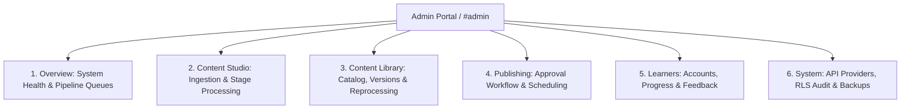

# Lexilume — Admin Content Studio & Information Architecture Specification

> **Security Mandate (Part 7):** All admin features must have server-side authorization and database-level protection. A hidden frontend tab is NOT a security boundary. Access to Content Studio, Publishing Queue, and System Operations requires verified `role = 'admin'` via Supabase JWT and RLS policies.

---

## 1. Admin Information Architecture Overview

The Administrative Workbench is organized into 6 focused subsystems:



---

## 2. Deep Specification of the 6 Admin Subsystems

### 2.1. Overview Subsystem
- **Real-Time Operational Counters:**
  - `Drafts in Preparation`: Unprocessed or in-progress imports.
  - `Processing Queue`: Active background extraction or translation jobs.
  - `Review Queue`: Content packages awaiting admin approval.
  - `Published Packages`: Live English content items accessible to learners.
  - `Failed Jobs`: Stage executions requiring admin attention or retry.
- **Provider Health Tracker:** Real-time success rates, average latency, and quota exhaustion warnings for MyMemory, Wiktionary, Tatoeba, and optional Gemini.
- **System Activity Log:** Live feed from `admin_audit_logs`.

### 2.2. Content Studio (Primary Authoring Interface)
The core content engine where administrators ingest, analyze, and transform authentic material into learning packages:
- **Intake Panel:** Drag-and-drop file upload (PDF, DOCX, TXT, SRT, VTT, MP3, JPG/PNG) or URL/raw text paste.
- **Extraction Correction Canvas:** Side-by-side text editor where administrators can review extracted text, fix OCR typos, adjust paragraph breaks, and clean unwanted web chrome before running the pipeline.
- **Linguistic Synthesis Controller:**
  - One-click trigger for the 21-stage pipeline.
  - Visual stage progress indicator (green checkmark for completed, amber pulse for active, red badge for failed).
  - Stage-level retry controls (e.g. re-run *only* Stage 10 Translation or Stage 12 Comprehension).
- **Quality Inspection & Learner Preview:**
  - Bilingual sentence translation matrix (English ↔ Portuguese / Spanish).
  - Lexical items table with editable IPA, part-of-speech, and contextual definitions.
  - Interactive Preview Mode: Test the lesson exactly as a learner will experience it.

### 2.3. Content Library Subsystem
- **Search & Multi-Facet Filtering:** Filter by genre (`workplace`, `news`, `conversation`, `literature`), topic, internal CEFR tier (`A1`–`C1`), and reading duration.
- **Version Control History:** View diffs between Content Version 1, 2, and 3.
- **Duplicate Detection Engine:** Checks cosine similarity of sentence embeddings or exact slug matches to prevent duplicate learning items.
- **Reprocessing Engine:** Batch-reprocess selected stages across existing content when pedagogical templates are updated.

### 2.4. Publishing Subsystem
- **Approval Workflow:** Content packages require explicit admin sign-off before publication.
- **Scheduling Engine:** Set future release dates (e.g., release a daily news article at 06:00 UTC).
- **Deprecation & Archival:** Archive outdated material without deleting historical learner completion records.

### 2.5. Learners Subsystem
- **Tenant Management:** View registered users, active roles, and interface/explanation language preferences.
- **Pedagogical Analytics:** High-frequency mistake patterns across all learners to identify grammar points needing new content creation.
- **Activity Feedback:** Aggregate feedback on comprehension difficulty.

### 2.6. System Subsystem
- **Provider & Secret Configuration:** Manage API keys, rate limits, and fallback priority without editing code.
- **Sync & Storage Health:** Monitor Dexie sync queue health and unresolved conflict counts.
- **Database Backup & Recovery:** Trigger automated snapshots via `scripts/backup_restore.py`.
- **Security Audit Trail:** Query `admin_audit_logs` for all sensitive operations.

---

## 3. Server-Side Security & RLS Defense-in-Depth

Every admin action is enforced through three independent defensive perimeters:

```mermaid
sequenceDiagram
    autonumber
    actor Admin as Verified Administrator
    actor Malicious as Unauthenticated User
    participant UI as React Admin View
    participant API as Supabase Auth & Edge
    participant DB as PostgreSQL with RLS

    Admin->>UI: Navigates to /#admin
    UI->>API: Validates session JWT
    API-->>UI: Role: 'admin' confirmed
    UI->>DB: SELECT * FROM admin_audit_logs
    DB-->>UI: 200 OK (Policy: admin_audit_logs_select)

    Malicious->>API: Direct curl request to /rest/v1/admin_audit_logs
    API->>DB: Executes with anon/learner token
    DB-->>Malicious: 403 Forbidden (RLS rejects query; 0 rows returned)
```
