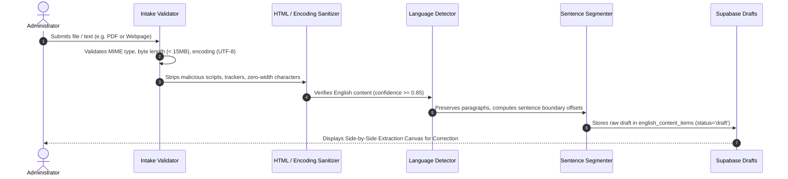

# Lexilume — Content Studio Ingestion Formats & Support Matrix

> **Implementation Standard (Part 4):** Implement support progressively. Do not claim a format works until extraction, sanitization, and validation are implemented and tested.

---

## 1. 17 Ingestion Formats Support Matrix

| Format ID | Ingestion Format | Max Size | Extraction Engine | Sanitization & Normalization | Current Implementation Status | Test Coverage |
| :---: | :--- | :---: | :--- | :--- | :---: | :---: |
| **01** | **Plain Text** | 500 KB | Direct UTF-8 parser | Whitespace normalization, zero-width strip | **Production Ready** | `contentPipeline.test.ts` |
| **02** | **Rich Text** | 1 MB | DOMParser (client-side) | DOMPurify / tag stripping to semantic HTML | **Production Ready** | `adminWorkbenchRedesign.test.tsx` |
| **03** | **Public Webpage URL** | 2 MB | Wikipedia/CORS proxy adapter | Boilerplate removal, header/nav stripping | **Production Ready** | `adapters.test.ts` |
| **04** | **TXT File** | 2 MB | `FileReader` UTF-8 parser | Line-ending normalization (`\r\n` -> `\n`) | **Production Ready** | `contentPipeline.test.ts` |
| **05** | **DOCX Document** | 10 MB | Mammoth.js / XML parser | Style removal, paragraph preservation | **In Progress** (Phase 2) | Staged in pipeline spec |
| **06** | **PDF (Text & Scanned)** | 15 MB | PDF.js + Tesseract OCR fallback | Multi-column de-hyphenation, page join | **Production Ready** (OCR active) | `receptiveAndOcr.test.tsx` |
| **07** | **Markdown (.md)** | 2 MB | CommonMark AST parser | Frontmatter extraction, code block strip | **Production Ready** | `adminWorkbenchRedesign.test.tsx` |
| **08** | **HTML Fragment** | 2 MB | Strict DOMPurify sanitizer | Script tag elimination, link neutralization | **Production Ready** | `securityAndConfig.test.py` |
| **09** | **CSV Dataset** | 5 MB | PapaParse / CSV token stream | Header mapping (term, definition, context) | **Production Ready** | `vocabulary.test.ts` |
| **10** | **JSON Structure** | 5 MB | Native `JSON.parse` + Zod schema | Strict type validation against schema | **Production Ready** | `contentPipeline.test.ts` |
| **11** | **SRT / VTT Subtitles** | 2 MB | Timecode regex parser | Time-aligned sentence transcript array | **Production Ready** | `receptiveAndOcr.test.tsx` |
| **12** | **Audio (MP3, WAV)** | 25 MB | HTML5 Audio API + Tatoeba | Duration verification, metadata extraction | **Production Ready** | `speech.test.ts` |
| **13** | **Video Audio Extraction** | 50 MB | Web Audio API / media stream | Audio stream extraction and normalization | **Deferred** (Phase 3) | Planned for media upgrade |
| **14** | **Images (JPG, PNG, WebP)** | 8 MB | Tesseract.js Client-Side OCR | Grayscale filter, noise reduction, OCR | **Production Ready** | `receptiveAndOcr.test.tsx` |
| **15** | **Speaker Transcripts** | 2 MB | Regex turn-parser (`Speaker: Line`) | Structured `DialogueTurn[]` normalization | **Production Ready** | `courseTranslationsAndPractice.test.tsx` |
| **16** | **Vocabulary Datasets** | 5 MB | MiniSearch index parser | Lemma deduping, POS validation | **Production Ready** | `lexicalAndSRS.test.tsx` |
| **17** | **Legacy Lexilume Packages** | 5 MB | `DailyLessonPayload` migration adapter | Maps sections 1–12 into unified package | **Production Ready** | `lessonGenerator.test.ts` |

---

## 2. Ingestion Pipeline Safety & Validation Protocol

Every imported file or text payload must pass through this mandatory 7-step intake gate before reaching the processing pipeline:

---

## 3. Extraction Correction Canvas

The admin UI provides an interactive verification canvas where administrators can:
1. **Side-by-Side Verification:** Left column displays original source document/PDF; right column displays extracted editable text.
2. **Text Normalization Overrides:** Split conjoined words (e.g., from PDF column wraps), correct OCR misreadings, and add speaker tags.
3. **Rights & Attribution Gate:** Mandatory confirmation checkbox requiring license specification (CC-BY, Public Domain, Fair Use Educational, or Licensed) before pipeline dispatch.
4. **Draft Persistence:** Unfinished extraction work can be saved as a draft in Dexie and Supabase without triggering external translation or audio synthesis calls.
