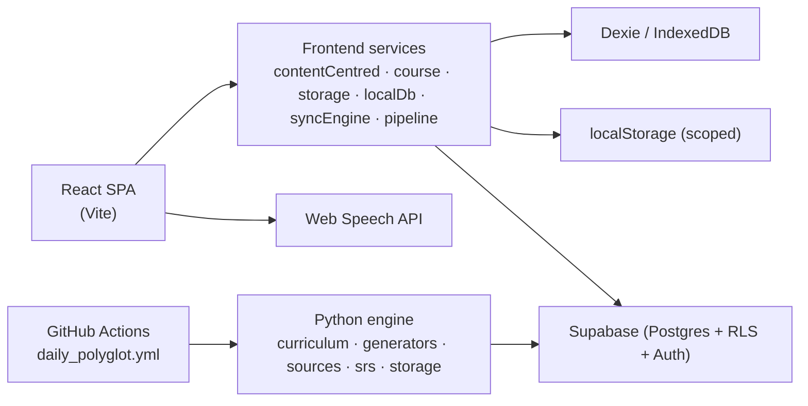

# 01 — Existing System Audit

> **Phase 0 deliverable.** Repository inspection against `phase-8-ui-redesign` @ `032a4f8`.
> Findings are evidence-based. Live Supabase schema was **not** connected; any schema claims come from `supabase/migrations/*.sql`.

---

## 1. Repository state

| Item | Value |
| :--- | :--- |
| Branch | `phase-8-ui-redesign` |
| HEAD | `032a4f8` — "added admin and hoe page changes" |
| Recent commits | `4d8ba73` "pushed all the changes", `76d678e`, `affded2` |
| Working tree | Clean at audit time |
| Languages | Frontend TypeScript/React; engine Python 3.12 |

Top-level structure: `frontend/`, `engine/`, `supabase/migrations/`, `scripts/`, `docs/`, `tests/`, `.github/workflows/`.

---

## 2. Existing architecture

Lexilume is a **local-first SPA** (React 19 + Vite + Tailwind v4) with an optional Supabase cloud mirror, plus a **Python content engine** used for offline batch generation/verification.

- **Router:** hash-based (`#dashboard`, `#admin/<destination>`) via `useAppRouter`.
- **Layout:** `AppLayout` renders global `Navigation` (learner + admin shells).
- **Admin:** `AdminPage` → `AdminWorkbench` with two tab groups (Primary Workflow + Operations & Governance).

---

## 3. Modules & responsibilities

### 3.1 Frontend services

| Service | Responsibility |
| :--- | :--- |
| `contentCentredService` | Published content/versions/activities, learner progress, saved words, mistakes; cache-aside Supabase + Dexie |
| `contentPipelineService` | Deterministic processing pipeline (intake → detect → classify → segment → translate → lexicon → grammar → activities → validate) |
| `dailyContentService` | Daily poetry/dialogue (separate from content-centred) |
| `courseService` | Multi-course CRUD, active course, curriculum totals |
| `lessonGenerator` (`ClientLessonGenerator`) | Deterministic daily curriculum synthesis on-device |
| `StorageService` | Tenant-scoped `localStorage` (SRS mirror, activities, active time) |
| `localDb` (Dexie) | Offline caches, progress, SRS, mistakes, bookmarks, sync queue, API cache |
| `syncEngine` | Queued mutation replay, monotonic merge, truthful sync status |
| `srs`/`sm2` | Spaced-repetition scheduling |
| `auth` | Supabase auth + guest mode + roles |
| `speech`, `pdfService` | TTS and study-pack export |

### 3.2 Python engine

`engine/` contains `curriculum`, `diagnostic`, `email`, `exercises`, `generators`, `models`, `security`, `sources`, `srs`, `storage`, `translation`.

- `generators/template_engine.py` — deterministic `DeterministicLessonGenerator`.
- `generators/gemini_generator.py` — `GeminiLessonGenerator` (see §7.2).
- `generators/false_friends.py`, `generators/validator.py`.
- `sources/` — Wiktionary, Tatoeba, Wikimedia, Wikipedia adapters + fixtures.
- `storage/` — repository interfaces + Supabase REST repository.

### 3.3 Supabase migrations

001 → 015. See `02-existing-database-inventory.md` for the full table map.

---

## 4. Current content-generation flow

Two separate, currently **uncoordinated** generation paths exist:

1. **On-device deterministic lessons** — `ClientLessonGenerator.generateOrGetLesson()` produces the 12-section daily curriculum; used by Home (`ContinueLearning` fallback) and course pages. No AI.
2. **Deterministic content pipeline** — `contentPipelineService.executePipeline()` ingests raw text and produces a segmented, glossed, grammar-tagged, activity-bearing `ContentItem` + `ContentVersion`. Purely rule-based.
3. **Python deterministic engine** — `DeterministicLessonGenerator` (template_engine) is the active server/batch generator.
4. **Gemini** — `GeminiLessonGenerator` exists but is referenced only by `scripts/verify_connections.py` (a diagnostic), not by the production batch path.

**There is no centralized generation queue, no provider router, no multi-provider abstraction, and no database-backed scheduler.** Generation is triggered manually (admin import form) or by the daily GitHub Actions workflow calling the deterministic engine.

---

## 5. Current persistence flow

- Reads: cache-aside — Supabase first (if configured), Dexie fallback, in-memory registry.
- Writes: local (Dexie/localStorage) first, then best-effort Supabase upsert.
- `syncEngine` replays queued mutations with `client_mutation_id` and monotonic `max()` merges for progress.

**Observed reliability gaps** (§8) affect this flow.

---

## 6. Existing database schema (summary)

Full inventory in `02-existing-database-inventory.md`. Content-centred core (migration 015):

`content_sources`, `content_items`, `content_versions`, `learning_activities`, `learner_content_progress`, `user_saved_words`, `user_word_review_events`, `user_mistakes`, `content_processing_jobs`, `migration_exception_logs`.

Legacy/learner/operations tables span migrations 001–014 (e.g., `daily_published_content`, `content_review_items`, `admin_background_jobs`, `srs_items`, `exercise_attempts`, `user_courses`, `learning_activity_events`).

---

## 7. Existing API integrations

| Integration | Location | Notes |
| :--- | :--- | :--- |
| Supabase | `frontend/src/services/supabaseClient.ts` | Anon key via `VITE_SUPABASE_*`; placeholder guard |
| Gemini | `engine/generators/gemini_generator.py` | Direct HTTPS `generativelanguage` call; deterministic fallback |
| Wiktionary / Tatoeba / Wikipedia / Wikimedia | `engine/sources/` | Deterministic adapters/fixtures |
| External free APIs | `frontend/src/integrations/` | Open-Meteo, Nager.Date, Frankfurter, REST Countries, MyMemory, Tatoeba |
| Web Speech | `frontend/src/services/speech.ts` | TTS by learning language + variety |

**No provider abstraction/registry exists** for LLM providers. Only Gemini has an adapter (Python, dormant).

---

## 8. Confirmed defects

Verified against current code (issue → status):

1. **String IDs in UUID columns — FIXED (Phase 2).**
   `saveContentItem`/`saveContentVersion`/`saveLearningActivity`/`saveUserWord`/`saveUserMistake`/`updateLearnerProgress` and pipeline jobs now generate `crypto.randomUUID()` (`services/uuid.ts`). Remote writes are skipped (local-first preserved) when an identifier is not a valid UUID.

2. **Supabase error handling inconsistent — FIXED (Phase 2).**
   All content-centred writes now go through `supabaseUpsert`/`supabaseUpdate`/`supabaseInsert` helpers that inspect the returned `error` object (not only JS exceptions).

3. **Overlapping content catalogues — CONFIRMED.**
   `dailyContentService` persists poems/conversations to `daily_published_content`, while `content_items` also supports `genre` `conversation` / `dialogue` / `short_story`. "Today's Edition" mixes both sources. Two catalogues for the same learner-facing concepts.

4. **Generation job requires a content item — CONFIRMED.**
   `content_processing_jobs.content_item_id UUID NOT NULL REFERENCES content_items`. `contentPipelineService` creates the `ContentItem` first, then the job. A standalone generation job (before content exists) cannot be represented today.

5. **Gemini frontend-facing — NOT CONFIRMED (premise false).**
   No Gemini code in the frontend. It is Python-only.

6. **Python engine initializes deterministic instead of Gemini — CONFIRMED.**
   `GeminiLessonGenerator` is only imported by `scripts/verify_connections.py`; the production path uses `DeterministicLessonGenerator`. Gemini is effectively dormant.

7. **Translation/pipeline placeholder stages — CONFIRMED for retry.**
   `contentPipelineService.retryStage()` sets status `running` then immediately `completed` with the comment “In a real execution, we rerun from stageName forward”. It does not re-execute the failed stage. Stage implementations are deterministic placeholders (word counting, heuristics) rather than real AI/translation.

8. **Admin navigation/UX inconsistency — PARTIALLY ADDRESSED.**
   Recent work localized admin shell/tabs and unified the palette; the Phase 7 content-studio authoring panes remain English-authored and are not interface-language-aware.

9. **`daily_published_content` not reconciled** with the unified content model (see #3).

10. **`migration_exception_logs`** exists (015) but its usage/wiring was not observed in frontend services during this pass.

---

## 9. Reusable existing components

- `content_items` / `content_versions` / `learning_activities` / `learner_content_progress` — solid versioned-content foundation.
- `user_saved_words` + `user_word_review_events` — complete SM-2 lexicon with idempotency.
- `content_processing_jobs` — durable stage tracking (status, stages_completed, stage_outputs, timings, retry_count).
- `syncEngine` monotonic merge + `client_mutation_id` — idempotent write pattern to reuse.
- `admin_background_jobs` / `content_review_items` — queue + review primitives.
- Python `sources/` adapters — reusable for Discovery.
- Frontend design system (stone/amber editorial) + i18n (3 languages) — reuse for Admin/Discovery UI.
- Four-way language decoupling (`languageMatrix.ts`) and `getLanguageName`.

---

## 10. Proposed changes (target architecture)

1. Adopt a **single content catalogue** (`content_items`/`content_versions`) for all eight content types; reconcile `daily_published_content` into it (or mark it legacy + migrate).
2. Fix **UUID generation** (`crypto.randomUUID()` / `gen_random_uuid()`) and **Supabase error checks** everywhere.
3. Introduce a **server-side generation queue** decoupled from content-item existence (job → attempt → draft).
4. Add a **provider abstraction + router** (Gemini/Groq/DeepSeek/…) in the Python engine; wire Gemini (and others) into the batch/generation path behind deterministic fallback.
5. Add **database-backed schedules + coverage planner**; reuse GitHub Actions as the trigger only.
6. Build **Discovery** as an aggregation service reusing Python `sources/` adapters; keep facts vs. generated explanations separate; preserve attribution/licensing.
7. Expose a **shared content/discovery API** consumed by all frontend modules (no per-module stores).
8. Extend Admin Content Studio for schedules, providers, jobs, review, and Discovery management.

---

## 11. Risks & unresolved questions

- **Live schema drift:** migrations may diverge from the deployed Supabase schema; needs a live introspection dump before Phase 2.
- **ID migration:** existing `ci_*`/`cv_*`/`job_*` local records may already be seeded into Supabase (or only local). A safe backfill/migration strategy is required before enforcing UUIDs.
- **Duplicate catalogue:** deciding whether `daily_published_content` becomes a view, a soft-relocated table, or is merged with `content_items` affects Home/Today's Edition and Admin Daily Studio.
- **Gemini activation:** confirm whether Gemini should be wired now or remain optional; provider secrets stay server-side.
- **Admin content-studio localization** (English-authored panes) remains unfinished for pt/es.
- **Retention/delete:** no account-deletion retention policy observed yet; must be defined before any retention automation.
- **Worker/scheduler location:** Python batch (GitHub Actions) vs. a long-running worker needs a decision; Redis/Kafka are **not** currently justified.
