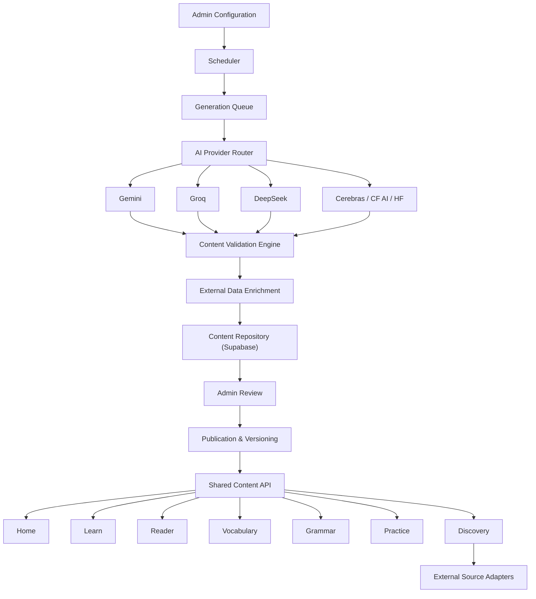
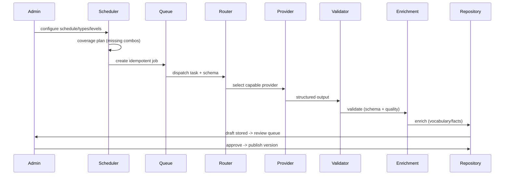

# 03 — Target System Architecture

> Centralized content engine + multi-provider AI + Discovery. Design target; implementation is phased.

## 1. Logical components

| # | Component | Responsibility | Layer |
| :--- | :--- | :--- | :--- |
| 1 | Admin Configuration | schedules, providers, limits, content types/levels | server + admin UI |
| 2 | Scheduler | read enabled schedules, compute coverage, create idempotent jobs | server (Python / Actions trigger) |
| 3 | Generation Queue | durable job + attempt + failure records | database |
| 4 | AI Provider Router | pick capable provider; health/budget/rate-limit/priority | server |
| 5 | Provider Adapters | Gemini/Groq/DeepSeek/... implement `AIProvider` | server |
| 6 | Content Generation Engine | prompt assembly, all eight types | server |
| 7 | Content Validation Engine | JSON-schema + content-quality checks | server |
| 8 | External Data Enrichment | Wiktionary/Tatoeba/etc. enrich vocabulary/facts | server |
| 9 | Content Repository | `content_items`/`content_versions` (single catalogue) | Supabase |
| 10 | Publication & Versioning | immutable published versions; draft→review→publish | server + admin |
| 11 | Shared Content Access API | one API for all learner modules | server |
| 12 | Discovery Aggregation API | external + internal resources | server |
| 13 | Frontend modules | Home/Learn/Reader/Vocabulary/Grammar/Practice/Discovery/Admin | React |

## 2. Component responsibilities & decisions

- **Single catalogue:** all eight content types reuse `content_items` + `content_versions`. No per-type tables for content. `genre` is extended/encoded as `content_type`; `daily_published_content` is reconciled (migrated to the unified model or retained as a legacy view).
- **Generation queue decoupled from content:** a job is creatable before a content item exists. The job links to a *future* item via a nullable FK resolved at completion, or via a separate generation-request record (see `04`).
- **No frontend provider calls:** generation/discovery enrichment happen server-side (Python). React consumes only the shared API.
- **Secrets server-side only:** `GEMINI_API_KEY`, `GROQ_API_KEY`, etc. read from environment on the server; never `VITE_*`.
- **Deterministic fallback:** every provider path falls back to the deterministic engine; nothing is published if all providers fail.
- **Redis/Kafka not introduced:** the DB-backed queue + GitHub Actions trigger is the initial mechanism.

## 3. Language model

Four independent dimensions, product-scoped to `pt`/`es`/`en`:

- interface language (UI only)
- target language (learning content)
- explanation language (translations/explanations)
- regional variety (bound to target)

All nine target×explanation combinations are supported. `LanguageContext` (see `engine/ai/content_types.py`) is passed through every request so no layer hardcodes a language.

## 4. Request lifecycle (generation)

## 5. Trade-offs

| Decision | Chosen | Rejected alternative | Rationale |
| :--- | :--- | :--- | :--- |
| Queue | DB-backed + Actions trigger | Redis/Kafka | no measured workload justifies infra |
| Content store | extend `content_items`/`content_versions` | new per-type tables | avoid duplicate catalogues |
| Provider abstraction | Python `AIProvider` | frontend SDK calls | keep secrets server-side; single contract |
| Scheduler | DB authoritative + Actions as trigger | CRON-only | admin-configurable, auditable |
| Discovery | compose `engine.sources` adapters | new source layer | reuse rate-limit/cache/provenance |

## 6. Open decisions (for review)

- Gemini activation (keep optional vs. enable by default with deterministic fallback).
- `daily_published_content` final disposition (merge vs. legacy view).
- Worker host for long-running generation (Actions vs. managed worker).
