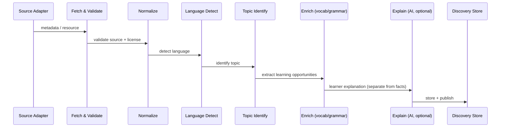

# 07 — Discovery Platform

> Contracts in `engine/ai/discovery.py`; implemented manager/pipeline in `engine/ai/discovery_manager.py`; adapters in `engine/ai/discovery_adapters.py`.

## 0. Implementation status (Phase 6)

| Source | Adapter | Status |
| :--- | :--- | :--- |
| Tatoeba | `TatoebaDiscoveryAdapter` | Implemented (wraps `engine.sources`) |
| Wiktionary | `WiktionaryDiscoveryAdapter` | Implemented (wraps `engine.sources`) |
| Wikipedia | `WikipediaDiscoveryAdapter` | Implemented (wraps `engine.sources`) |
| Wikidata | `WikidataDiscoveryAdapter` | Implemented (HTTP, injectable) |
| Open Library | `OpenLibraryDiscoveryAdapter` | Implemented (HTTP, injectable) |
| Frequency lists | `FrequencyListAdapter` | Implemented (local, attributed) |
| Curated RSS | `RssDiscoveryAdapter` | Implemented (XML parse, admin feeds) |

`DiscoveryManager` aggregates sources with per-source isolation (one failure never blocks the batch), deduplicates by `(source_id, id)`, and rejects items missing license/attribution. Facts and generated explanations are kept separate.

## 1. Architecture

## 2. Source adapter interface

`DiscoverySourceAdapter` — `source_id`, `supported_resource_types`, `supported_languages`, `license`, `search(query, lang, limit)`, `fetch(id)`, `health_check()`.

Compose the existing `engine.sources.BaseSourceAdapter` (rate limiting, retries, cache, offline fallback).

## 3. External resources

| Source | Use | License/attribution |
| :--- | :--- | :--- |
| Tatoeba | real example sentences + translations | CC BY 2.0 FR; attribution |
| Wiktionary | definitions, POS, IPA, etymology | CC BY-SA; attribution |
| Wikipedia/Wikimedia | cultural/historical topics | CC BY-SA; language editions |
| Wikidata | structured places/people/events | CC0 |
| Open Library | books/authors bibliographic data | per Open Library guidelines |
| Frequency lists | common vocabulary prioritization | dataset-specific license |
| Curated RSS feeds | article metadata (title/desc/date/canonical URL) | publisher terms + robots |
| LibreTranslate | translation fallback | self-host preferred; cache |

## 4. Rules

- Facts vs. explanation separation: `DiscoveryResource.facts` (provenance) vs `DiscoveryResource.explanation` (generated/curated). Never present a generated explanation as a source quote/fact.
- Factual claims require references; AI references are not treated as verified.
- Do not copy full copyrighted articles/books; prefer links + short summaries + separate learning explanation.
- Public-domain material requires jurisdiction + source verification.
- Attribution/license metadata is mandatory (`SourceProvenance`).
- A failing source must not block the whole Discovery batch (per-source isolation).

## 5. Processing pipeline

Source discovery → fetch metadata → validate source/license → normalize → detect language → identify topic → extract learning opportunities → enrich vocabulary/grammar → optional learner explanation → validate → store metadata + normalized content → publish.

## 6. Discovery experience

Sections: Featured, Explore by language, Culture & places, Articles & reading, Books & authors, Expressions & idioms, Vocabulary discoveries, Real-world sentences, Topic collections, Recently added.

Filters: target language, explanation language, CEFR (where applicable), category, topic, source, date.

UI language controls labels only; target language controls learning content; explanation language controls translations/explanations. Reuse the existing design system; responsive and accessible.
