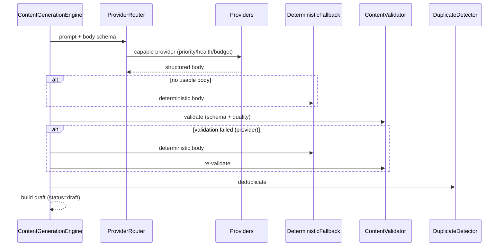

# 08 — Content Generation Workflow

> Implemented engine: `engine/ai/generation.py` + `prompts.py`, `validation.py`, `enrichment.py`, `dedupe.py`, `fallback.py`.

## 1. End-to-end sequence

## 2. Steps

1. **Prompt assembly** — `build_prompt` combines a versioned system prompt with language/CEFR/topic context. Models are asked for *only* the type-specific body; the engine injects authoritative `target_language`/`explanation_language`/`cefr_level`.
2. **Provider generation** — `ContentGenerationEngine` calls `router.generate_with_fallback` with a minimal body JSON Schema.
3. **Deterministic fallback** — if no provider yields a usable body (not configured, all failed, or invalid), `DeterministicContentFallback` produces valid, original content for the type.
4. **Enrichment** — deterministic metadata (`estimated_read_minutes`, `tags`, `provenance`).
5. **Validation** — `ContentValidator` checks required meta + type fields, language/CEFR bounds, and type-specific quality rules (poetry copyright, cultural-article sources).
6. **Deduplication** — `DuplicateDetector` blocks exact/body-signature duplicates.
7. **Draft storage** — returns a `ContentDraft` with `status="draft"` (never auto-published).

## 3. Review & publication (Admin, later phases)

Draft → `review_required` → Admin approve → `content_versions` immutable published version → shared content API. Rejected/regenerated drafts remain drafts and are never shown to learners.

## 4. Versioning

Published content is immutable. A new revision creates a new `content_versions` row; learners continue the version they started (existing Phase 2 `content_items`/`content_versions` model).

## 5. Failure handling

- Provider failures are classified (`FailureCategory`) and fall back deterministically.
- If deterministic output cannot be produced for a type (unsupported type), the outcome returns `success=False` with a `SCHEMA_VIOLATION`/`failure` and no content is fabricated.
