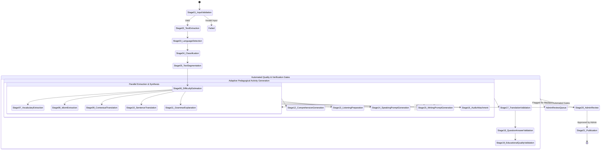

# Lexilume — 21-Stage Content Processing Pipeline Specification

> **Architectural Standard:** Every stage is an isolated, idempotent, typed step with explicit input/output contracts, persistent stage state, automated retry policy, and independent failure isolation. A failure in audio synthesis must NEVER invalidate completed translation or vocabulary work.

---

## 1. Pipeline State Machine & Execution Flow



---

## 2. Specification of the 21 Processing Stages

| Stage # | Stage Name | Typed Input | Typed Output | Failure Handling & Retry Policy | Idempotency Key |
| :---: | :--- | :--- | :--- | :--- | :--- |
| **01** | `InputValidation` | Raw input payload (file buffer or string, format, declared source) | Cleaned input descriptor, verified MIME type, byte length | Immediate fail if corrupt or unsupported; no retry | `hash(raw_input)` |
| **02** | `TextExtraction` | File buffer or raw text | Plain text string, clean line breaks, preserved whitespace | Exponential retry (max 2); fallback to raw text if OCR fails | `hash(input + version)` |
| **03** | `LanguageDetection` | Extracted text | Primary language (`en`), confidence score, detected variety | Fallback to `en-US` if confidence < 0.85 | `hash(text_sample)` |
| **04** | `Classification` | Extracted text, metadata | Genre classification (`workplace`, `news`, `dialogue`, etc.), topic tags | Fallback to `general_english` | `hash(text + genre)` |
| **05** | `TextSegmentation` | Clean text | Ordered paragraphs and sentence arrays with character indices | Deterministic rule-based regex segmentation (zero network calls) | `hash(clean_text)` |
| **06** | `DifficultyEstimation` | Tokenized text, sentence lengths | CEFR tier (`A1`–`C1`), FKGL readability score, lexical diversity | Deterministic heuristic calculation based on word frequency lists | `hash(token_list)` |
| **07** | `VocabularyExtraction` | Token list, CEFR tier | Top 10–15 salient lexical lemmas, POS, frequency rank, IPA | Cascades from MiniSearch index to offline Wiktionary dictionary | `hash(tokens + level)` |
| **08** | `IdiomExtraction` | Sentence array | Identified multi-word expressions, phrasal verbs, idioms | Rule-based idiom dictionary matching | `hash(sentences)` |
| **09** | `ContextualTranslation` | Extracted lemmas with surrounding sentence context | Contextual definitions and translations into PT and ES | Local trilingual dictionary cascade with optional Gemini fallback | `hash(lemma + context)` |
| **10** | `SentenceTranslation` | Sentence array | Aligned sentence translation map (`pt`, `es`) | MyMemory API with rate limit; cascades to offline translation | `hash(sentence_ids)` |
| **11** | `GrammarExplanation` | Sentence array, CEFR tier | 2–3 salient grammar patterns, syntactic formulas, notes | Template-based grammar rule catalog matching | `hash(grammar_rules)` |
| **12** | `ComprehensionGen` | Full passage, paragraph array | 3–5 multiple-choice questions, distractor rationales | Template-driven question generator with deterministic fallbacks | `hash(passage + q_ver)` |
| **13** | `ListeningPrep` | Sentence array, audio source | Time-aligned sentence transcript markers | Deterministic punctuation time estimator if audio present | `hash(audio + text)` |
| **14** | `SpeakingPromptGen` | Topic, genre, key terms | Speaking discussion prompt, model response, target expressions | Pre-curated genre templates | `hash(topic + genre)` |
| **15** | `WritingPromptGen` | Topic, genre | Writing task instructions, word count target, evaluation rubric | Pre-curated genre templates | `hash(topic + genre)` |
| **16** | `AudioAttachment` | Sentence array, speech preferences | Media URL (Tatoeba MP3, uploaded audio, or Web Speech synth) | Failure isolates to this stage; does not block other stages | `hash(text + voice)` |
| **17** | `TranslationQuality` | Translated text, original sentences | Length-ratio validation, untranslated token check, score | Automatic retry with fallback if ratio abnormal (>2.5x or <0.4x) | `hash(translations)` |
| **18** | `Q&AValidation` | Questions, options, correct indices | Answer distinctness verification, distractor quality check | Flags ambiguous questions for admin review | `hash(qa_data)` |
| **19** | `EducationalQuality` | Full assembled content package | Completeness score, missing-component audit | Flags package if essential items missing | `hash(package_data)` |
| **20** | `AdminReview` | Assembled package + quality report | Admin approval signature, edit overrides, stage re-run commands | Pauses pipeline until admin approves or policy permits auto-pub | `hash(admin_id + date)` |
| **21** | `Publication` | Approved content package | Written to `daily_published_content`, indexed in search | Atomically committed via database transaction; distributed | `hash(pkg_id + ver)` |

---

## 3. Stage Storage & Failure Resilience Architecture

Every stage execution is tracked in the `admin_background_jobs` and `content_review_items` database tables with this JSON structure:

```typescript
export interface PipelineStageExecutionRecord {
  stage_number: number;
  stage_name: string;
  status: 'pending' | 'in_progress' | 'completed' | 'failed' | 'skipped';
  started_at: string;
  completed_at?: string;
  duration_ms?: number;
  retry_count: number;
  max_retries: number;
  error_message?: string;
  input_digest: string; // SHA-256 hash of stage inputs for idempotency
  output_payload?: unknown;
}
```

### Key Resilience Invariants:
1. **Zero Cascade Failure:** If Stage 16 (Audio) fails due to a network timeout or missing voice asset, Stages 7–15 remain 100% valid and saved.
2. **Stage-Level Reprocessing:** The admin can re-run *only* Stage 12 (Comprehension Questions) with a different difficulty target without re-extracting vocabulary or re-translating sentences.
3. **Draft Preservation:** Even if a processing run encounters an unrecoverable parser error, the raw source text is preserved in Supabase drafts.
