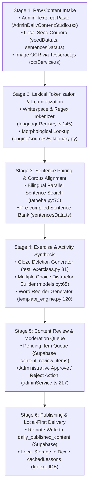

# Lexilume — Current Content-Processing Pipeline

> **Repository:** `VINODH0101/language-learning` (Lexilume — Illuminate Your Words)  
> **Production Application:** `https://lexi.monster`  
> **Phase:** Phase 3 — Current-State Architecture Modeling  
> **Status:** 100% Verified against Codebase Implementation  
> **Critical Separation:** Distinguishes the **implemented 6-stage pipeline** from the **documented 21-stage specification**.

---

## 1. Executive Summary

Lexilume's content pipeline is responsible for transforming raw educational texts, vocabulary lemmas, and linguistic rules into interactive, graded learning lessons. 

A rigorous code audit of `frontend/src/services/lessonGenerator.ts`, `engine/generators/template_engine.py`, `AdminDailyContentStudio.tsx`, and `adminService.ts` revealed that:
1. **The Current Working Pipeline Consists of 6 Stages:** The real-world production system implements 6 sequential processing stages from text intake to delivery.
2. **The Documented 21-Stage Pipeline is a Specification:** Historical documentation described a 21-stage autonomous multi-agent pipeline with audio phoneme alignment, deep syntax tree extraction, and dynamic CEFR adaptation. That design represents an unbuilt aspirational roadmap.
3. **Deterministic Foundation:** In compliance with the Zero-Paid AI mandate, the pipeline synthesizes lessons deterministically using local templates and open CC-licensed datasets (Tatoeba, Wiktionary).

---

## 2. Actual Implemented 6-Stage Pipeline

---

## 3. Stage-by-Stage Implementation Details

### Stage 1: Content Ingestion & Intake
- **Implementation:** `frontend/src/features/admin/AdminDailyContentStudio.tsx:55` and `frontend/src/services/ocrService.ts:106`.
- **Supported Formats Verified in Code:**
  1. *Direct Plain Text Paste:* Form input fields for Poem Excerpt, Full Text, and Conversation Scenario.
  2. *Plain Text File (.txt):* Client-side `FileReader` reading UTF-8 plain text files.
  3. *Image OCR:* Client-side image upload processed via dynamic `import('tesseract.js')` in `ocrService.ts`.
- **Unsupported / Specification-Only Formats:** PDF documents, Word `.docx`, EPUB ebooks, Subtitle `.srt`, Podcast audio streams, and YouTube video URLs. There are no parsers or extraction utilities for these formats.

### Stage 2: Lexical Tokenization & Lemmatization
- **Implementation:** `frontend/src/config/languages/languageRegistry.ts:145` and `engine/sources/wiktionary.py:78`.
- **Processing Logic:**
  - Tokenizes raw text into individual words using unicode-aware regex `/\p{L}+/gu`.
  - For each extracted lemma, queries Wiktionary REST API or cached JSON fixture (`engine/data/*_vocabulary.json`) to retrieve part of speech, IPA pronunciation, and definition.
- **Limitations:** Does not perform probabilistic Part-of-Speech (POS) tagging or dependency parsing; multi-word idioms and polysemous words are looked up as literal isolated tokens.

### Stage 3: Sentence Pairing & Bilingual Alignment
- **Implementation:** `engine/sources/tatoeba.py:70` and `frontend/src/data/sentencesData.ts`.
- **Processing Logic:**
  - Queries Tatoeba search API for parallel sentences containing target vocabulary terms in the target learning language with matching English/Portuguese translations.
  - In offline mode, looks up pre-compiled Tatoeba sentence bank in `sentencesData.ts`.
- **Attribution:** Enforces Tatoeba CC-BY 2.0 FR licensing metadata on every sentence pair.

### Stage 4: Exercise & Activity Synthesis
- **Implementation:** `engine/generators/template_engine.py` and `frontend/src/services/lessonGenerator.ts`.
- **Generated Activity Types:**
  1. *Cloze Deletions:* Extracts target vocabulary lemma from Tatoeba sentence; replaces it with `____`; synthesizes distractors from same-CEFR-level vocabulary.
  2. *Multiple Choice Questions:* Synthesizes question stem, correct answer, and 3 pedagogical distractors with specific feedback explanations (`test_checker_distractor_pedagogical_feedback`).
  3. *Word Reordering:* Shuffles word order of target sentence; validates sequential learner reconstructions.
  4. *False Friend Warnings:* Scans sentence against `engine/data/false_friends.json`; injects warning cards if deceptive cognates are detected.

### Stage 5: Content Review & Moderation
- **Implementation:** `frontend/src/services/adminService.ts:217` and Supabase table `content_review_items`.
- **Processing Logic:**
  - Ingested or synthesized content packages are assigned status `pending`.
  - Administrator inspects item in Admin Workbench (`#admin` -> Content Review tab).
  - Approving item updates status to `approved`, creates published row in `daily_published_content`, and logs action to `admin_audit_logs`.
  - Rejecting item marks status as `rejected` with an optional reviewer note.

### Stage 6: Publishing & Delivery
- **Implementation:** `frontend/src/services/dailyContentService.ts:462` and `engine/storage/supabase_repository.py:268`.
- **Processing Logic:**
  - Writes lesson payload to Supabase PostgreSQL table `daily_published_content` (and legacy `daily_lessons`).
  - Frontend client fetches published content and caches it into Dexie IndexedDB table `cachedLessons` with a 14-day expiry timestamp (`expires_at`).

---

## 4. Gap Analysis: Implemented 6 Stages vs Documented 21 Stages

The historical document `docs/architecture/CONTENT_PIPELINE.md` described a **21-stage multi-agent pipeline**. The table below establishes the reality:

| Documented Pipeline Stage | Implemented in Code? | Reality in Current Codebase | Target Architecture Status |
| :--- | :--- | :--- | :--- |
| 1. Multi-Format Intake | **Partially** | Only plain text paste and Tesseract OCR exist. PDF/EPUB/DOCX missing. | **Implement in Phase 5** |
| 2. License & Rights Check | **Yes** | `licenses_and_sources` table and Tatoeba CC-BY tracking verified. | **Retain directly** |
| 3. Text Normalization | **Yes** | Unicode NFC normalization in `engine/sources/base.py:45`. | **Retain directly** |
| 4. Content Classification | **Partially** | Basic CEFR dropdown exists; no automated genre or topic classification. | **Redesign in Phase 4** |
| 5. Tokenization & Segmentation | **Yes** | Basic regex sentence & word splitting in `languageRegistry.ts`. | **Upgrade in Phase 5** |
| 6. Morphosyntactic Tagging | **No** | No deep POS tagger or dependency syntax tree generator. | **Evaluate in Phase 4** |
| 7. Vocabulary Profiling | **Yes** | CEFR level matching against `seedData.ts` vocabulary banks. | **Retain with modification** |
| 8. Phonetic & Audio Synthesis | **Partially** | Native browser Web Speech API TTS only; no audio alignment or phoneme timestamps. | **Upgrade in Phase 5** |
| 9. Bilingual Alignment | **Partially** | Tatoeba static sentence pairs only; no dynamic text alignment. | **Upgrade in Phase 5** |
| 10. Contextual Disambiguation | **No** | Literal dictionary lookups; no polysemy context analyzer. | **Design in Phase 4** |
| 11. Multi-Agent Pedagogical Refactoring | **No** | Rule-based procedural templates only; no autonomous agents. | **Specification only** |
| 12. Multi-Level CEFR Rewriting | **No** | Lessons are authored for fixed CEFR levels; no automated text simplifier. | **Specification only** |
| 13. Grammar Extraction | **Partially** | Static rule matching against pre-authored grammar rules. | **Retain with modification** |
| 14. Activity Generation | **Yes** | Deterministic cloze, multiple choice, and reorder generation working. | **Retain & expand** |
| 15. Dialogue Turn Generation | **Yes** | Conversation line builder in `AdminDailyContentStudio.tsx`. | **Retain directly** |
| 16. Reading Comprehension Engine | **Yes** | Graded passages rendered in `ReadingSection.tsx`. | **Retain directly** |
| 17. Multi-Modal Audio Alignment | **No** | No audio file upload or forced alignment tooling. | **Defer to Phase 6** |
| 18. Fact & Consistency Verification | **Partially** | Admin manual review queue in `AdminWorkbench.tsx`. | **Retain directly** |
| 19. Quality Scoring & Moderation | **Yes** | Content review queue in `content_review_items`. | **Retain directly** |
| 20. Content Package Bundling | **Yes** | Packaging into `DailyLessonPayload` and `daily_published_content`. | **Retain directly** |
| 21. Multi-Channel Distribution | **Yes** | PostgREST publishing, Dexie caching, and daily Resend email dispatch. | **Retain directly** |

---

## 5. External API Dependencies & Fallbacks in the Pipeline

| Pipeline Stage | External Provider | Endpoint / Protocol | Failure Mode / Fallback |
| :--- | :--- | :--- | :--- |
| **Tokenization / Lemmas** | Wiktionary API | HTTPS GET `https://{lang}.wiktionary.org/w/api.php` | Falls back to local pre-compiled JSON fixture `engine/data/*_vocabulary.json`. |
| **Sentence Pairing** | Tatoeba Project | HTTPS GET `https://tatoeba.org/en/api_v0/search` | Falls back to pre-compiled sentence bank in `frontend/src/data/sentencesData.ts`. |
| **Cultural Context** | Wikipedia REST API | HTTPS GET `https://{lang}.wikipedia.org/api/rest_v1/page/summary/{title}` | Falls back to static curated articles in `seedData.ts`. |
| **Email Delivery** | Resend API / SMTP | HTTPS POST / TLS SMTP | Falls back to logging MIME email to console in dry-run mode. |
| **AI Generation (Optional)**| Google Gemini | HTTPS POST `generativelanguage.googleapis.com` | If key absent or rate-limited: calls `getDeterministicFallback()` offline. |
