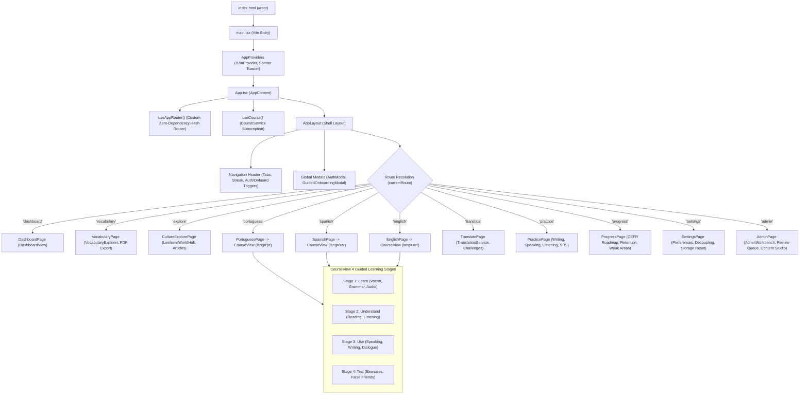
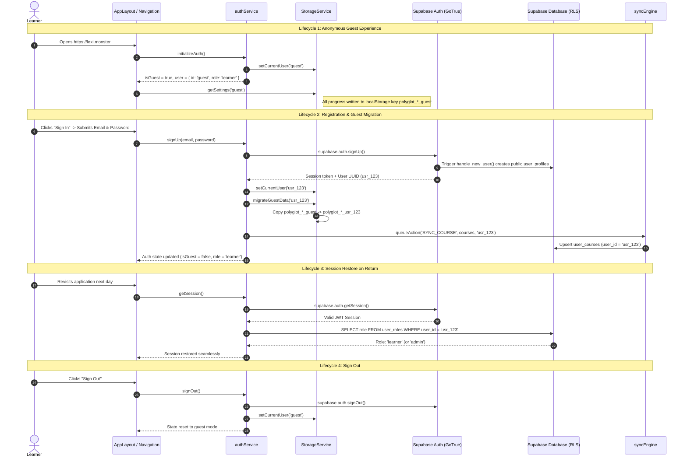
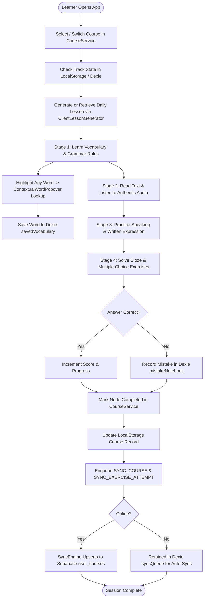
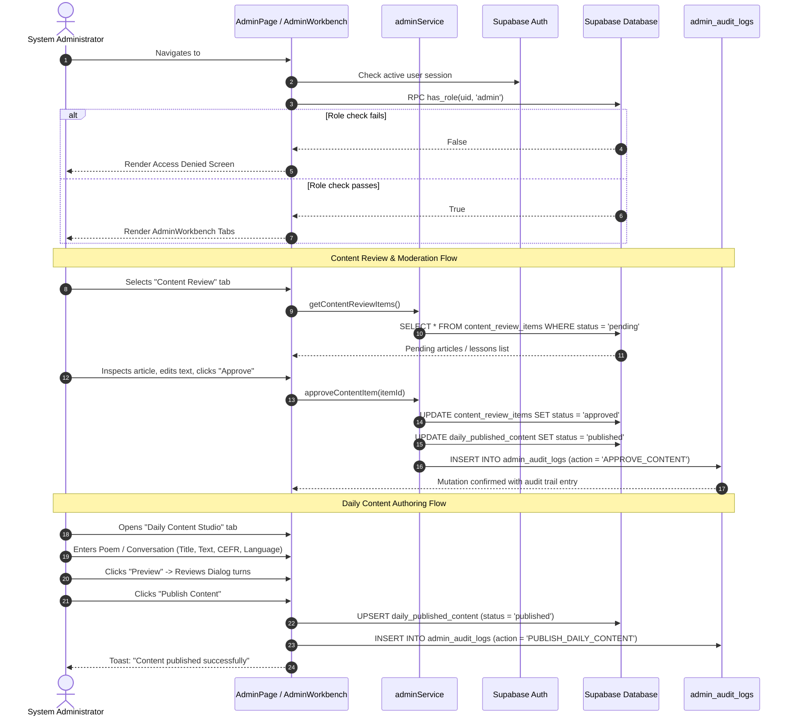
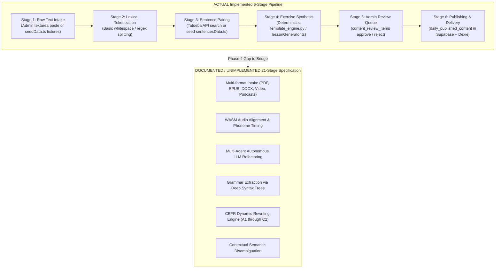
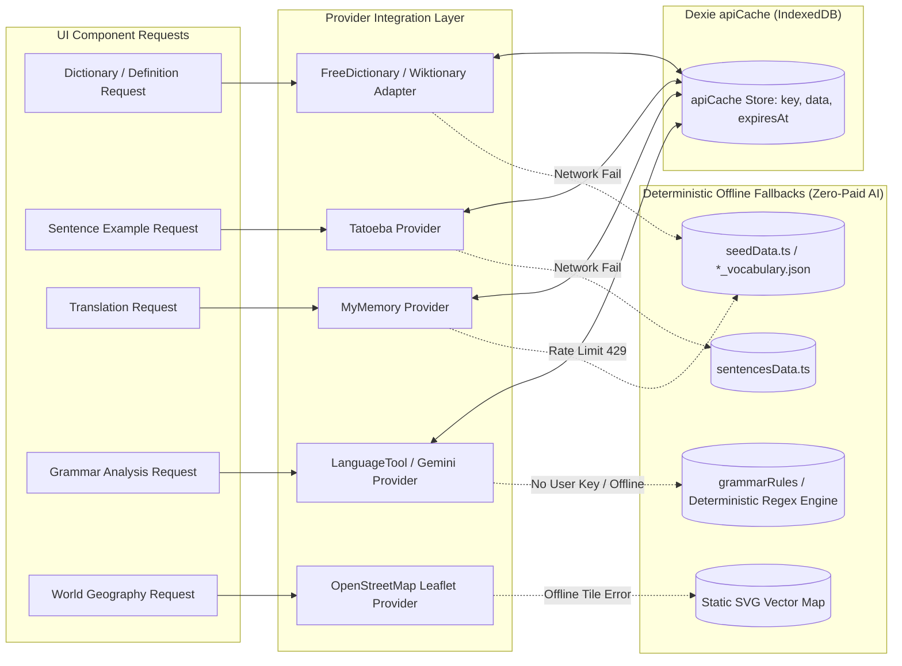

# Lexilume — Current-State Architecture Diagrams

> **Repository:** `VINODH0101/language-learning` (Lexilume — Illuminate Your Words)  
> **Production Application:** `https://lexi.monster`  
> **Phase:** Phase 3 — Current-State Architecture Modeling  
> **Status:** 100% Verified against Codebase Implementation and Production Configurations

---

## 1. Executive Overview

This document consolidates the **10 mandatory system architecture diagrams** for Lexilume as it operates today. In strict adherence to the Phase 3 ground truth principles:
- All diagrams represent **implemented and verified functionality**.
- Unverified, optional, or fallback paths are explicitly labeled.
- Planned future-state capabilities are isolated from the current-state baseline.

---

## 2. Diagram 1 — System Context

```mermaid
flowchart TB
    subgraph Users ["Actors & Users"]
        Learner["Learner / Authenticated User"]
        Guest["Anonymous Guest Learner"]
        Admin["Administrator / Content Editor"]
    end

    subgraph ClientDevice ["Client Device (Browser Runtime)"]
        BrowserApp["React 19 SPA (Vite)"]
        subgraph ClientStorage ["Local Browser Storage Tier"]
            LocalStorage["Scoped LocalStorage<br/>(UserSettings, Course State)"]
            DexieDB["IndexedDB (PolyglotLocalDatabase v4)<br/>(8 Entity Stores, apiCache)"]
            SyncQueue["Dexie syncQueue Store<br/>(Offline Mutations)"]
        end
    end

    subgraph Hosting ["Production Hosting"]
        StaticCDN["Static Web Host (Vercel / Cloudflare)<br/>Domain: lexi.monster"]
    end

    subgraph BackendCloud ["Cloud Backend Layer (Supabase)"]
        SupaAuth["Supabase Auth Service<br/>(JWT Sessions)"]
        PostgresDB[("Supabase PostgreSQL Database<br/>(26 Active Tables with RLS)")]
    end

    subgraph AutomationHost ["Scheduled Execution (GitHub Actions)"]
        GHActions["GitHub Actions Runner<br/>(daily_polyglot.yml @ 04:00 UTC)"]
        PythonEngine["Python 3.12 Processing Engine<br/>(run_daily_batch.py)"]
    end

    subgraph ExternalServices ["External API Providers (Free / Open / Zero-Paid)"]
        Wiktionary["Wiktionary API (Definitions/IPA)"]
        Tatoeba["Tatoeba Project (Bilingual Sentences)"]
        Wikipedia["Wikipedia REST API (Culture/Reading)"]
        MyMemory["MyMemory Translation API"]
        LeafletTiles["OpenStreetMap Tile Servers"]
        OpenMeteo["Open-Meteo Weather API"]
        EmailService["Email Dispatch (Resend / SMTP)"]
        GeminiOptional["Google Gemini API<br/>(Optional: User-Provided Key Only)"]
    end

    %% Interactions
    Learner -->|Interactive UI| BrowserApp
    Guest -->|Offline Learning| BrowserApp
    Admin -->|Content Workbench| BrowserApp

    BrowserApp -->|HTTP Fetch Assets| StaticCDN
    BrowserApp <-->|Sync Read/Write| LocalStorage
    BrowserApp <-->|Async Entity Storage| DexieDB
    BrowserApp -->|Enqueue Mutations| SyncQueue

    BrowserApp <-->|REST PostgREST / RLS| PostgresDB
    BrowserApp <-->|Auth Tokens / Refresh| SupaAuth

    SyncQueue -->|Online Automatic Flush| PostgresDB

    BrowserApp -.->|Cached HTTP GET| Wiktionary
    BrowserApp -.->|Cached HTTP GET| Tatoeba
    BrowserApp -.->|Cached HTTP GET| Wikipedia
    BrowserApp -.->|Rate-Limited GET| MyMemory
    BrowserApp -.->|Raster PNG Tiles| LeafletTiles
    BrowserApp -.->|Cached Weather| OpenMeteo
    BrowserApp -.->|User Key Only / Fallback| GeminiOptional

    GHActions -->|Daily Scheduled Cron| PythonEngine
    PythonEngine -->|Admin Service Role Key| PostgresDB
    PythonEngine -.->|Harvest Parallel Data| Tatoeba
    PythonEngine -.->|Harvest Morphology| Wiktionary
    PythonEngine -.->|Send Daily Lessons| EmailService
```



---

## 3. Diagram 2 — Frontend Component & Route Architecture



---

## 4. Diagram 3 — Authentication & User Lifecycle



---

## 5. Diagram 4 — Learner Session & Study Loop



---

## 6. Diagram 5 — Administrator Operational Workflow



---

## 7. Diagram 6 — Current Database Entity-Relationship Model (26 Tables)

```mermaid
erDiagram
    auth_users ||--o{ user_profiles : "owns"
    auth_users ||--o{ user_roles : "assigned"
    auth_users ||--o{ admin_audit_logs : "creates"
    auth_users ||--o{ user_courses : "maintains"
    auth_users ||--o{ user_learning_tracks : "tracks (legacy)"
    auth_users ||--o{ srs_items : "schedules"
    auth_users ||--o{ saved_translations : "saves"
    auth_users ||--o{ exercise_attempts : "submits"
    auth_users ||--o{ cultural_bookmarks : "bookmarks"
    auth_users ||--o{ learning_activity_events : "logs"
    auth_users ||--o{ email_deliveries : "receives"

    language_tracks ||--o{ curriculum_nodes : "structures"
    language_tracks ||--o{ curated_materials : "contains"
    language_tracks ||--o{ daily_lessons : "groups (legacy)"

    curriculum_nodes ||--o{ vocabulary_items : "teaches"
    curriculum_nodes ||--o{ grammar_rules : "explains"
    curriculum_nodes ||--o{ exercise_templates : "synthesizes"

    daily_published_content ||--o{ content_review_items : "moderates"
    daily_lessons ||--o{ lesson_exercises : "links"

    user_profiles {
        uuid id PK
        uuid auth_user_id FK
        string full_name
        string native_language
        string primary_target_language
        int streak_count
        int xp_points
    }

    user_roles {
        uuid id PK
        uuid user_id FK
        string role
        timestamp granted_at
    }

    user_courses {
        uuid id PK
        uuid user_id FK
        string target_language
        string regional_variant
        string cefr_level
        string explanation_language
        int streak_days
        int total_lessons_completed
        boolean is_active
    }

    srs_items {
        uuid id PK
        uuid user_id FK
        string vocabulary_item_id
        string language
        float ease_factor
        int interval_days
        int repetition_count
        timestamp next_review_date
    }

    saved_translations {
        uuid id PK
        uuid user_id FK
        string source_text
        string translated_text
        string source_lang
        string target_lang
    }

    exercise_attempts {
        uuid id PK
        uuid user_id FK
        string exercise_id
        string submitted_answer
        boolean is_correct
        timestamp created_at
    }

    daily_published_content {
        uuid id PK
        date publish_date
        string learning_language
        string cefr_level
        string title
        jsonb payload
        string status
    }
```



---

## 8. Diagram 7 — Three-Tier Persistence & Synchronization Flow

```mermaid
flowchart TD
    subgraph Tier1 ["Tier 1: Scoped LocalStorage (Synchronous)"]
        LS_Settings["polyglot_settings_{uid}"]
        LS_Courses["polyglot_courses_{uid}"]
        LS_Active["polyglot_active_course_{uid}"]
        LS_Tracks["polyglot_track_{lang}_{uid}"]
        LS_SRS["polyglot_srs_items_{uid}"]
    end

    subgraph Tier2 ["Tier 2: Dexie IndexedDB v4 (Asynchronous Structured)"]
        D_Cached["cachedLessons"]
        D_Progress["activeLessonProgress"]
        D_Vocab["savedVocabulary"]
        D_Reviews["srsReviews (SM-2)"]
        D_Mistakes["mistakeNotebook"]
        D_Bookmarks["culturalBookmarks"]
        D_ApiCache["apiCache (TTL Eviction)"]
        D_SyncQueue["syncQueue (pending / failed)"]
    end

    subgraph Tier3 ["Tier 3: Supabase Cloud PostgreSQL (Remote Truth)"]
        S_Profiles["user_profiles"]
        S_Courses["user_courses"]
        S_SRS["srs_items"]
        S_Trans["saved_translations"]
        S_Attempts["exercise_attempts"]
        S_Content["daily_published_content"]
        S_Events["learning_activity_events"]
    end

    UIAction[User Completes Learning Action] --> WriteLS[Write to Scoped LocalStorage]
    UIAction --> WriteDexie[Write to Dexie Store]
    WriteDexie --> Enqueue[Enqueue mutation into Dexie syncQueue]

    Enqueue --> CheckNet{Online & Authenticated?}
    CheckNet -- Offline or Guest --> RetainQueue[Retained in syncQueue with Exponential Backoff]
    CheckNet -- Online & Authenticated --> SyncEngine[syncEngine.syncNow()]

    SyncEngine --> PostgRESTUpsert[Execute Supabase Idempotent Upsert]
    PostgRESTUpsert -- HTTP 200/201 --> Dequeue[Delete record from syncQueue]
    PostgRESTUpsert -- Failure / 4xx / 5xx --> Backoff[Increment retry_count with Jitter Guard]
    Backoff --> RetainQueue
```

---

## 9. Diagram 8 — Implemented Content-Processing Pipeline (Actual vs Documented)



---

## 10. Diagram 9 — External Integration & Fallback Cascade



---

## 11. Diagram 10 — Production Deployment & Operational Architecture

```mermaid
flowchart TB
    subgraph PublicDomain ["Public Production Domain: https://lexi.monster"]
        DNS[DNS Route 53 / Cloudflare CDN]
    end

    subgraph FrontendHosting ["Edge Static Hosting (Vercel / Cloudflare Pages)"]
        StaticAssets["Vite Production Bundle<br/>(dist/index.html, dist/assets/*.js, *.css)"]
        SPA_Rewrite["200.html / SPA Routing Fallback"]
    end

    subgraph CloudDatabase ["Managed Database Cloud (Supabase Managed Service)"]
        SupabasePostgres[("Supabase PostgreSQL Cluster<br/>(PostgREST REST API, Realtime, Auth Engine)")]
    end

    subgraph GitHubAutomation ["Automated CI/CD & Batch Runners (GitHub)"]
        RepoOrigin["GitHub Repository: VINODH0101/language-learning (main)"]
        CI_Workflow["CI Workflow: Run Vitest, Vite Build & Pytest on Push"]
        Cron_Workflow["Cron Workflow: daily_polyglot.yml (Daily @ 04:00 UTC)"]
        RunnerVM["Ubuntu-Latest GitHub Actions VM"]
        DailyBatchScript["python scripts/run_daily_batch.py"]
    end

    subgraph ExternalDelivery ["Transactional Email Dispatch"]
        ResendAPI["Resend Email API / SMTP Mailer"]
    end

    DNS --> StaticAssets
    StaticAssets --> SPA_Rewrite
    SPA_Rewrite -->|Client-side HTTPS REST| SupabasePostgres

    RepoOrigin -->|Git Push Event| CI_Workflow
    RepoOrigin -->|Scheduled Schedule Event| Cron_Workflow
    Cron_Workflow --> RunnerVM
    RunnerVM --> DailyBatchScript
    DailyBatchScript -->|HTTPS Write (Service Role Key)| SupabasePostgres
    DailyBatchScript -->|HTTPS POST| ResendAPI
```
