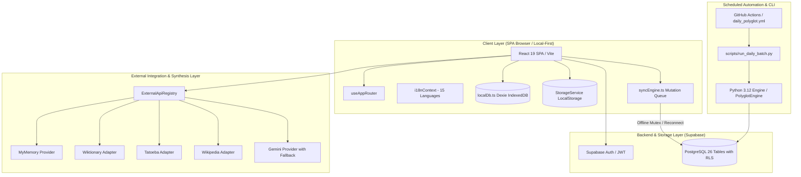

# Lexilume — Current State Architecture & Operational Flows

> **Target Standard:** Document the real architecture based on actual CLI code execution and verified contracts, not an idealized system.

---

## 1. High-Level System Architecture Diagram

---

## 2. Deep Tracing of the 20 Core Execution Flows

### Flow 1: Application Startup
- **Entry Point:** `frontend/src/main.tsx` → `frontend/src/App.tsx`.
- **Components:** `AppProviders`, `I18nProvider`, `AppLayout`, `Navigation`.
- **Services:** `initializeExternalApiRegistry()`, `StorageService.getTrackState('pt')`, `useAppRouter('dashboard')`.
- **Data Contracts:** `UserSettings`, `UserTrackState`.
- **Database Operations:** IndexedDB initialized via `new PolyglotLocalDatabase()`. Checks `localStorage` tenant scoping keys.
- **Error Handling:** Graceful fallback to `guest` partition if storage access fails.
- **Security Boundaries:** Client-side mock admin profile check guarded against invalid URL parameters.
- **Existing Tests:** `frontend/src/tests/navigation.test.tsx`, `App.test.tsx`.
- **Known Weaknesses:** Startup checks ptTrack streak by default rather than active course streak.

### Flow 2: Guest Access and Authenticated Access
- **Entry Point:** `frontend/src/services/auth/authService.ts`.
- **Components:** `AuthModal.tsx`, `UserMenu.tsx`.
- **Services:** `courseService.setUserId()`, `StorageService.setCurrentUser()`.
- **Data Contracts:** `UserProfile`, `UserRole`.
- **Database Operations:** Reads from `polyglot_mock_auth_user` or Supabase session. LocalStorage partitioned with `_guest` or `_usr_<id>`.
- **Security Boundaries:** Account isolation prevents cross-account data leakage on shared devices.
- **Existing Tests:** `frontend/src/tests/auth.test.ts`, `frontend/src/tests/securityAndPersistenceRepairs.test.ts`.

### Flow 3: Sign-In, Sign-Out & Profile Management
- **Entry Point:** `authService.signIn()` / `authService.signOut()`.
- **Services:** `StorageService.migrateGuestData()`, `courseService.migrateGuestCourses()`.
- **Data Contracts:** `user_profiles`, `user_courses`.
- **Database Operations:** Merges guest courses into authenticated partition without duplicate creation.
- **Security Boundaries:** Clear separation between guest credentials and Supabase JWT tokens.
- **Existing Tests:** `frontend/src/tests/auth.test.ts`, `tests/test_auth_and_admin_migrations.py`.

### Flow 4: Admin Authorization and RLS Enforcement
- **Entry Point:** Route `#admin` in `App.tsx` and `AdminPage.tsx`.
- **Components:** `AdminWorkbench.tsx`, `UserManagementModal.tsx`.
- **Services:** `authService.getCurrentUser()`, Supabase `user_roles` query.
- **Data Contracts:** `UserRole` (`admin`, `editor`, `learner`).
- **Database Operations:** Supabase RLS enforces `auth.uid() IN (SELECT user_id FROM user_roles WHERE role = 'admin')`.
- **Security Boundaries:** Server-side database rejection if non-admin queries `admin_audit_logs` or `admin_background_jobs`.
- **Existing Tests:** `frontend/src/tests/adminWorkbenchRedesign.test.tsx`.

### Flow 5: User Preferences & Four-Way Linguistic Decoupling
- **Entry Point:** `frontend/src/lib/languages/languageMatrix.ts` & `i18nContext.tsx`.
- **Decoupled Contracts:**
  - `interface_language`: 15 languages (`en`, `pt`, `es`, `fr`, `de`, `it`, `ja`, etc.).
  - `learning_language`: Target language actively studied (13 base languages; Hindi excluded).
  - `explanation_language`: Pedagogical grammar language (`en`, `pt`, `es`).
  - `regional_variety`: Strictly bound to learning language (`pt-BR`, `pt-PT`, `es-ES`, etc.).
- **Enforcement:** `enforceRegionalVariety(lang, variety)` normalizes invalid variants.
- **Existing Tests:** `frontend/src/tests/languageDecoupling.test.ts`, `tests/test_language_separation.py`.

### Flow 6: Course and Learning State
- **Entry Point:** `courseService.ts` and `useCourse.ts`.
- **Data Contracts:** `Course`, `CourseConfig`, `ActiveLessonProgress`.
- **Persistence:** LocalStorage key `polyglot_courses_<userId>`, IndexedDB `activeLessonProgress`.
- **Database Operations:** Queues `SYNC_COURSE` action via `syncEngine.ts`.
- **Existing Tests:** `frontend/src/tests/course.test.ts`, `frontend/src/tests/uxRedesign.test.tsx`.

### Flow 7: Vocabulary Lookup and Translation
- **Entry Point:** `frontend/src/services/dictionaryService.ts` & `VocabularyExplorer.tsx`.
- **Services:** `MiniSearch` lexical index, `WiktionaryAdapter`, `MyMemoryAdapter`.
- **Data Contracts:** `NormalizedDictionaryEntry`, `VocabularyItem`.
- **Failure Behavior:** If network down, cascades to local trilingual dictionary in `translationData.ts`.
- **Existing Tests:** `frontend/src/tests/providers/providerArchitecture.test.ts`, `frontend/src/tests/vocabulary.test.ts`.

### Flow 8: Contextual Word and Phrase Explanations
- **Entry Point:** `ContextualLookupWrapper.tsx` and `ContextualWordPopover.tsx`.
- **Execution:** User selects or highlights text; popover displays IPA, translation, pedagogical definition, audio button, and "Save to Vocabulary" CTA.
- **Persistence:** Direct write to Dexie `localDb.savedVocabulary`.
- **Existing Tests:** `frontend/src/tests/uxRedesign.test.tsx` (Stage 4).

### Flow 9: Exercise Generation and Answer Checking
- **Entry Point:** `PracticeEngine.ts` and `components/lesson/ExerciseSection.tsx`.
- **Execution:** Validates user input against `acceptable_solutions`, checks distractors for specific feedback, detects accent warnings.
- **Persistence:** Logs attempt to `localDb.exercise_attempts` without marking course complete prematurely.
- **Existing Tests:** `frontend/src/tests/practiceRedesign.test.tsx`, `tests/test_exercises.py`.

### Flow 10: Spaced Repetition (SM-2) Scheduling
- **Entry Point:** `frontend/src/services/srs.ts` and `engine/srs/sm2.py`.
- **Execution:** SuperMemo-2 algorithm computes next interval, repetition count, and ease factor (min 1.3).
- **Persistence:** Dexie `localDb.srsReviews` and Supabase `srs_items`.
- **Existing Tests:** `frontend/src/tests/srs.test.ts`, `tests/test_srs.py`.

### Flows 11–20: System, Storage & Operational Tracing
- **Flow 11 (Reading/Listening/Speaking/Writing):** Handled via specialized lesson sections in `frontend/src/components/lesson/`. Web Speech API synthesized audio with Tatoeba MP3 fallback.
- **Flow 12 (Scheduled Generation):** `scripts/run_daily_batch.py` runs nightly via `.github/workflows/daily_polyglot.yml`, generating lessons and caching them.
- **Flow 13 (Content Review & Publishing):** Admin uses `ContentStudioView.tsx` to inspect generated daily payloads, approval writes to `daily_published_content`.
- **Flow 14 (IndexedDB Writes):** `localDb.ts` (Dexie v4) manages 8 object stores with automated schema upgrades and in-memory fallback.
- **Flow 15 (LocalStorage Writes):** `StorageService.ts` partitions keys using user IDs.
- **Flow 16 (Supabase Reads/Writes):** Handled by `syncEngine.ts` on client side and `supabase_repository.py` on backend.
- **Flow 17 (Sync Queue & Retries):** `syncEngine.ts` maintains a persistent queue in Dexie with exponential backoff retry.
- **Flow 18 (API Calls & Caching):** `CacheManager.ts` and `ApiRateLimiter.ts` protect upstream quotas.
- **Flow 19 (Email & Notification):** `engine/email/composer.py` renders HTML email; dispatched via Resend or SMTP.
- **Flow 20 (Deployment & Recovery):** Static SPA hosted on production domain `https://lexi.monster`, backed by Supabase cloud database with automated backup scripts in `scripts/backup_restore.py`.
