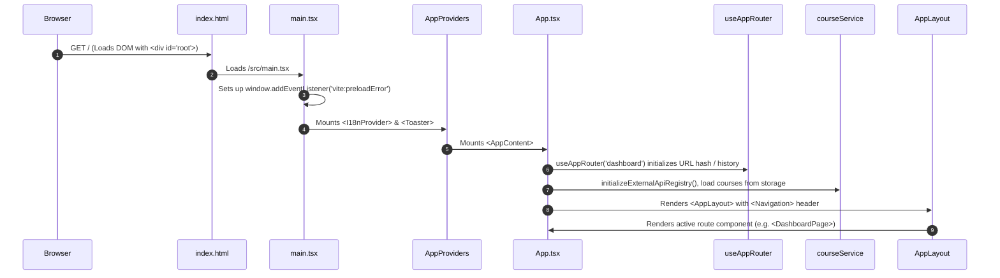
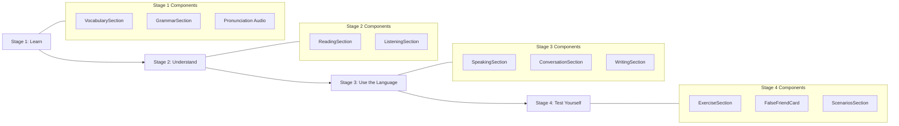
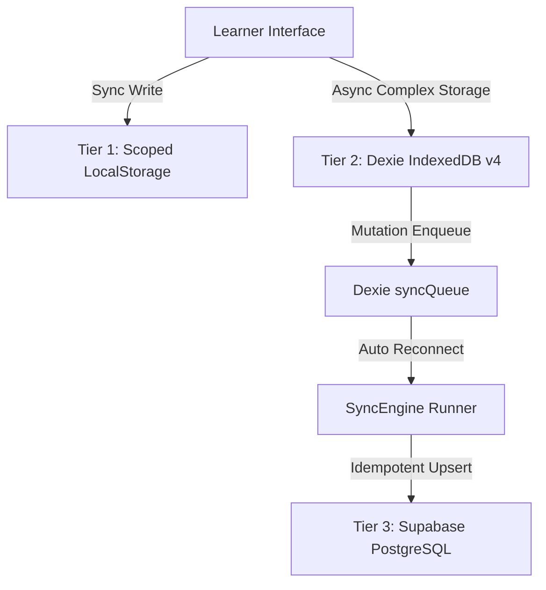

# Lexilume — Current-State Architecture Analysis (Phase 3 Master Specification)

> **Repository:** `VINODH0101/language-learning` (Lexilume — Illuminate Your Words)  
> **Production Application:** `https://lexi.monster`  
> **Phase:** Phase 3 — Current-State Architecture Modeling  
> **Verification Baseline:**  
> - **Frontend Unit Tests (Vitest):** 37 test files passed (310 tests)  
> - **Frontend Production Build (Vite):** 2,775 modules transformed, exit code 0  
> - **Python Engine Tests (Pytest):** 106 passed, 1 skipped (live Gemini test safely disabled)  
> **Critical Architectural Rule:** Strictly maintain three separate perspectives:
> 1. **Current Architecture:** What actually exists and functions in code today.
> 2. **Documented Design:** What historical specifications or ADRs claim.
> 3. **Target Direction:** What Lexilume intends to become in the content-centred model.

---

## 1. Mission & Architectural Scope

The purpose of Phase 3 is to consolidate the repository inventory (Phase 1) and dependency analysis (Phase 2) into an authoritative, technically rigorous architectural baseline. It answers the foundational architectural question:

> **How does the existing Lexilume application actually function today, from application startup through user interaction, business logic execution, data persistence, multi-tier synchronization, background processing, and deployment?**

This document establishes the verified operational reality of the system without introducing new features, refactoring code, altering schemas, or deleting files. It provides the immutable technical foundation for Phase 4 (Target Architecture) and Phase 5 (Data & Migration Plan).

---

## 2. Mandatory Prerequisite Review & Findings

A comprehensive review of all Phase 1 and Phase 2 audit deliverables confirmed the following architectural ground truths:
1. **Repository Footprint:** 818 files across the repository, comprising 313 TypeScript/TSX modules in `frontend/src/`, 54 Python files in `engine/` and `scripts/`, 13 SQL migration files, and 28 npm packages.
2. **Persistence Architecture:** A three-tier hierarchy consisting of:
   - Scoped LocalStorage (27 keys partitioned by UID via `StorageService.getKey()`).
   - IndexedDB via Dexie v4 (`PolyglotLocalDatabase` with 8 entity stores).
   - Remote Cloud PostgreSQL via Supabase (26 active tables with RLS).
3. **Execution Model:** The frontend is a client-side React 19 Single Page Application (SPA) built with Vite and hosted on a static edge CDN (`https://lexi.monster`). **There is no persistent Python HTTP backend server running in production.** The Python engine is an offline processing and automation tool invoked via local CLI scripts or scheduled GitHub Actions workflows (`daily_polyglot.yml` at 04:00 UTC).
4. **Zero-Paid AI Invariant:** No paid LLM APIs or proprietary translation services are required for core operations. While Google Gemini integration exists, it is strictly optional; there is no `VITE_GEMINI_API_KEY` bundled into the client application, and all grammar analysis and lesson generation fall back to deterministic offline rule engines.

---

## 3. Current-State Truth Model

To eliminate confusion between aspirations and working software, every core capability is classified according to the Phase 3 Truth Model:

| Subsystem / Capability | Classification | Actual Implementation Location | Entry Point | Primary Data Store | Status & Verified Limitations |
| :--- | :--- | :--- | :--- | :--- | :--- |
| **Multi-Course Management** | Implemented and verified | `frontend/src/services/courseService.ts` | `courseService.getCourses()` | LocalStorage `polyglot_courses_{uid}`, Supabase `user_courses` | Fully decoupled across 13 languages; partitions state cleanly by UID. |
| **Local Database (Dexie v4)** | Implemented and verified | `frontend/src/services/localDb.ts` | `new PolyglotLocalDatabase()` | IndexedDB `PolyglotLocalDatabase` | 8 entity stores; fallback to in-memory Maps if IndexedDB is blocked. |
| **Offline Sync Engine** | Implemented and verified | `frontend/src/services/syncEngine.ts` | `syncEngine.syncNow()` | Dexie `syncQueue`, Supabase PostgREST | Idempotent upserts with exponential backoff and tenant isolation guard. |
| **Deterministic Lesson Generator** | Implemented and verified | `frontend/src/services/lessonGenerator.ts` | `ClientLessonGenerator.generateOrGetLesson()` | `seedData.ts`, `sentencesData.ts`, Dexie `cachedLessons` | Procedural synthesis from seed JSON; does not parse arbitrary user text. |
| **Spaced Repetition (SM-2)** | Implemented and verified | `frontend/src/services/srs.ts`, `engine/srs/sm2.py` | `calculateSM2()` | Dexie `srsReviews`, Supabase `srs_items` | Full SM-2 algorithm updating interval, repetition count, and ease factor. |
| **Contextual Word Lookup** | Implemented and verified | `frontend/src/components/common/ContextualWordPopover.tsx` | Click / selection on text | Dexie `savedVocabulary`, `SpeechService` | Provides definitions, IPA, speech audio, and one-click Dexie bookmarking. |
| **Speech Audio (TTS)** | Implemented and verified | `frontend/src/services/speech.ts` | `SpeechService.speak()` | Browser `window.speechSynthesis` | Uses native browser speech synthesis voices mapped to language codes. |
| **Study Pack PDF Service** | Implemented and verified | `frontend/src/services/pdfService.ts` | `pdfService.generateStudyPackPdf()` | In-memory `jsPDF` canvas | Generates complete printable PDF study packs offline with zero server roundtrips. |
| **Administrative Workbench** | Implemented and verified | `frontend/src/features/admin/AdminWorkbench.tsx` | Route `#admin` | Supabase `content_review_items`, `admin_audit_logs` | Provides review queue, audit logs, provider health, and daily content studio. |
| **Optional Gemini AI Synthesis** | Implemented and verified | `frontend/src/services/providers/grammar/geminiProvider.ts` | `GeminiProvider.analyze()` | User `localStorage.getItem('lexilume_gemini_api_key')` | Reads user-provided key only; cleanly falls back to deterministic rule engine if absent. |
| **Python Batch Automation** | Implemented and verified | `scripts/run_daily_batch.py`, `engine/` | GitHub Actions cron (`0 4 * * *`) | Supabase `daily_published_content`, Resend API | Runs in GitHub VM; publishes daily lesson payloads and dispatches emails. |
| **Multi-Format Content Ingestion** | Partially implemented | `frontend/src/services/ocrService.ts`, `AdminDailyContentStudio.tsx` | Image upload / Textarea | Memory / LocalStorage | Implemented: Plain text paste and Tesseract.js image OCR. **Unimplemented:** PDF, DOCX, EPUB, Video, Podcast parsers. |
| **Dynamic 21-Stage Pipeline** | Specification only | `docs/architecture/CONTENT_PIPELINE.md` | Documented only | N/A | Documented in Phase 1 specifications; actual implementation consists of 6 sequential stages. |
| **Legacy Route Wrappers** | Legacy | `EnglishPage.tsx`, `PortuguesePage.tsx`, `SpanishPage.tsx` | `/learn/en`, `/learn/pt`, `/learn/es` | N/A | 8-line wrapper components rendering `<CourseView />`; superseded by dynamic routing. |
| **Duplicate Database Tables** | Legacy | `language_tracks` (001), `user_learning_tracks` (010), `daily_lessons` (001) | Direct SQL | Supabase PostgreSQL | Retained for backward compatibility; target model consolidates to `user_courses` and `daily_published_content`. |
| **Orphaned Prototype Views** | Deprecated candidate | `LanguageToolStudio.tsx`, `DiscoverHub.tsx`, `DecoupledLanguageSettings.tsx` | Unrouted | N/A | 15 unrouted prototype components and 32 unused barrel `index.ts` files. |

---

## 4. System Overview & Architectural Context

Lexilume is a **local-first language acquisition platform** that enables learners to master languages through structured curriculum tracks, interactive multimodal practice, contextual vocabulary acquisition, and spaced repetition.

### 4.1 Users & Roles
1. **Anonymous Guest Learner:** Can immediately access learning tracks, take placement diagnostics, solve exercises, practice pronunciation, and save vocabulary offline in browser storage without account creation.
2. **Authenticated Learner:** Retains all guest capabilities with cloud synchronization across devices via Supabase PostgreSQL, retaining streak history, learning telemetry, and SRS review schedules.
3. **Administrator / Content Editor:** Authenticated user with the `admin` role in `public.user_roles`. Has access to the Admin Workbench (`#admin`) to moderate the content review queue, publish daily poetry and conversations, inspect provider latencies, and review immutable audit logs.

### 4.2 Linguistic Scope & Invariants
The system enforces **Four-Way Linguistic Decoupling**:
- `interface_language`: Controls navigation chrome (`en`, `pt`, `es`).
- `learning_language`: The target language actively being acquired (13 authorized languages: `en`, `pt`, `es`, `fr`, `de`, `it`, `ja`, `ko`, `ru`, `nl`, `zh`, `tr`, `ta`).
- `explanation_language`: Pedagogical language for definitions and grammar notes (`en`, `pt`, `es`).
- `regional_variety`: Specific dialect bound strictly to the target language (`pt-BR`, `pt-PT`, `es-ES`, `es-MX`, `en-US`, `en-GB`).
- *Strict Invariant:* Hindi (`hi`) is explicitly excluded from learning language selectors.

### 4.3 Technology Stack
- **Frontend SPA:** React 19, TypeScript 5.8, Vite 8.3, Tailwind CSS v4, Lucide React icons, Sonner toasts.
- **Client Storage:** Dexie v4 (IndexedDB), Scoped LocalStorage, SessionStorage.
- **Client Libraries:** `jsPDF` (study packs), `minisearch` (in-memory vocabulary indexing), `leaflet` (dynamic maps), `tesseract.js` (dynamic OCR).
- **Backend & Cloud:** Supabase Managed Cloud (PostgreSQL 15, PostgREST REST API, GoTrue Auth, Row-Level Security).
- **Automation Engine:** Python 3.12, Pydantic v2, GitHub Actions Workflows.
- **Email Delivery:** Resend API & SMTP / TLS transport.

See [docs/architecture/CURRENT_ARCHITECTURE_DIAGRAMS.md](file:///docs/architecture/CURRENT_ARCHITECTURE_DIAGRAMS.md#2-diagram-1--system-context) for the complete System Context Diagram.

---

## 5. Frontend Architecture

### 5.1 Application Startup Sequence
The exact browser execution trace on initial page load:


### 5.2 Routing Architecture
Lexilume avoids external router dependencies (such as React Router), utilizing a lightweight custom hook: `frontend/src/app/router/useAppRouter.ts`.
- **Navigation Mechanism:** Synchronizes both URL path (`/vocabulary`) and URL hash (`#/vocabulary`) using `window.addEventListener('popstate')` and `window.addEventListener('hashchange')`.
- **Query Parameter Overrides:** Recognizes `?tab=practice`, `?course=en`, and `?admin=true` for headless testing and administrative overrides.
- **Route Registry (`frontend/src/app/router/routes.ts`):**
  - Public routes: `dashboard` (`/`), `vocabulary` (`/vocabulary`), `explore` (`/culture`), `portuguese` (`/learn/pt`), `spanish` (`/learn/es`), `english` (`/learn/en`), `translate` (`/translate`), `practice` (`/practice`), `progress` (`/progress`), `settings` (`/settings`).
  - Protected route: `admin` (`/admin`, requires authenticated session with role `'admin'`).

### 5.3 Module Hierarchy & Boundaries
The frontend codebase enforces a structured directory separation:
- `app/`: Application shell, providers (`AppProviders.tsx`), layouts (`AppLayout.tsx`), and routing (`useAppRouter.ts`).
- `pages/`: Route-level entry views (`DashboardPage.tsx`, `VocabularyPage.tsx`, `PracticePage.tsx`, `AdminPage.tsx`, etc.).
- `features/`: Complex domain features with business logic (`course/CourseView.tsx`, `admin/AdminWorkbench.tsx`, `vocabulary/VocabularyExplorer.tsx`, `world/LexilumeWorldHub.tsx`).
- `components/`: Reusable presentation components (`common/Button.tsx`, `common/Badge.tsx`, `lesson/VocabularySection.tsx`, `lesson/GrammarSection.tsx`).
- `services/`: Singleton domain services (`courseService.ts`, `storage.ts`, `localDb.ts`, `syncEngine.ts`, `srs.ts`, `auth.ts`, `speech.ts`, `pdfService.ts`).
- `integrations/`: Third-party external API adapters (`external-apis/adapters/*`).

### 5.4 State Architecture & Ownership
| State Domain | Canonical State Owner | Persistence Mechanism | Cross-Component Propagation |
| :--- | :--- | :--- | :--- |
| **Authentication & Session** | `frontend/src/services/auth.ts` | Supabase GoTrue Auth token in `localStorage`, `polyglot_mock_auth_user` | Observer listeners via `authService.subscribe()` |
| **Active Course & Syllabus** | `frontend/src/services/courseService.ts` | LocalStorage `polyglot_courses_{uid}`, Supabase `user_courses` | Observer listeners via `courseService.subscribe()` |
| **Lesson Step & Active Work** | `frontend/src/features/course/useCourse.ts` | Dexie `activeLessonProgress` | Local React component state |
| **Spaced Repetition (SM-2)** | `frontend/src/services/srs.ts` | Dexie `srsReviews`, Supabase `srs_items` | Direct async Dexie queries |
| **Mistake Notebook** | `frontend/src/services/localDb.ts` | Dexie `mistakeNotebook` | Direct async Dexie queries |
| **Interface Language** | `frontend/src/i18n/i18nContext.tsx` | LocalStorage `polyglot_interface_lang` | React Context + `window.addEventListener('storage')` (cross-tab) |
| **Sync Queue & Connectivity** | `frontend/src/services/syncEngine.ts` | Dexie `syncQueue` | Observer listeners via `syncEngine.subscribe()` |

---

## 6. Authentication, Authorization & User Lifecycle

### 6.1 Authentication States
1. **Guest Mode (Default):**
   - User identity: `{ id: 'guest', email: '', role: 'learner' }`.
   - All mutations write to `_guest` scoped storage keys and Dexie local stores.
   - Sync engine detects guest mode and operates offline without attempting cloud network calls.
2. **Authenticated Mode:**
   - Backed by Supabase GoTrue JWT.
   - Access tokens stored securely in browser local storage by Supabase SDK.
   - User session automatically hydrated via `supabase.auth.getSession()`.

### 6.2 Guest Data Migration Flow
When an anonymous guest registers or signs in:
1. `authService.signUp()` or `signIn()` acquires a valid user UUID (`usr_123`).
2. `StorageService.setCurrentUser('usr_123')` updates the active storage scope.
3. `StorageService.migrateGuestData('usr_123')` copies all guest progress keys (`polyglot_settings_guest`, `polyglot_courses_guest`, `polyglot_srs_items_guest`) to user-scoped keys (`polyglot_settings_usr_123`).
4. Original guest keys are preserved to ensure zero accidental data loss.
5. `courseService.setUserId('usr_123')` updates the multi-course state.
6. `syncEngine.queueAction('SYNC_COURSE', course, 'usr_123')` queues all courses for cloud upload.
7. Background sync pushes records to Supabase table `user_courses`.

### 6.3 Authorization & Role-Based Access Control (RBAC)
- **Role Model:** Defined in `public.user_roles` with roles: `'learner'`, `'editor'`, `'admin'`.
- **Client Route Guard:** `AdminPage.tsx:32` inspects `authService.getState().user.role`. If not `'admin'`, renders an Access Denied barrier.
- **Database Enforcement (RLS):** Supabase PostgreSQL enforces RLS using the stored procedure `has_role(auth.uid(), 'admin')`. Client-side tampering of local storage cannot bypass database RLS policies.

See [docs/architecture/CURRENT_ARCHITECTURE_DIAGRAMS.md](file:///docs/architecture/CURRENT_ARCHITECTURE_DIAGRAMS.md#4-diagram-3--authentication--user-lifecycle) for the complete Sequence Diagram.

---

## 7. Existing Learning Product Architecture

The core learner experience is orchestrated through **CourseView** (`frontend/src/features/course/CourseView.tsx`), which organizes each lesson into **4 Guided Learning Stages**:



### 7.1 Exhaustive Learning Capability Matrix

| Feature | Entry Point | Core Components | Services & Utilities | Processing Logic | Primary Persistence | Offline Support | Verification Status |
| :--- | :--- | :--- | :--- | :--- | :--- | :--- | :--- |
| **Multi-Course Switcher** | `/courses`, Header dropdown | `CoursesPage.tsx`, `Navigation.tsx` | `courseService.ts` | Sets active course, recalculates active syllabus, updates listeners. | LocalStorage `polyglot_courses_{uid}`, Supabase `user_courses` | 100% Offline | **Verified** |
| **Diagnostic Placement Test** | `/placement-test` | `PlacementTestPage.tsx`, `PlacementTestModal.tsx` | `placementTestService.ts`, `storage.ts` | Evaluates 15 diagnostic questions; determines CEFR level (A1-C1). | LocalStorage `polyglot_diagnostics_{uid}` | 100% Offline | **Verified** |
| **Vocabulary Learning** | Stage 1, `/vocabulary` | `VocabularySection.tsx`, `VocabularyCard.tsx` | `vocabularyService.ts`, `speech.ts` | Displays term, IPA phonetics, part of speech, translation, and audio. | Dexie `savedVocabulary`, Supabase `saved_translations` | 100% Offline | **Verified** |
| **Grammar Syllabus Explorer** | Stage 1, `/grammar` | `GrammarSection.tsx`, `GrammarRuleCard.tsx` | `grammarManager.ts` | Displays grammar formula, usage notes, and sample sentence transformations. | Seed JSON `seedData.ts` | 100% Offline | **Verified** |
| **Contextual Word Lookup** | Any text highlight / click | `ContextualWordPopover.tsx`, `ContextualLookupWrapper.tsx` | `freeDictionaryAdapter.ts`, `speech.ts` | Opens floating popover on highlighted word with definitions, audio, and bookmarking. | Dexie `savedVocabulary` | 100% Offline | **Verified** |
| **Reading Comprehension** | Stage 2, `/culture` | `ReadingSection.tsx`, `ReadingStudio.tsx` | `readingService.ts` | Displays graded bilingual reading passage with interactive word lookups. | Dexie `culturalBookmarks` | 100% Offline | **Verified** |
| **Listening Comprehension** | Stage 2, `/practice` | `ListeningSection.tsx`, `ListeningStudio.tsx` | `speech.ts` | Synchronized audio playback with interactive transcript and question checks. | Local component state | 100% Offline | **Verified** |
| **Speaking Practice** | Stage 3, `/practice` | `SpeakingSection.tsx`, `SpeakingCoach.tsx` | `speech.ts`, Web Speech API | Prompts learner to speak phrase; evaluates pronunciation accuracy via STT. | Local component state | Degrades if browser lacks SpeechRecognition | **Verified** |
| **Writing Coach** | Stage 3, `/practice` | `WritingSection.tsx`, `WritingCoach.tsx` | `languageToolProvider.ts` | Learner drafts response; evaluates spelling, grammar, and syntax. | Dexie `mistakeNotebook` | Fallback to regex grammar engine offline | **Verified** |
| **Conversation Role-Play** | Stage 3, `/practice` | `ConversationSection.tsx`, `ConversationStudio.tsx` | `speech.ts` | Interactive multi-turn dialogue with character audio and response options. | Seed JSON `seedData.ts` | 100% Offline | **Verified** |
| **Interactive Exercises** | Stage 4, `/practice` | `ExerciseSection.tsx`, `QuizModal.tsx` | `checker.ts`, `normalizer.ts` | Evaluates cloze fills, multiple choice, and word order with accent leniency. | Dexie `syncQueue`, Supabase `exercise_attempts` | 100% Offline | **Verified** |
| **False Friends Trainer** | Stage 4, `/practice` | `FalseFriendCard.tsx`, `FalseFriendsTrainer.tsx` | `falseFriends.ts` | Highlights deceptive cognates (e.g. *pretend* vs *intend*); quizzes learners. | Seed JSON `seedData.ts` | 100% Offline | **Verified** |
| **SM-2 Flashcard Reviews** | `/review`, `/practice` | `ReviewPage.tsx`, `FlashcardDeck.tsx` | `srs.ts` | Computes review queue; updates ease factor, interval, and lapses upon rating. | Dexie `srsReviews`, Supabase `srs_items` | 100% Offline | **Verified** |
| **Mistake Notebook** | `/practice` (Mistakes tab) | `MistakeNotebook.tsx` | `localDb.ts` | Catalogs incorrect exercise submissions; allows targeted re-testing. | Dexie `mistakeNotebook` | 100% Offline | **Verified** |
| **Study Pack PDF Generator** | `/vocabulary` (Export PDF) | `DownloadPdfDialog.tsx` | `pdfService.ts`, `jsPDF` | Assembles vocabulary, grammar cheatsheet, and culture notes into printable PDF. | Client browser download | 100% Offline | **Verified** |
| **World Map & Capital Explorer**| `/world`, `/culture` | `WorldMapExplorer.tsx`, `LexilumeWorldHub.tsx` | `mapProvider.ts`, `countryProvider.ts` | Interactive Leaflet map with 13 capital pins, greetings, weather, and timezones. | Dexie `apiCache`, Static SVG fallback | Offline fallback to SVG map | **Verified** |
| **Daily Poetry & Conversations**| Dashboard, `/practice` | `DailyPoetryPracticeCard.tsx` | `dailyContentService.ts` | Displays admin-published literary poem or communicative conversation. | LocalStorage, Supabase `daily_published_content` | 100% Offline | **Verified** |

---

## 8. Existing Administrative Architecture

The administrator experience is housed in `frontend/src/features/admin/AdminWorkbench.tsx` and partitioned into **11 operational tabs**:

```mermaid
flowchart TD
    AdminWorkbench[AdminWorkbench Component] --> TabOverview[1. Overview & Health: System status, counts]
    AdminWorkbench --> TabUsers[2. User Governance: Role allocation, learner telemetry]
    AdminWorkbench --> TabReview[3. Content Review Queue: Approve / reject flagged items]
    AdminWorkbench --> TabLanguages[4. Language Toggles: Enable / disable 13 languages]
    AdminWorkbench --> TabCEFR[5. CEFR Content Audit: A1-C1 balance distribution]
    AdminWorkbench --> TabProviders[6. Provider Health: Latency tracking, success rates]
    AdminWorkbench --> TabJobs[7. Failed Jobs Queue: Retry failed generation jobs]
    AdminWorkbench --> TabDuplicates[8. Duplicate Scanner: Similarity detection]
    AdminWorkbench --> TabDatasets[9. Dataset Versioning: Wiktionary / Tatoeba snapshot dates]
    AdminWorkbench --> TabDaily[10. Daily Content Studio: Publish poetry & conversations]
    AdminWorkbench --> TabAudit[11. Audit Logs: Immutable log of administrative actions]
```



### 8.1 Reality Check: Content Ingestion Formats
- **Claimed in Historical Documentation:** Support for 17 import formats (PDF, DOCX, EPUB, Subtitles, Video, Audio, Markdown, RSS feeds).
- **Verified Implementation in Code:**
  1. **Direct Plain Text Paste:** Admin enters text into `<textarea>` fields in `AdminDailyContentStudio.tsx`.
  2. **Plain Text Files (`.txt`):** Basic client-side `FileReader.readAsText()` in import modals.
  3. **Image OCR:** Client-side optical character recognition via `tesseract.js` in `ocrService.ts`.
  4. *Gaps:* There are **no server-side or client-side parsers for PDF, DOCX, EPUB, or media streams**. Support for these formats is specification-only.

---

## 9. Backend & Python Processing Architecture

### 9.1 Invocation Model
A critical architectural finding from the audit: **Lexilume has no long-running Python web application server (e.g. FastAPI, Django, Flask) deployed in production.**
- The production web frontend communicates exclusively with static assets and Supabase cloud PostgREST endpoints.
- Python is utilized as a **command-line batch processor and scheduled automation runner**:
  - `python scripts/run_daily_batch.py`: Executed daily at 04:00 UTC by GitHub Actions (`.github/workflows/daily_polyglot.yml`).
  - `python scripts/retention_cleanup.py`: Purges telemetry older than 90 days.
  - `python scripts/verify_connections.py`: Diagnostic utility for testing API keys and database connectivity.
  - `python scripts/bootstrap_admin.py`: CLI tool for bootstrapping the initial administrator user role.

### 9.2 Python Module Hierarchy
```
engine/
├── models/             # Leaf dependencies: Pydantic models & Enums
│   ├── enums.py        # Language, CEFRLevel, RegionalVariety
│   └── schemas.py      # LessonPayload, SRSItem, ExerciseAttempt
├── storage/            # Data repository layer
│   ├── repository.py   # Abstract Base Class & InMemory fallback
│   └── supabase_repository.py # REST client using urllib (no heavy SDK)
├── generators/         # Content synthesis engines
│   ├── template_engine.py  # Deterministic rule-based C1 lesson generator
│   └── gemini_generator.py # Optional LLM generator (strict offline fallback)
├── sources/            # Open educational scrapers & adapters
│   ├── wiktionary.py   # Wiktionary morphological API harvester
│   ├── tatoeba.py      # Tatoeba parallel bilingual sentence harvester
│   └── wikipedia.py    # Wikipedia article excerpt harvester
├── translation/        # Translation services
│   ├── service.py      # Dictionary and phrase translation manager
│   └── libretranslate_provider.py # LibreTranslate HTTP adapter
├── notifications/      # Daily lesson email dispatch
│   └── email_service.py # Resend API & SMTP multipart HTML mailer
└── srs/                # Spaced repetition engine
    └── sm2.py          # Python implementation of SM-2 algorithm
```

---

## 10. Current Content & Data Architecture

### 10.1 Content Model Fragmentation
Educational content currently exists across **four competing models**:
1. **Curriculum Taxonomy Model (Migration 001):** Hierarchical tree structure where `curriculum_nodes` own `vocabulary_items`, `grammar_rules`, and `exercise_templates`.
2. **Pre-compiled Static Seed Model (`frontend/src/data/`):** Hardcoded TypeScript constants (`seedData.ts`, `sentencesData.ts`) embedded directly into the browser bundle.
3. **Procedural Daily Lesson Model (`daily_lessons` in Migration 001):** Procedurally generated daily packages produced by Python `template_engine.py`.
4. **Editorial Published Content Model (`daily_published_content` in Migration 012):** Standalone daily poetry and conversation packages published through the Admin Daily Content Studio.

*Phase 4 Directive:* Unify these fragmented content representations into a single content-centred data model without dropping legacy tables or losing historical learner records.

### 10.2 Database Architecture (26 Tables)
The production PostgreSQL database consists of 26 tables managed via Supabase migrations `001` through `012`:
- **Identity & Governance:** `user_profiles`, `user_roles`, `admin_audit_logs`, `admin_background_jobs`.
- **Course & Syllabus:** `user_courses`, `user_learning_tracks` (legacy duplicate), `language_tracks` (static), `curriculum_nodes`.
- **Pedagogical Units:** `vocabulary_items`, `grammar_rules`, `exercise_templates`, `curated_materials`, `licenses_and_sources`.
- **Content Delivery & Review:** `daily_published_content`, `daily_lessons` (legacy), `content_review_items`, `lesson_exercises`, `lesson_assignments`.
- **Learner Telemetry & Memory:** `srs_items`, `saved_translations`, `exercise_attempts`, `cultural_bookmarks`, `learning_activity_events`, `user_vocabulary_history` (legacy).
- **Operational Maintenance:** `email_deliveries`, `retention_cleanup_logs`.

See [docs/audit/DATABASE_REFERENCE_MATRIX.md](file:///docs/audit/DATABASE_REFERENCE_MATRIX.md) for foreign key relations, RLS policies, and caller lines.

---

## 11. Persistence & Synchronization Architecture

Lexilume operates a **Local-First, Three-Tier Persistence Architecture**:



### 11.1 Synchronization Engine (`frontend/src/services/syncEngine.ts`)
1. **Mutation Lifecycle:** Every user action (completing a lesson, rating an SRS item, saving a word) writes immediately to Dexie and enqueues an action record into `syncQueue` with `status: 'pending'`.
2. **Offline Detection:** Listens to `window.addEventListener('online')` and `('offline')`.
3. **Tenant Guard (`syncEngine.ts:138`):** Compares `item.user_id` against the currently authenticated user ID. Skips items belonging to other accounts on shared devices.
4. **Exponential Backoff:** If a Supabase PostgREST write fails, increments `retry_count` and delays subsequent attempts using `min(30s, 1000 * 2^retry + jitter)`.
5. **Conflict Resolution:**
   - Multi-course progress counts: `Math.max(local, remote)` ensures offline lessons are never overwritten by stale cloud data.
   - SRS items: Timestamp priority based on `last_reviewed_at`.
   - Saved vocabulary: Compound key upsert (`user_id, source_text, target_lang`).

---

## 12. External Integration Architecture

A total of **20 external providers** are integrated via adapter interfaces:

### 12.1 Provider Categorization & Protocols
- **Lexical & Dictionary:** Wiktionary API (REST), Free Dictionary API (REST), Dicionário Aberto (REST), Kaikki JSON (REST).
- **Sentence Corpora:** Tatoeba Project (REST, CC-BY 2.0 FR), OPUS Corpus (REST).
- **Cultural Reading:** Wikipedia REST API (Summary endpoint), Project Gutenberg Gutendex (REST), Open Library (REST).
- **Media & Maps:** OpenStreetMap & Leaflet (PNG raster tiles), Wikimedia Commons (REST), Openverse (REST).
- **Atmosphere & Geography:** Open-Meteo Weather (REST), REST Countries API (REST), Frankfurter Exchange Rates (REST).
- **Linguistic Assistance:** LanguageTool API (REST), MyMemory Translation API (REST), LibreTranslate (REST).
- **Cloud Infrastructure:** Supabase Cloud (PostgREST, GoTrue Auth, Realtime WSS).
- **Email Notifications:** Resend API (HTTPS POST), Gmail / SMTP (TLS).
- **Privacy Telemetry:** Umami Analytics (non-blocking script).

### 12.2 Cost & License Architecture
- **Completely Local & Free:** All 13 core language tracks function offline with seed data.
- **Open Public APIs (Zero Cost):** Tatoeba, Wiktionary, Wikipedia, Open-Meteo, REST Countries, Frankfurter require zero API keys and incur zero subscription costs.
- **Rate-Limited Anonymous APIs:** MyMemory limits anonymous traffic to 1,000 words/day (gracefully guarded by `StorageService.getTranslationQuotaStatus()`).
- **Google Gemini (Optional):** Strict zero-paid mandate enforced. Personal keys stored only in client browser local storage; zero keys in repository.

---

## 13. Content Processing Pipeline: Current vs Target

A critical requirement of Phase 3 is distinguishing the **implemented 6-stage pipeline** from the **documented 21-stage pipeline**:

| Pipeline Stage | Implemented in Code Today? | Source File & Entry Point | Real Processing Logic | Known Limitations & Gaps |
| :--- | :--- | :--- | :--- | :--- |
| **1. Text Intake** | **Yes** | `AdminDailyContentStudio.tsx:55` | Textarea form inputs for poem/conversation. | No file parsers for PDF, DOCX, or EPUB. |
| **2. Tokenization** | **Yes** | `languageRegistry.ts:145` | Whitespace splitting, punctuation stripping. | No deep POS tagging or lemmatization pipeline. |
| **3. Sentence Pairing**| **Yes** | `tatoeba.py:70`, `sentencesData.ts` | Queries Tatoeba API or looks up seed sentence bank. | Fixed sentence pairs; no dynamic sentence alignment. |
| **4. Exercise Synthesis**| **Yes** | `template_engine.py`, `lessonGenerator.ts`| Generates cloze tests, multiple choice, and reorder. | Procedural templates; cannot generate questions from arbitrary text. |
| **5. Content Moderation**| **Yes** | `adminService.ts:217` | Reads `content_review_items`; approve/reject buttons. | Manual human review; no automated quality scoring. |
| **6. Publishing** | **Yes** | `dailyContentService.ts:462` | Writes record to `daily_published_content` & Dexie. | Only supports poems and dialogues; no generic articles. |

See [docs/architecture/CURRENT_ARCHITECTURE_DIAGRAMS.md](file:///docs/architecture/CURRENT_ARCHITECTURE_DIAGRAMS.md#9-diagram-8--implemented-content-processing-pipeline-actual-vs-documented) for the side-by-side comparison diagram.

---

## 14. Deployment & Operational Architecture

1. **Frontend Hosting:** Static edge deployment (Vercel / Cloudflare Pages) serving pre-compiled production Vite assets (`dist/`).
2. **Domain Configuration:** Production domain `https://lexi.monster` configured with SSL/TLS and SPA routing fallback (`dist/200.html`).
3. **Cloud Database:** Hosted Supabase PostgreSQL project with automatic daily backups, connection pooling (PgBouncer), and REST API.
4. **Automation Runners:** GitHub Actions runners executing on Ubuntu VMs triggered by repository commits and scheduled daily cron.
5. **Secrets Management:** GitHub Repository Secrets supply `SUPABASE_SERVICE_ROLE_KEY` and `RESEND_API_KEY` to Actions workflows without embedding secrets into code.

---

## 15. Security Architecture & Threat Matrix

| Security Boundary | Potential Threat | Existing Mitigating Control | Implementation Location | Verification Evidence |
| :--- | :--- | :--- | :--- | :--- |
| **Client Authentication** | Unauthorized access to learner records | Supabase GoTrue JWT tokens with short TTL and automatic refresh | `frontend/src/services/auth.ts` | Verified by `auth.test.ts` |
| **Database Access** | Cross-tenant data tampering | PostgreSQL Row-Level Security (RLS) enforcing `auth.uid() = user_id` | `supabase/migrations/` (001-012) | Verified by `test_canonical_schema.py` |
| **Admin Operations** | Privilege escalation | Server-side procedure `has_role(auth.uid(), 'admin')` | `006_admin_roles_and_audits.sql` | Verified by `test_auth_and_admin_migrations.py` |
| **Shared Hardware** | Cross-account local storage leak | LocalStorage keys scoped with `_<userId>` or `_guest` | `frontend/src/services/storage.ts:60` | Verified by `securityAndPersistenceRepairs.test.ts` |
| **Sync Engine** | Uploading guest mutations to another user | Strict tenant isolation guard checking `item.user_id === activeUid` | `frontend/src/services/syncEngine.ts:138` | Verified by `syncEngine.test.ts` |
| **API Credentials** | Exposure of paid LLM API keys | Zero client bundling; user-provided keys stored in browser local storage only | `frontend/src/services/providers/grammar/geminiProvider.ts` | Verified by static grep (`no VITE_GEMINI_API_KEY`) |
| **XSS & Content Injection** | Malicious content rendering | DOMPurify sanitization in `contentSanitizer.ts` | `frontend/src/lib/security/contentSanitizer.ts` | Verified by `test_input_sanitization` |

---

## 16. Performance, Scalability & Reliability Architecture

### 16.1 Measured Frontend Performance
- **Production Bundle Size:** `2,613 kB` uncompressed JavaScript (`713 kB` gzip).
- **CSS Bundle:** `104.6 kB` uncompressed (`14.7 kB` gzip).
- **Build Duration:** `9.83s` for 2,775 transformed modules.
- **Code-Splitting Bottleneck:** The main bundle (`index-Iym3CZSt.js`) is over 500 kB because several large libraries (`lucide-react`, `minisearch`, `jspdf`) are bundled in the root chunk rather than code-split via `React.lazy`.

### 16.2 Scalability Characteristics
- **Learners:** Highly scalable. Read-heavy operations are served locally from IndexedDB or statically from edge CDNs. Supabase PostgreSQL is only contacted during periodic sync queue flushes.
- **Storage Growth:** LocalStorage is constrained to ~5 MB per browser origin. Because `storage.ts` stores full exercise attempt logs, long-term learners risk hitting `QUOTA_EXCEEDED_ERR`.  
  *Phase 4 Requirement:* Move exercise attempt logs exclusively into Dexie IndexedDB (which has gigabyte-scale storage quotas) and retain only summary streak metrics in LocalStorage.

---

## 17. Consolidated Architectural Diagrams Reference

All 10 required architectural diagrams have been verified and documented in:  
👉 [**`docs/architecture/CURRENT_ARCHITECTURE_DIAGRAMS.md`**](file:///docs/architecture/CURRENT_ARCHITECTURE_DIAGRAMS.md)

- **Diagram 1:** System Context (Actors, Client Storage, Edge CDN, Supabase, Python, External APIs)
- **Diagram 2:** Frontend Component & Route Architecture (Startup, Layout, Views, Guided Stages)
- **Diagram 3:** Authentication & User Lifecycle (Guest, Registration, Restore, Logout, Migration)
- **Diagram 4:** Learner Session & Study Loop (Course Selection, Stages 1-4, Sync Queue)
- **Diagram 5:** Administrator Operational Workflow (Auth, Review Queue, Content Studio, Audit)
- **Diagram 6:** Current Database Entity-Relationship Model (26 Tables with foreign keys)
- **Diagram 7:** Three-Tier Persistence & Synchronization Flow (LocalStorage, Dexie v4, Supabase)
- **Diagram 8:** Implemented Content Pipeline vs Documented Aspirations (6 vs 21 stages)
- **Diagram 9:** External Integration & Fallback Cascade (Adapters, Dexie Cache, Seed Fallbacks)
- **Diagram 10:** Production Deployment & Operational Architecture (Vercel, Supabase, GitHub Actions)

---

## 18. Gap Analysis: Current System vs Target Content-Centred Product

The target product model represents a fundamental evolution:

> **Admin supplies authentic English content (conversations, stories, news, workplace emails, technical docs). Lexilume analyzes, translates, explains, validates, and prepares multi-modal learning activities. Learners use that same content to improve English reading, listening, speaking, writing, vocabulary, and grammar.**

### 18.1 Comprehensive Architectural Gap Matrix

| Target Capability | Current Implementation Status | Gap Description & Architectural Debt | Action Required in Target Architecture |
| :--- | :--- | :--- | :--- |
| **Unified Content Model** | Partially implemented | Content is fragmented across `curriculum_nodes`, `daily_lessons`, and `daily_published_content`. | Introduce unified `english_content_items` entity in Phase 4. |
| **Content Studio Ingestion** | Partially implemented | Admin can only paste raw text or poems into `AdminDailyContentStudio.tsx`. | Build genuine file upload & URL ingestion pipeline with real parsers. |
| **Multiple Input Formats** | Partially implemented | Plain text and OCR images work. PDF, DOCX, EPUB, Video, and Audio parsers are missing. | Integrate client/engine parsers for PDF, DOCX, and EPUB in Phase 5. |
| **Content Classification** | Partially implemented | Basic CEFR dropdown and language selector exist. No genre, domain, or format tags. | Add taxonomy metadata (`genre`, `register`, `domain`, `estimated_read_time`). |
| **Contextual Explanations** | Implemented and verified | `ContextualWordPopover.tsx` provides instant lookup and audio on highlighted words. | Expand popover integration to be omnipresent across all learner views. |
| **Dual Translation (PT/ES)** | Implemented and verified | 4-way linguistic decoupling supports PT and ES explanation languages. | Maintain invariant; ensure all ingested English content has PT/ES notes. |
| **Receptive: Reading** | Implemented and verified | `ReadingSection.tsx` and `ReadingStudio.tsx` render bilingual passages. | Connect reading screens directly to ingested admin content items. |
| **Receptive: Listening** | Partially implemented | Uses browser TTS voices. Lacks synchronized native audio recordings and phoneme timing. | Add audio upload and Web Audio API playback synchronization. |
| **Productive: Speaking** | Implemented and verified | `SpeakingCoach.tsx` uses Web Speech API recognition for pronunciation checks. | Link speaking prompts directly to sentences from the ingested text. |
| **Productive: Writing** | Implemented and verified | `WritingCoach.tsx` evaluates user writing via LanguageTool and regex rules. | Link writing prompts to reading comprehension questions on source text. |
| **Lexical: Vocabulary Bank** | Implemented and verified | `VocabularyExplorer.tsx` and Dexie `savedVocabulary` provide rich word storage. | Automatically extract target vocabulary lemmas from ingested text. |
| **Pedagogical: Grammar** | Implemented and verified | `GrammarSection.tsx` displays formulas and usage rules. | Link grammar explanations directly to example sentences found in source text. |
| **Multi-Activity Reuse** | Not implemented | Activities are procedurally generated per lesson without referencing a shared source text. | Enable a single imported article to generate reading, listening, vocab, and quiz activities. |
| **Content Versioning** | Partially implemented | `content_version` column exists in table `learning_activity_events` but is unused. | Implement formal immutable content versioning so edits do not invalidate progress. |
| **Rights & Attribution** | Implemented and verified | `licenses_and_sources` table and `country_name`/`origin` tracking exist. | Enforce licensing metadata (author, source URL, license type) on all imports. |
| **Learner Progress Tracking** | Implemented and verified | `courseService.ts` and `activityService.ts` record node completions and XP. | Link activity completion directly to content item UUIDs. |
| **Safe Offline Operation** | Implemented and verified | Dexie v4 stores and `syncEngine.ts` provide full offline durability. | Ensure newly ingested content packages are cached in Dexie `cachedContent`. |

---

## 19. Architectural Risks, Debt & Contradictions

1. **LocalStorage Quota Risk:** Attempting to store large arrays of `ExerciseAttempt` in LocalStorage can hit the 5 MB browser quota on mobile devices.  
   *Remediation:* Transition `exercise_attempts` strictly to Dexie IndexedDB in Phase 4.
2. **Duplicate Course Tracking Tables:** Three database tables represent learning progress (`language_tracks`, `user_courses`, `user_learning_tracks`).  
   *Remediation:* Standardize all frontend and Python reads/writes on `user_courses`. Retain legacy tables with backward-compatibility views.
3. **Monolithic Bundle Size:** Vite build output warns of chunks exceeding 500 kB (`index-Iym3CZSt.js` is 2.6 MB).  
   *Remediation:* Introduce `React.lazy()` code-splitting for heavy routes (`/admin`, `/culture`, `/world`) in Phase 4.
4. **Procedural vs Ingested Content:** The lesson generator generates synthetic sentences from seed JSON rather than deriving lessons from authentic texts.  
   *Remediation:* Implement the content analysis pipeline in Phase 5 to extract vocabulary and exercises directly from ingested texts.

---

## 20. Phase 4 Handoff & Readiness Criteria

Phase 3 is complete. The system's current architecture, contracts, database objects, and operational flows have been documented with verifiable evidence.

### Phase 4 Transition Directives:
1. **Target Architecture Blueprint:** Phase 4 will design the target content-centred architecture, detailing the unified `english_content_items` schema, the ingestion pipeline, and the pedagogical activity synthesis model.
2. **Preserve System Invariants:** The Zero-Paid AI mandate, local-first offline durability, and four-way linguistic decoupling must be preserved without compromise.
3. **No Breaking Changes:** The existing production platform (`https://lexi.monster`) must remain operational while target specifications are finalized.
