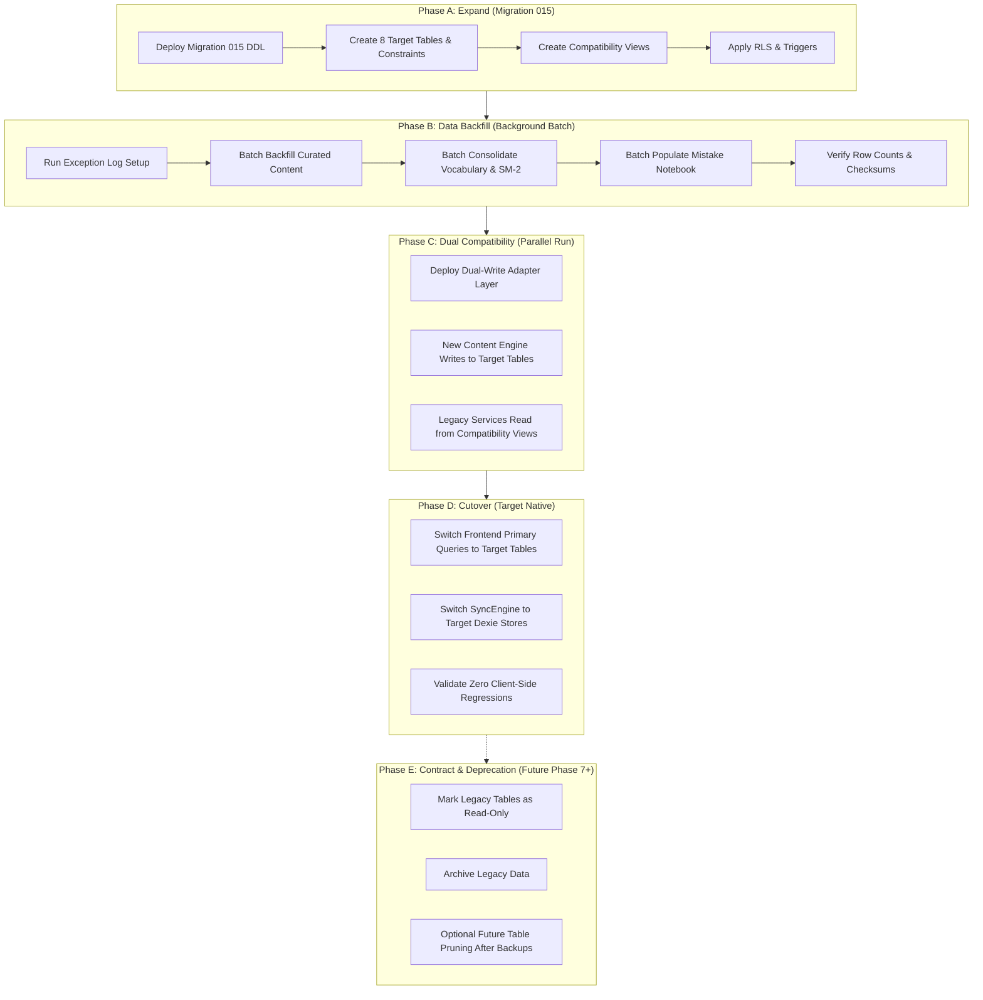

# Lexilume — Database Migration Sequence & Execution Strategy

> **Repository:** `VINODH0101/language-learning` (Lexilume — Illuminate Your Words)  
> **Production Application:** `https://lexi.monster`  
> **Phase:** Phase 5 — Database Design, Data Mapping & Safe Migration Plan  
> **Target Migration Number:** `015` (`015_content_centred_architecture.sql`)  
> **Document Type:** Safe Expand-and-Contract Migration Blueprint

---

## 1. Executive Summary & Zero-Downtime Migration Philosophy

Transforming an active, multi-user production database serving `https://lexi.monster` requires strict adherence to the **Expand-and-Contract (Parallel Run) Pattern**. 

### Core Rules:
1. **Never perform destructive schema operations in Phase A.** Never drop columns, alter existing types, or rename active tables during the initial rollout.
2. **Decouple DDL from Data Population.** Migration `015` defines structure and views only. Heavy data backfilling runs asynchronously in controlled, idempotent batches.
3. **Dual Compatibility Windows.** The database and application layer must support simultaneous reads and writes from both legacy code and new content-centred features.
4. **Instant Rollback Capability.** Every operational step must have an explicit, tested reverse procedure.

---

## 2. The Five Migration Phases (Expand-and-Contract)

---

## 3. Phase-by-Phase Technical Execution Blueprint

### Phase A: Expand — Target Schema Deployment (Migration `015`)
- **Objective:** Deploy all target tables, indexes, constraints, triggers, and compatibility views without modifying or locking existing legacy tables.
- **Execution Script:** `supabase/migrations/015_content_centred_architecture.sql` (Proposed in Deliverable 9).
- **Duration / Impact:** Under 5 seconds on production PostgreSQL. No exclusive table locks on existing tables.
- **Artifacts Created:**
  1. `content_sources`
  2. `english_content_items`
  3. `content_versions`
  4. `learning_activities`
  5. `learner_content_progress`
  6. `user_saved_words`
  7. `user_mistakes`
  8. `content_processing_jobs`
  9. `migration_exception_logs`
  10. Compatibility views: `v_legacy_srs_items`, `v_legacy_daily_content`
- **Verification Gate:** Verify all 8 tables and 2 views exist in `information_schema.tables` and `information_schema.views`.

---

### Phase B: Safe Backfill & Data Population
- **Objective:** Migrate historical learner vocabulary, progress, and curated texts into the target schema in idempotent batches of 500 rows.
- **Execution Script:** Run via background worker or Supabase SQL script `015_backfill_legacy_data.sql`.
- **Safety Limits:**
  - `statement_timeout = '30s'` to prevent query runaway.
  - `lock_timeout = '3s'` to prevent deadlocking active user requests.
  - Transactions scoped per 500-row batch with intermediate checkpoints.
- **Execution Order:**
  1. `licenses_and_sources` -> `content_sources`
  2. `curated_materials` & `daily_published_content` -> `english_content_items` & `content_versions`
  3. `saved_translations` & `srs_items` -> `user_saved_words`
  4. `learning_activity_events` -> `learner_content_progress`
  5. `exercise_attempts` (where `is_correct = false`) -> `user_mistakes`
- **Verification Gate:** Compare row counts between source tables and target tables minus known duplicates logged in `migration_exception_logs`.

---

### Phase C: Dual Compatibility & Parallel Run
- **Objective:** Enable both legacy features (e.g. legacy polyglot flashcards) and new content-centred features to function simultaneously.
- **Strategy Analysis: Compatibility Views vs. Application Adapters:**

| Approach | Where It Operates | Pros | Cons | Recommendation |
| :--- | :--- | :--- | :--- | :--- |
| **Compatibility Views** (`v_legacy_srs_items`) | PostgreSQL Engine | Instant zero-code frontend compatibility; works immediately with existing Supabase queries. | Cannot handle complex bi-directional writes without INSTEAD OF triggers. | **Use for SELECT queries** on legacy tables. |
| **Application Adapters** (`StorageService`, `syncEngine.ts`) | TypeScript Client / PostgREST Layer | Full control over mutation formatting, error handling, offline Dexie queuing, and dual-writes. | Requires careful client-side code updates and regression testing. | **Use for MUTATIONS (INSERT/UPDATE)**. |

- **Hybrid Pattern Decision:**
  - Use database **Compatibility Views** for reading historical data structures during intermediate steps.
  - Use **Application Adapters** in `syncEngine.ts` to route new mutations directly to `user_saved_words` and `learner_content_progress`.

---

### Phase D: Cutover (Target Native)
- **Objective:** Transition frontend services and background jobs to query target tables directly.
- **Steps:**
  1. Update `courseService.ts` and `dailyContentService.ts` to consume `english_content_items` and `content_versions`.
  2. Update `srs.ts` to query `user_saved_words`.
  3. Deploy updated frontend build to production (`https://lexi.monster`).
  4. Verify client error logs (Sentry/console) for zero schema-related 400/404 errors.
- **Verification Gate:** Confirm 100% of new learning sessions write to `learner_content_progress` and `user_saved_words`.

---

### Phase E: Contract & Deprecation (Deferred to Future Phase)
- **Objective:** Safely decommission legacy tables only after extended validation (minimum 60 days on production).
- **Mandatory Preconditions:**
  1. Zero reads or writes recorded on legacy tables for 60 consecutive days.
  2. Full binary and SQL logical dumps stored in immutable cold storage.
  3. Formal user authorization received before running any `DROP TABLE` commands.
- **Phase 5 Status:** Contract phase is strictly defined for planning purposes and **WILL NOT** be executed in Phase 5 or Phase 6.

---

## 4. Rollback and Recovery Runbook

Every phase has an immediate, deterministic rollback plan:

| Incident Scenario | Phase | Detection Trigger | Recovery Procedure |
| :--- | :--- | :--- | :--- |
| **Migration 015 syntax or lock error** | Phase A | PostgREST migration failure or timeout | Run `015_rollback.sql`. Drops target tables with `IF EXISTS CASCADE`. Existing 26 tables are completely untouched. |
| **Batch backfill performance degradation** | Phase B | Supabase CPU spikes > 70% or query latency > 500ms | Immediately kill active backfill worker PID via `SELECT pg_cancel_backend(pid)`. Resume batch with reduced batch size (100 rows). |
| **Duplicate lemma conflict in `user_saved_words`** | Phase B | Unique constraint violation logged in exception table | Safe: `ON CONFLICT DO UPDATE` resolves duplicates; unresolvable rows divert to `migration_exception_logs`. |
| **Client-side sync failures after cutover** | Phase D | PostgREST returns 406 or Dexie sync queue stalls | Toggle feature flag `VITE_USE_TARGET_SCHEMA=false` in frontend environment; fallback to legacy API routes. |

---

## 5. Prerequisite Checklist Before Migration 015 Execution

- [x] Phase 1: Repository inventory complete and verified.
- [x] Phase 2: Dependency and usage analysis complete and verified.
- [x] Phase 3: Current-state architecture documented.
- [x] Phase 4: Target architecture documented.
- [x] Baseline migration count verified (14 migrations, next is `015`).
- [ ] Database logical backup performed via Supabase CLI (`supabase db dump`).
- [ ] Target schema syntax verified in offline PostgreSQL test container.
- [ ] User review and approval of Phase 5 migration specification.
