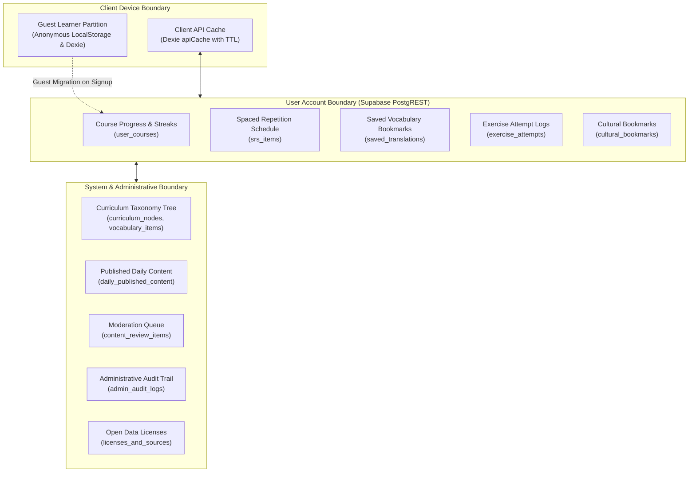
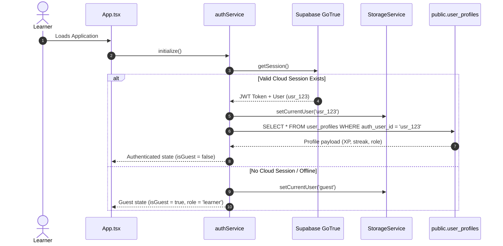
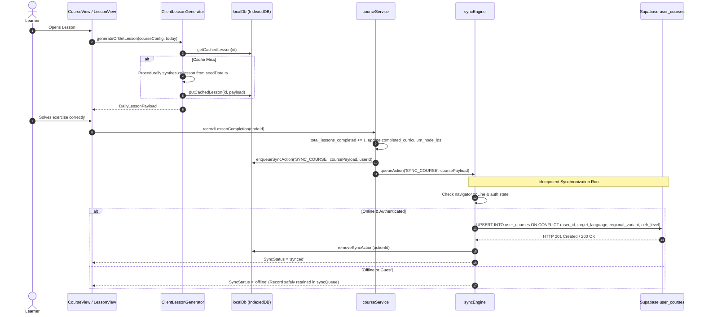
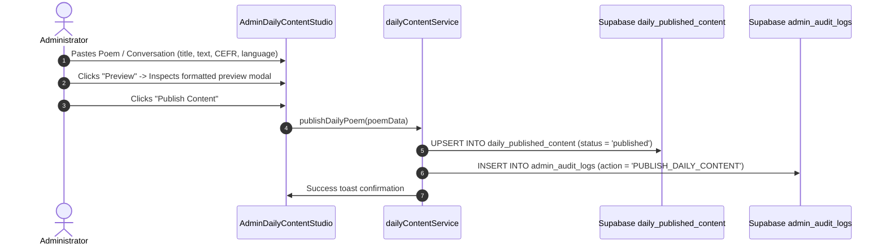
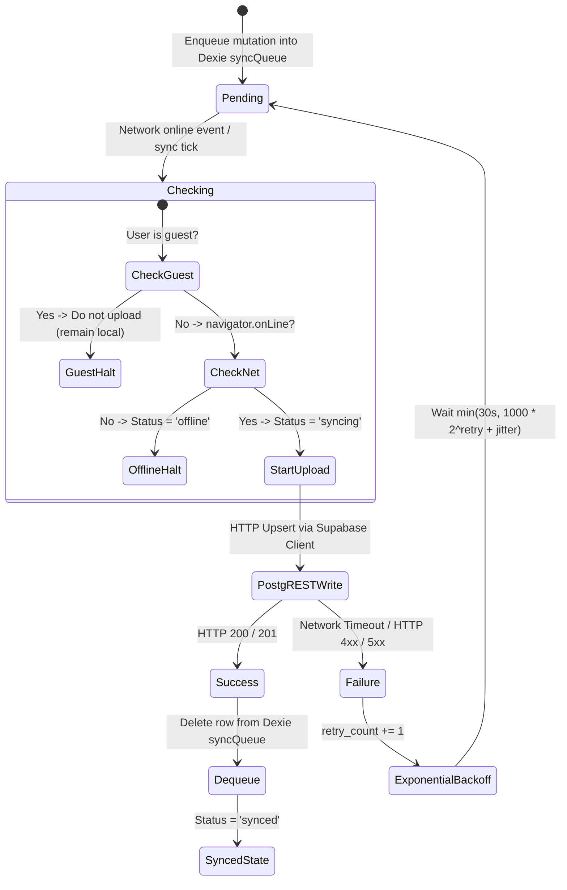

# Lexilume — Data Flow & Storage Model

> **Repository:** `VINODH0101/language-learning` (Lexilume — Illuminate Your Words)  
> **Production Application:** `https://lexi.monster`  
> **Phase:** Phase 3 — Current-State Architecture Modeling  
> **Status:** 100% Verified against Dexie v4 schema, StorageService, and Supabase migrations

---

## 1. Executive Summary & Data Principles

Lexilume implements a **local-first, multi-tier data architecture** designed for offline resilience, deterministic execution, and zero data loss.

### Core Data Principles Verified in Code:
1. **Local-First Precedence:** All learner interactions mutate local client storage (Scoped LocalStorage and Dexie v4 IndexedDB) synchronously or asynchronously before initiating any cloud network requests.
2. **Tenant & Account Isolation:** Storage keys and database records are partitioned strictly by user ID (`_guest` vs `_<userId>`) to eliminate cross-account data leaks on shared hardware (`StorageService.getKey()` and `syncEngine.ts:138`).
3. **Idempotent Synchronization:** All remote PostgREST writes execute using compound conflict keys (`onConflict: 'user_id, target_language, regional_variant, cefr_level'`), ensuring re-syncs merge cleanly without primary key collisions or duplicate records.
4. **Zero-Paid AI / Offline Corpus:** Learning materials originate from local seed JSON corpora (`seedData.ts`, `sentencesData.ts`) and deterministic generators, eliminating dependencies on external paid cloud databases for routine study.

---

## 2. Data Ownership Boundaries



### Data Ownership Classifications:
1. **Client-Owned (Ephemeral / Device):**
   - In-memory active lesson state (`useCourse.ts`).
   - Browser UI settings: `polyglot_font_size`, `polyglot_session_duration`, `lexilume_user_avatar`.
   - Dexie `apiCache` entries (ephemeral cached responses from Wiktionary, Tatoeba, Open-Meteo).
2. **User-Owned (Cloud-Synchronized):**
   - Active course configurations, streaks, and completed curriculum node IDs (`user_courses`).
   - SM-2 spaced repetition items, intervals, and ease factors (`srs_items`).
   - Saved vocabulary entries and custom translations (`saved_translations`).
   - Exercise attempt logs and error telemetry (`exercise_attempts`).
   - Cultural reading bookmarks (`cultural_bookmarks`).
   - Learner activity events (`learning_activity_events`).
3. **System & Admin-Owned (Global / Shared):**
   - Static curriculum syllabus trees (`curriculum_nodes`, `grammar_rules`, `vocabulary_items`).
   - Admin-published poems and conversations (`daily_published_content`).
   - Moderation items (`content_review_items`).
   - Immutable administrative audit logs (`admin_audit_logs`).
   - Role assignments (`user_roles`).

---

## 3. Storage Tiers & Schemas

### 3.1 Tier 1: Scoped LocalStorage (27 Keys)
All LocalStorage read/write calls route through `frontend/src/services/storage.ts`:
- **Scoping Formula:** `StorageService.getKey(baseKey, userId)` returns `baseKey` if user is `'guest'`, or `${baseKey}_${userId}` when authenticated.
- **Key Categories:**
  - Course state: `polyglot_courses_{uid}`, `polyglot_active_course_{uid}`, `polyglot_track_{lang}_{uid}`.
  - Learner progress: `polyglot_settings_{uid}`, `polyglot_diagnostics_{uid}`, `polyglot_srs_items_{uid}`.
  - Telemetry: `polyglot_exercise_attempts_{uid}`, `polyglot_unified_activities_{uid}`.
  - Global browser settings: `polyglot_interface_lang`, `polyglot_font_size`, `lexilume_onboarding_completed`.

### 3.2 Tier 2: Dexie IndexedDB (`PolyglotLocalDatabase` v4)
Defined in `frontend/src/services/localDb.ts:40-120`:
1. `cachedLessons`: Primary key `id` (`${language}_${date}`). Stores `DailyLessonPayload` for 14-day rolling offline window.
2. `activeLessonProgress`: Primary key `id` (Language code). Tracks current section tab and progress step for active in-progress lessons.
3. `savedVocabulary`: Primary key `id` (UUID). Indexes: `user_id, source_text, target_lang, created_at`.
4. `srsReviews`: Primary key `id` (UUID). Indexes: `user_id, language, vocabulary_item_id, next_review_date`.
5. `mistakeNotebook`: Primary key `id` (UUID). Indexes: `user_id, language, error_category, timestamp, is_resolved`.
6. `culturalBookmarks`: Primary key `id` (`${user_id}_${article_id}`). Indexes: `user_id, article_id, content_language, origin_country`.
7. `apiCache`: Primary key `id` (`${provider}:${cacheKey}`). Indexes: `provider, cacheKey, expiresAt`. Automatically evicted when `Date.now() > expiresAt`.
8. `syncQueue`: Primary key `id` (UUID). Indexes: `user_id, action, status, created_at`. Stores pending mutations waiting for network sync.

### 3.3 Tier 3: Supabase Cloud PostgreSQL (26 Tables)
Managed via Supabase migrations `001` through `012`. Enforces Row-Level Security (RLS) on all user-owned tables:
```sql
CREATE POLICY "Users can only manage their own courses"
ON public.user_courses
FOR ALL
USING (auth.uid() = user_id)
WITH CHECK (auth.uid() = user_id);
```

---

## 4. Complete Data Lifecycle Traces

### 4.1 Authentication & Session Lifecycle


### 4.2 Learner Data Lifecycle (Study Loop to Sync)


### 4.3 Administrator Content Lifecycle


---

## 5. Synchronization & Conflict Resolution Architecture

### 5.1 Sync Engine State Machine


### 5.2 Conflict Resolution Strategies
1. **Course Progress Metrics (`total_lessons_completed`, `streak_days`):**  
   Evaluated with `Math.max(local, remote)` to prevent multi-device race conditions from resetting offline progress.
2. **SM-2 Spaced Repetition Schedules (`srs_items`):**  
   Resolved using timestamp precedence: The record with the more recent `last_reviewed_at` or `updated_at` wins.
3. **Saved Vocabulary Bookmarks (`saved_translations`):**  
   Compound primary key upsert on `(user_id, source_text, target_lang)` ensures additions merge idempotently.
4. **Tenant Isolation Guard (`syncEngine.ts:138`):**  
   If `item.user_id !== 'guest' && item.user_id !== activeAuthUserId`, sync execution skips the item, preventing accidental data leakage to a different user's cloud account on shared hardware.

---

## 6. Source-of-Truth Analysis

| Entity / Domain | Primary Authority (Source of Truth) | Local Copy | Remote Cloud Copy | Conflict Strategy |
| :--- | :--- | :--- | :--- | :--- |
| **User Course Progress** | LocalStorage + Dexie | Scoped LocalStorage `polyglot_courses_{uid}` | Supabase `user_courses` | Local-precedence write; `Math.max` merge on pull |
| **Active Lesson Step** | Dexie `activeLessonProgress` | IndexedDB `activeLessonProgress` | None (Client ephemeral) | Local authority |
| **SM-2 Repetition State** | Dexie `srsReviews` | IndexedDB `srsReviews` | Supabase `srs_items` | Most recent review timestamp wins |
| **Saved Vocabulary** | Dexie `savedVocabulary` | IndexedDB `savedVocabulary` | Supabase `saved_translations` | Idempotent compound key merge |
| **Published Daily Content** | Supabase `daily_published_content` | LocalStorage `lexilume_daily_poetry_v1` | Supabase PostgreSQL | Remote authority (Admin published) |
| **Curriculum Taxonomy** | Seed JSON `seedData.ts` / Migration 001 | In-memory JS bundle constants | Supabase `curriculum_nodes` | Static seed authority |
| **API Cache** | Dexie `apiCache` | IndexedDB `apiCache` | None (Client ephemeral) | TTL timestamp expiration |
