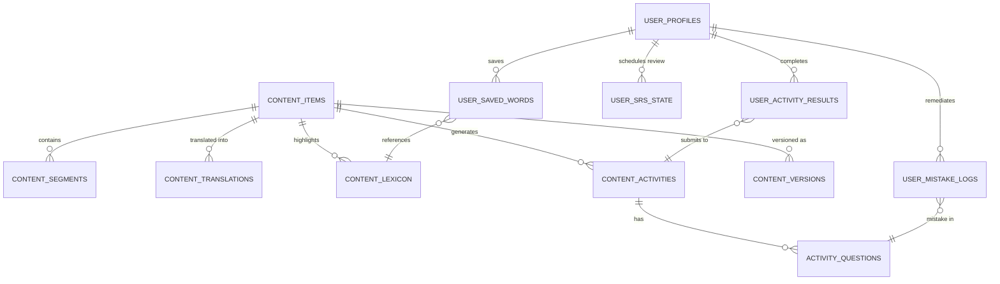

# Lexilume — Unified Content & Learning Data Model

> **Ground Truth Rule:** Reuse existing database tables and models (`daily_published_content`, `vocabulary_items`, `srs_items`, `saved_translations`, `exercise_attempts`, `user_courses`). Keep shared educational content strictly decoupled from personal learner state.

---

## 1. Domain Separation: Educational Content vs. Personal Learner Data



---

## 2. Shared Educational Content Schema (Target Product DDL)

Implemented as a forward-only extension in migration `015_content_centred_english_pipeline.sql`:

```sql
-- 1. Master Content Table (General English Genres)
CREATE TABLE IF NOT EXISTS public.english_content_items (
    id UUID PRIMARY KEY DEFAULT gen_random_uuid(),
    content_slug VARCHAR(128) UNIQUE NOT NULL,
    title TEXT NOT NULL,
    genre VARCHAR(64) NOT NULL, -- 'conversation', 'news', 'story', 'workplace', 'essay', etc.
    topic_category VARCHAR(64) NOT NULL, -- 'technology', 'business', 'daily_life', etc.
    internal_cefr_level VARCHAR(8) NOT NULL DEFAULT 'B1', -- 'A1' to 'C1' internal metadata
    estimated_reading_minutes INT NOT NULL DEFAULT 3,
    original_text TEXT NOT NULL,
    raw_source_format VARCHAR(32) NOT NULL, -- 'plain_text', 'pdf', 'url', 'subtitles', etc.
    source_attribution_id UUID REFERENCES public.licenses_and_sources(id),
    current_version INT NOT NULL DEFAULT 1,
    publication_status VARCHAR(32) NOT NULL DEFAULT 'draft', -- 'draft', 'in_review', 'published', 'archived'
    published_at TIMESTAMPTZ,
    created_at TIMESTAMPTZ NOT NULL DEFAULT CURRENT_TIMESTAMP,
    updated_at TIMESTAMPTZ NOT NULL DEFAULT CURRENT_TIMESTAMP
);

-- 2. Segmented Paragraphs & Sentences (For Sentence-by-Sentence View & Audio Sync)
CREATE TABLE IF NOT EXISTS public.english_content_segments (
    id UUID PRIMARY KEY DEFAULT gen_random_uuid(),
    content_id UUID NOT NULL REFERENCES public.english_content_items(id) ON DELETE CASCADE,
    paragraph_index INT NOT NULL,
    sentence_index INT NOT NULL,
    sentence_text TEXT NOT NULL,
    start_char_offset INT NOT NULL,
    end_char_offset INT NOT NULL,
    audio_start_timestamp_ms INT,
    audio_end_timestamp_ms INT,
    CONSTRAINT unique_content_segment UNIQUE (content_id, paragraph_index, sentence_index)
);

-- 3. Multilingual Sentence & Paragraph Translations
CREATE TABLE IF NOT EXISTS public.english_content_translations (
    id UUID PRIMARY KEY DEFAULT gen_random_uuid(),
    content_id UUID NOT NULL REFERENCES public.english_content_items(id) ON DELETE CASCADE,
    target_language VARCHAR(16) NOT NULL, -- 'pt' or 'es'
    version INT NOT NULL DEFAULT 1,
    translated_title TEXT NOT NULL,
    full_translated_text TEXT NOT NULL,
    sentence_translation_map JSONB NOT NULL, -- { "<segment_id>": "Tradução da frase..." }
    translator_provider VARCHAR(64) NOT NULL DEFAULT 'mymemory_local_cascade',
    verified_by_admin BOOLEAN NOT NULL DEFAULT FALSE,
    created_at TIMESTAMPTZ NOT NULL DEFAULT CURRENT_TIMESTAMP,
    CONSTRAINT unique_content_translation UNIQUE (content_id, target_language, version)
);

-- 4. Extracted Lexical & Idiomatic Items
CREATE TABLE IF NOT EXISTS public.english_content_lexicon (
    id UUID PRIMARY KEY DEFAULT gen_random_uuid(),
    content_id UUID NOT NULL REFERENCES public.english_content_items(id) ON DELETE CASCADE,
    term TEXT NOT NULL,
    lemma TEXT NOT NULL,
    part_of_speech VARCHAR(32) NOT NULL,
    phonetic_ipa TEXT,
    contextual_meaning_en TEXT NOT NULL,
    translation_pt TEXT NOT NULL,
    translation_es TEXT NOT NULL,
    is_idiom_or_phrase BOOLEAN NOT NULL DEFAULT FALSE,
    frequency_tier INT NOT NULL DEFAULT 1,
    audio_url TEXT
);

-- 5. Contextual Grammar Insights
CREATE TABLE IF NOT EXISTS public.english_content_grammar (
    id UUID PRIMARY KEY DEFAULT gen_random_uuid(),
    content_id UUID NOT NULL REFERENCES public.english_content_items(id) ON DELETE CASCADE,
    rule_code VARCHAR(64) NOT NULL,
    pattern_title TEXT NOT NULL,
    target_excerpt TEXT NOT NULL,
    structural_formula TEXT NOT NULL,
    explanation_pt TEXT NOT NULL,
    explanation_es TEXT NOT NULL
);

-- 6. Adaptive Learning Activities (Comprehension, Speaking, Writing)
CREATE TABLE IF NOT EXISTS public.english_content_activities (
    id UUID PRIMARY KEY DEFAULT gen_random_uuid(),
    content_id UUID NOT NULL REFERENCES public.english_content_items(id) ON DELETE CASCADE,
    activity_type VARCHAR(32) NOT NULL, -- 'comprehension_quiz', 'vocab_cloze', 'speaking_prompt', 'writing_prompt'
    activity_payload JSONB NOT NULL,
    created_at TIMESTAMPTZ NOT NULL DEFAULT CURRENT_TIMESTAMP
);
```

---

## 3. Personal Learner State Schema (Zero Data Loss)

All existing user records in `user_profiles`, `user_courses`, `srs_items`, `saved_translations`, and `exercise_attempts` remain completely intact. The target model links user activity cleanly:

```sql
-- 1. User Completed Content Activities
CREATE TABLE IF NOT EXISTS public.learner_content_completions (
    id UUID PRIMARY KEY DEFAULT gen_random_uuid(),
    user_id UUID NOT NULL REFERENCES public.user_profiles(id) ON DELETE CASCADE,
    content_id UUID NOT NULL REFERENCES public.english_content_items(id) ON DELETE CASCADE,
    activity_type VARCHAR(32) NOT NULL,
    score_percentage NUMERIC(5,2),
    completed_at TIMESTAMPTZ NOT NULL DEFAULT CURRENT_TIMESTAMP,
    CONSTRAINT unique_user_content_activity UNIQUE (user_id, content_id, activity_type)
);

-- 2. User Targeted Mistake Notebook (Replaces Vanity Streaks with Real Remediation)
CREATE TABLE IF NOT EXISTS public.learner_mistake_notebook (
    id UUID PRIMARY KEY DEFAULT gen_random_uuid(),
    user_id UUID NOT NULL REFERENCES public.user_profiles(id) ON DELETE CASCADE,
    content_id UUID REFERENCES public.english_content_items(id) ON DELETE SET NULL,
    error_category VARCHAR(64) NOT NULL, -- 'false_friend', 'preposition', 'verb_tense', 'agreement'
    prompt_text TEXT NOT NULL,
    user_answer TEXT NOT NULL,
    correct_solution TEXT NOT NULL,
    pedagogical_explanation TEXT NOT NULL,
    review_count INT NOT NULL DEFAULT 0,
    is_resolved BOOLEAN NOT NULL DEFAULT FALSE,
    logged_at TIMESTAMPTZ NOT NULL DEFAULT CURRENT_TIMESTAMP,
    resolved_at TIMESTAMPTZ
);
```

---

## 4. Retention & Storage Optimization Policies

1. **No Transient Click Telemetry in Database:** Word highlights and page scroll ratios are kept in IndexedDB `activeLessonProgress` only. They expire when the session completes, preventing database bloating.
2. **Immutable Content Versions:** When content is updated, `current_version` increments, preserving past `content_translations` so learner completion history points to the exact text they studied.
3. **Safe Learner Deletion Cascade:** If a user requests account deletion, `ON DELETE CASCADE` removes their saved words and mistake notebook, but never modifies shared `english_content_items`.
