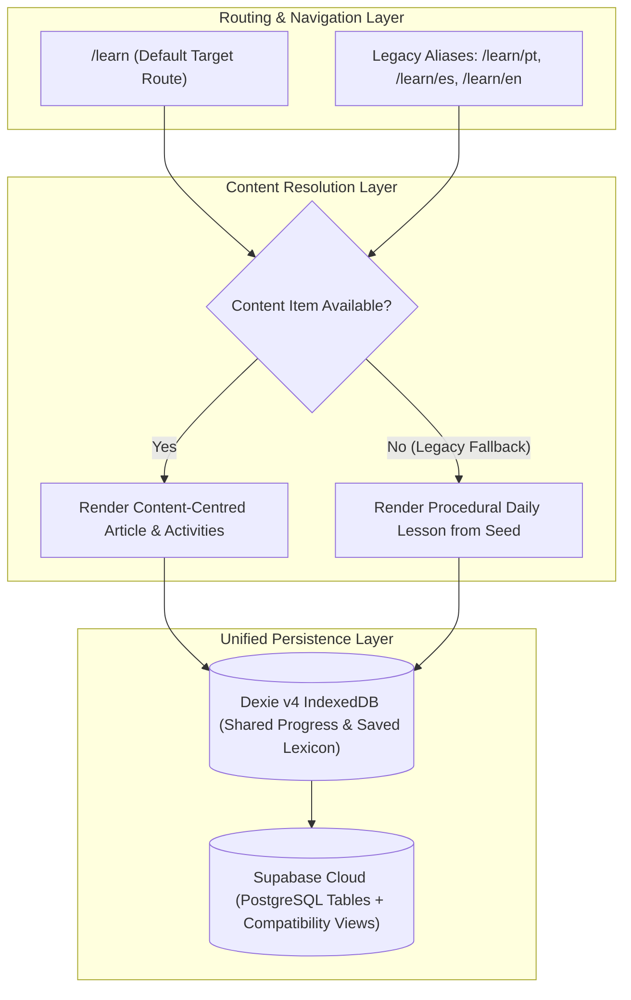

# Lexilume — Feature Transition & Coexistence Matrix

> **Repository:** `VINODH0101/language-learning` (Lexilume — Illuminate Your Words)  
> **Production Application:** `https://lexi.monster`  
> **Phase:** Phase 4 — Target Architecture Design  
> **Core Principle:** Safe, non-destructive evolution from procedural courses to content-centred English learning.

---

## 1. Executive Summary

This matrix maps every existing feature in Lexilume to its designated role in the target architecture. In strict accordance with the non-negotiable migration rules:
- **No abrupt removals:** Existing learners at `https://lexi.monster` will not lose active streaks, saved vocabulary, or course progress.
- **Coexistence Period:** The existing procedural curriculum courses and the new content-centred reading items will coexist during Phase 5 and Phase 6 before legacy routes are deprecated.

---

## 2. Comprehensive Feature Transition Matrix

| Existing Feature / Module | Current Implementation | Target Architectural State | Transition Classification | Migration & Coexistence Strategy |
| :--- | :--- | :--- | :--- | :--- |
| **Multi-Course Management** | `frontend/src/services/courseService.ts` | Refocused on English acquisition; retains multilingual tracks | **Adapt** | Adapt `courseService` to track progress across content items while retaining secondary language courses. |
| **Daily Procedural Lessons** | `frontend/src/services/lessonGenerator.ts` | Replaced by authentic text packages (`english_content_items`) | **Replace** | Continue serving cached daily lessons until content library reaches critical mass (50+ articles). |
| **Vocabulary Explorer** | `frontend/src/features/vocabulary/VocabularyExplorer.tsx` | Consolidated into `My Words` tab (`/words`) | **Merge** | Merge standalone vocabulary explorer with `savedVocabulary` into the unified `My Words` interface. |
| **Grammar Syllabus Explorer** | `frontend/src/pages/GrammarPage.tsx` | Shifted to contextual grammar insights within reading | **Adapt** | Adapt grammar rules into modular insights linked directly to sentences in authentic texts. |
| **Reading Section & Studio** | `frontend/src/features/reading/ReadingStudio.tsx` | Promoted to the core view of the `Learn` tab | **Adapt** | Repurpose the reader component as the primary interface of `LearnPage.tsx`. |
| **Listening Practice Studio** | `frontend/src/features/listening/ListeningStudio.tsx` | Integrated into content reader audio toolbar | **Adapt** | Connect audio playback controls and transcripts directly to source content items. |
| **Speaking Coach** | `frontend/src/features/speaking/SpeakingCoach.tsx` | Embedded as a productive prompt under reading texts | **Adapt** | Prompts learner to speak key sentences from the text they just read; evaluates via Web Speech API. |
| **Writing Coach** | `frontend/src/features/writing/WritingCoach.tsx` | Embedded as a response prompt under reading texts | **Adapt** | Prompts learner to summarize or respond to the reading passage with LanguageTool feedback. |
| **Spaced Repetition (SM-2)** | `frontend/src/services/srs.ts`, `engine/srs/sm2.py` | Embedded directly into `My Words` flashcard deck | **Retain directly** | Retain SM-2 calculation engine unaltered; link review items to authentic source sentences. |
| **Mistake Notebook** | `frontend/src/components/practice/MistakeNotebook.tsx` | Promoted to dedicated `My Mistakes` tab (`/mistakes`) | **Adapt** | Elevate to top-level tab; add contextual remediation practice and master rules. |
| **Placement / Diagnostic Test**| `frontend/src/pages/PlacementTestPage.tsx` | Retained as optional onboarding proficiency test | **Retain directly** | Keep placement test to recommend initial content reading levels (A2, B1, B2, C1). |
| **Study Pack PDF Service** | `frontend/src/services/pdfService.ts` | Generates study pack for any published content item | **Adapt** | Update jsPDF generator to format an entire article, its vocabulary, and exercises into a printable PDF. |
| **Admin Content Review** | `frontend/src/features/admin/AdminWorkbench.tsx` | Streamlined into 7-state Content Studio | **Adapt** | Refactor workbench tabs into a clean editorial publishing flow (`Draft` -> `Review` -> `Publish`). |
| **Contextual Word Popover** | `ContextualWordPopover.tsx` | First-class interaction across all reading views | **Retain directly** | Retain popover engine; make it omnipresent across all learner text views. |
| **Legacy Route Wrappers** | `EnglishPage.tsx`, `PortuguesePage.tsx`, `SpanishPage.tsx` | Consolidated into dynamic `LearnPage.tsx` | **Consolidate later** | Retain legacy routes as redirects (`/learn/en` -> `/learn?lang=en`) until Phase 6 cleanup. |
| **Duplicate Database Tables** | `language_tracks`, `user_learning_tracks`, `daily_lessons` | Standardized on `user_courses` and `daily_published_content` | **Deprecate later** | Route all new writes to target tables; retain legacy tables for read compatibility in Phase 5. |
| **Orphaned Prototype Views** | `LanguageToolStudio.tsx`, `DiscoverHub.tsx` | Unused prototypes slated for safe removal | **Remove after migration**| Prune in Phase 6 after all target features are verified in production. |
| **Scheduled Automation** | `scripts/run_daily_batch.py`, `daily_polyglot.yml` | Extended to process and publish daily reading articles | **Adapt** | Retain GitHub Actions cron runner; update script to invoke the content analysis pipeline. |
| **External API Adapters** | `WiktionaryAdapter`, `TatoebaAdapter`, `FreeDictionaryAdapter` | Retained behind abstract provider interfaces | **Retain directly** | Retain all open educational data adapters as deterministic fallback providers. |

---

## 3. Coexistence & Dual-Model Support Strategy

During Phase 5 (Data & Migration Plan) and Phase 6 (Safe Cleanup), Lexilume will support a **parallel coexistence architecture**:

### Architectural Guarantees for Existing Users:
1. **Streak Continuity:** The `streak_days` counter in `user_courses` increments regardless of whether a learner completes a new content-centred article or an existing curriculum lesson.
2. **Vocabulary Preservation:** Words previously saved in `saved_translations` will be mapped into `user_saved_words` without dropping historical review intervals or dates.
3. **Zero 404 Disruption:** Any bookmarked URLs (e.g. `https://lexi.monster/#learn/en`) will transparently render the unified reader without throwing client-side routing exceptions.
