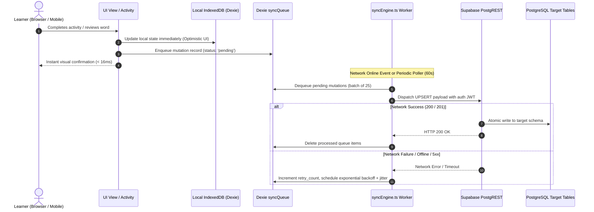

# Lexilume — Learner Data Synchronization & Recovery Specification

> **Repository:** `VINODH0101/language-learning` (Lexilume — Illuminate Your Words)  
> **Production Application:** `https://lexi.monster`  
> **Phase:** Phase 5 — Database Design, Data Mapping & Safe Migration Plan  
> **Target Services:** `frontend/src/services/syncEngine.ts`, `frontend/src/services/localDb.ts`  
> **Document Type:** Offline-to-Online Synchronization, Conflict Resolution & Disaster Recovery

---

## 1. Executive Summary & Synchronization Invariants

In Lexilume's content-centred architecture, a learner interacts with authentic reading passages, audio narration, vocabulary flashcards, and interactive exercises primarily through local browser memory and IndexedDB. 

### Synchronization Invariants:
1. **Uninterrupted Offline Learning:** Zero network requests are required to complete reading lessons, review vocabulary cards, or submit exercises.
2. **Guaranteed Delivery (At-Least-Once):** Every mutating action is committed to the local Dexie `syncQueue` *before* any network dispatch is attempted.
3. **Deterministic Conflict Resolution:** When multi-device updates or guest-to-account transitions occur, conflicts are resolved via mathematically defined merge algorithms rather than arbitrary overwrites.
4. **Resilient Disaster Recovery:** Learners can export and import their complete local learning history as a cryptographically signed JSON snapshot, independent of cloud connectivity.

---

## 2. Synchronization Architecture & Lifecycle



---

## 3. Guest-to-Account Transition Lifecycle

Lexilume allows new learners to explore authentic content and save vocabulary immediately without registration. When the guest registers or authenticates, local state transitions safely into the cloud account.

```typescript
/**
 * Rebinds local guest records and enqueues cloud synchronization upon successful login.
 */
export async function syncGuestDataToAccount(newUserId: string): Promise<void> {
  if (!newUserId || newUserId === 'guest') return;

  await localDb.transaction('rw', [
    localDb.userSavedWords,
    localDb.learnerContentProgress,
    localDb.userMistakes,
    localDb.syncQueue
  ], async () => {
    // 1. Rebind saved vocabulary words
    const guestWords = await localDb.userSavedWords.where({ user_id: 'guest' }).toArray();
    for (const word of guestWords) {
      await localDb.userSavedWords.delete(word.id);
      const reboundWord = { ...word, user_id: newUserId, updated_at: new Date().toISOString() };
      await localDb.userSavedWords.put(reboundWord);
      
      // Enqueue sync mutation
      await localDb.syncQueue.add({
        id: crypto.randomUUID(),
        user_id: newUserId,
        action: 'UPSERT_SAVED_WORD',
        payload: reboundWord,
        status: 'pending',
        retry_count: 0,
        created_at: new Date().toISOString()
      });
    }

    // 2. Rebind content progress
    const guestProgress = await localDb.learnerContentProgress.where({ user_id: 'guest' }).toArray();
    for (const prog of guestProgress) {
      await localDb.learnerContentProgress.delete(prog.id);
      const reboundProg = { 
        ...prog, 
        id: `${newUserId}_${prog.content_item_id}`, 
        user_id: newUserId, 
        updated_at: new Date().toISOString() 
      };
      await localDb.learnerContentProgress.put(reboundProg);

      await localDb.syncQueue.add({
        id: crypto.randomUUID(),
        user_id: newUserId,
        action: 'UPSERT_CONTENT_PROGRESS',
        payload: reboundProg,
        status: 'pending',
        retry_count: 0,
        created_at: new Date().toISOString()
      });
    }

    // 3. Rebind mistake notebook items
    const guestMistakes = await localDb.userMistakes.where({ user_id: 'guest' }).toArray();
    for (const mistake of guestMistakes) {
      await localDb.userMistakes.delete(mistake.id);
      const reboundMistake = { ...mistake, user_id: newUserId, updated_at: new Date().toISOString() };
      await localDb.userMistakes.put(reboundMistake);

      await localDb.syncQueue.add({
        id: crypto.randomUUID(),
        user_id: newUserId,
        action: 'UPSERT_MISTAKE',
        payload: reboundMistake,
        status: 'pending',
        retry_count: 0,
        created_at: new Date().toISOString()
      });
    }
  });

  // Trigger sync queue drain
  void syncEngine.drainQueue();
}
```

---

## 4. Multi-Device Conflict Resolution Strategy

When a learner uses multiple devices (e.g. studying on desktop web during the day, mobile web at night), mutations can conflict upon synchronization:

| Entity & Field | Conflict Scenario | Resolution Algorithm & Invariant |
| :--- | :--- | :--- |
| **`user_saved_words`** (SM-2 parameters) | Word reviewed on Phone at 14:00, then reviewed on Laptop at 15:00 while offline. | **Latest Timestamp Wins:** Compare `last_reviewed_at`. The review with the latest ISO timestamp updates `next_review`, `interval_days`, and `ease_factor`. |
| **`learner_content_progress`** (`percent_complete`) | Device A reports 60% complete; Device B reports 40% complete. | **Max Progress Monotonicity:** `max(DeviceA.percent, DeviceB.percent)`. Progress percentages never regress due to an out-of-order sync. |
| **`learner_content_progress`** (`completed_activity_ids`) | Device A completed activities `[1, 2]`; Device B completed activities `[2, 3]`. | **Mathematical Set Union:** `Array.from(new Set([...DeviceA, ...DeviceB]))`. Guarantees no earned achievements are lost. |
| **`learner_content_progress`** (`time_spent_seconds`) | Device A spent 120s; Device B spent 180s on the same lesson while offline. | **Additive Summation:** `DeviceA.time_spent + DeviceB.time_spent`. Preserves true engagement effort. |
| **`user_mistakes`** (`occurrences_count`) | Mistake recorded twice on Laptop, once on Phone. | **Max Counter with Timestamp Update:** `occurrences_count = max(DeviceA, DeviceB) + 1` with `last_occurred_at = max(times)`. |

---

## 5. Sync Queue Retry & Full-Jitter Backoff

To prevent the "thundering herd" problem when network connectivity is restored across hundreds of clients, `syncEngine.ts` employs **Exponential Backoff with Full Jitter**:

$$\text{Sleep Interval} = \text{random}(0, \; \min(\text{max\_backoff}, \; \text{base} \times 2^{\text{retry\_count}}))$$

### Parameter Matrix:
- **Base Backoff:** 1,500 ms (1.5 seconds)
- **Maximum Backoff:** 60,000 ms (60 seconds)
- **Maximum Retries:** 5 attempts before marking queue item as `'failed'`
- **Alerting Threshold:** If an item fails 5 times, it is retained in Dexie for manual retry and a non-intrusive UI toast appears: *"Some study activities are waiting for internet connection."*

---

## 6. Learner Data Recovery & Portability

### 6.1 Cryptographic Client Snapshot Export (JSON Backup)
Learners can export their entire educational footprint at any time via Settings -> Data Management:
- Serializes `userSavedWords`, `learnerContentProgress`, and `userMistakes`.
- Computes SHA-256 checksum over the payload for tamper detection.
- Generates downloadable file: `lexilume-backup-YYYY-MM-DD.json`.

### 6.2 Cloud State Reconstruction (New Device Login)
When an existing user logs into a brand new device or clears browser cache:
```typescript
/**
 * Pulls canonical remote state from Supabase and populates local Dexie storage.
 */
export async function pullRemoteState(userId: string): Promise<void> {
  const [words, progress, mistakes] = await Promise.all([
    supabase.from('user_saved_words').select('*').eq('user_id', userId),
    supabase.from('learner_content_progress').select('*').eq('user_id', userId),
    supabase.from('user_mistakes').select('*').eq('user_id', userId)
  ]);

  await localDb.transaction('rw', [
    localDb.userSavedWords,
    localDb.learnerContentProgress,
    localDb.userMistakes
  ], async () => {
    if (words.data) {
      await localDb.userSavedWords.bulkPut(words.data);
    }
    if (progress.data) {
      await localDb.learnerContentProgress.bulkPut(progress.data);
    }
    if (mistakes.data) {
      await localDb.userMistakes.bulkPut(mistakes.data);
    }
  });
}
```
