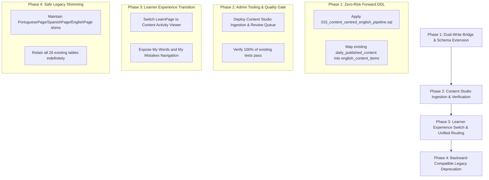

# Lexilume — Zero-Loss Forward Migration Plan

> **Non-Negotiable Invariants (Rules 4, 5, 6, 11, 12):**  
> - *Do not delete database migrations or rewrite historical migrations.*  
> - *Do not drop or truncate production tables.*  
> - *Do not remove user data, saved vocabulary, SRS records, mistakes, progress, accounts, or historical activity.*  
> - *Preserve the existing production application until a tested migration is ready.*  
> - *Work in a dedicated feature branch and use small, reviewable commits.*

---

## 1. Migration Phasing & Execution Strategy



---

## 2. Phase 1: Forward-Only Schema Extension (`015`)

### DDL Implementation Rules:
1. `015_content_centred_english_pipeline.sql` is appended to `supabase/migrations/` as a purely additive migration.
2. Migrations `001` through `014` remain completely untouched.
3. Zero `DROP TABLE` or `ALTER TABLE ... DROP COLUMN` statements.
4. New tables (`english_content_items`, `english_content_segments`, `english_content_translations`, `english_content_lexicon`, `english_content_activities`, `learner_content_completions`, `learner_mistake_notebook`) reference existing `user_profiles(id)` and `licenses_and_sources(id)`.

### Automatic Backward Compatibility Script:
Existing daily lessons in `daily_published_content` (from migration `012`) are mapped into `english_content_items` via an idempotent SQL migration function:
```sql
INSERT INTO public.english_content_items (
    content_slug,
    title,
    genre,
    topic_category,
    internal_cefr_level,
    original_text,
    raw_source_format,
    publication_status,
    published_at
)
SELECT 
    dpc.content_id,
    dpc.title,
    COALESCE(dpc.category, 'general_english'),
    'curated_legacy',
    COALESCE(dpc.cefr_level, 'C1'),
    dpc.raw_content,
    'legacy_daily_payload',
    'published',
    dpc.published_at
FROM public.daily_published_content dpc
ON CONFLICT (content_slug) DO NOTHING;
```

---

## 3. Phase 2: User Data Preservation Matrix

| User Data Domain | Existing Table (`001`-`014`) | Target Architecture Action | Verification Method |
| :--- | :--- | :--- | :--- |
| **Learner Accounts & Roles** | `user_profiles`, `user_roles` | 100% Preserved. Foreign keys link directly. | Auth unit tests & Supabase session checks |
| **Saved Vocabulary & Phrasebook** | `saved_translations`, `localDb.savedVocabulary` | 100% Preserved. Forward-mapped into `My Words` tab. | `lexicalAndSRS.test.tsx`, `localDb.test.ts` |
| **Spaced Repetition (SM-2)** | `srs_items`, `localDb.srsReviews` | 100% Preserved. Review intervals and ease factors untouched. | `srs.test.ts`, `test_srs.py` |
| **Historical Mistakes** | `exercise_attempts`, `localDb.mistakeNotebook` | 100% Preserved. Mapped directly into `My Mistakes` remediation view. | `localDb.test.ts`, `test_exercises.py` |
| **Course Progression & Streaks** | `user_courses`, `user_learning_tracks` | 100% Preserved. Completed node IDs retained. | `course.test.ts`, `dashboardRedesign.test.tsx` |

---

## 4. Rollback Strategy & Safe Recovery

If any unexpected regression occurs during deployment:
1. **Frontend Rollback:** The UI routing can immediately revert to the previous hash routing (`#dashboard`, `#learn`, `#practice`, `#discover`, `#progress`) via feature flag or git checkout.
2. **Database Non-Destructiveness:** Because all schema changes are additive (`CREATE TABLE IF NOT EXISTS`), existing queries targeting `user_courses`, `daily_lessons`, or `srs_items` continue executing without error.
3. **Dexie Client-Side Rollback:** Dexie versioning in `localDb.ts` preserves existing stores.
