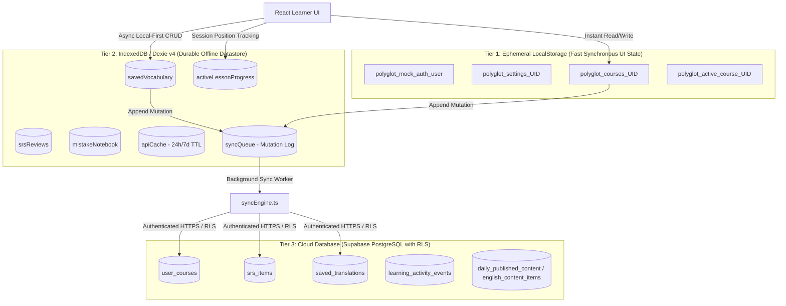

# Lexilume — Persistence, Offline Storage & Bidirectional Sync Architecture

> **Invariant Mandates (Rules 2, 4, 15):**  
> 1. *Local-First Functionality: Core learning activities, SM-2 reviews, vocabulary browsing, and placement testing must operate offline in browser storage via Dexie / IndexedDB and localStorage.*  
> 2. *Never silently report a successful save when the database write failed.*  
> 3. *Tenant & Account Isolation: LocalStorage keys and Dexie sync records must be strictly partitioned by User ID.*

---

## 1. Multi-Tiered Storage Topology

Lexilume operates across three tightly coordinated persistence tiers:



---

## 2. SyncEngine Mutation Protocol & Conflict Handling

The synchronization engine in `frontend/src/services/syncEngine.ts` enforces non-blocking offline writes with guaranteed eventual consistency:

```typescript
export interface SyncQueueRecord {
  id: string; // UUID of mutation record
  user_id: string; // Tenant isolation key
  action: 'SYNC_COURSE' | 'DELETE_COURSE' | 'SYNC_LESSON_PROGRESS' | 'SYNC_VOCABULARY';
  payload: unknown;
  status: 'pending' | 'failed' | 'processing';
  retry_count: number;
  max_retries: 5;
  error_message?: string;
  created_at: string;
}
```

### Sync Lifecycle:
1. **Immediate Local Commit:** The learner action is written instantly to Dexie and/or LocalStorage. The UI updates optimistically with zero spinner delay.
2. **Queueing:** A corresponding mutation item is appended to `syncQueue` with `status = 'pending'` and the active `user_id`.
3. **Execution Window:**
   - If online: The mutation triggers an immediate non-blocking network dispatch.
   - If offline: The item waits in Dexie until the browser dispatches the `online` event or the user triggers a manual sync.
4. **Conflict Resolution Policy (Server-Timestamp LWW):**
   - For course progress and curriculum nodes: Sets are combined via union (`Set([...localNodes, ...remoteNodes])`). Completed lessons are **never uncompleted** due to a sync conflict.
   - For SRS review dates: Latest review timestamp wins (*Last-Write-Wins*).
   - For vocabulary collections: Additive merge preserves all saved words.

---

## 3. Strict Failure Transparency (Rule 15 Enforcement)

To guarantee that database write errors are never masked as false successes:

```typescript
// Verified Sync Dispatcher Architecture
export async function dispatchCloudMutation(action: SyncQueueRecord): Promise<void> {
  try {
    const { error } = await supabase
      .from(getTableName(action.action))
      .upsert(action.payload);

    if (error) {
      // Record failure explicitly in Dexie
      await localDb.syncQueue.update(action.id, {
        status: 'failed',
        retry_count: action.retry_count + 1,
        error_message: error.message,
      });
      
      // Dispatch toast notification to inform user of sync delay
      toast.error(`Offline sync deferred: ${error.message}. Progress is safely stored on this device.`);
      throw error;
    }

    // Explicitly delete from queue ONLY after verified HTTP 200/201 response
    await localDb.syncQueue.delete(action.id);
  } catch (err: any) {
    console.warn(`[SyncEngine] Cloud write failed for mutation ${action.id}:`, err);
    throw err;
  }
}
```

---

## 4. Tenant Partitioning & Cross-Account Isolation

Shared devices (e.g. household or lab computers) are protected by tenant-scoped storage:

1. **LocalStorage Keys:** Scoped by user ID suffix:
   - `polyglot_courses_guest`
   - `polyglot_courses_usr_001`
   - `polyglot_active_course_usr_001`
2. **IndexedDB Records:** Every row in `savedVocabulary`, `srsReviews`, and `mistakeNotebook` stores `user_id`. Queries always filter by `where('user_id').equals(currentUserId)`.
3. **Guest-to-Authenticated Migration:** When an unauthenticated learner signs in:
   - `StorageService.migrateGuestData(userId)` safely transfers guest vocabulary and progress without overwriting existing cloud records.
   - Guest partition is safely cleared after confirmed migration.
