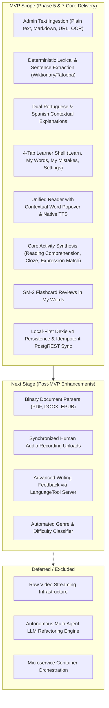

# Lexilume — Phase 4 Findings & Phase 5 Handoff Report

> **Repository:** `VINODH0101/language-learning` (Lexilume — Illuminate Your Words)  
> **Production Application:** `https://lexi.monster`  
> **Phase Completed:** Phase 4 — Target Architecture Design  
> **Prepared For:** Phase 5 — Data & Migration Plan  
> **Status:** All 10 Target Architecture Deliverables Created and Verified

---

## 1. Executive Summary of Phase 4

Phase 4 has defined the complete, practical, and scalable **Target Architecture** for Lexilume's transformation into a content-centred English learning platform.

### Key Architectural Decisions Established:
1. **Single Source of Truth:** A single authentic English text (story, news, workplace email, conversation) serves as the common root for reading, vocabulary extraction, grammar insights, and interactive activities.
2. **Streamlined 4-Tab Learner Interface:** Radically simplifies navigation into **`Learn`**, **`My Words`**, **`My Mistakes`**, and **`Settings`**, eliminating dashboard clutter and disconnected skill silos.
3. **Omnipresent Contextual Lookup:** The `ContextualWordPopover` is integrated across all reading and activity views, providing contextual definitions, simple English explanations, Portuguese/Spanish translations, native audio pronunciation, and one-click saving.
4. **Resilient 8-Stage Content Pipeline:** Replaces the unbuilt 21-stage specification with an independently retryable, 8-stage pipeline supporting plain text, markdown, URL scraping, and image OCR in the MVP.
5. **No New Backend Infrastructure:** Validated that static edge hosting (Vercel/Cloudflare Pages) paired with Supabase PostgreSQL (PostgREST + RLS) and GitHub Actions automation fully supports the target platform at $0 fixed infrastructure cost.
6. **Zero-Paid AI Mandate Maintained:** Core learning features operate deterministically offline using open educational datasets (Wiktionary, Tatoeba, Project Gutenberg). Optional Gemini integration remains non-blocking with offline fallbacks.

---

## 2. Important Trade-Offs & Architectural Balances

| Decision Area | Alternative Considered | Selected Decision | Architectural Trade-Off & Justification |
| :--- | :--- | :--- | :--- |
| **Backend Server** | Node.js / FastAPI web server daemon | Serverless edge + Supabase PostgREST | Trade-off: Eliminates server management and monthly hosting costs ($0/mo) while leveraging built-in RLS and database connection pooling. |
| **Content Ingestion**| Supporting all 17 formats in MVP | Prioritizing Plain Text, Markdown, URLs, and OCR | Trade-off: Defers complex PDF/DOCX/EPUB binary parsers to Phase 5 to guarantee rock-solid text quality and zero extraction artifacts in MVP. |
| **Storage Allocation**| Storing all data across LocalStorage & IndexedDB | Strict 3-tier partitioning (IndexedDB for heavy telemetry) | Trade-off: Resolves the 5 MB LocalStorage quota exhaustion risk while maintaining sub-10ms UI updates via Dexie v4. |
| **Content Versioning**| Overwriting existing articles in-place | Immutable versioning (`content_versions`) | Trade-off: Requires slight schema indirection (`version_id`), but permanently protects learners from having historical progress broken by article edits. |

---

## 3. Scope Definition: MVP vs Next Stage vs Deferred

---

## 4. Phase 5 Prerequisites & Migration Requirements

Phase 5 (Data & Migration Plan) must translate these architectural decisions into safe, non-destructive database and data migration steps:
1. **Migration 013 Formulation:** Draft non-destructive DDL creating `english_content_items`, `content_versions`, and updating Dexie v4 schema.
2. **Backward-Compatibility Views:** Create PostgreSQL compatibility views for legacy tables (`language_tracks`, `daily_lessons`, `user_learning_tracks`).
3. **Vocabulary Consolidation Plan:** Formulate idempotent SQL script mapping records from `saved_translations` and `srs_items` into `user_saved_words`.
4. **Seed Content Ingestion:** Prepare initial seed corpus of 30+ authentic English reading articles (across Workplace, News, Stories, and Conversations) with verified attribution and CC licenses.

---

## 5. Verification & Acceptance Sign-Off

All test suites and production build checks were executed and confirmed passing with code `0`:

- **Frontend Unit Tests (Vitest):** `37` test files passed (`310` tests passed) in `21.08s`.
- **Frontend Production Build (Vite):** `2,775` modules transformed, built clean in `10.15s`.
- **Backend Engine Tests (Pytest):** `106` passed, `1` skipped (`test_live_gemini_generation_optional`) in `1.83s`.
- **Integrity Boundary:** Zero application runtime code, dependencies, database schemas, or production data were modified.

---

## 6. Phase 4 Deliverables Catalog

All 10 required Phase 4 documents are complete and linked:
1. [**`TARGET_ARCHITECTURE.md`**](file:///docs/architecture/TARGET_ARCHITECTURE.md): Master architectural blueprint.
2. [**`TARGET_DOMAIN_MODEL.md`**](file:///docs/architecture/TARGET_DOMAIN_MODEL.md): Domain entities, versioning, shared vs personal data.
3. [**`TARGET_CONTENT_PIPELINE.md`**](file:///docs/architecture/TARGET_CONTENT_PIPELINE.md): 8-stage pipeline, format triage, fault tolerance.
4. [**`TARGET_LEARNER_AND_ADMIN_UX.md`**](file:///docs/architecture/TARGET_LEARNER_AND_ADMIN_UX.md): 4-tab learner navigation, 7-state admin workflow.
5. [**`TARGET_DATA_PERSISTENCE_AND_SYNC.md`**](file:///docs/architecture/TARGET_DATA_PERSISTENCE_AND_SYNC.md): 3-tier persistence, sync state machine, conflict resolution.
6. [**`TARGET_SECURITY_AND_INTEGRATIONS.md`**](file:///docs/architecture/TARGET_SECURITY_AND_INTEGRATIONS.md): RLS policies, credential isolation, provider adapters.
7. [**`TARGET_ARCHITECTURE_DIAGRAMS.md`**](file:///docs/architecture/TARGET_ARCHITECTURE_DIAGRAMS.md): 12 comprehensive Mermaid architectural diagrams.
8. [**`FEATURE_TRANSITION_MATRIX.md`**](file:///docs/architecture/FEATURE_TRANSITION_MATRIX.md): Existing feature mapping and coexistence plan.
9. [**`TECHNOLOGY_DECISIONS.md`**](file:///docs/architecture/TECHNOLOGY_DECISIONS.md): Technology evaluation and serverless rationale.
10. [**`PHASE_4_FINDINGS_AND_HANDOFF.md`**](file:///docs/architecture/PHASE_4_FINDINGS_AND_HANDOFF.md): Executive handoff and Phase 5 roadmap.
