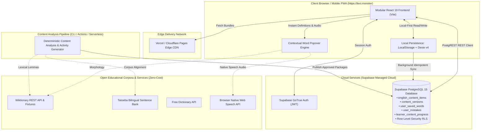

# Lexilume — Target Architecture Specification

> **Repository:** `VINODH0101/language-learning` (Lexilume — Illuminate Your Words)  
> **Production Application:** `https://lexi.monster`  
> **Phase:** Phase 4 — Target Architecture Design  
> **Document Type:** Master System Specification  
> **Status:** Final Proposed Target Architecture Baseline

---

## 1. Executive Summary & Product Vision

Lexilume is transforming into a **simple, content-centred English learning platform**. The foundational paradigm shift is:

> **One authentic source of English content (an article, conversation, workplace email, story, or technical guide) becomes the single source of truth for reading, listening, speaking, writing, vocabulary acquisition, grammar analysis, and contextual comprehension.**

### The Target Product Model in Action:
1. **Administrative Content Provision:** An administrator provides authentic English text (via clean text paste, article URL, or file upload) along with metadata (genre, source attribution, license).
2. **Deterministic & Contextual Analysis:** The system segments the text, profiles vocabulary by frequency and CEFR level, extracts key expressions and idioms, derives grammar insights directly from the text, attaches Portuguese and Spanish pedagogical explanations, and synthesizes content-type-aware learning activities.
3. **Editorial Quality Gate:** The administrator inspects and verifies the analysis in the Admin Content Studio, with the ability to edit wording or rerun individual stages before approving publication.
4. **Unified Learner Engagement:** A learner engages with the published content through a streamlined **4-tab interface** (`Learn`, `My Words`, `My Mistakes`, `Settings`). The learner reads the authentic text, uses the **Contextual Word Popover** to see contextual meanings and hear native pronunciation, saves vocabulary to their personal SM-2 spaced repetition deck, and completes exercises derived directly from the text they just read.

---

## 2. Core Architectural Principles

The target architecture strictly adheres to five core architectural principles:

### 2.1 Content-Centred Foundation
Content is the primary learning resource. Courses, vocabulary lists, grammar topics, reading passages, and quizzes no longer operate as disconnected silos with separate sources of truth. All pedagogical activities are derived from, and link back to, an authentic content item.

### 2.2 Radical Simplicity Over Feature Bloat
The current application suffers from excessive dashboard widgets, duplicate vocabulary tables, multiple competing lesson generators, and fragmented navigation. The target architecture replaces this with:
- A streamlined **4-tab learner navigation** (`Learn`, `My Words`, `My Mistakes`, `Settings`).
- A single canonical course engine focused on English acquisition (with Portuguese and Spanish explanations).
- Zero unnecessary navigational friction between reading and practice.

### 2.3 Modular Monolith Architecture
Lexilume avoids unnecessary microservices or distributed systems. It is structured as a **modular monolith** with clean, decoupled boundaries:
- **Application Shell & Routing:** Zero-dependency SPA navigation with lazy-loaded route boundaries.
- **Learner Experience Subsystem:** Unified reader, contextual lookup engine, and dynamic activity player.
- **Personal Lexicon & SRS Subsystem:** Word bookmarking, custom notes, and SM-2 spaced repetition scheduling.
- **Diagnostic & Remediation Subsystem:** Mistake notebook capturing genuine errors with targeted re-practice.
- **Administrative Subsystem:** Content submission, stage-by-stage processing pipeline, review queue, and audit logs.
- **Persistence & Synchronization Subsystem:** Three-tier local-first storage (LocalStorage, Dexie v4, Supabase PostgREST).
- **Linguistic & Provider Subsystem:** Open educational datasets (Wiktionary, Tatoeba), Web Speech API, and optional LLM fallback.

### 2.4 Local-First Resilience
Learners must be able to study on a plane, subway, or during network disruptions without degraded functionality.
- Core learning content, saved vocabulary, SRS flashcards, and mistake notebooks operate offline in **Dexie v4 IndexedDB**.
- Offline mutations enqueue into `syncQueue` and automatically flush to Supabase PostgreSQL upon reconnection with idempotent conflict resolution.

### 2.5 Cost-Conscious / Zero-Paid AI Mandate
The platform must function sustainably with **zero mandatory external paid AI subscriptions**:
- Content analysis, definitions, parallel sentence examples, and exercise generation operate deterministically using open educational datasets (Wiktionary, Tatoeba, Project Gutenberg).
- Content is analyzed and generated **once** at administrative publishing time and shared across all learners, rather than executing expensive live LLM requests for every individual learner interaction.
- Optional Gemini API integration remains strictly user-provided or administrative, with full offline deterministic fallbacks.

---

## 3. System Context & High-Level Architecture



---

## 4. Frontend Application Architecture & Route Splitting

### 4.1 Modular Frontend Structure
```
frontend/src/
├── app/                        # Application Shell
│   ├── layouts/AppShell.tsx    # Streamlined 4-tab shell layout
│   ├── providers/AppProviders  # I18n, Auth, Toast contexts
│   └── router/useAppRouter.ts  # Lightweight history/hash router
├── features/                   # Core Feature Subsystems
│   ├── learn/                  # Unified Reading & Activity Experience
│   │   ├── components/         # ContentCard, UnifiedReader, ActivityHost
│   │   ├── hooks/useContent.ts # Content loading & caching hook
│   │   └── types.ts            # Content item & activity interfaces
│   ├── words/                  # My Words Personal Lexicon
│   │   ├── components/         # WordList, WordDetailModal, SrsDeck
│   │   └── services/vocabSvc.ts# Vocabulary persistence & SM-2
│   ├── mistakes/               # My Mistakes Notebook
│   │   └── components/         # MistakeList, RemediationSession
│   ├── settings/               # Decoupled Language & UI Settings
│   └── admin/                  # Administrative Content Studio
│       ├── components/         # IngestionForm, StageReview, AuditLogs
│       └── services/pipeline.ts# Processing job triggers & retry
├── shared/                     # Shared Atomic UI & Utilities
│   ├── components/             # Button, Badge, Modal, Card
│   ├── popover/                # ContextualWordPopover component
│   └── speech/                 # Web Speech API wrapper
└── services/                   # Foundation Services
    ├── localDb.ts              # Dexie v4 IndexedDB configuration
    ├── storage.ts              # Scoped LocalStorage manager
    └── syncEngine.ts           # Offline mutation sync engine
```

### 4.2 Route Hierarchy & Lazy Loading
To eliminate the 2.6 MB monolithic bundle warning discovered in Phase 3, the target architecture enforces **route-level code-splitting** using `React.lazy()`:

| Route Path | Route ID | Target View Component | Loading Strategy | Target Bundle Size |
| :--- | :--- | :--- | :--- | :--- |
| `/` or `/learn` | `learn` | `LearnPage.tsx` | Eager (Root Chunk) | ~180 kB |
| `/learn/:slug` | `content_detail`| `ContentDetailPage.tsx` | Lazy Loaded (`React.lazy`) | ~90 kB |
| `/words` | `my_words` | `MyWordsPage.tsx` | Lazy Loaded (`React.lazy`) | ~110 kB |
| `/mistakes` | `my_mistakes` | `MyMistakesPage.tsx` | Lazy Loaded (`React.lazy`) | ~75 kB |
| `/settings` | `settings` | `SettingsPage.tsx` | Lazy Loaded (`React.lazy`) | ~65 kB |
| `/admin` | `admin` | `AdminStudioPage.tsx` | Lazy Loaded (`React.lazy`) | ~240 kB (Admin only) |

*Benefit:* Initial learner load drops from 2,613 kB to **~280 kB total JS**, reducing Time-to-Interactive (TTI) by over 70% on mobile networks.

---

## 5. Security & Authorization Architecture

### 5.1 Defense-in-Depth Model
Client-side route guards are treated strictly as presentation conveniences. The actual security boundaries are enforced at the database and API layers:

```mermaid
flowchart TD
    ClientReq[Client HTTPS Request] --> JWTCheck{Valid Supabase JWT?}
    JWTCheck -- No (Guest) --> RLS_Public[RLS Rule: Allow SELECT on published content only]
    JWTCheck -- Yes (Learner) --> RLS_User[RLS Rule: Allow CRUD on rows where auth.uid() = user_id]
    
    JWTCheck -- Yes (Admin) --> RoleCheck{has_role(auth.uid(), 'admin')}
    RoleCheck -- Yes --> RLS_Admin[RLS Rule: Allow ALL on admin tables & draft content]
    RoleCheck -- No --> AccessDenied[HTTP 403 Forbidden]
```

### 5.2 Key Security Controls
1. **Zero Credential Exposure:** Neither `SUPABASE_SERVICE_ROLE_KEY` nor server AI keys are ever bundled into the client Vite build.
2. **Row-Level Security (RLS):** All user tables (`user_saved_words`, `user_mistakes`, `learner_content_progress`) enforce strict tenant ownership via `auth.uid() = user_id`.
3. **Shared Content Read Rules:** `english_content_items` and `content_versions` permit public `SELECT` access only where `status = 'published'`, preventing learners from accessing drafts or unmoderated content.
4. **Input Sanitization:** All ingested text, whether from plain text or external URL scraping, passes through DOMPurify sanitization before database persistence or DOM injection.

---

## 6. Performance, Scalability & Storage Cost Architecture

### 6.1 Storage Distribution & Quota Management
To resolve the critical Phase 3 finding regarding the 5 MB browser LocalStorage quota:
- **LocalStorage:** Restricted to lightweight preferences (`theme`, `interface_language`, `explanation_language`, active content slug).
- **Dexie IndexedDB:** Handles all structured data (cached articles, saved vocabulary, SM-2 schedules, exercise attempts). IndexedDB offers gigabyte-scale storage quotas and indexed queries.
- **Supabase Cloud:** Serves as the authoritative remote store for shared published content and synchronized learner accounts.

### 6.2 Scaling Characteristics
- **Read Operations (Learners):** 100% scalable via edge caching and local IndexedDB. 10,000 concurrent learners reading published articles generate zero Supabase database queries once cached locally.
- **Write Operations (Sync):** Batched via `syncEngine.ts` upon activity completion, preventing database write spikes.
- **Content Processing (Admin):** Content analysis executes asynchronously; publishing one article benefits thousands of learners with zero marginal cost.

---

## 7. Architectural Decisions & Cross-Reference

The target architecture is fully specified across the dedicated Phase 4 documentation suite:
- **Domain Modeling & ERD:** See [TARGET_DOMAIN_MODEL.md](file:///docs/architecture/TARGET_DOMAIN_MODEL.md).
- **Content Processing Pipeline:** See [TARGET_CONTENT_PIPELINE.md](file:///docs/architecture/TARGET_CONTENT_PIPELINE.md).
- **Learner & Admin UX Architecture:** See [TARGET_LEARNER_AND_ADMIN_UX.md](file:///docs/architecture/TARGET_LEARNER_AND_ADMIN_UX.md).
- **Persistence & Synchronization:** See [TARGET_DATA_PERSISTENCE_AND_SYNC.md](file:///docs/architecture/TARGET_DATA_PERSISTENCE_AND_SYNC.md).
- **Security & External Integrations:** See [TARGET_SECURITY_AND_INTEGRATIONS.md](file:///docs/architecture/TARGET_SECURITY_AND_INTEGRATIONS.md).
- **Complete Architectural Diagrams (12):** See [TARGET_ARCHITECTURE_DIAGRAMS.md](file:///docs/architecture/TARGET_ARCHITECTURE_DIAGRAMS.md).
- **Feature Transition Matrix:** See [FEATURE_TRANSITION_MATRIX.md](file:///docs/architecture/FEATURE_TRANSITION_MATRIX.md).
- **Technology Decision Matrix:** See [TECHNOLOGY_DECISIONS.md](file:///docs/architecture/TECHNOLOGY_DECISIONS.md).
- **Phase 4 Findings & Handoff:** See [PHASE_4_FINDINGS_AND_HANDOFF.md](file:///docs/architecture/PHASE_4_FINDINGS_AND_HANDOFF.md).
