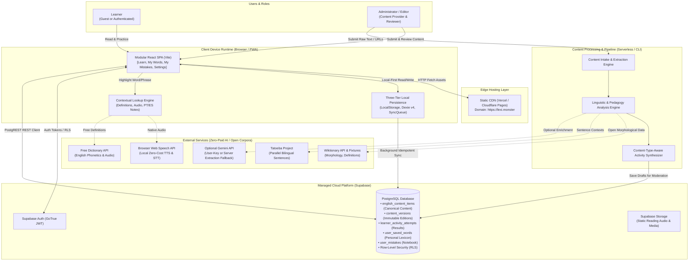
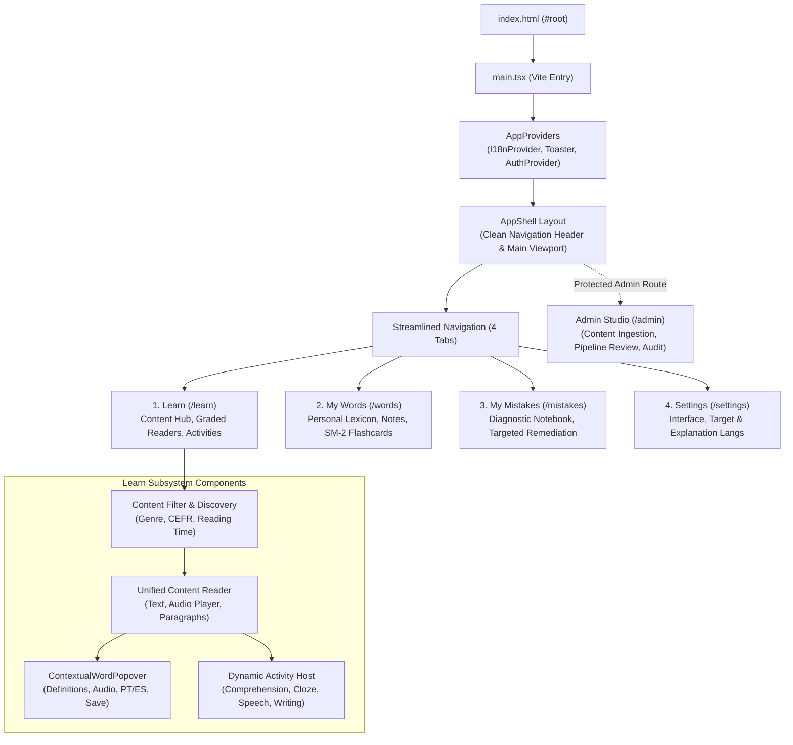
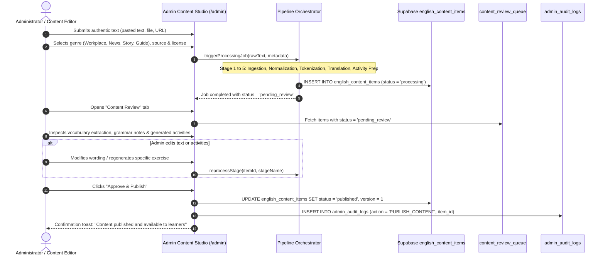
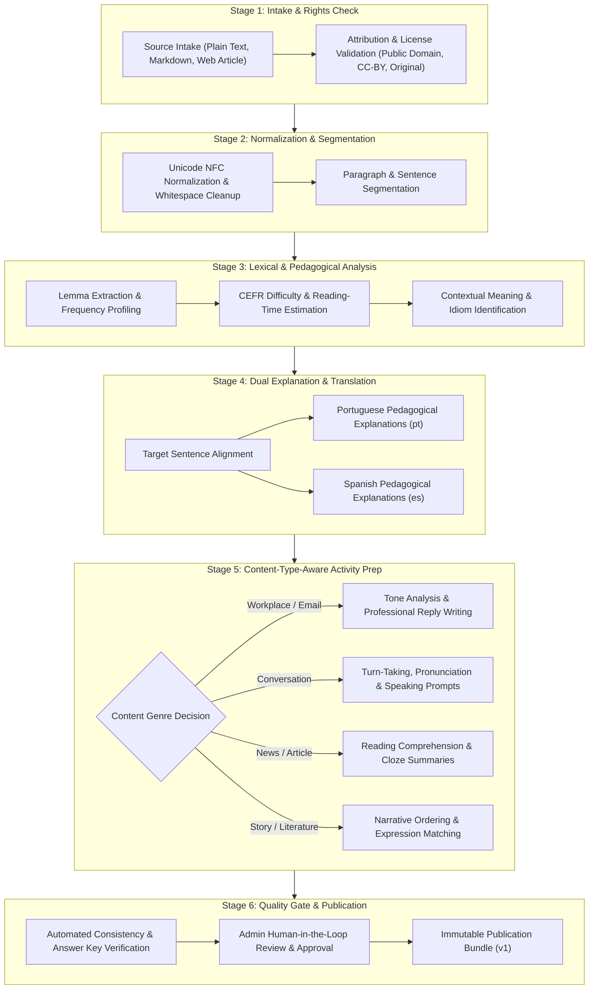
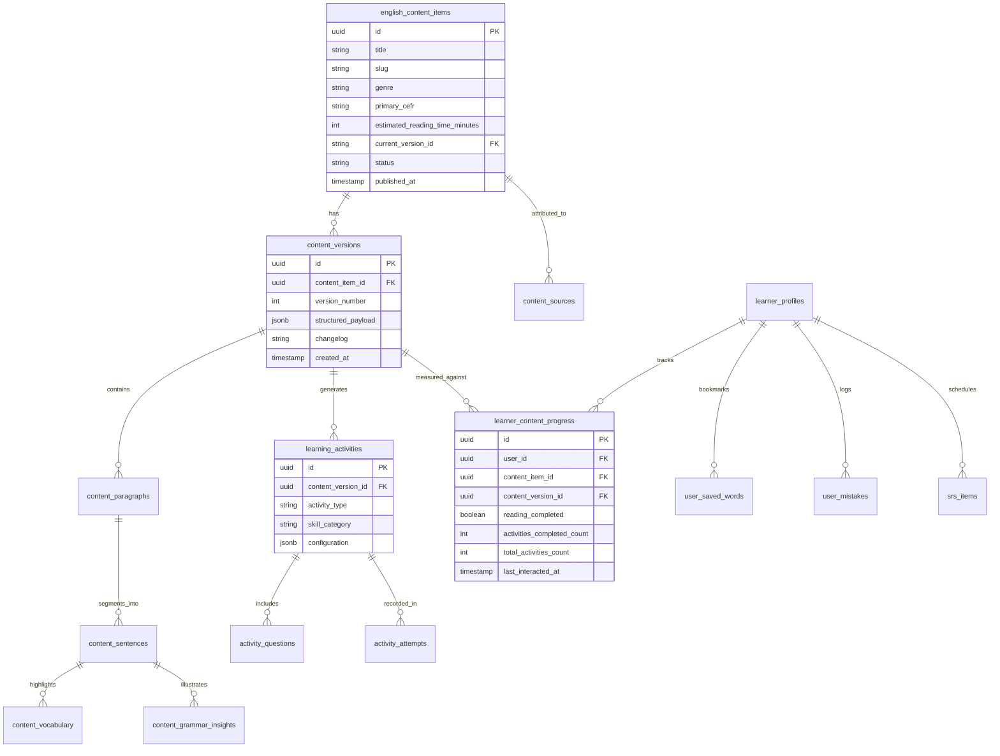
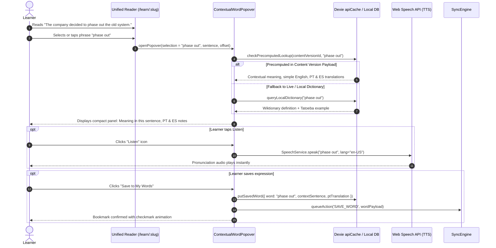
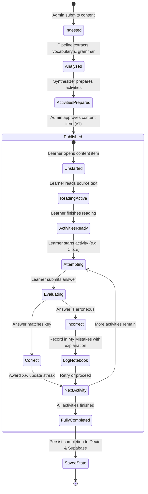
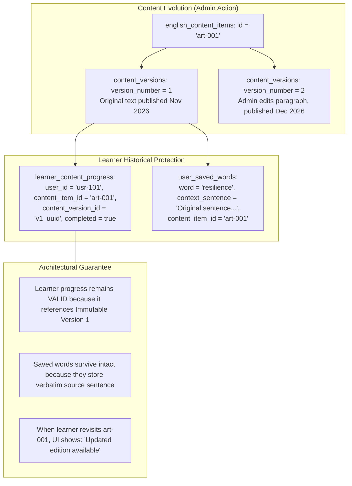
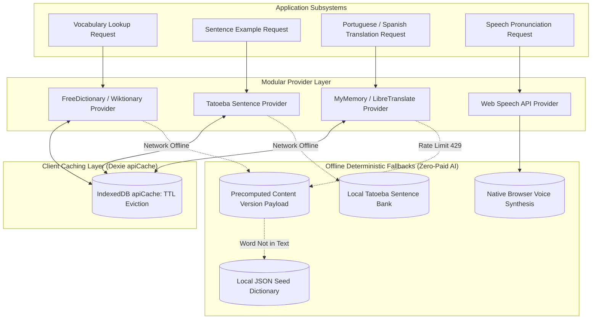
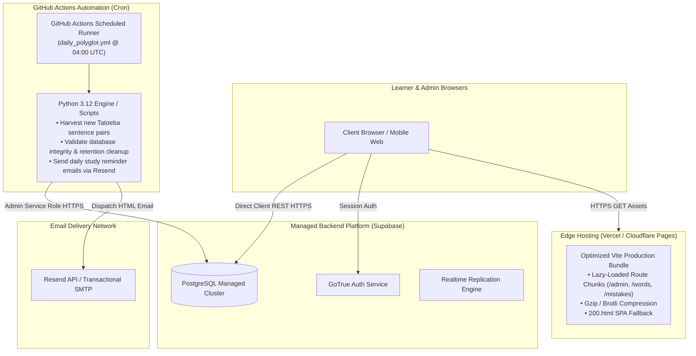

# Lexilume — Target Architecture Diagrams

> **Repository:** `VINODH0101/language-learning` (Lexilume — Illuminate Your Words)  
> **Production Application:** `https://lexi.monster`  
> **Phase:** Phase 4 — Target Architecture Design  
> **Core Principle:** One authentic source of content powers multiple meaningful learning experiences.

---

## 1. Overview

This document consolidates the **12 mandatory architectural diagrams** for the target Lexilume platform. These diagrams represent the planned target architecture, cleanly distinguishing between MVP capabilities and future extensions.

---

## 2. Diagram 1 — Overall Target System Context



---

## 3. Diagram 2 — Frontend Application Structure



---

## 4. Diagram 3 — Admin Content Ingestion and Publication



---

## 5. Diagram 4 — Content-Processing Pipeline Architecture



---

## 6. Diagram 5 — Content Domain Relationships & Entities



---

## 7. Diagram 6 — Learner Reading and Contextual Lookup Interaction



---

## 8. Diagram 7 — Learning Activity Lifecycle



---

## 9. Diagram 8 — Authentication, Authorization & Security Architecture

```mermaid
flowchart TD
    subgraph ClientAuth ["Client Auth Flow (authService.ts)"]
        InitCheck{Session exists in browser?}
        InitCheck -- No --> GuestMode[Guest Mode: User ID = 'guest', Role = 'learner']
        InitCheck -- Yes --> TokenCheck{JWT Token Valid?}
        TokenCheck -- Yes --> AuthLearner[Authenticated Learner: User ID = UUID]
        TokenCheck -- Expired --> Refresh[Auto-Refresh JWT via Supabase GoTrue]
        Refresh --> AuthLearner
    end

    subgraph SecurityEnforcement ["Security & Access Enforcement"]
        UI_Guard[Client Route Guard: Can display view?]
        PostgREST_RLS[Supabase PostgreSQL RLS: Row-Level Security]
    end

    subgraph DatabaseTables ["Database Protection Rules"]
        PublicContent[english_content_items: READ allowed if status = 'published']
        PersonalData[learner_progress, user_saved_words: ALL allowed WHERE auth.uid() = user_id]
        AdminTables[admin_audit_logs, review_queue: ALL allowed WHERE has_role(auth.uid(), 'admin')]
    end

    GuestMode --> UI_Guard
    AuthLearner --> UI_Guard

    UI_Guard -->|REST Request| PostgREST_RLS
    PostgREST_RLS --> PublicContent
    PostgREST_RLS --> PersonalData
    PostgREST_RLS --> AdminTables
```

---

## 10. Diagram 9 — Local-First Persistence and Background Synchronization

```mermaid
flowchart LR
    subgraph Tier1LocalStorage ["Tier 1: LocalStorage"]
        LS_Pref["polyglot_settings_{uid}<br/>(UI theme, interface_lang)"]
        LS_Active["polyglot_active_item_{uid}<br/>(Current reading pointer)"]
    end

    subgraph Tier2Dexie ["Tier 2: Dexie IndexedDB v4"]
        D_Content["cached_content_items<br/>(Full offline reading articles)"]
        D_Words["user_saved_words<br/>(Personal lexicon + SM-2)"]
        D_Mistakes["user_mistakes<br/>(Diagnostic error notebook)"]
        D_Progress["learner_progress<br/>(Content completion records)"]
        D_Queue["syncQueue<br/>(Pending mutations)"]
    end

    subgraph Tier3Supabase ["Tier 3: Supabase Cloud PostgreSQL"]
        S_Content["english_content_items (Canonical)"]
        S_Words["user_saved_words (Cloud Backup)"]
        S_Mistakes["user_mistakes (Cloud Backup)"]
        S_Progress["learner_content_progress (Telemetry)"]
    end

    LearnerAction[Learner Saves Word / Completes Activity] --> WriteTier1[Write lightweight state to LocalStorage]
    LearnerAction --> WriteTier2[Write structured entity to Dexie IndexedDB]
    WriteTier2 --> Enqueue[Enqueue mutation into Dexie syncQueue]

    Enqueue --> CheckOnline{Online & Authenticated?}
    CheckOnline -- No --> OfflineStay[Retain in syncQueue with Exponential Backoff]
    CheckOnline -- Yes --> SyncEngine[syncEngine.syncNow()]

    SyncEngine --> UpsertCloud[Idempotent PostgREST Upsert with Compound Conflict Key]
    UpsertCloud -- Success (200/201) --> Dequeue[Delete item from syncQueue]
    UpsertCloud -- Network Failure --> Backoff[Increment retry_count + Jitter Delay]
    Backoff --> OfflineStay
```

---

## 11. Diagram 10 — Content Versioning and Learner Progress Immutability



---

## 12. Diagram 11 — External Integration Architecture & Fallback Cascade



---

## 13. Diagram 12 — Target Production Deployment and Scheduled Automation


