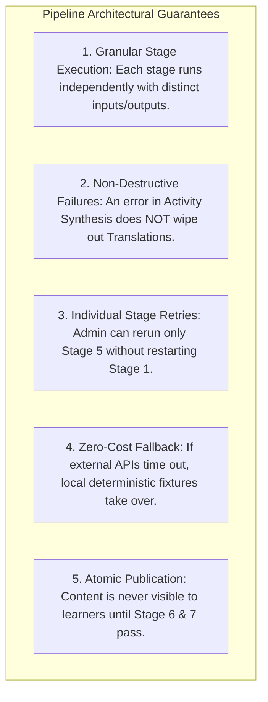

# Lexilume — Target Content-Processing Pipeline

> **Repository:** `VINODH0101/language-learning` (Lexilume — Illuminate Your Words)  
> **Production Application:** `https://lexi.monster`  
> **Phase:** Phase 4 — Target Architecture Design  
> **Core Principle:** A resilient, decoupled multi-stage pipeline that prepares authentic text for learning without expensive per-learner cloud calls.

---

## 1. Executive Summary

The target content-processing pipeline transforms raw English source material into structured, verified educational packages. Rather than implementing an unnecessarily fragile 21-stage autonomous multi-agent system, the target architecture consolidates processing into **8 practical, independently retryable stages**:

---

## 2. Format Support Strategy (Categorization of 17 Historical Formats)

To ensure high reliability and immediate delivery, historical intake formats are prioritized:

| Tier | Format / Source Type | Supported in MVP? | Extraction Mechanism | Rationale & Trade-Offs |
| :--- | :--- | :--- | :--- | :--- |
| **Tier 1: MVP Core** | **Plain Text / Paste** | **Yes (Primary)** | Direct UTF-8 textarea input | Highest reliability; zero parser dependencies; zero extraction artifacts. |
| **Tier 1: MVP Core** | **Markdown (.md)** | **Yes** | Standard markdown parser | Preserves headings, bold highlights, bulleted lists, and quotes. |
| **Tier 1: MVP Core** | **Article Webpage URL** | **Yes** | Serverless readability scraper | Fetches clean article body, stripping ads and navigation chrome. |
| **Tier 1: MVP Core** | **Image OCR** | **Yes** | Dynamic Tesseract.js WASM | Extracts text from snapshots of signs, menus, and book pages. |
| **Tier 2: Next Stage** | **PDF Documents** | Planned (Phase 5) | `pdfjs-dist` text stream extractor | High demand for workplace manuals and academic papers; requires layout de-hyphenation. |
| **Tier 2: Next Stage** | **Word (.docx)** | Planned (Phase 5) | `mammoth.js` DOCX-to-HTML parser | Common in workplace contexts; clean XML extraction. |
| **Tier 2: Next Stage** | **EPUB E-books** | Planned (Phase 5) | EPUB unzipper & chapter extractor | Excellent for public-domain literature (Project Gutenberg). |
| **Tier 3: Future** | **Subtitles (.srt / .vtt)** | Future Optional | Subtitle timestamp parser | Conversational dialogues with timecodes for listening practice. |
| **Tier 3: Future** | **Podcast Audio Transcripts**| Future Optional | Whisper API transcription | High pedagogical value, but requires audio storage infrastructure. |
| **Tier 4: Excluded** | **Raw Video Files** | **Not Recommended**| N/A | High bandwidth cost; excessive transcoding complexity; out of product scope. |

---

## 3. Practical 8-Stage Pipeline Specifications

### Stage 1: Intake & Rights Validation
- **Purpose:** Receives raw text input and validates copyright, licensing, and attribution metadata.
- **Input:** Raw string, file stream, or URL; metadata: `title`, `author`, `source_url`, `license_type` (`Public Domain`, `CC-BY`, `Original Author`, `Fair Use Quotation`).
- **Processing:** Validates required attribution fields; rejects unverified commercial texts.
- **Output:** Cleaned intake payload with license verification badge.
- **Execution:** Deterministic. Required. Idempotent.

### Stage 2: Normalization & Sentence Segmentation
- **Purpose:** Normalizes unicode characters and splits text into structured paragraphs and sentences.
- **Input:** Verified intake text.
- **Processing:** Applies Unicode NFC normalization; strips control characters; splits text into paragraphs (`\n\n`) and sentences using sentence boundary disambiguation (handling abbreviations like *e.g.*, *Dr.*, *U.S.* without breaking).
- **Output:** `Array<Paragraph>` where each paragraph contains `Array<Sentence>` with character start/end offsets.
- **Execution:** Deterministic. Required. Idempotent.

### Stage 3: Lexical & Pedagogy Profiling
- **Purpose:** Identifies key vocabulary lemmas, expressions, and CEFR difficulty.
- **Input:** Segmented sentences.
- **Processing:**
  - Tokenizes lemmas and queries Wiktionary / Free Dictionary for part of speech, IPA phonetics, and frequency tier.
  - Matches multi-word expressions against an idiomatic phrase dictionary (e.g. *phase out*, *take for granted*).
  - Computes text-level CEFR rating (`A2` through `C1`) based on lexical distribution and average sentence length.
  - Computes estimated reading time (words / 180 words-per-minute).
- **Output:** `LexicalProfile` containing key target words with sentence coordinates and estimated CEFR level.
- **Execution:** Deterministic (with optional LLM enrichment). Required. Idempotent.

### Stage 4: Dual Explanation & Translation
- **Purpose:** Prepares pedagogical Portuguese and Spanish explanations for the identified key words and expressions.
- **Input:** Target sentences and extracted lexical items.
- **Processing:**
  - Queries Tatoeba parallel sentence alignments for bilingual example sentences.
  - Generates context-specific meaning in simple English, Portuguese translation, and Spanish translation.
  - Fallback: MyMemory API / local trilingual dictionary fixtures.
- **Output:** `BilingualNotes` containing `pt` and `es` definitions, translations, and false-friend alerts.
- **Execution:** Deterministic fallback active. Required. Idempotent.

### Stage 5: Genre-Aware Learning Activity Synthesis
- **Purpose:** Synthesizes interactive exercises tailored to the specific genre of the text.
- **Input:** Source text, paragraphs, lexical items, and genre metadata.
- **Processing (Genre Rules):**
  - *Workplace / Email:* Generates tone analysis exercise, professional vocabulary cloze, and reply drafting prompt.
  - *Conversation / Dialogue:* Generates turn-taking sequencing, pronunciation check, and dialogue response prompt.
  - *News / Thought Leadership:* Generates reading comprehension multiple choice, summary fill-in-the-blank, and argumentative writing prompt.
  - *Story / Literature:* Generates chronological event ordering, figurative expression matching, and creative extension writing prompt.
- **Output:** `Array<LearningActivity>` with question stems, distractor options, correct keys, and pedagogical feedback.
- **Execution:** Deterministic templates. Required. Idempotent.

### Stage 6: Quality Gate & Automated Validation
- **Purpose:** Verifies internal consistency before presenting the package for administrative review.
- **Processing Checks:**
  1. *Answer Key Validity:* Verifies that every multiple choice question has exactly one correct answer and 3 distinct plausible distractors.
  2. *Cloze Integrity:* Verifies that cloze target words exist verbatim within the referenced source sentence.
  3. *Attribution Completeness:* Verifies author, source URL, and license are present.
  4. *Linguistic Coverage:* Confirms that at least 5 key vocabulary items and 3 exercises were successfully generated.
- **Output:** Validation status: `passed` or `failed` with diagnostic error log.
- **Execution:** Deterministic. Required. Idempotent.

### Stage 7: Administrative Human Review
- **Purpose:** Provides a human-in-the-loop editorial interface for review and adjustments.
- **Capabilities:**
  - Administrator inspects generated vocabulary, translations, and exercises in the Admin Studio.
  - Can edit wording, replace a distractor, or click "Regenerate Stage 5" without re-running stages 1–4.
  - Approves or rejects the item with reviewer notes.
- **Output:** Status updated to `approved`.
- **Execution:** Manual human action. Required.

### Stage 8: Immutable Publication
- **Purpose:** Packages approved content into an immutable version and publishes it to learners.
- **Processing:**
  - Creates `content_versions` row with `version_number = 1` containing the complete payload in `structured_payload`.
  - Sets `english_content_items.status = 'published'` and `published_at = NOW()`.
  - Emits background cache warming to Dexie IndexedDB.
  - Logs immutable audit record to `admin_audit_logs`.
- **Output:** Publicly accessible content item live on `https://lexi.monster/learn/:slug`.
- **Execution:** Deterministic database transaction. Required.

---

## 4. Pipeline Resilience & Fault-Tolerance Guarantees

