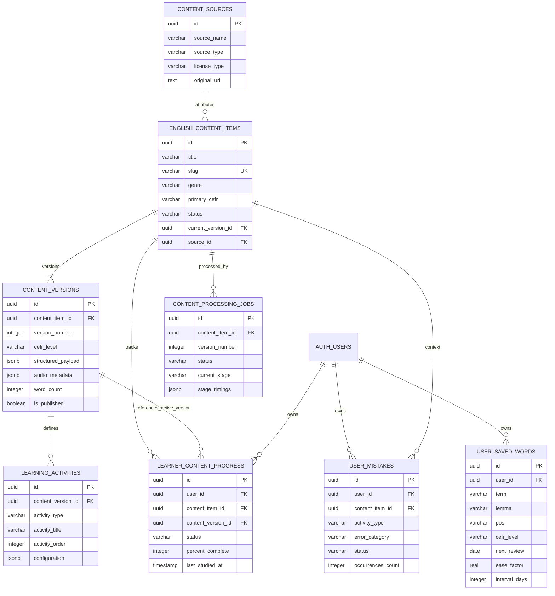

# Lexilume — Target Database Schema Specification

> **Repository:** `VINODH0101/language-learning` (Lexilume — Illuminate Your Words)  
> **Production Application:** `https://lexi.monster`  
> **Phase:** Phase 5 — Database Design, Data Mapping & Safe Migration Plan  
> **Target Migration Number:** `015` (`015_content_centred_architecture.sql`)  
> **Status:** Proposed Target Schema Specification (Strictly DDL Design — Not Executed)

---

## 1. Executive Summary & Design Principles

The Phase 4 Target Architecture established that Lexilume must transition from fragmented, multi-track curriculum catalogs into a **unified, content-centred language-learning engine**. In this target model:
1. **One authentic content item** (conversation, story, news article, business message, academic text) becomes the single source of truth for all learning activities (reading, listening, vocabulary, grammar, writing, speaking).
2. **Content is versioned immutably**, ensuring learner progress and bookmarks remain stable even when editorial corrections or expansions occur.
3. **Lexical storage is consolidated**, unifying `saved_translations`, `srs_items`, and `user_vocabulary_history` into a single, high-performance personal vocabulary repository (`user_saved_words`).
4. **Targeted error recovery** is elevated to a first-class feature via a dedicated mistake notebook (`user_mistakes`).
5. **Architectural boundary separation** is enforced between queryable relational metadata and deep hierarchical pedagogical payloads (relational columns for indexing, filtering, and joins; JSONB for token alignments and interactive exercises).

---

## 2. Relational vs. JSONB Trade-Off Matrix

A critical design choice in PostgreSQL for educational platforms is deciding where relational columns end and JSONB documents begin:

| Entity / Concern | Primary Storage | Justification & Query Pattern |
| :--- | :--- | :--- |
| **Content Catalog Indexing** (`status`, `genre`, `primary_cefr`, `slug`) | **Relational Columns** | High-cardinality filtering, sorting, pagination, and multi-tenant catalog search require B-tree index efficiency. |
| **Content Hierarchy** (Paragraphs, sentences, tokens, annotations) | **JSONB Document** (`structured_payload`) | A single reading activity requires the entire annotated text tree. Fetching this in 1 JSONB read avoids 400+ normalized row joins per lesson. The internal structure is immutable per content version. |
| **Personal Lexicon & Spaced Repetition** (`user_saved_words`) | **Relational Columns** | SM-2 scheduling requires exact index scans on `(user_id, next_review ASC)` for daily due queues. Querying JSONB for scheduled dates introduces severe index bloat. |
| **Mistake Notebook** (`user_mistakes`) | **Relational Columns** | Filtered by `user_id`, `status`, and `error_category` for targeted review sessions. Relational columns allow exact aggregation of error frequency and mastery metrics. |
| **Activity Definitions** (`learning_activities`) | **Hybrid** (Relational header + JSONB config) | Relational headers allow ordering and filtering by `activity_type`; JSONB `configuration` handles diverse schemas (multiple-choice, fill-in-blank, open writing prompt) without polymorphic table sprawl. |
| **Pipeline Job Execution** (`content_processing_jobs`) | **Hybrid** (Relational state + JSONB audit) | Relational status allows worker queue polling (`status = 'queued'`); JSONB `stage_timings` logs granular profiling data. |

---

## 3. Canonical Target Entity Relationship (ERD)



---

## 4. Comprehensive Target Table Specifications

### 4.1 `content_sources`
Tracks attribution, open licenses (Creative Commons, Public Domain, Tatoeba), and external provenance for copyright compliance.

```sql
CREATE TABLE IF NOT EXISTS public.content_sources (
    id UUID PRIMARY KEY DEFAULT gen_random_uuid(),
    source_name VARCHAR(100) NOT NULL,
    source_type VARCHAR(50) NOT NULL CHECK (source_type IN ('public_domain', 'open_license', 'editorial', 'user_submitted', 'partner')),
    author VARCHAR(150),
    original_url TEXT,
    license_type VARCHAR(50) NOT NULL DEFAULT 'CC-BY-SA-4.0',
    license_text TEXT,
    attribution_notice TEXT NOT NULL,
    created_at TIMESTAMPTZ NOT NULL DEFAULT timezone('utc'::text, now()),
    updated_at TIMESTAMPTZ NOT NULL DEFAULT timezone('utc'::text, now())
);

CREATE INDEX IF NOT EXISTS idx_content_sources_license ON public.content_sources(license_type);
```

### 4.2 `english_content_items`
The primary catalog entity for authentic English reading and listening materials.

```sql
CREATE TABLE IF NOT EXISTS public.english_content_items (
    id UUID PRIMARY KEY DEFAULT gen_random_uuid(),
    title VARCHAR(200) NOT NULL,
    slug VARCHAR(220) NOT NULL,
    summary TEXT,
    genre VARCHAR(50) NOT NULL CHECK (genre IN (
        'conversation', 'dialogue', 'short_story', 'literature', 
        'news_article', 'workplace_email', 'business_report', 
        'academic_essay', 'culture_and_travel', 'grammar_in_action'
    )),
    primary_cefr VARCHAR(2) NOT NULL CHECK (primary_cefr IN ('A1', 'A2', 'B1', 'B2', 'C1', 'C2')),
    estimated_read_minutes INTEGER NOT NULL DEFAULT 3 CHECK (estimated_read_minutes > 0),
    status VARCHAR(30) NOT NULL DEFAULT 'draft' CHECK (status IN (
        'draft', 'processing', 'in_review', 'published', 'archived'
    )),
    current_version_id UUID, -- Foreign key added via ALTER after content_versions table creation
    source_id UUID REFERENCES public.content_sources(id) ON DELETE SET NULL,
    created_by UUID REFERENCES auth.users(id) ON DELETE SET NULL,
    created_at TIMESTAMPTZ NOT NULL DEFAULT timezone('utc'::text, now()),
    updated_at TIMESTAMPTZ NOT NULL DEFAULT timezone('utc'::text, now()),
    CONSTRAINT uq_english_content_items_slug UNIQUE (slug)
);

CREATE INDEX IF NOT EXISTS idx_content_items_catalog ON public.english_content_items(status, primary_cefr, genre);
CREATE INDEX IF NOT EXISTS idx_content_items_created_at ON public.english_content_items(created_at DESC);
CREATE INDEX IF NOT EXISTS idx_content_items_source_id ON public.english_content_items(source_id);
```

### 4.3 `content_versions`
Immutable version editions for a content item. Each version snapshot freezes the tokenized text, annotations, audio references, and exercises.

```sql
CREATE TABLE IF NOT EXISTS public.content_versions (
    id UUID PRIMARY KEY DEFAULT gen_random_uuid(),
    content_item_id UUID NOT NULL REFERENCES public.english_content_items(id) ON DELETE CASCADE,
    version_number INTEGER NOT NULL DEFAULT 1 CHECK (version_number > 0),
    cefr_level VARCHAR(2) NOT NULL CHECK (cefr_level IN ('A1', 'A2', 'B1', 'B2', 'C1', 'C2')),
    structured_payload JSONB NOT NULL DEFAULT '{}'::jsonb,
    audio_metadata JSONB NOT NULL DEFAULT '{}'::jsonb,
    word_count INTEGER NOT NULL DEFAULT 0 CHECK (word_count >= 0),
    sentence_count INTEGER NOT NULL DEFAULT 0 CHECK (sentence_count >= 0),
    lexical_density REAL CHECK (lexical_density >= 0.0 AND lexical_density <= 1.0),
    is_published BOOLEAN NOT NULL DEFAULT FALSE,
    change_summary VARCHAR(255),
    created_by UUID REFERENCES auth.users(id) ON DELETE SET NULL,
    published_at TIMESTAMPTZ,
    created_at TIMESTAMPTZ NOT NULL DEFAULT timezone('utc'::text, now()),
    CONSTRAINT uq_content_versions_item_version UNIQUE (content_item_id, version_number)
);

CREATE INDEX IF NOT EXISTS idx_content_versions_item ON public.content_versions(content_item_id, version_number DESC);
CREATE INDEX IF NOT EXISTS idx_content_versions_published ON public.content_versions(is_published, cefr_level);
-- GIN index on structured_payload for fast pedagogical token or grammar query
CREATE INDEX IF NOT EXISTS idx_content_versions_payload_gin ON public.content_versions USING gin(structured_payload);

-- Add circular foreign key from english_content_items to content_versions
ALTER TABLE public.english_content_items
    ADD CONSTRAINT fk_content_items_current_version
    FOREIGN KEY (current_version_id)
    REFERENCES public.content_versions(id)
    ON DELETE SET NULL;
```

#### Structured Payload JSONB Schema Specification:
```json
{
  "title": "A Morning Coffee in Dublin",
  "paragraphs": [
    {
      "id": "p1",
      "order": 1,
      "sentences": [
        {
          "id": "s1_1",
          "order": 1,
          "text": "The barista poured the velvety flat white into a ceramic cup.",
          "tokens": [
            { "text": "The", "lemma": "the", "pos": "DET", "cefr": "A1" },
            { "text": "barista", "lemma": "barista", "pos": "NOUN", "cefr": "B1" },
            { "text": "poured", "lemma": "pour", "pos": "VERB", "cefr": "A2" },
            { "text": "velvety", "lemma": "velvety", "pos": "ADJ", "cefr": "C1", "glossary_id": "g_velvety" }
          ],
          "audio_offset_ms": { "start": 0, "end": 3420 }
        }
      ]
    }
  ],
  "annotations": {
    "g_velvety": {
      "lemma": "velvety",
      "pos": "adjective",
      "definition": "Having a smooth, soft texture reminiscent of velvet.",
      "ipa": "/ˈvɛlvɪti/",
      "cefr": "C1",
      "context_translation": {
        "pt": "aveludado",
        "es": "aterciopelado"
      }
    }
  },
  "grammar_points": [
    {
      "id": "gram_past_simple",
      "title": "Past Simple with Irregular & Regular Verbs",
      "target_tokens": ["poured"],
      "explanation_summary": "Poured is the regular simple past form of pour."
    }
  ]
}
```

### 4.4 `learning_activities`
Structured learning activities derived from a content version (Reading comprehension, Cloze exercises, Vocabulary matching, Listening dictation, Written production).

```sql
CREATE TABLE IF NOT EXISTS public.learning_activities (
    id UUID PRIMARY KEY DEFAULT gen_random_uuid(),
    content_version_id UUID NOT NULL REFERENCES public.content_versions(id) ON DELETE CASCADE,
    activity_type VARCHAR(40) NOT NULL CHECK (activity_type IN (
        'reading_comprehension', 'vocabulary_cloze', 'grammar_transformation',
        'listening_dictation', 'sentence_scramble', 'spoken_shadowing', 'free_writing'
    )),
    activity_title VARCHAR(150) NOT NULL,
    activity_order INTEGER NOT NULL DEFAULT 1 CHECK (activity_order > 0),
    estimated_minutes INTEGER NOT NULL DEFAULT 5 CHECK (estimated_minutes > 0),
    configuration JSONB NOT NULL DEFAULT '{}'::jsonb,
    created_at TIMESTAMPTZ NOT NULL DEFAULT timezone('utc'::text, now()),
    CONSTRAINT uq_learning_activities_version_order UNIQUE (content_version_id, activity_order)
);

CREATE INDEX IF NOT EXISTS idx_learning_activities_version ON public.learning_activities(content_version_id, activity_order ASC);
CREATE INDEX IF NOT EXISTS idx_learning_activities_type ON public.learning_activities(activity_type);
```

### 4.5 `learner_content_progress`
Granular completion and engagement telemetry tracking each learner's journey through content items and their respective versions.

```sql
CREATE TABLE IF NOT EXISTS public.learner_content_progress (
    id UUID PRIMARY KEY DEFAULT gen_random_uuid(),
    user_id UUID NOT NULL REFERENCES auth.users(id) ON DELETE CASCADE,
    content_item_id UUID NOT NULL REFERENCES public.english_content_items(id) ON DELETE CASCADE,
    content_version_id UUID NOT NULL REFERENCES public.content_versions(id) ON DELETE CASCADE,
    status VARCHAR(30) NOT NULL DEFAULT 'not_started' CHECK (status IN (
        'not_started', 'in_progress', 'completed', 'revisiting'
    )),
    percent_complete INTEGER NOT NULL DEFAULT 0 CHECK (percent_complete >= 0 AND percent_complete <= 100),
    completed_activity_ids JSONB NOT NULL DEFAULT '[]'::jsonb,
    time_spent_seconds INTEGER NOT NULL DEFAULT 0 CHECK (time_spent_seconds >= 0),
    comprehension_score REAL CHECK (comprehension_score >= 0.0 AND comprehension_score <= 1.0),
    first_opened_at TIMESTAMPTZ NOT NULL DEFAULT timezone('utc'::text, now()),
    last_studied_at TIMESTAMPTZ NOT NULL DEFAULT timezone('utc'::text, now()),
    completed_at TIMESTAMPTZ,
    created_at TIMESTAMPTZ NOT NULL DEFAULT timezone('utc'::text, now()),
    updated_at TIMESTAMPTZ NOT NULL DEFAULT timezone('utc'::text, now()),
    CONSTRAINT uq_learner_content_user_item UNIQUE (user_id, content_item_id)
);

CREATE INDEX IF NOT EXISTS idx_learner_progress_user ON public.learner_content_progress(user_id, status, last_studied_at DESC);
CREATE INDEX IF NOT EXISTS idx_learner_progress_item ON public.learner_content_progress(content_item_id);
```

### 4.6 `user_saved_words`
Consolidates personal vocabulary bookmarks, SuperMemo SM-2 spaced repetition state, and contextual definitions across all content.

```sql
CREATE TABLE IF NOT EXISTS public.user_saved_words (
    id UUID PRIMARY KEY DEFAULT gen_random_uuid(),
    user_id UUID NOT NULL REFERENCES auth.users(id) ON DELETE CASCADE,
    term VARCHAR(100) NOT NULL,
    lemma VARCHAR(100) NOT NULL,
    pos VARCHAR(30),
    cefr_level VARCHAR(2) CHECK (cefr_level IN ('A1', 'A2', 'B1', 'B2', 'C1', 'C2')),
    explanation_language VARCHAR(5) NOT NULL DEFAULT 'en' CHECK (explanation_language IN ('en', 'pt', 'es')),
    definition TEXT NOT NULL,
    context_sentence TEXT,
    context_translation TEXT,
    source_content_id UUID REFERENCES public.english_content_items(id) ON DELETE SET NULL,
    audio_url TEXT,
    ipa VARCHAR(60),
    
    -- SM-2 Spaced Repetition Fields
    next_review DATE NOT NULL DEFAULT CURRENT_DATE,
    interval_days INTEGER NOT NULL DEFAULT 0 CHECK (interval_days >= 0),
    ease_factor REAL NOT NULL DEFAULT 2.5 CHECK (ease_factor >= 1.3),
    repetitions INTEGER NOT NULL DEFAULT 0 CHECK (repetitions >= 0),
    lapses INTEGER NOT NULL DEFAULT 0 CHECK (lapses >= 0),
    last_reviewed_at TIMESTAMPTZ,
    
    -- Status state machine
    state VARCHAR(20) NOT NULL DEFAULT 'learning' CHECK (state IN ('learning', 'reviewing', 'mastered', 'ignored')),
    
    created_at TIMESTAMPTZ NOT NULL DEFAULT timezone('utc'::text, now()),
    updated_at TIMESTAMPTZ NOT NULL DEFAULT timezone('utc'::text, now()),
    CONSTRAINT uq_user_saved_words_user_lemma_lang UNIQUE (user_id, lemma, explanation_language)
);

CREATE INDEX IF NOT EXISTS idx_user_saved_words_review_queue ON public.user_saved_words(user_id, next_review ASC) WHERE state IN ('learning', 'reviewing');
CREATE INDEX IF NOT EXISTS idx_user_saved_words_user_term ON public.user_saved_words(user_id, term);
CREATE INDEX IF NOT EXISTS idx_user_saved_words_source ON public.user_saved_words(source_content_id);
```

### 4.7 `user_mistakes`
The Mistake Notebook repository: stores explicit pedagogical error incidents for spaced review and targeted remediation.

```sql
CREATE TABLE IF NOT EXISTS public.user_mistakes (
    id UUID PRIMARY KEY DEFAULT gen_random_uuid(),
    user_id UUID NOT NULL REFERENCES auth.users(id) ON DELETE CASCADE,
    content_item_id UUID REFERENCES public.english_content_items(id) ON DELETE SET NULL,
    activity_id UUID REFERENCES public.learning_activities(id) ON DELETE SET NULL,
    activity_type VARCHAR(40) NOT NULL,
    error_category VARCHAR(50) NOT NULL CHECK (error_category IN (
        'vocabulary_choice', 'verb_tense', 'preposition', 'spelling', 
        'word_order', 'article_usage', 'comprehension_inference', 'pronunciation'
    )),
    stimulus TEXT NOT NULL,
    user_response TEXT NOT NULL,
    correct_response TEXT NOT NULL,
    pedagogical_explanation TEXT NOT NULL,
    status VARCHAR(30) NOT NULL DEFAULT 'unresolved' CHECK (status IN (
        'unresolved', 'review_pending', 'mastered', 'dismissed'
    )),
    occurrences_count INTEGER NOT NULL DEFAULT 1 CHECK (occurrences_count >= 1),
    first_occurred_at TIMESTAMPTZ NOT NULL DEFAULT timezone('utc'::text, now()),
    last_occurred_at TIMESTAMPTZ NOT NULL DEFAULT timezone('utc'::text, now()),
    resolved_at TIMESTAMPTZ,
    created_at TIMESTAMPTZ NOT NULL DEFAULT timezone('utc'::text, now()),
    updated_at TIMESTAMPTZ NOT NULL DEFAULT timezone('utc'::text, now())
);

CREATE INDEX IF NOT EXISTS idx_user_mistakes_queue ON public.user_mistakes(user_id, status, error_category);
CREATE INDEX IF NOT EXISTS idx_user_mistakes_content ON public.user_mistakes(content_item_id);
```

### 4.8 `content_processing_jobs`
Asynchronous pipeline audit and execution tracker for the 8-stage English content analysis pipeline.

```sql
CREATE TABLE IF NOT EXISTS public.content_processing_jobs (
    id UUID PRIMARY KEY DEFAULT gen_random_uuid(),
    content_item_id UUID NOT NULL REFERENCES public.english_content_items(id) ON DELETE CASCADE,
    version_number INTEGER NOT NULL DEFAULT 1,
    status VARCHAR(30) NOT NULL DEFAULT 'queued' CHECK (status IN (
        'queued', 'running', 'completed', 'failed', 'cancelled'
    )),
    current_stage VARCHAR(50) NOT NULL DEFAULT 'stage_0_intake',
    stages_completed JSONB NOT NULL DEFAULT '[]'::jsonb,
    stage_timings JSONB NOT NULL DEFAULT '{}'::jsonb,
    error_message TEXT,
    retry_count INTEGER NOT NULL DEFAULT 0 CHECK (retry_count >= 0),
    triggered_by UUID REFERENCES auth.users(id) ON DELETE SET NULL,
    started_at TIMESTAMPTZ,
    completed_at TIMESTAMPTZ,
    created_at TIMESTAMPTZ NOT NULL DEFAULT timezone('utc'::text, now()),
    updated_at TIMESTAMPTZ NOT NULL DEFAULT timezone('utc'::text, now())
);

CREATE INDEX IF NOT EXISTS idx_content_jobs_worker ON public.content_processing_jobs(status, created_at ASC);
CREATE INDEX IF NOT EXISTS idx_content_jobs_item ON public.content_processing_jobs(content_item_id, version_number);
```

---

## 5. Architectural Data Invariants & Validation Constraints

1. **Strict Immutability of Published Versions:** Once `content_versions.is_published = true`, updates to `structured_payload` are rejected. Any correction creates a new record with `version_number = version_number + 1`.
2. **Pedagogical Language Scoping:** In `user_saved_words`, `explanation_language` must match supported pedagogical explanation languages (`en`, `pt`, `es`). Regional variations (`pt-BR`, `es-ES`) belong strictly to rendering/audio, never to the dictionary key.
3. **Foreign Key Integrity:** Deleting a user profile triggers cascading deletes across personal progress (`learner_content_progress`, `user_saved_words`, `user_mistakes`). Content catalog records (`english_content_items`) are preserved by setting `created_by = NULL`.
4. **Idempotent Timestamp Triggers:** All 8 target tables automatically update their `updated_at` timestamps using the existing `update_updated_at_column()` trigger function.

---

## 6. Compatibility Views for Legacy Client Code

To guarantee that existing frontend services (`srs.ts`, `dailyContentService.ts`, `syncEngine.ts`) continue operating during gradual feature migration, the target schema introduces non-breaking compatibility views:

```sql
-- 1. Spaced Repetition Compatibility View (Emulates legacy srs_items)
CREATE OR REPLACE VIEW public.v_legacy_srs_items AS
SELECT 
    id,
    user_id,
    lemma AS vocabulary_item_id,
    interval_days AS interval,
    ease_factor,
    repetitions,
    next_review::text AS next_review_date,
    last_reviewed_at AS last_reviewed,
    created_at,
    updated_at
FROM public.user_saved_words;

-- 2. Daily Content Compatibility View (Emulates legacy daily_published_content)
CREATE OR REPLACE VIEW public.v_legacy_daily_content AS
SELECT 
    c.id::text AS id,
    c.title,
    c.summary AS context_background,
    v.structured_payload->>'cefr_level' AS cefr_level,
    c.genre AS content_type,
    v.structured_payload->>'text' AS source_text,
    c.created_at AS published_at,
    (c.status = 'published') AS is_active,
    c.created_by,
    c.created_at,
    c.updated_at
FROM public.english_content_items c
JOIN public.content_versions v ON c.current_version_id = v.id
WHERE c.status = 'published';
```
