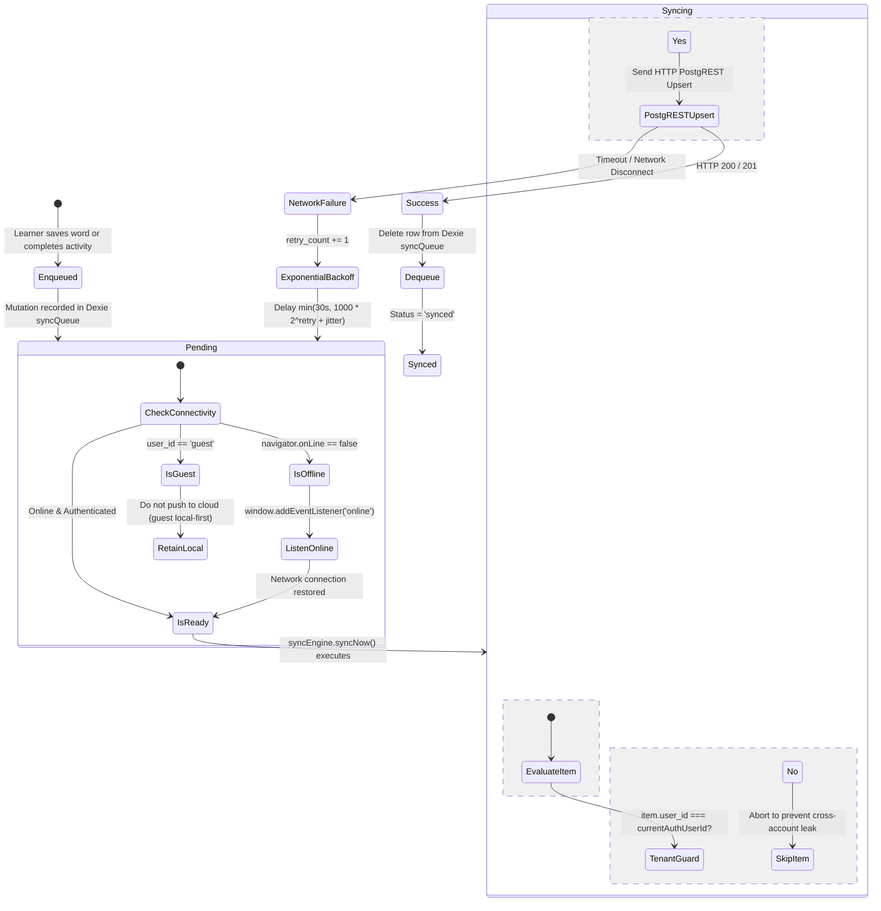

# Lexilume — Target Data Persistence & Synchronization Architecture

> **Repository:** `VINODH0101/language-learning` (Lexilume — Illuminate Your Words)  
> **Production Application:** `https://lexi.monster`  
> **Phase:** Phase 4 — Target Architecture Design  
> **Core Principle:** Local-first durability with zero cross-account data leakage and conflict-resistant cloud synchronization.

---

## 1. Executive Summary

The target data persistence model establishes a disciplined division of responsibility across three storage tiers:
1. **LocalStorage:** Reserved strictly for lightweight, non-sensitive UI preferences and active navigation pointers.
2. **Dexie v4 IndexedDB (`PolyglotLocalDatabase`):** The authoritative local storage engine for structured content caches, personal vocabulary, SRS review queues, mistake notebooks, and the offline sync queue.
3. **Supabase Cloud PostgreSQL:** The remote source of truth for published shared content, authenticated user profiles, and synchronized multi-device records.

---

## 2. Multi-Tier Storage Allocation Matrix

| Data Entity | LocalStorage (Tier 1) | Dexie IndexedDB v4 (Tier 2) | Supabase PostgreSQL (Tier 3) | Canonical Source of Truth |
| :--- | :--- | :--- | :--- | :--- |
| **UI Preferences** (`theme`, `font_size`) | `polyglot_settings_{uid}` | None | `user_profiles.preferences` | LocalStorage (Local preference) |
| **Language Decoupling Settings** | `polyglot_interface_lang` | None | `user_profiles` | LocalStorage + Supabase |
| **Published Shared Content** | None (Avoid 5MB limit) | `cached_content_items` | `english_content_items` & `content_versions` | **Supabase Cloud** (Authoritative) |
| **Personal Saved Vocabulary** | None (Avoid 5MB limit) | `user_saved_words` | `user_saved_words` | **Dexie v4** (Local-first) -> Cloud sync |
| **SM-2 Spaced Repetition State** | None (Avoid 5MB limit) | `user_saved_words` (SRS fields) | `user_saved_words` (SRS fields) | **Dexie v4** (Local-first) -> Cloud sync |
| **Mistake Notebook Entries** | None (Avoid 5MB limit) | `user_mistakes` | `user_mistakes` | **Dexie v4** (Local-first) -> Cloud sync |
| **Learner Activity Attempts** | None (Avoid 5MB limit) | `activity_attempts` | `learner_activity_attempts` | **Dexie v4** (Local-first) -> Cloud sync |
| **Content Reading Progress** | `polyglot_active_slug_{uid}` | `learner_content_progress` | `learner_content_progress` | **Dexie v4** (Local-first) -> Cloud sync |
| **Pending Mutations Queue** | None | `syncQueue` | None (Client ephemeral) | **Dexie v4 `syncQueue`** |

*Critical Architecture Decision:* High-volume telemetry (exercise attempts, saved words, cached reading articles) is **completely removed from LocalStorage**, resolving the 5 MB quota exhaustion risk identified in Phase 3.

---

## 3. Synchronization Lifecycle & State Machine



---

## 4. Conflict Resolution & Idempotency Strategies

When multiple devices synchronize progress or an offline session reconnects, the following conflict resolution strategies are enforced:

### 4.1 Content Completion & Progress Counts
- **Strategy:** `Math.max(localValue, remoteValue)`.
- **Rationale:** If a learner completes 3 activities offline on mobile and 2 on desktop, merging evaluates the maximum completed count and takes the union of completed activity IDs (`completed_activity_ids = Array.from(new Set([...local, ...remote]))`). Progress is never lost or rolled back.

### 4.2 Spaced Repetition Schedules (`user_saved_words`)
- **Strategy:** Timestamp Precedence.
- **Rule:** The record with the more recent `last_reviewed_at` or `updated_at` timestamp takes precedence. If a flashcard was reviewed offline today, its calculated interval overwrites older remote intervals.

### 4.3 Saved Vocabulary Bookmarks
- **Strategy:** Compound Primary Key Upsert.
- **PostgREST Query:**
  ```typescript
  await supabase.from('user_saved_words').upsert({
    user_id: userId,
    word_or_expression: word.term,
    contextual_meaning: word.meaning,
    context_sentence: word.sentence,
    explanation_lang: word.explanationLang,
    updated_at: new Date().toISOString()
  }, { onConflict: 'user_id, word_or_expression, context_sentence' });
  ```
- **Rationale:** Prevents duplicate cards while allowing the same word to be saved from different authentic sentences with different contextual meanings.

---

## 5. Guest-to-Account Migration Architecture

When an anonymous guest registers an account:
1. `authService.signUp()` generates a verified Supabase user UUID (`usr_target`).
2. `StorageService.migrateGuestData('usr_target')` copies any lightweight guest keys.
3. **Dexie Store Migration:**
   ```typescript
   await localDb.transaction('rw', [localDb.userSavedWords, localDb.userMistakes, localDb.learnerProgress], async () => {
     // Re-scope all guest records to authenticated user UUID
     await localDb.userSavedWords.where('user_id').equals('guest').modify({ user_id: targetUserId });
     await localDb.userMistakes.where('user_id').equals('guest').modify({ user_id: targetUserId });
     await localDb.learnerProgress.where('user_id').equals('guest').modify({ user_id: targetUserId });
   });
   ```
4. **Immediate Sync Queue Flush:** All migrated records are enqueued into `syncQueue` under `usr_target` and immediately uploaded to Supabase PostgreSQL, ensuring the new account retains all guest study history.
