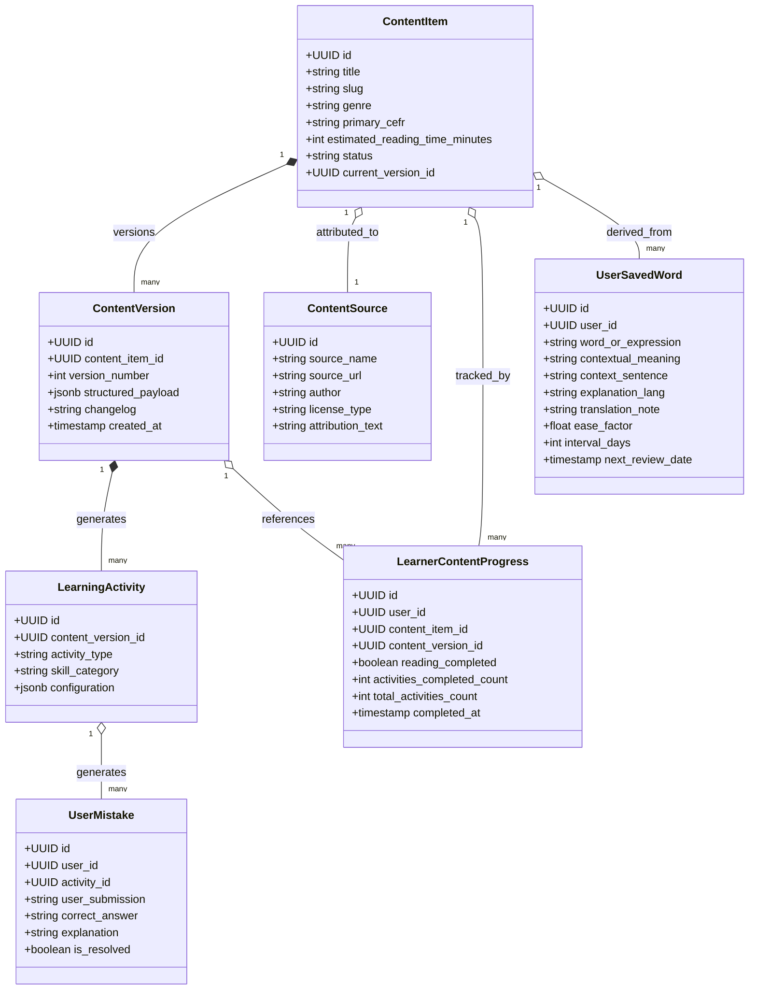
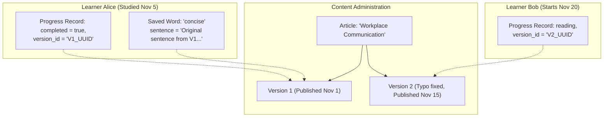

# Lexilume — Target Domain Model & Entity Architecture

> **Repository:** `VINODH0101/language-learning` (Lexilume — Illuminate Your Words)  
> **Production Application:** `https://lexi.monster`  
> **Phase:** Phase 4 — Target Architecture Design  
> **Core Principle:** Strict separation of immutable shared educational content from private learner state.

---

## 1. Domain Model Overview

The target domain model replaces Lexilume's four fragmented historical content models with a **unified, content-centred entity hierarchy**.

---

## 2. Shared vs Personal Data Separation

A foundational invariant of the target architecture is the absolute segregation between **Shared Content** and **Personal Learner Data**:

| Data Domain | Classification | Entity Examples | Cardinality | Storage Strategy | Mutability |
| :--- | :--- | :--- | :--- | :--- | :--- |
| **Shared Content** | Public / Universal | `ContentItem`, `ContentVersion`, `ContentSource`, `LearningActivity` | Generated **once** per article; shared by all learners. | Supabase PostgreSQL + Dexie `cached_content_items` | **Immutable** once published. Edits spawn a new version (`v2`). |
| **Personal Learner Data** | Private / Tenant-Owned | `LearnerContentProgress`, `UserSavedWord`, `UserMistake`, `SRSReview` | Created per individual learner account. | Scoped LocalStorage + Dexie stores + Supabase PostgREST | **Mutable** as learner studies and reviews. |

*Architectural Guarantee:* Editing or archiving a shared `ContentItem` can **never** mutate, overwrite, or delete a learner's personal vocabulary deck, historical scores, or SM-2 spaced repetition intervals.

---

## 3. Entity Definitions & Persistence Allocation

To prevent unnecessary database bloat, the architecture distinguishes between concepts that require dedicated relational tables versus those best stored inside structured JSON payloads:

### 3.1 Relational Tables (Dedicated Supabase & Dexie Tables)
1. **`english_content_items`:**
   - Identity: `id` (UUID, PK), `title` (string), `slug` (string, unique), `genre` (string), `primary_cefr` (string: `A1`-`C1`), `estimated_reading_time_minutes` (int), `status` (string: `'draft' | 'processing' | 'pending_review' | 'published' | 'archived'`), `current_version_id` (UUID), `published_at` (timestamp).
   - Indexes: `status, primary_cefr`, `slug`.
2. **`content_versions`:**
   - Identity: `id` (UUID, PK), `content_item_id` (UUID, FK -> `english_content_items.id`), `version_number` (int), `structured_payload` (JSONB), `changelog` (string), `created_at` (timestamp).
   - Invariant: Compound unique key on `(content_item_id, version_number)`.
3. **`learner_content_progress`:**
   - Identity: `id` (UUID, PK), `user_id` (UUID, FK -> `auth.users`), `content_item_id` (UUID, FK), `content_version_id` (UUID, FK), `reading_completed` (boolean), `activities_completed_count` (int), `total_activities_count` (int), `xp_earned` (int), `last_interacted_at` (timestamp).
   - Invariant: Compound unique key on `(user_id, content_item_id)`.
4. **`user_saved_words` (Unified Personal Lexicon):**
   - Identity: `id` (UUID, PK), `user_id` (UUID, FK), `word_or_expression` (string), `contextual_meaning` (string), `context_sentence` (text), `source_content_id` (UUID, nullable), `explanation_lang` (string: `'pt' | 'es' | 'en'`), `translation_note` (string), `ease_factor` (float), `interval_days` (int), `repetitions` (int), `next_review_date` (timestamp).
   - Replaces: Legacy duplicate tables `saved_translations`, `user_vocabulary_history`, and `srs_items`.
5. **`user_mistakes` (Mistake Notebook):**
   - Identity: `id` (UUID, PK), `user_id` (UUID, FK), `content_item_id` (UUID), `activity_id` (string), `exercise_type` (string), `prompt_text` (text), `submitted_answer` (text), `correct_answer` (text), `explanation` (text), `is_resolved` (boolean), `occurred_at` (timestamp).
6. **`admin_audit_logs`:**
   - Retained from migration `006` for immutable administrative logging.

### 3.2 Structured JSON Entities (Stored within `content_versions.structured_payload`)
Concepts that are tightly bound to a specific edition of a text are represented inside `structured_payload` rather than fragmented into separate relational tables:
- **`paragraphs` & `sentences`:** Array of segmented paragraphs and sentences with character offsets.
- **`lexical_insights`:** Array of key vocabulary and expressions found in the text with IPA, simple English definitions, and Portuguese/Spanish explanations.
- **`grammar_insights`:** Grammar rules illustrated by specific sentences in the text.
- **`learning_activities`:** Array of generated exercises (reading comprehension, cloze, word order, speaking prompts, writing challenges) linked to question stems and answer keys.

*Rationale:* Storing pedagogical analysis inside an immutable JSON payload ensures that an entire content package is retrieved in a single indexed read (`SELECT structured_payload FROM content_versions WHERE id = :id`), eliminating multi-table relational joins during active reading.

---

## 4. Content Versioning & Immutability Architecture

A critical flaw in naive CMS architectures is that updating an article invalidates previous student answers or changes question numbers. The target architecture guarantees **historical immutability**:

### Versioning Rules Verified:
1. **Creation:** When an article is first approved, it receives `version_number = 1`.
2. **Edits to Published Content:** If an administrator edits the source text, the existing `Version 1` record is untouched. A new `content_versions` row is created with `version_number = 2`. The parent `english_content_items.current_version_id` is updated to point to `Version 2`.
3. **Learner Protection:**
   - Any learner who completed activities under `Version 1` maintains their 100% completion status.
   - Saved vocabulary entries store the verbatim context sentence in `user_saved_words.context_sentence`, ensuring the saved card never breaks even if the source article changes.
   - When a returning learner opens an article with a newer version, the UI shows a non-intrusive badge: *"Updated edition available"*, allowing the learner to review the new edition without losing past progress.
4. **Archiving:** Archiving an item sets `status = 'archived'`. Existing learners who saved words from that item retain their words and review schedules in perpetuity.
