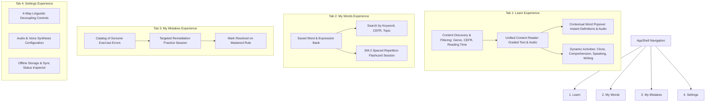
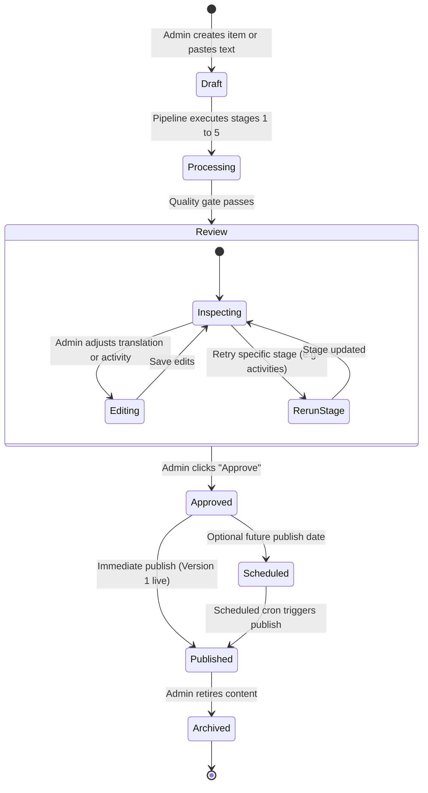

# Lexilume — Target Learner & Administrative UX Architecture

> **Repository:** `VINODH0101/language-learning` (Lexilume — Illuminate Your Words)  
> **Production Application:** `https://lexi.monster`  
> **Phase:** Phase 4 — Target Architecture Design  
> **Core Principle:** A distraction-free 4-tab learner experience paired with a streamlined administrative publishing workflow.

---

## 1. Executive Summary

Lexilume eliminates navigational clutter by replacing its fragmented multi-page layout with a **clean 4-tab learner navigation**:
1. **Learn (`/learn`):** Discover authentic English reading materials, read with inline contextual assistance, and complete embedded activities.
2. **My Words (`/words`):** Personal vocabulary and expression library with SM-2 flashcard reviews and pronunciation audio.
3. **My Mistakes (`/mistakes`):** Intelligent mistake notebook capturing genuine learner errors with targeted remediation.
4. **Settings (`/settings`):** Fully independent language preferences, interface localization, and accessibility controls.

For administrators, the complex 11-tab workbench is consolidated into a linear **7-state editorial workflow** (`Draft` -> `Processing` -> `Review` -> `Approved` -> `Scheduled` -> `Published` -> `Archived`).

---

## 2. Learner Experience Architecture (The 4 Tabs)



---

## 3. Tab 1: Learn Subsystem Architecture

The **Learn** tab is the primary learning vehicle. Learners read authentic texts and immediately apply what they have learned through embedded activities without navigating to separate screens.

### 3.1 Content Discovery & Filtering
- **Card Metadata Displayed:**
  - Content Title & Subtitle.
  - Genre Tag (e.g. `Workplace`, `News`, `Story`, `Technical`, `Conversation`).
  - Primary CEFR Badge (`A2`, `B1`, `B2`, `C1`).
  - Estimated Reading Time (`3 min read`, `5 min read`).
  - Progress Indicator (`Unread`, `In Progress`, `Completed`).
- **Filtering Controls:** Horizontal filter chips allowing one-click filtering by Genre or CEFR level.

### 3.2 The Unified Reading Interface
- Text is presented in clean, legible typography with comfortable line height (`leading-relaxed`) and generous paragraph spacing.
- **Contextual Selection:** Every word and expression is interactively selectable via click or tap.
- **Audio Toolbar:** Sticky header with play/pause button, playback speed selector (`0.75x`, `1.0x`, `1.25x`), and sentence jumping.

### 3.3 Contextual Word Lookup Experience
When a learner selects a word or phrase (e.g. *"phase out"* in *"The company decided to phase out the old system"*), a compact floating popover opens immediately above the selection:

```
┌────────────────────────────────────────────────────────┐
│  phase out                          /feɪz aʊt/    🔊   │
│  ────────────────────────────────────────────────────  │
│  Contextual Meaning:                                  │
│  To discontinue or withdraw something gradually.       │
│                                                        │
│  Simple English:                                      │
│  To stop using something slowly over time.             │
│                                                        │
│  Portuguese: descontinuar gradualmente                │
│  Spanish:    retirar gradualmente                      │
│                                                        │
│  Example: They are phasing out petrol cars by 2030.    │
│  ────────────────────────────────────────────────────  │
│  [🔖 Save to My Words]                    [Dismiss]   │
└────────────────────────────────────────────────────────┘
```

#### Meaning Layering Enforced in Code:
1. **Contextual Meaning:** The exact definition of the term in this specific sentence context.
2. **Simple English Explanation:** An A2/B1 level explanation avoiding complex pedagogical jargon.
3. **Bilingual Notes:** Direct translations into the learner's chosen explanation language (`pt` or `es`).
4. **Pronunciation:** Native browser audio pronunciation with standard IPA phonetics.
5. **One-Click Save:** Instantly bookmarks the word, its contextual definition, and the original sentence to `My Words`.

### 3.4 Embedded Learning Activities
Directly below the reading passage, learners complete activities derived from the text:
- **Reading Comprehension:** 3–4 multiple choice questions evaluating main ideas and inference.
- **Lexical Cloze:** Fill-in-the-blank sentences targeting the key vocabulary extracted from the text.
- **Expression Usage:** Sentence reordering or matching targeting idiomatic expressions.
- **Productive Prompt:** An optional speaking prompt (via SpeechRecognition) or writing prompt (with instant spelling/grammar feedback).

---

## 4. Tab 2: My Words Subsystem Architecture

The **My Words** tab serves as the learner's personal vocabulary vault:
- **Saved Expressions:** Displays all words bookmarked during reading or lookup.
- **Verbatim Context Sentence:** Every saved word preserves the exact sentence where the learner encountered it.
- **Bilingual Translations:** Shows definition and notes in Portuguese or Spanish based on the learner's explanation language setting.
- **Daily SM-2 Spaced Repetition Session:**
  - Clicking "Review Due Words" launches an interactive flashcard session.
  - Presents the word or prompt; learner rates difficulty (0 to 5); algorithm updates `ease_factor`, `interval_days`, and `next_review_date`.
- **Search & Filter:** Instant in-memory search using `MiniSearch` filtering by word, tag, or mastery level.

---

## 5. Tab 3: My Mistakes Subsystem Architecture

The **My Mistakes** tab transforms errors into learning milestones:
- **Automatic Error Logging:** Erroneous submissions in quizzes or writing exercises automatically create an entry in `user_mistakes`.
- **Contextual Explanation:** Explains *why* the answer was incorrect and presents the grammar or lexical rule.
- **Remediation Practice:** Clicking "Practice Mistakes" launches a targeted session presenting only unresolved mistakes.
- **Resolution:** Submitting the correct answer resolves the mistake, removing it from the active review queue while retaining historical mastery metrics.

---

## 6. Tab 4: Settings Subsystem Architecture

The **Settings** tab enforces the core invariant of **Four-Way Linguistic Decoupling**:
- **Interface Language:** Controls UI chrome (`en`, `pt`, `es`).
- **Learning Language:** The target language actively being studied (`en`).
- **Explanation Language:** The pedagogical language for grammar notes and definitions (`pt` or `es`).
- **Regional Variety:** Controls spelling and audio accents (`en-US` vs `en-GB`).
- **Storage & Synchronization Inspector:** Displays pending sync queue items, last sync timestamp, and an offline storage clearance tool.

---

## 7. Administrative Content Studio Architecture



### Administrative Features:
1. **Content Submission:** Simple form accepting Title, Genre dropdown, Source Attribution, and Text input (paste, file upload, or URL).
2. **Live Processing Tracker:** Visual indicators showing status of Normalization, Tokenization, Translation, and Activity Synthesis.
3. **Stage-Level Retry:** An administrator can modify a mistranslated definition or regenerate quiz questions with one click without re-running the entire pipeline.
4. **Preview Modal:** Renders the article exactly as a learner will see it (with clickable words and activity cards) prior to publication.
5. **Immutable Audit History:** Every publish, edit, or approval action logs user ID, timestamp, and action description to `admin_audit_logs`.
