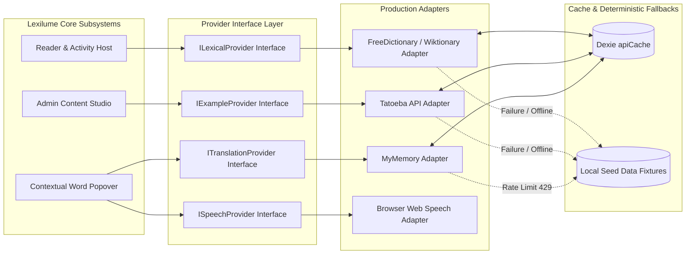

# Lexilume — Target Security & External Integration Architecture

> **Repository:** `VINODH0101/language-learning` (Lexilume — Illuminate Your Words)  
> **Production Application:** `https://lexi.monster`  
> **Phase:** Phase 4 — Target Architecture Design  
> **Core Principle:** Strict database-level authorization, zero credential exposure, and provider-agnostic resilient integrations.

---

## 1. Executive Summary

The target security and integration architecture is designed around two non-negotiable standards:
1. **Server-Side Enforcement:** Security is enforced at the database level via PostgreSQL Row-Level Security (RLS) policies and stored procedures. Client-side route guards are treated strictly as presentation conveniences.
2. **Resilient Provider Independence:** External open-data integrations (Wiktionary, Tatoeba, Free Dictionary) operate behind abstract provider interfaces with local caching in Dexie `apiCache` and deterministic offline fallbacks. The application operates fully even during complete network or API outages.

---

## 2. Authentication & Role-Based Authorization Architecture

```mermaid
flowchart TD
    ClientReq[Client HTTPS Request] --> JWTValidation{Valid GoTrue JWT Token?}
    JWTValidation -- No (Anonymous / Guest) --> GuestRole[Context: auth.uid() IS NULL / Role = anon]
    JWTValidation -- Yes (Authenticated) --> AuthenticatedRole[Context: auth.uid() = UUID / Role = authenticated]

    GuestRole --> RLS_Public[RLS: SELECT ON english_content_items WHERE status = 'published']
    
    AuthenticatedRole --> RLS_User[RLS: ALL ON user_saved_words, user_mistakes WHERE auth.uid() = user_id]
    AuthenticatedRole --> AdminCheck{SELECT has_role(auth.uid(), 'admin')}

    AdminCheck -- True --> RLS_Admin[RLS: ALL ON draft content, review queues, audit logs]
    AdminCheck -- False --> RLS_User
```

### 2.1 Role Definitions & Privileges
- **Anonymous Guest (`guest`):** May read all published English content; writes are strictly local to browser storage; zero cloud database write permissions.
- **Learner (`authenticated`):** May read all published content; has full CRUD permissions over their own `learner_content_progress`, `user_saved_words`, and `user_mistakes`.
- **Content Editor / Admin (`admin`):** Verified by `public.has_role(auth.uid(), 'admin')`. Has access to draft content, ingestion pipelines, moderation queues, and immutable administrative audit logs.

### 2.2 Row-Level Security (RLS) Policies for Target Schema
```sql
-- 1. Published Content is globally readable by all learners (including guests)
ALTER TABLE public.english_content_items ENABLE ROW LEVEL SECURITY;
CREATE POLICY "Public read for published content"
ON public.english_content_items FOR SELECT
USING (status = 'published');

-- 2. Only Admins can create or modify content items
CREATE POLICY "Admins manage all content items"
ON public.english_content_items FOR ALL
USING (public.has_role(auth.uid(), 'admin'))
WITH CHECK (public.has_role(auth.uid(), 'admin'));

-- 3. Personal Saved Words: Strictly isolated to the owning learner
ALTER TABLE public.user_saved_words ENABLE ROW LEVEL SECURITY;
CREATE POLICY "Users manage their own saved words"
ON public.user_saved_words FOR ALL
USING (auth.uid() = user_id)
WITH CHECK (auth.uid() = user_id);

-- 4. Learner Mistakes: Strictly isolated to the owning learner
ALTER TABLE public.user_mistakes ENABLE ROW LEVEL SECURITY;
CREATE POLICY "Users manage their own mistakes"
ON public.user_mistakes FOR ALL
USING (auth.uid() = user_id)
WITH CHECK (auth.uid() = user_id);

-- 5. Learner Content Progress: Strictly isolated to the owning learner
ALTER TABLE public.learner_content_progress ENABLE ROW LEVEL SECURITY;
CREATE POLICY "Users manage their own progress"
ON public.learner_content_progress FOR ALL
USING (auth.uid() = user_id)
WITH CHECK (auth.uid() = user_id);
```

---

## 3. Credential Protection & Zero-Paid AI Isolation

1. **Zero Client Secret Bundling:** The client Vite configuration bundles only public environment variables (`VITE_SUPABASE_URL` and `VITE_SUPABASE_ANON_KEY`). High-privilege credentials (`SUPABASE_SERVICE_ROLE_KEY`, `RESEND_API_KEY`) remain confined to GitHub Repository Secrets and serverless batch runners.
2. **Optional Gemini Isolation:** The client bundle contains **no `VITE_GEMINI_API_KEY`**. If an administrator or learner utilizes Gemini, keys are read exclusively from local browser storage or supplied during administrative processing sessions. If absent, the system executes deterministic offline rule engines.

---

## 4. Provider-Agnostic External Integration Architecture



### 4.1 Provider Specifications & Fallbacks

| Integration Provider | Protocol & Endpoint | Credential Type | Rate Limits | Caching Policy | Offline Fallback Mechanism |
| :--- | :--- | :--- | :--- | :--- | :--- |
| **Wiktionary API** | HTTPS GET `wiktionary.org/w/api.php` | None (Public open API) | Unmetered (Standard UA) | Dexie `apiCache` (TTL 7d) | Falls back to local pre-compiled JSON lemma fixture. |
| **Tatoeba Project** | HTTPS GET `tatoeba.org/en/api_v0` | None (CC-BY 2.0 FR) | Unmetered | Dexie `apiCache` (TTL 7d) | Falls back to pre-compiled sentence bank in `sentencesData.ts`. |
| **Free Dictionary API**| HTTPS GET `api.dictionaryapi.dev` | None (Public open API) | Unmetered | Dexie `apiCache` (TTL 7d) | Falls back to Wiktionary adapter or local seed dictionary. |
| **Web Speech API** | Browser Native API | None (Local system voices)| Unlimited | Browser memory | Speaks via native speech synthesis; graceful silence if disabled. |
| **MyMemory Translation**| HTTPS GET `api.mymemory.translated.net`| None (Anonymous tier) | 1,000 words/day | Dexie `apiCache` (TTL 7d) | Falls back to local trilingual dictionary fixtures. |
| **Resend Email API** | HTTPS POST `api.resend.com` | `RESEND_API_KEY` (Server) | 3,000 emails/mo | None (Batch only) | Falls back to SMTP mailer or console output in dry-run mode. |

---

## 5. Content Rights, Licensing & Data Privacy

### 5.1 Content Licensing Framework
All authentic English texts submitted to Lexilume must satisfy one of four recognized licensing categories tracked in `content_sources`:
1. **Public Domain:** Expired copyright (e.g. pre-1929 literature from Project Gutenberg).
2. **Creative Commons Attribution (CC-BY / CC-BY-SA):** Open educational articles, Wikipedia extracts, or research syntheses with mandatory author and source URL attribution.
3. **Original Author Content:** Texts written directly by Lexilume educators or community contributors.
4. **Fair Use Quotation:** Short excerpts (under 250 words) used for non-commercial educational analysis and commentary.

### 5.2 Privacy & GDPR Retention
- **No PII in Telemetry:** Umami analytics logs anonymized page views with zero student text or IP recording.
- **GDPR 90-Day Retention:** The automated retention worker (`scripts/retention_cleanup.py`) purges raw exercise attempt logs older than 90 days, retaining only summary mastery and streak counters.
