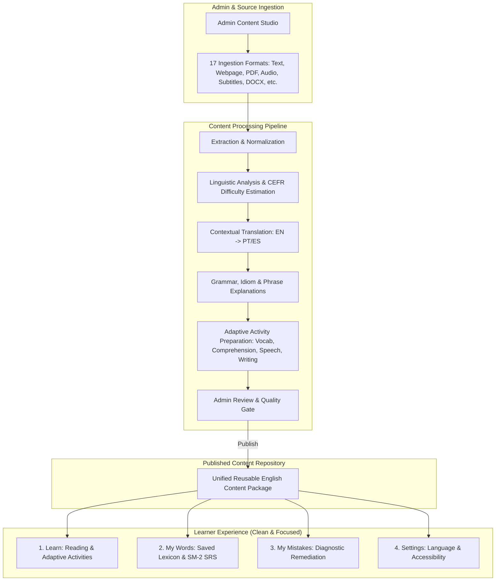

# Lexilume — Target Product Architecture: Content-Centred English Learning

> **Mission:** Transform Lexilume from an isolated course-generator into a unified, content-centred English-learning platform where authentic real-world content powers reading, listening, speaking, writing, vocabulary acquisition, grammar explanation, and contextual comprehension.  
> **Master Target Architecture Specification:** See [TARGET_ARCHITECTURE.md](file:///docs/architecture/TARGET_ARCHITECTURE.md) for the definitive Phase 4 architectural blueprint.  
> **Target Diagrams Reference:** See [TARGET_ARCHITECTURE_DIAGRAMS.md](file:///docs/architecture/TARGET_ARCHITECTURE_DIAGRAMS.md) for the 12 target Mermaid diagrams.

---

## 1. Core Target Architecture & Product Model



---

## 2. Universal English Content Typology (17 Formats)

The target system supports diverse real-world English genres without creating parallel skill silos:

1. **Everyday Conversations & Social Dialogues** — Natural colloquial exchanges, register shifts, pragmatic markers.
2. **Short Stories, Vignettes & Fiction** — Narrative flow, descriptive language, past tenses, indirect discourse.
3. **News, Current Affairs & Journalism** — Factual reporting, passive voice, attribution, journalistic vocabulary.
4. **Thought Leadership Articles, Essays & Blogs** — Argumentation, connectors, rhetorical structures.
5. **Workplace & Professional Communication** — Agendas, executive summaries, negotiation dialogue, polite requests.
6. **Business Emails, Slack Threads & Memos** — Formal vs informal salutations, clear calls-to-action, concise tone.
7. **Academic Papers & Educational Syntheses** — Abstract terminology, data descriptions, citations.
8. **Technical Documentation & API Guides** — Step-by-step procedures, conditional logic, technical terminology.
9. **Travel Situations & Navigational Dialogues** — Airport, transit, hotel, emergencies, polite inquiries.
10. **Interviews, Podcasts & Panel Discussions** — Spontaneous speech, turn-taking, follow-up questions.
11. **Speeches & Keynote Presentations** — Public speaking cadence, pauses, emphasis, persuasion.
12. **Poetry & Literary Passages** — Imagery, metaphors, figurative language, rhythm.
13. **Public-Domain Song Lyrics** — Rhymes, informal idioms, contractions, natural elision.
14. **Customer Reviews & Opinion Columns** — Evaluative adjectives, sentiment expressions, pros/cons.
15. **How-To Guides & Standard Operating Procedures** — Imperatives, sequence adverbs (*first, then, subsequently*).
16. **Social Media Discussions & Public Debates** — Conversational slang, acronyms, internet English.
17. **Transcripts with Subtitles (SRT/VTT)** — Time-coded audio/video alignment for synchronized listening.

---

## 3. The Unified Content Package Contract

Instead of generating disconnected lessons, a single **Content Package** powers all pedagogical activities:

```typescript
export interface UnifiedContentPackage {
  id: string; // Unique content identifier (e.g., 'pkg-en-workplace-negotiation-01')
  version: number; // Incrementing content revision
  title: string;
  genre: ContentGenre;
  topic_category: string;
  difficulty_cefr: CEFRLevel; // Internal metadata (not forced on user)
  estimated_reading_minutes: number;
  
  // 1. Source Text & Segmentation
  original_text: string;
  paragraphs: Array<{
    id: string;
    sentences: Array<{
      id: string;
      text: string;
      start_char: number;
      end_char: number;
      audio_start_ms?: number;
      audio_end_ms?: number;
    }>;
  }>;

  // 2. Multilingual Explanations & Translations (PT & ES priority)
  translations: {
    pt?: { title: string; full_text: string; sentence_map: Record<string, string> };
    es?: { title: string; full_text: string; sentence_map: Record<string, string> };
  };

  // 3. Extracted Lexicon & Idiomatic Expressions
  lexical_items: Array<{
    term: string;
    lemma: string;
    part_of_speech: string;
    phonetic_ipa: string;
    contextual_meaning_en: string;
    translation_pt: string;
    translation_es: string;
    is_idiom_or_phrase: boolean;
    frequency_tier: number;
  }>;

  // 4. Grammar Highlights in Context
  grammar_insights: Array<{
    pattern_title: string;
    target_excerpt: string;
    formula: string;
    explanation_pt: string;
    explanation_es: string;
  }>;

  // 5. Adaptive Learning Activities (Selected according to content genre)
  activities: {
    comprehension_questions?: Array<{
      id: string;
      question: string;
      options: string[];
      correct_index: number;
      explanation_pt: string;
      explanation_es: string;
    }>;
    vocabulary_practice?: Array<{
      exercise_type: 'cloze' | 'matching' | 'definition';
      prompt: string;
      target_word: string;
      options?: string[];
    }>;
    listening_audio?: {
      audio_url: string;
      duration_seconds: number;
      synchronized_sentences: boolean;
    };
    speaking_prompt?: {
      prompt_text: string;
      sample_response: string;
      key_expressions_to_use: string[];
    };
    writing_prompt?: {
      task_description: string;
      minimum_words: number;
      model_response: string;
    };
  };

  // 6. Rights & Publication Metadata
  attribution: {
    source_name: string;
    source_url?: string;
    license: string;
    rights_confirmed: boolean;
  };
  publication_status: 'draft' | 'under_review' | 'published' | 'archived';
  published_at?: string;
}
```

---

## 4. Adaptive Activity Selection (No Forced Layouts)

The target platform avoids forcing every piece of content into an identical template:

| Content Type | Primary Reading | Synchronized Audio | Vocabulary Practice | Comprehension Quiz | Speaking Practice | Writing Exercise |
| :--- | :---: | :---: | :---: | :---: | :---: | :---: |
| **Everyday Dialogue** | Yes | **Essential** | High | Yes | **Essential** (Role-play) | Optional |
| **News / Essay** | **Essential** | Optional | High | **Essential** | Optional | **Essential** (Summary) |
| **Short Story / Fiction** | **Essential** | Yes | High | Yes | Optional | Yes (Creative rewrite) |
| **Workplace Email** | Yes | Optional | **Essential** | Optional | Optional | **Essential** (Reply draft) |
| **Speech / Keynote** | Yes | **Essential** | High | Yes | **Essential** (Pronunciation) | Optional |
| **Poetry / Lyrics** | **Essential** | **Essential** | Cultural | Optional | **Essential** (Recitation) | Creative |

---

## 5. Four-Way Linguistic Decoupling in Target State

The architecture preserves the strict invariant:
- **Interface Language:** Controls UI chrome, navigation buttons, modals (`en`, `pt`, `es`).
- **Learning Language:** English (`en`) — focused on rich, natural comprehension and production.
- **Explanation Language:** Pedagogical translation language for grammar rules, glossaries, and answer rationales (defaults to `pt` or `es` based on user profile).
- **Regional Variety:** Regional accent and syntax targeting (`en-US` American English or `en-GB` British English).
