# Lexilume — Complete Database Object & Schema Inventory

> **Ground Truth Architecture Standards:** Rules 4, 5, 6  
> - *Do not delete database migrations or rewrite historical migrations.*  
> - *Do not drop or truncate production tables.*  
> - *Do not remove user data, saved vocabulary, SRS records, mistakes, progress, accounts, or historical activity.*

---

## 1. Chronological Migration Register

All 14 production database migrations located at `supabase/migrations/` in sequential application order:

| Index | Migration Filename | Primary Domain & Architectural Responsibility | New Tables | Modified Tables | Functions / Triggers |
| :---: | :--- | :--- | :---: | :---: | :---: |
| **001** | `001_initial_schema.sql` | Baseline canonical polyglot schema (CEFR curriculum, vocabulary, grammar, daily lessons) | 11 | — | `update_updated_at_column()` |
| **002** | `002_rls_policies.sql` | Row Level Security (RLS) enforcement across learner-owned vs public tables | — | 11 | RLS Enablement |
| **003** | `003_email_and_retention.sql` | Automated email dispatch logs, delivery tracking, and data retention audit trail | 2 | — | `clean_expired_retention_records()` |
| **004** | `004_minimal_wikipedia_assignments.sql` | Wikipedia assignment minimal storage and attribution tracking | 1 | — | — |
| **005** | `005_language_directions_and_saved_translations.sql` | Directional translation bookmarks (`pt->en`, `es->en`, `en->pt`) and quota guards | 1 | 1 | — |
| **006** | `006_auth_roles_audit_and_onboarding.sql` | Role-based access control (`admin`, `editor`, `learner`), audit logging, onboarding flags | 2 | 1 | `sync_auth_user_role()` |
| **007** | `007_multiple_courses_and_progress_isolation.sql` | Multi-course management (`user_courses`) and per-course isolated progression | 1 | — | — |
| **008** | `008_cultural_bookmarks_and_sync.sql` | Real-world cultural bookmarks and cross-device sync metadata | 1 | — | — |
| **009** | `009_schema_reconciliation_and_sync.sql` | Foreign key alignment, idempotent upsert keys, and sync queue indexing | — | 4 | Sync indices |
| **010** | `010_database_persistence_and_sync_repair.sql` | Local-first Dexie sync repair (`user_learning_tracks`, `srs_items`, `exercise_attempts`) | 3 | — | `process_offline_sync_queue()` |
| **011** | `011_daily_lessons_reconciliation.sql` | Dual payload support for daily lessons (`full_lesson_payload` JSONB) | — | 1 | JSONB indexes |
| **012** | `012_daily_content_studio.sql` | Admin Content Studio: raw text ingestion, stage-based processing, content review | 2 | — | — |
| **013** | `013_progress_and_activity_tracking.sql` | Cognitive time tracking, activity event logs, CEFR radar aggregations | 1 | 1 | — |
| **014** | `014_admin_operations_and_audit.sql` | Admin operations workbench, background job queues, and security monitoring | 1 | 1 | `log_admin_action()` |

---

## 2. Comprehensive Inventory of Tables (26 Tables)

### 2.1. Shared Educational Content & Sources (Public Read)

#### 1. `licenses_and_sources`
- **Created in:** `001_initial_schema.sql`
- **Purpose:** Open license tracking (CC-BY-SA, Tatoeba, Wiktionary, Wikipedia).
- **Columns:**
  - `id` (UUID, PK)
  - `source_name` (VARCHAR(120), NOT NULL)
  - `source_url` (TEXT, NOT NULL)
  - `license_type` (VARCHAR(64), NOT NULL)
  - `attribution_text` (TEXT, NOT NULL)
  - `terms_url` (TEXT)
  - `imported_at` (TIMESTAMPTZ, DEFAULT CURRENT_TIMESTAMP)
- **RLS:** Public `SELECT` allowed.

#### 2. `curriculum_nodes`
- **Created in:** `001_initial_schema.sql`
- **Purpose:** Curated CEFR milestones (sequence, can-do statements, regional relevance).
- **Columns:** `id` (VARCHAR(64), PK), `language` (VARCHAR(16)), `cefr_level` (VARCHAR(8)), `sequence_order` (INT), `topic_title` (TEXT), `can_do_statement` (TEXT), `grammar_focus` (TEXT), `vocabulary_theme` (TEXT), `regional_relevance` (VARCHAR(16)), `prerequisite_node_id` (VARCHAR(64)).

#### 3. `vocabulary_items`
- **Created in:** `001_initial_schema.sql`
- **Purpose:** Curated vocabulary entries with IPA, translations, definitions, and frequency rank.
- **Columns:** `id` (VARCHAR(64), PK), `curriculum_node_id` (VARCHAR(64), FK), `language` (VARCHAR(16)), `lemma` (TEXT), `part_of_speech` (VARCHAR(32)), `cefr_level` (VARCHAR(8)), `frequency_rank` (INT), `phonetic_ipa` (TEXT), `definition_target` (TEXT), `definition_en` (TEXT), `example_sentence_target` (TEXT), `example_sentence_en` (TEXT), `audio_url` (TEXT), `attribution_id` (UUID, FK).

#### 4. `grammar_rules`
- **Created in:** `001_initial_schema.sql`
- **Purpose:** Grammar rule specifications, formulas, markdown explanations, and common errors.
- **Columns:** `id` (VARCHAR(64), PK), `curriculum_node_id` (VARCHAR(64), FK), `language` (VARCHAR(16)), `rule_code` (VARCHAR(64)), `title` (TEXT), `category` (VARCHAR(64)), `cefr_level` (VARCHAR(8)), `explanation_markdown` (TEXT), `structural_formula` (TEXT), `examples` (JSONB), `common_errors` (JSONB), `regional_notes` (JSONB).

#### 5. `exercise_templates`
- **Created in:** `001_initial_schema.sql`
- **Purpose:** Pedagogical exercises (cloze, multiple choice, error correction).
- **Columns:** `id` (VARCHAR(64), PK), `curriculum_node_id` (VARCHAR(64), FK), `language` (VARCHAR(16)), `exercise_type` (VARCHAR(32)), `cefr_level` (VARCHAR(8)), `prompt` (TEXT), `context_passage` (TEXT), `options` (JSONB), `acceptable_solutions` (JSONB), `distractor_feedback` (JSONB), `explanation` (TEXT).

#### 6. `curated_materials`
- **Created in:** `001_initial_schema.sql`
- **Purpose:** Authentic reading passages, conversation scripts, and audio dialogs.
- **Columns:** `id` (VARCHAR(64), PK), `language` (VARCHAR(16)), `material_type` (VARCHAR(32)), `title` (TEXT), `cefr_level` (VARCHAR(8)), `regional_variety` (VARCHAR(16)), `content_target` (TEXT), `content_en` (TEXT), `glossary` (JSONB), `comprehension_questions` (JSONB), `speaking_prompt` (TEXT), `writing_prompt` (TEXT).

#### 7. `daily_lessons`
- **Created in:** `001_initial_schema.sql`, updated in `011_daily_lessons_reconciliation.sql`
- **Purpose:** Compiled daily polyglot lessons.
- **Columns:** `id` (VARCHAR(64), PK), `language` (VARCHAR(16)), `lesson_date` (DATE), `regional_variety` (VARCHAR(16)), `cefr_level` (VARCHAR(8)), `curriculum_node_id` (VARCHAR(64)), `reading_material_id` (VARCHAR(64)), `conversation_material_id` (VARCHAR(64)), `full_lesson_payload` (JSONB), `published_at` (TIMESTAMPTZ).

#### 8. `daily_published_content`
- **Created in:** `012_daily_content_studio.sql`
- **Purpose:** Admin-published content packages (reading, vocab, questions, audio).
- **Columns:** `id` (UUID, PK), `content_id` (VARCHAR(128)), `title` (TEXT), `source_type` (VARCHAR(64)), `category` (VARCHAR(64)), `cefr_level` (VARCHAR(8)), `raw_content` (TEXT), `processed_payload` (JSONB), `published_by` (UUID), `publication_status` (VARCHAR(32)), `published_at` (TIMESTAMPTZ).

---

### 2.2. Learner State, Accounts & Spaced Repetition (Strict Tenant RLS)

#### 9. `user_profiles`
- **Created in:** `001_initial_schema.sql`, updated in `006`
- **Columns:** `id` (UUID, PK, FK to `auth.users`), `email` (VARCHAR(255)), `full_name` (TEXT), `native_language` (VARCHAR(16)), `primary_target_language` (VARCHAR(16)), `interface_language` (VARCHAR(16)), `explanation_language` (VARCHAR(16)), `role` (VARCHAR(32)), `onboarding_completed` (BOOLEAN).

#### 10. `user_roles`
- **Created in:** `006_auth_roles_audit_and_onboarding.sql`
- **Purpose:** Server-side roles (`admin`, `editor`, `learner`) enforced via Supabase security definer functions.
- **Columns:** `id` (UUID, PK), `user_id` (UUID, FK, UNIQUE), `role` (VARCHAR(32)), `granted_by` (UUID), `created_at` (TIMESTAMPTZ).

#### 11. `user_courses`
- **Created in:** `007_multiple_courses_and_progress_isolation.sql`
- **Purpose:** Multi-course management under a single user account.
- **Columns:** `id` (VARCHAR(128), PK), `user_id` (UUID, FK), `target_language` (VARCHAR(16)), `regional_variant` (VARCHAR(16)), `cefr_level` (VARCHAR(8)), `explanation_language` (VARCHAR(16)), `daily_goal_minutes` (INT), `streak_days` (INT), `total_lessons_completed` (INT), `completed_curriculum_node_ids` (JSONB), `is_active` (BOOLEAN).

#### 12. `user_learning_tracks`
- **Created in:** `010_database_persistence_and_sync_repair.sql`
- **Purpose:** Synchronized local-first learning track mirror.
- **Columns:** `id` (VARCHAR(128), PK), `user_id` (UUID, FK), `language` (VARCHAR(16)), `current_cefr_level` (VARCHAR(8)), `streak_days` (INT), `total_lessons_completed` (INT), `completed_curriculum_node_ids` (JSONB), `mastered_vocabulary_ids` (JSONB).

#### 13. `srs_items`
- **Created in:** `010_database_persistence_and_sync_repair.sql`
- **Purpose:** SuperMemo-2 (SM-2) review schedule per learner per vocabulary term.
- **Columns:** `id` (VARCHAR(128), PK), `user_id` (UUID, FK), `language` (VARCHAR(16)), `vocabulary_item_id` (VARCHAR(64)), `repetition_number` (INT), `ease_factor` (NUMERIC), `interval_days` (INT), `next_review_date` (DATE), `mastery_status` (VARCHAR(32)).

#### 14. `exercise_attempts`
- **Created in:** `010_database_persistence_and_sync_repair.sql`
- **Purpose:** Exercise answers, attempt counts, and error validation logs.
- **Columns:** `id` (VARCHAR(128), PK), `user_id` (UUID, FK), `language` (VARCHAR(16)), `exercise_id` (VARCHAR(64)), `submitted_answer` (TEXT), `is_correct` (BOOLEAN), `attempt_count` (INT), `created_at` (TIMESTAMPTZ).

#### 15. `saved_translations`
- **Created in:** `005_language_directions_and_saved_translations.sql`
- **Purpose:** Offline phrasebook / dictionary saved words with IPA and definitions.
- **Columns:** `id` (VARCHAR(128), PK), `user_id` (UUID, FK), `source_text` (TEXT), `translated_text` (TEXT), `source_language` (VARCHAR(16)), `target_language` (VARCHAR(16)), `notes` (TEXT).

#### 16. `cultural_bookmarks`
- **Created in:** `008_cultural_bookmarks_and_sync.sql`
- **Purpose:** Saved cultural articles, poems, and contextual materials.
- **Columns:** `id` (VARCHAR(128), PK), `user_id` (UUID, FK), `article_id` (VARCHAR(128)), `article_title` (TEXT), `content_language` (VARCHAR(16)), `created_at` (TIMESTAMPTZ).

#### 17. `learning_activity_events`
- **Created in:** `013_progress_and_activity_tracking.sql`
- **Purpose:** Fine-grained cognitive time tracking and session history.
- **Columns:** `id` (UUID, PK), `user_id` (UUID, FK), `language` (VARCHAR(16)), `activity_type` (VARCHAR(32)), `duration_seconds` (INT), `created_at` (TIMESTAMPTZ).

---

### 2.3. Admin Operations, Background Jobs & Auditing

#### 18. `content_review_items`
- **Created in:** `012_daily_content_studio.sql`
- **Purpose:** Content review queue for draft, approved, and rejected learning materials.
- **Columns:** `id` (UUID, PK), `content_id` (VARCHAR(128)), `title` (TEXT), `status` (VARCHAR(32)), `review_notes` (TEXT), `reviewed_by` (UUID), `created_at` (TIMESTAMPTZ).

#### 19. `admin_audit_logs`
- **Created in:** `006_auth_roles_audit_and_onboarding.sql`
- **Purpose:** Immutable audit log of administrative actions (publishing, user updates, role grants).
- **Columns:** `id` (UUID, PK), `admin_user_id` (UUID, FK), `action` (VARCHAR(64)), `target_entity` (VARCHAR(64)), `payload` (JSONB), `timestamp` (TIMESTAMPTZ).

#### 20. `admin_background_jobs`
- **Created in:** `014_admin_operations_and_audit.sql`
- **Purpose:** Background processing jobs (audio synthesis, batch extraction, translation).
- **Columns:** `id` (UUID, PK), `job_type` (VARCHAR(64)), `status` (VARCHAR(32)), `payload` (JSONB), `error_message` (TEXT), `retry_count` (INT), `created_at` (TIMESTAMPTZ).

#### 21–26. Auxiliary Historical Tables
- `language_tracks` (`001`) — Baseline track record.
- `lesson_exercises` (`001`) — Exercises bound to daily lessons.
- `user_vocabulary_history` (`001`) — Early vocabulary tracking table.
- `email_deliveries` (`003`) — Resend/SMTP dispatch records.
- `retention_cleanup_logs` (`003`) — Automated 14-day data retention cleanup audits.
- `lesson_assignments` (`004`) — Minimal Wikipedia article assignments.

---

## 3. Database Entity-Relationship (ER) Diagram

```mermaid
erDiagram
    user_profiles ||--o{ user_roles : "has role"
    user_profiles ||--o{ user_courses : "enrolled in"
    user_profiles ||--o{ user_learning_tracks : "tracks progress in"
    user_profiles ||--o{ srs_items : "reviews"
    user_profiles ||--o{ exercise_attempts : "submits"
    user_profiles ||--o{ saved_translations : "saves"
    user_profiles ||--o{ cultural_bookmarks : "bookmarks"
    user_profiles ||--o{ learning_activity_events : "logs cognitive time"
    user_profiles ||--o{ admin_audit_logs : "audited when admin"
    
    licenses_and_sources ||--o{ vocabulary_items : "licenses"
    licenses_and_sources ||--o{ curated_materials : "licenses"
    
    curriculum_nodes ||--o{ vocabulary_items : "contains"
    curriculum_nodes ||--o{ grammar_rules : "contains"
    curriculum_nodes ||--o{ exercise_templates : "contains"
    curriculum_nodes ||--o{ daily_lessons : "synthesized into"
    
    daily_published_content ||--o{ content_review_items : "reviewed via"
    daily_published_content ||--o{ admin_background_jobs : "processed by"
```

---

## 4. Row-Level Security (RLS) Policy Architecture

All 26 tables have Row-Level Security explicitly enabled (`ALTER TABLE ... ENABLE ROW LEVEL SECURITY;`).

1. **Shared Educational Tables (`curriculum_nodes`, `vocabulary_items`, `grammar_rules`, `daily_lessons`, `daily_published_content`):**
   - `SELECT`: `USING (true)` (Public read access for all learners and guests).
   - `INSERT / UPDATE / DELETE`: Restricted to verified administrators (`auth.uid() IN (SELECT user_id FROM user_roles WHERE role = 'admin')`).
2. **Learner-Scoped Tables (`user_courses`, `srs_items`, `exercise_attempts`, `saved_translations`, `learning_activity_events`):**
   - `SELECT`: `USING (auth.uid() = user_id)`.
   - `INSERT`: `WITH CHECK (auth.uid() = user_id)`.
   - `UPDATE`: `USING (auth.uid() = user_id)`.
   - `DELETE`: `USING (auth.uid() = user_id)`.
3. **Admin Operations Tables (`admin_audit_logs`, `content_review_items`, `admin_background_jobs`):**
   - Strictly restricted to `role = 'admin'` for all operations.

---

## 5. Forward-Only Migration Blueprint (Target Product)

To support the Content-Centred English product model without violating Rules 4, 5, and 6:
- **Migration `015_content_centred_english_pipeline.sql`:**
  - Forward-only DDL adding `english_content_items` and `content_activity_packages` tables.
  - Foreign key references link to existing `daily_published_content` and `licenses_and_sources`.
  - Zero modification to historical migrations 001–014.
  - Zero dropping of existing tables or columns.
