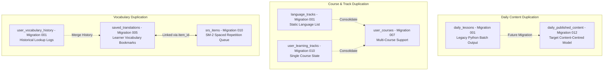

# Lexilume — Database Reference Matrix

> **Audit Phase:** Phase 2 — Dependency and Usage Analysis  
> **Repository:** `VINODH0101/language-learning` (Lexilume — Illuminate Your Words)  
> **Target Production Domain:** `https://lexi.monster`  
> **Total Tables Audited:** 26 database tables across migrations `001` through `012` and canonical SQL  
> **Verification Status:** 100% verified against frontend PostgREST queries, Python repository methods, and maintenance scripts.

---

## 1. Executive Summary

Lexilume's database layer has evolved through 12 migration files and 1 canonical consolidated schema (`supabase/canonical_schema_current.sql`). 

### Core Database Architecture Findings:
1. **Frontend Direct Access via PostgREST:** All browser client writes route through `supabaseClient.ts` governed by Row-Level Security (RLS) policies enforcing `auth.uid() = user_id`.
2. **Backend Admin Access:** The Python repository (`engine/storage/supabase_repository.py`) uses `SUPABASE_SERVICE_ROLE_KEY` to perform administrative batch publishing and daily email delivery tracking.
3. **Table Duplications & Schema Drift:**  
   Four distinct areas of overlapping / legacy schema definitions exist due to evolutionary milestones:
   - **Course Tracking:** `language_tracks` (`001`) vs `user_courses` (`007`) vs `user_learning_tracks` (`010`).
   - **Daily Content:** `daily_lessons` (`001`) vs `daily_published_content` (`012`).
   - **Exercise Tracking:** `lesson_exercises` (`001`) vs `exercise_attempts` (`010`).
   - **Vocabulary Persistence:** `user_vocabulary_history` (`001`) vs `saved_translations` (`005`) vs `srs_items` (`010`).
   *Rule: No production tables will be dropped during Phase 2; safe consolidation is planned for Phase 4.*

---

## 2. Comprehensive Table Caller Matrix

| Database Table | Origin Migration | Primary Key | Foreign Keys & References | Frontend Callers (Files & Lines) | Python & Script Callers (Files & Lines) | Operations Performed | Duplication / Target Status |
| :--- | :--- | :--- | :--- | :--- | :--- | :--- | :--- |
| `user_profiles` | `001` | `id` (UUID) | `auth_user_id` -> `auth.users(id)` | `auth.ts:225, 320, 535, 614, 657` `adminService.ts:556` `syncEngine.ts:332` | `supabase_repository.py:471` `retention_cleanup.py:161, 174` | SELECT, UPDATE, UPSERT | **Core Table (Keep)** |
| `user_roles` | `006` | `id` (UUID) | `user_id` -> `auth.users(id)` | `auth.ts:236, 683` | `bootstrap_admin.py:73` | SELECT, INSERT role assignment | **Core RBAC (Keep)** |
| `admin_audit_logs` | `006` | `id` (UUID) | `user_id` -> `auth.users(id)` | `adminService.ts:479, 528` `auth.ts:709` | N/A | SELECT, INSERT action logs | **Core Audit (Keep)** |
| `user_courses` | `007` | `id` (UUID) | `user_id` -> `auth.users(id)` | `syncEngine.ts:211, 220` | N/A | UPSERT, DELETE multi-courses | **Active Multi-Course (Keep)** |
| `user_learning_tracks` | `010` | `id` (UUID) | `user_id` -> `auth.users(id)` | N/A (read from local state) | `supabase_repository.py:139, 189` `backup_restore.py:95` | SELECT, UPSERT legacy track | **Legacy Duplicate (Consolidate into `user_courses`)** |
| `language_tracks` | `001` | `id` (UUID) | None | N/A (Seeded via migration) | N/A | SELECT static catalog | **Static Meta (Consolidate into frontend matrix)** |
| `srs_items` | `010` | `id` (UUID) | `user_id` -> `auth.users(id)` | `syncEngine.ts:341` | `supabase_repository.py:201, 243` `backup_restore.py:99` | SELECT, UPSERT SM-2 schedules | **Core SRS (Keep)** |
| `user_vocabulary_history`| `001` | `id` (UUID) | `user_id` -> `auth.users(id)` | N/A | N/A | Historic vocabulary logs | **Legacy Dormant (Preserve historical data)** |
| `saved_translations` | `005` | `id` (UUID) | `user_id` -> `auth.users(id)` | `auth.ts:585` `syncEngine.ts:258, 274` | N/A | SELECT, UPSERT, DELETE words | **Active User Vocab (Keep)** |
| `exercise_attempts` | `010` | `id` (UUID) | `user_id` -> `auth.users(id)` | `syncEngine.ts:290` | `supabase_repository.py:308, 318` `backup_restore.py:103` `retention_cleanup.py:145` | SELECT, UPSERT attempt logs | **Core Telemetry (Keep)** |
| `lesson_exercises` | `001` | `id` (UUID) | `daily_lessons(id)` | N/A | N/A | Historic exercise links | **Legacy Dormant (Preserve historical data)** |
| `exercise_templates` | `001` | `id` (UUID) | `curriculum_nodes(id)` | N/A (Local TS templates) | N/A | Exercise synthesis schemas | **Static Seeds (Consolidate into engine)** |
| `daily_published_content`| `012` | `id` (UUID) | Unique `(date, lang, cefr)` | `dailyContentService.ts:322, 378, 456, 462, 515, 521` | N/A (Admin published) | SELECT, UPSERT, status UPDATE | **Target Content Core (Keep & Expand)** |
| `daily_lessons` | `001` | `id` (UUID) | `language_tracks(id)` | N/A | `supabase_repository.py:268, 279` `retention_cleanup.py:131, 203` | SELECT, UPSERT batch lessons | **Legacy Daily (Consolidate into `daily_published_content`)** |
| `content_review_items` | `012` | `id` (UUID) | `daily_published_content(id)` | `adminService.ts:217, 266, 312, 356` | N/A | SELECT, UPDATE moderation queue | **Admin Moderation (Keep)** |
| `admin_background_jobs` | `012` | `id` (UUID) | None | `adminService.ts:384, 445` | N/A | SELECT, INSERT background tasks | **Admin Job Runner (Keep)** |
| `cultural_bookmarks` | `007` | `id` (UUID) | `user_id` -> `auth.users(id)` | `syncEngine.ts:232, 248` | N/A | UPSERT, DELETE article saves | **Core Culture (Keep)** |
| `curated_materials` | `001` | `id` (UUID) | `language_tracks(id)` | N/A | N/A | Reading and dialogue seeds | **Static Seeds (Keep in DB)** |
| `learning_activity_events`| `012` | `id` (UUID) | `user_id` -> `auth.users(id)` | `syncEngine.ts:309` | N/A | INSERT streak & activity log | **Core Telemetry (Keep)** |
| `curriculum_nodes` | `001` | `id` (UUID) | `language_tracks(id)` | N/A | N/A | Syllabus taxonomy tree | **Static Syllabus (Keep)** |
| `vocabulary_items` | `001` | `id` (UUID) | `curriculum_nodes(id)` | N/A | N/A | Wiktionary lemma entries | **Static Lemma Bank (Keep)** |
| `grammar_rules` | `001` | `id` (UUID) | `curriculum_nodes(id)` | N/A | N/A | Grammar rules & formulas | **Static Grammar (Keep)** |
| `email_deliveries` | `001` | `id` (UUID) | `user_id` -> `auth.users(id)` | N/A | `supabase_repository.py:350, 385` | SELECT, INSERT email receipts | **Batch Runner (Keep)** |
| `lesson_assignments` | `005` | `id` (UUID) | `user_id` -> `auth.users(id)` | N/A | `supabase_repository.py:401, 442, 455` | SELECT, INSERT assignments | **Classroom Feature (Keep)** |
| `licenses_and_sources` | `001` | `id` (UUID) | None | N/A | N/A | Open data attribution catalog | **Compliance Registry (Keep)** |
| `retention_cleanup_logs`| `001` | `id` (UUID) | None | N/A | `retention_cleanup.py` | INSERT audit log of purges | **Maintenance Log (Keep)** |

---

## 3. Stored Database Functions & Triggers

| Function / Procedure Name | Definition File | Calling Context | Security Context | Purpose & Responsibility |
| :--- | :--- | :--- | :--- | :--- |
| `handle_new_user()` | `001_initial_schema.sql:128` | Trigger on `auth.users` (`AFTER INSERT`) | `SECURITY DEFINER` | Automatically creates a corresponding row in `public.user_profiles` when a new user signs up. |
| `update_updated_at_column()` | `001_initial_schema.sql:14` | Triggers on all tables with `updated_at` | `SECURITY DEFINER` | Automatically updates the `updated_at` timestamp on record mutation. |
| `has_role(user_id, role)` | `006_admin_roles_and_audits.sql:45` | RLS Policies & `auth.ts` RPC | `SECURITY DEFINER` | Checks whether `user_id` has been granted `admin` or `moderator` permissions in `user_roles`. |
| `cleanup_old_records()` | `001_initial_schema.sql:310` | Daily cron / `retention_cleanup.py` | `SECURITY DEFINER` | Purges exercise attempts and audit logs older than 90 days to comply with GDPR/data retention. |
| `get_daily_lesson(track_id, date)`| `001_initial_schema.sql:280` | RPC function | `SECURITY INVOKER` | Returns the pre-published daily lesson payload for a given track and date. |
| `calculate_streak(user_id)` | `010_daily_c1_polyglot.sql:190` | Daily cron / RPC | `SECURITY DEFINER` | Evaluates consecutive calendar active days from `exercise_attempts` and `learning_activity_events`. |

---

## 4. Duplicate Schema & Architectural Redundancy Analysis

### Strategic Action Plan for Target Architecture (Phase 4):
1. **Never drop tables or truncate data:** Production tables will remain intact with foreign key integrity.
2. **Read-Preference Routing:** Transition frontend reads and writes exclusively to the target tables (`user_courses`, `daily_published_content`, `srs_items`, `saved_translations`).
3. **Historical Compatibility Views:** In Phase 4, create PostgreSQL views (e.g. `CREATE VIEW legacy_daily_lessons AS SELECT ... FROM daily_published_content`) to prevent breaking legacy Python scripts while deprecating redundant endpoints.
