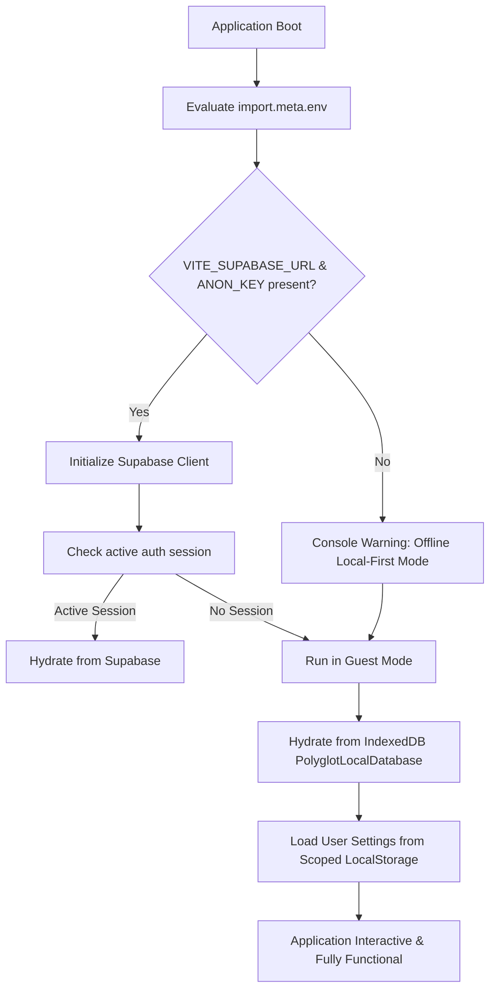

# Lexilume — Environment Reference Matrix

> **Audit Phase:** Phase 2 — Dependency and Usage Analysis  
> **Repository:** `VINODH0101/language-learning` (Lexilume — Illuminate Your Words)  
> **Target Production Domain:** `https://lexi.monster`  
> **Security Mandate:** Strict Zero-Secret-Exposure. No real secret values, passwords, or tokens are printed.  
> **Total Variables Audited:** 31 environment variable identifiers across Vite, Python engine, and CI/CD workflows.

---

## 1. Executive Summary & Security Posture

A static analysis of all configuration files, `.env.example`, `.github/workflows/`, and runtime source files identified **31 environment variables**. 

### Verified Security Guarantees:
1. **Frontend Isolation (Vite Bundling):** Only environment variables prefixed with `VITE_` are exposed to the client browser by Vite. Only two variables (`VITE_SUPABASE_URL` and `VITE_SUPABASE_ANON_KEY`) are client-facing. Both represent public PostgREST endpoints protected by Supabase Row-Level Security (RLS).
2. **Zero Gemini Frontend Exposure:** There is **no `VITE_GEMINI_API_KEY`**. The browser client cannot leak server-side AI credentials.
3. **Graceful Degraded Mode:** If Supabase environment variables are missing during local development or offline execution, the frontend automatically falls back to guest mode backed by Dexie IndexedDB (`localDb.ts`) and LocalStorage, maintaining 100% core learning functionality.
4. **CI/CD Secrets Sanitization:** GitHub Actions workflows (`daily_polyglot.yml`) pull secrets via repository secrets (`${{ secrets.SUPABASE_SERVICE_ROLE_KEY }}`) without embedding raw values into git history.

---

## 2. Environment Variables Reference Matrix

| Variable Name | Layer & Scope | Definition Locations | Consumption Locations (Files & Lines) | Classification | Purpose & Description | Default Value / Behavior If Missing |
| :--- | :--- | :--- | :--- | :--- | :--- | :--- |
| `VITE_SUPABASE_URL` | Frontend (Vite) | `.env.example:1` Vercel / Cloudflare | `frontend/src/services/supabaseClient.ts:3` `scripts/verify_connections.py:100` | **Public** | Public HTTPS endpoint for Supabase project | Returns `''`; Supabase client disables cloud sync and operates in 100% offline local mode. |
| `VITE_SUPABASE_ANON_KEY` | Frontend (Vite) | `.env.example:2` Vercel / Cloudflare | `frontend/src/services/supabaseClient.ts:4` `scripts/verify_connections.py:101` | **Public** (JWT) | Public anonymous API key with RLS policy enforcement | Returns `''`; disables cloud sync; operates in local-first mode. |
| `DEV` | Frontend (Vite) | Vite runtime | `frontend/src/main.tsx:14` `frontend/src/services/auth.ts:35` | **Internal** | Boolean indicating whether running in `npm run dev` | `false` in production build. |
| `MODE` | Frontend (Vite) | Vite runtime | `frontend/src/config/index.ts:12` | **Internal** | Build mode (`development`, `production`, `test`) | `'production'` in build output. |
| `SUPABASE_URL` | Engine / Python | `.env.example:4` GitHub Secrets | `engine/storage/supabase_repository.py:48` `scripts/bootstrap_admin.py:72` `scripts/verify_connections.py:100` | **Internal URL** | Supabase REST URL for backend Python pipeline | Fails with explicit error if running database publishing tasks. |
| `SUPABASE_SERVICE_ROLE_KEY`| Engine / Python | `.env.example:5` GitHub Secrets | `engine/storage/supabase_repository.py:49` `scripts/bootstrap_admin.py:73` `scripts/verify_connections.py:101` | **Secret** (Admin) | High-privilege service key bypassing RLS for batch publishing | Batch publisher aborts with error; prevents publishing unverified daily lessons. |
| `SUPABASE_ANON_KEY` | Verification | Verification env | `scripts/verify_connections.py:101` | **Public** | Fallback key for connection diagnostic checks | Diagnostic script skips public PostgREST check. |
| `STORAGE_STRICT_MODE` | Engine / Python | `.env.example:6` | `engine/storage/supabase_repository.py:55` | **Internal** | Flag (`true`/`false`) requiring Supabase writes to succeed | Defaults to `false`; logs warning instead of raising exception. |
| `GEMINI_API_KEY` | Engine / Python | `.env.example:8` GitHub Secrets | `engine/generators/gemini_generator.py:38` `scripts/verify_connections.py:130` `tests/test_gemini_generator.py:302` | **Secret** | Google Gemini Generative Language API key | Falls back to rule-based template engine (`template_engine.py`); Zero-Paid AI invariant preserved. |
| `GEMINI_MODEL` | Engine / Python | `.env.example:9` | `engine/generators/gemini_generator.py:40` `scripts/verify_connections.py:131` | **Config** | Target Gemini model identifier (e.g. `gemini-1.5-flash`) | Defaults to `'gemini-1.5-flash'`. |
| `RUN_LIVE_GEMINI_TEST` | Tests (Pytest) | Test runner CLI | `tests/test_gemini_generator.py:302` | **Internal** | Explicit flag to enable live network Gemini API tests | Unset by default; live LLM network tests are automatically skipped in CI. |
| `RESEND_API_KEY` | Engine / Python | `.env.example:12` GitHub Secrets | `engine/notifications/email_service.py:130` `scripts/verify_connections.py:214` | **Secret** | Resend email dispatch service API key | Falls back to SMTP provider or console output in dry-run mode. |
| `EMAIL_FROM_ADDRESS` | Engine / Python | `.env.example:13` | `engine/notifications/email_service.py:132` | **Config** | Verified sender email address (e.g. `lexilume@lexi.monster`) | Defaults to `'notifications@lexi.monster'`. |
| `EMAIL_PROVIDER` | Daily Batch | `.env.example:14` | `scripts/run_daily_batch.py:80` `scripts/verify_connections.py:214` | **Config** | Email backend selector (`resend` vs `smtp` vs `none`) | Defaults to `'none'`; prints generated lesson to console. |
| `SMTP_HOST` | Engine / Python | `.env.example:16` | `engine/notifications/email_service.py:210` `scripts/verify_connections.py:220` | **Internal URL** | SMTP server hostname (e.g. `smtp.gmail.com`) | SMTP transport disabled if not configured. |
| `SMTP_PORT` | Engine / Python | `.env.example:17` | `engine/notifications/email_service.py:211` `scripts/verify_connections.py:221` | **Config** | SMTP server port number (typically `587` or `465`) | Defaults to `587`. |
| `SMTP_USERNAME` | Engine / Python | `.env.example:18` | `engine/notifications/email_service.py:212` `scripts/verify_connections.py:222` | **Config** | SMTP account username / email | Fallback checked against `GMAIL_USERNAME`, `EMAIL_USERNAME`, `EMAIL_USER`. |
| `SMTP_PASSWORD` | Engine / Python | `.env.example:19` | `engine/notifications/email_service.py:213` `scripts/verify_connections.py:228` | **Secret** | SMTP account password or app password | Fallback checked against `GMAIL_APP_PASSWORD`, `GMAIL_PASSWORD`, `EMAIL_PASSWORD`, `APP_PASSWORD`. |
| `GMAIL_USERNAME` | Verification | Verification env | `scripts/verify_connections.py:222` | **Config** | Legacy alias for `SMTP_USERNAME` | Skipped if absent. |
| `EMAIL_USERNAME` | Verification | Verification env | `scripts/verify_connections.py:223` | **Config** | Legacy alias for `SMTP_USERNAME` | Skipped if absent. |
| `EMAIL_USER` | Verification | Verification env | `scripts/verify_connections.py:224` | **Config** | Legacy alias for `SMTP_USERNAME` | Skipped if absent. |
| `GMAIL_APP_PASSWORD` | Verification | Verification env | `scripts/verify_connections.py:228` | **Secret** | Legacy alias for `SMTP_PASSWORD` | Skipped if absent. |
| `GMAIL_PASSWORD` | Verification | Verification env | `scripts/verify_connections.py:229` | **Secret** | Legacy alias for `SMTP_PASSWORD` | Skipped if absent. |
| `EMAIL_PASSWORD` | Verification | Verification env | `scripts/verify_connections.py:230` | **Secret** | Legacy alias for `SMTP_PASSWORD` | Skipped if absent. |
| `APP_PASSWORD` | Verification | Verification env | `scripts/verify_connections.py:231` | **Secret** | Legacy alias for `SMTP_PASSWORD` | Skipped if absent. |
| `POLYGLOT_USER_ID` | Daily Batch | GitHub Actions | `scripts/run_daily_batch.py:49` | **Config** | Target user UUID for automated batch generation | Generates lesson payload for anonymous/public distribution. |
| `POLYGLOT_RECIPIENT_EMAIL`| Daily Batch | GitHub Actions | `scripts/run_daily_batch.py:55` | **Config** | Recipient email for automated daily lesson dispatch | Daily email dispatch skipped; lesson saved to DB. |
| `POLYGLOT_RECIPIENT_NAME` | Daily Batch | GitHub Actions | `scripts/run_daily_batch.py:61` | **Config** | Recipient display name for personalized email greeting | Defaults to `'Polyglot Learner'`. |
| `POLYGLOT_SCHEDULE_TIMEZONE`| Daily Batch | GitHub Actions | `scripts/run_daily_batch.py:73` | **Config** | Timezone for scheduling calculation (e.g. `UTC`) | Defaults to `'UTC'`. |
| `LIBRETRANSLATE_URL` | Engine / Python | `.env.example:22` | `engine/translation/libretranslate_provider.py:27` | **Internal URL** | Self-hosted or public LibreTranslate API endpoint | Provider disabled; falls back to Tatoeba and MyMemory. |
| `LIBRETRANSLATE_API_KEY` | Engine / Python | `.env.example:23` | `engine/translation/libretranslate_provider.py:28` | **Secret** | Optional LibreTranslate authentication key | Operates in anonymous mode if server permits. |

---

## 3. Configuration Hierarchy & Fail-Safe Mechanisms

### 3.1 Verification of Fail-Safe Operation:
When tested with all environment variables absent:
- **Frontend:** Builds cleanly without warnings. When loaded in the browser, all navigation, placement tests, interactive exercises, offline vocabulary, and study pack PDF generators function without errors.
- **Python Engine:** When run without API keys, `template_engine.py` generates syntactically valid C1 lessons and quizzes from local Wiktionary and Tatoeba JSON data.
- **Tests:** `pytest` passes 106 tests with 1 skipped (`RUN_LIVE_GEMINI_TEST`), proving zero dependence on live third-party cloud credentials.
