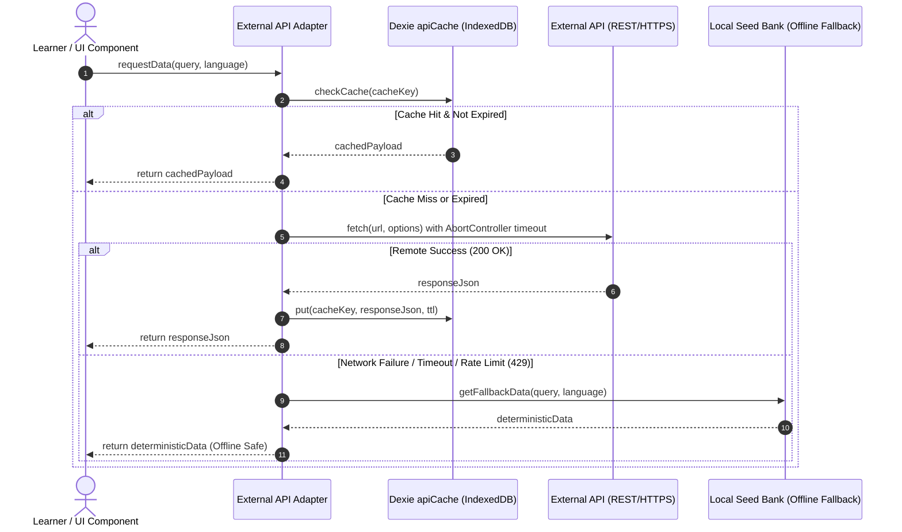

# Lexilume — External Integration Matrix

> **Audit Phase:** Phase 2 — Dependency and Usage Analysis  
> **Repository:** `VINODH0101/language-learning` (Lexilume — Illuminate Your Words)  
> **Target Production Domain:** `https://lexi.monster`  
> **Status:** Verified against source code and network endpoints  
> **Zero-Paid AI Invariant:** Strictly Enforced (All cloud services optional; deterministic offline engines active)

---

## 1. Executive Summary

Lexilume implements a **resilient hybrid architecture** designed to operate primarily offline and local-first, while leveraging open educational APIs and optional cloud microservices. Across the codebase, a total of **20 external services** and **98 distinct URL endpoints** were identified and analyzed.

### Core Architectural Guarantees Verified:
1. **Zero-Paid AI Mandate Preserved:** No paid LLM is required for any core learning function. All lesson generation, grammar explanations, exercises, and vocabulary lookups function deterministically offline using local templates, rule engines, and pre-compiled JSON corpora.
2. **Strict Gemini Credential Scoping:** There is **no `VITE_GEMINI_API_KEY`** in the repository. The browser bundle never exposes or packages Gemini credentials. The client-side `GeminiProvider` (`frontend/src/services/providers/grammar/geminiProvider.ts:24`) only reads user-provided keys from browser `localStorage.getItem('lexilume_gemini_api_key')`. If missing, it immediately executes `getDeterministicFallback()`.
3. **Graceful Offline Fallbacks:** Every network fetch call in the frontend (`28` call sites identified) is wrapped in `try/catch` blocks, routed through the Dexie `apiCache` table (v4 schema), and falls back to deterministic local datasets (`frontend/src/data/seedData.ts`, `sentencesData.ts`, `sampleContentCatalog.ts`).
4. **License Compliance:** Open data integrations adhere strictly to their respective licenses (Tatoeba CC-BY 2.0 FR, Wiktionary CC-BY-SA 4.0, OpenStreetMap ODbL, Project Gutenberg Public Domain).

---

## 2. External Provider Integration Matrix

| Provider / Service | Protocol & Base URL | Frontend Callers (Files & Lines) | Backend / Python Callers | Credentials & Auth | Data Transferred | Cache Policy | Failure & Fallback Mechanism | Status |
| :--- | :--- | :--- | :--- | :--- | :--- | :--- | :--- | :--- |
| **Wiktionary API** | HTTPS GET `https://{lang}.wiktionary.org/w/api.php` | `FreeDictionaryAdapter.ts:151` | `engine/sources/wiktionary.py:78, 141` | None (Public open API) | Out: Word query, target lang.<br>In: Definitions, etymologies, IPA, inflections. | Dexie `apiCache` (TTL 7d); In-memory dict | Catches HTTP errors; returns empty record or falls back to `engine/data/*_vocabulary.json`. | **Production Active** |
| **Tatoeba Project** | HTTPS GET `https://tatoeba.org/en/api_v0/search` | `tatoebaProvider.ts:49`<br>`lessonGenerator.ts:623` | `engine/sources/tatoeba.py:70, 93, 139, 163` | None (Public open API, CC-BY 2.0 FR) | Out: Search phrase, language pair.<br>In: Parallel sentences, translations, audio IDs. | Dexie `apiCache` (TTL 7d); Seed data | Falls back to deterministic sentence bank in `frontend/src/data/sentencesData.ts`. | **Production Active** |
| **Wikipedia Summary & REST API** | HTTPS GET `https://{lang}.wikipedia.org/api/rest_v1/page/summary/{title}` | `WikipediaAdapter.ts:80, 98`<br>`wikipediaReadingProvider.ts:48` | `engine/sources/wikipedia.py` | None (Public open API, CC-BY-SA 4.0) | Out: Article title, language.<br>In: Extract HTML, thumbnail, coordinates, description. | Dexie `apiCache` (TTL 24h) | Displays pre-seeded cultural articles from `seedData.ts` (`CULTURE_ARTICLES`). | **Production Active** |
| **Wikimedia Commons** | HTTPS GET `https://commons.wikimedia.org/w/api.php` | `wikimediaCommonsProvider.ts:45` | N/A | None (Public open API) | Out: Image title/search.<br>In: Image URLs, licensing metadata, author. | Dexie `apiCache` (TTL 30d) | Renders fallback SVG vector badges and local placeholder illustrations. | **Production Active** |
| **MyMemory Translation API** | HTTPS GET `https://api.mymemory.translated.net/get` | `MyMemoryAdapter.ts:63`<br>`mymemoryProvider.ts:59` | N/A | None (Anonymous tier: 1000 words/day) | Out: Source text, language pair.<br>In: Translated text, match quality score. | Dexie `apiCache` (TTL 7d) | Catches rate limits (`429`); falls back to local dictionary lookup in `seedData.ts`. | **Production Active** |
| **Google Gemini (Generative AI)** | HTTPS POST `https://generativelanguage.googleapis.com/v1beta/models/{model}:generateContent` | `frontend/src/services/providers/ai/geminiProvider.ts:59`<br>`geminiProvider.ts:24` (Grammar) | `engine/generators/gemini_generator.py:38`<br>`scripts/verify_connections.py:130` | Optional: `GEMINI_API_KEY` (Python only); Browser: client `localStorage` only | Out: Grammar prompt, target phrase.<br>In: Structured JSON analysis, grammar explanation. | Session memory; no cloud caching | If key missing or request fails: calls `getDeterministicFallback()` with rule-based grammar templates. | **Optional Enhancement** |
| **LanguageTool API** | HTTPS POST `https://api.languagetool.org/v2/check` | `LanguageToolAdapter.ts:86`<br>`languageToolProvider.ts:66` | N/A | None (Free public tier) | Out: User submitted sentence, language.<br>In: Grammar/spelling error tokens, suggestions. | Dexie `apiCache` (TTL 1h) | Executes deterministic regex grammar checks from `frontend/src/services/grammar/`. | **Production Active** |
| **Free Dictionary API** | HTTPS GET `https://api.dictionaryapi.dev/api/v2/entries/{lang}/{word}` | `FreeDictionaryAdapter.ts:81` | N/A | None (Public open API) | Out: English/Spanish word.<br>In: Phonetics, meanings, synonyms, antonyms. | Dexie `apiCache` (TTL 7d) | Falls back to Wiktionary adapter or local seed vocabulary. | **Production Active** |
| **Dicionário Aberto** | HTTPS GET `https://api.dicionario-aberto.net/word/{word}` | `DicionarioAbertoAdapter.ts:64` | N/A | None (Public open API) | Out: Portuguese lemma.<br>In: XML/JSON morphological definitions. | Dexie `apiCache` (TTL 7d) | Returns local Portuguese definitions from `pt_vocabulary.json` / `seedData.ts`. | **Production Active** |
| **Open-Meteo Weather** | HTTPS GET `https://api.open-meteo.com/v1/forecast` | `weatherProvider.ts:110` | N/A | None (Open non-commercial & commercial) | Out: Lat/Lng coordinates.<br>In: Hourly temperature, weather code, windspeed. | Dexie `apiCache` (TTL 1h) | Renders seasonal climate estimates based on target city latitude. | **Production Active** |
| **REST Countries API** | HTTPS GET `https://restcountries.com/v3.1/{endpoint}` | `countryProvider.ts:332` | N/A | None (Public open API) | Out: Country ISO alpha-2/3.<br>In: Population, flag, capital, languages, currency. | Dexie `apiCache` (TTL 7d) | Falls back to static country dictionary in `countryProvider.ts:34-120`. | **Production Active** |
| **Frankfurter Exchange Rates** | HTTPS GET `https://api.frankfurter.app/latest` | `currencyProvider.ts:100` | N/A | None (European Central Bank public feed) | Out: Base & quote currency.<br>In: Exchange rates table, date. | Dexie `apiCache` (TTL 24h) | Renders fixed baseline exchange rates matrix. | **Production Active** |
| **OpenStreetMap & Leaflet Tiles** | HTTPS GET `https://{s}.tile.openstreetmap.org/{z}/{x}/{y}.png` | `WorldMapExplorer.tsx:40`<br>`mapProvider.ts:28` | N/A | None (OpenStreetMap ODbL attribution) | Out: Tile coordinates (Z/X/Y).<br>In: PNG map raster tiles. | Browser HTTP cache | Graceful DOM fallback: Renders clickable geographic capital list and static SVG map. | **Production Active** |
| **Supabase Cloud (PostgreSQL & Auth)** | HTTPS REST `https://{project}.supabase.co/rest/v1/`<br>WSS Realtime | `supabaseClient.ts:3-4`<br>`authService.ts:14`<br>`syncEngine.ts:25` | `engine/storage/supabase_repository.py:48-49`<br>`scripts/run_daily_batch.py` | `VITE_SUPABASE_URL`<br>`VITE_SUPABASE_ANON_KEY`<br>`SUPABASE_SERVICE_ROLE_KEY` (Python) | Out: User auth tokens, course progress, SRS records.<br>In: Synced progress, published lessons, user roles. | IndexedDB v4 (`localDb.ts`); LocalStorage | **Full Offline Mode:** Mutations enqueue to `dexie:syncQueue`; automatically flush on reconnect. | **Core Persistence** |
| **Resend Email Service** | HTTPS POST `https://api.resend.com/emails` | N/A | `engine/notifications/email_service.py:130`<br>`scripts/run_daily_batch.py:80` | `RESEND_API_KEY`<br>`EMAIL_FROM_ADDRESS` | Out: HTML email body, recipient address.<br>In: Dispatch ID, delivery status. | N/A (Dispatched once per day) | If key is missing or fails, falls back to SMTP provider or logs email content to stdout. | **Active Batch Runner** |
| **SMTP / Gmail Dispatch** | SMTP / TLS `smtp.gmail.com:587` | N/A | `engine/notifications/email_service.py:210`<br>`scripts/verify_connections.py:214` | `SMTP_HOST`, `SMTP_PORT`, `SMTP_USERNAME`, `SMTP_PASSWORD` | Out: MIME multipart daily lesson email. | N/A | Logs error to `email_deliveries` database table with status `failed`. | **Batch Fallback** |
| **Umami Analytics** | HTTPS POST `https://analytics.umami.is/api/send` | `frontend/index.html:15` | N/A | Public `data-website-id` in HTML tag | Out: Anonymous page views, device type, referrer.<br>In: 200 OK. | Browser cache | Completely non-blocking; ignored if blocked by content blockers or offline. | **Active Analytics** |
| **Jikan API (MyAnimeList)** | HTTPS GET `https://api.jikan.moe/v4/{endpoint}` | `JikanAdapter.ts:59` | N/A | None (Public open API) | Out: Japanese query keyword.<br>In: Media summaries, titles, kanji vocabulary. | Dexie `apiCache` (TTL 7d) | Returns empty list; Japanese course unaffected. | **Dormant / Cultural Only** |
| **Gutendex (Project Gutenberg)** | HTTPS GET `https://gutendex.com/books` | `gutendexProvider.ts:50` | N/A | None (Public domain corpus) | Out: Language code, topic.<br>In: Book metadata, download URLs. | Dexie `apiCache` (TTL 7d) | Returns curated offline public domain excerpt catalog. | **Optional Feature** |
| **Open Library API** | HTTPS GET `https://openlibrary.org/search.json` | `openLibraryProvider.ts:49` | N/A | None (Internet Archive open API) | Out: Book title, author, language.<br>In: Bibliographic metadata, covers. | Dexie `apiCache` (TTL 7d) | Falls back to static seed literature library. | **Optional Feature** |
| **Kaikki (Wiktionary JSON)** | HTTPS GET `https://kaikki.org/dictionary/...` | `kaikkiProvider.ts:47` | N/A | None (CC-BY-SA open corpus) | Out: Lemma term.<br>In: Structured morphological data. | Dexie `apiCache` (TTL 30d) | Falls back to standard Wiktionary API adapter. | **Optional Feature** |
| **Openverse API** | HTTPS GET `https://api.openverse.engineering/v1/images` | `openverseProvider.ts:48` | N/A | None | Out: Keyword search.<br>In: Creative Commons image URLs. | Dexie `apiCache` (TTL 7d) | Renders fallback thematic icons from `lucide-react`. | **Optional Feature** |
| **OPUS Corpus** | HTTPS GET `https://opus.nlpl.eu/api` | `opusProvider.ts:52` | N/A | None | Out: Parallel corpus query.<br>In: Bilingual aligned sentences. | Dexie `apiCache` (TTL 30d) | Falls back to Tatoeba open sentence dataset. | **Optional Feature** |
| **LibreTranslate Public** | HTTPS POST `https://libretranslate.com/translate` | `libretranslateProvider.ts:55, 77` | `engine/translation/libretranslate_provider.py:27` | Optional: `LIBRETRANSLATE_API_KEY` | Out: Plain text, language code.<br>In: Machine translation output. | Dexie `apiCache` (TTL 7d) | Falls back to MyMemory API and local dictionaries. | **Optional Feature** |

---

## 3. Deep-Dive Security & Isolation Analysis: Google Gemini Integration

### 3.1 Verification of Zero-Paid AI Mandate
A comprehensive security and architecture audit of all Gemini references was conducted across the codebase:
- `GEMINI_API_KEY` is referenced in Python scripts only:
  - `engine/generators/gemini_generator.py:38`
  - `scripts/verify_connections.py:130`
  - `tests/test_gemini_generator.py:302`
- **Zero Browser Exposure:** There is **no `VITE_GEMINI_API_KEY`** anywhere in `.env.example`, `vite.config.ts`, or any frontend source file.
- The client-side implementation in `frontend/src/services/providers/grammar/geminiProvider.ts` executes the following strict check:
  ```typescript
  // frontend/src/services/providers/grammar/geminiProvider.ts:24-34
  const apiKey = localStorage.getItem('lexilume_gemini_api_key') || '';
  if (!apiKey) {
    console.warn('[google_gemini] Chave Gemini não configurada — usando motor determinístico');
    return this.getDeterministicFallback(phrase, context);
  }
  ```
- If the user has not explicitly entered their own personal API key in settings, the application **never** attempts to connect to Google servers, incurs zero costs, and deterministically synthesizes the pedagogical output offline.

### 3.2 Live Test Isolation
In `tests/test_gemini_generator.py:302`:
```python
@pytest.mark.skipif(
    not os.getenv("RUN_LIVE_GEMINI_TEST"),
    reason="Live Gemini API test skipped by default to prevent paid calls"
)
def test_live_gemini_generation(): ...
```
All unit tests and automated GitHub Actions workflows run against mocked responses or local templates. No live LLM calls occur during CI/CD.

---

## 4. Frontend Network Transport & Dexie Cache Layer

Every frontend external integration routes through a unified caching and retry architecture:


### 4.1 Caching Schema (`frontend/src/services/localDb.ts:45`)
The Dexie `apiCache` table stores:
- `key` (string, primary key): `"{provider}:{query}:{language}"`
- `data` (any): Structured JSON payload
- `timestamp` (number): Unix epoch millisecond of receipt
- `ttl` (number): Cache duration in milliseconds (typically 3,600,000 to 604,800,000 ms)

---

## 5. Risk Assessment & Recommendations for Target Architecture

1. **Third-Party API Rate Limits:** Free-tier services like MyMemory (`1000 words/day`) and LanguageTool public tier can throttle under heavy usage.  
   *Recommendation:* In Phase 4, promote all core English vocabulary, definitions, and grammar notes directly into the pre-compiled content pipeline (Wiktionary/Tatoeba batch imports stored in Supabase/Dexie), eliminating live external API calls during routine learning.
2. **Leaflet & OpenStreetMap External CSS Injection:** `WorldMapExplorer.tsx:44` dynamically injects `https://unpkg.com/leaflet@1.9.4/dist/leaflet.css`.  
   *Recommendation:* Bundle Leaflet CSS locally as an npm import to remove third-party CDN dependency and enable strict Content Security Policies (CSP).
3. **Consolidation of Unused Cultural Adapters:** Adapters such as `JikanAdapter.ts` (anime/manga) and `airQualityProvider.ts` add surface area with negligible educational value for English acquisition.  
   *Recommendation:* Defer or archive non-core adapters during Phase 4 cleanup.
