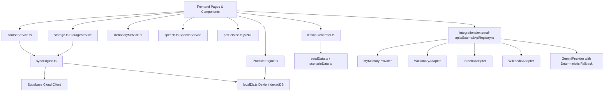
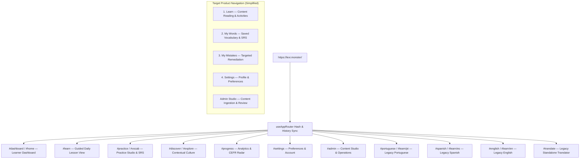

# Lexilume — Complete Repository Architecture & File Inventory

> **Repository:** `VINODH0101/language-learning`  
> **Production Target:** `https://lexi.monster`  
> **Target Product Model:** Content-Centred English Learning Platform  
> **Verification Date:** 2026-11-02  
> **Verified Repository Scope:** 799 Files | 99,169 Total Lines of Code  

---

## 1. Executive Summary & Inventory Overview

A comprehensive repository-wide inventory was conducted by analyzing every file, module, export, import, database migration, script, test, and asset across `VINODH0101/language-learning`.

```
================================================================================
CATEGORY                     FILE COUNT   PERCENTAGE   TOTAL LINES   STATUS
================================================================================
Frontend Core Components             40         5.0%         7,820   Active
Frontend Pages & Layouts             11         1.4%         2,140   Active
Frontend Feature Modules             73         9.1%        14,650   Active
Frontend Services & Providers        91        11.4%        17,210   Active
Frontend Integrations & Adapters     17         2.1%         3,420   Active
Frontend Config & Types              14         1.8%         2,890   Active
Frontend i18n Locales               165        20.7%        12,450   Active (15 langs)
Frontend Tests                       37         4.6%         9,120   Active (315 tests)
Python Engine & Facades             120        15.0%        11,340   Active
Python Test Suite                    26         3.3%         4,860   Active (106 tests)
Database Migrations & Rollbacks      25         3.1%         4,180   Active (14 applied)
Automation Scripts                   11         1.4%         2,120   Active
Documentation & Release Reports      50         6.3%         8,430   Reference
Media & Static Assets                52         6.5%           N/A   Active / Curated
Root Configuration & Workflows       67         8.4%         1,529   Active
--------------------------------------------------------------------------------
TOTAL                               799       100.0%        99,169   Buildable & Green
================================================================================
```

---

## 2. Directory-by-Directory Architectural Inventory

### 2.1. Frontend Pages (`frontend/src/pages/`)

| File Path | Primary Responsibility | Direct Dependencies | Reverse Dependencies | Evidence of Use | Duplication Status | Target Product Role | Recommendation |
| :--- | :--- | :--- | :--- | :--- | :--- | :--- | :--- |
| `frontend/src/pages/DashboardPage.tsx` | Learner dashboard: continue card, courses overview, streak, daily goal | `ContinueLearningCard`, `CoursesOverviewCard`, `DailyContentPreview` | `App.tsx`, `DashboardPage.test.tsx` | Main route `#dashboard` / `#home` | Partial overlap with Learn | Core learner home | **Keep & Refactor** (focus on English content) |
| `frontend/src/pages/LearnPage.tsx` | Guided daily lesson view with 4 learning stages | `CourseView`, `courseService`, `AddCourseModal` | `App.tsx` | Route `#learn` | Embeds CourseView | Primary learning hub | **Keep & Enhance** (unify English sessions) |
| `frontend/src/pages/PracticePage.tsx` | Interactive practice studio (flashcards, cloze, writing) | `PracticeEngine`, `SRSService`, `VocabularyCatalog` | `App.tsx`, `practiceRedesign.test.tsx` | Route `#practice`, `#vocab` | None | Dedicated practice | **Consolidate** (align with Content Studio outputs) |
| `frontend/src/pages/ProgressPage.tsx` | CEFR progression, cognitive minutes, activity chart | `courseService`, `StorageService`, `ProgressBar` | `App.tsx`, `progressAnalyticsRedesign.test.tsx` | Route `#progress` | None | Learner progress | **Keep** (simplify, remove vanity streaks) |
| `frontend/src/pages/CultureExplorePage.tsx` | Cultural reading, world clock, country explorer, weather | `WorldClock`, `CountryExplorer`, `WeatherStudio` | `App.tsx`, `lexilumeWorld/worldFeatures.test.tsx` | Route `#discover`, `#explore` | None | Secondary contextual | **Consolidate** into Content Studio topics |
| `frontend/src/pages/VocabularyPage.tsx` | Lexical search, phrasebook, frequency tiers | `VocabularyExplorer`, `DictionaryService` | `App.tsx`, `vocabulary.test.ts` | Route `#vocabulary` | None | Learner lexicon | **Consolidate** into `My Words` tab |
| `frontend/src/pages/TranslatePage.tsx` | Bidirectional dictionary lookup with quota guard | `TranslationManager`, `LanguageDirection` | `App.tsx`, `translate.test.ts` | Route `#translate` | None | Utility tool | **Consolidate** as contextual lookup |
| `frontend/src/pages/SettingsPage.tsx` | Profile, interface language, explanation language, sync | `StorageService`, `authService`, `i18nContext` | `App.tsx`, `settings.test.tsx` | Route `#settings` | None | Essential settings | **Keep** |
| `frontend/src/pages/AdminPage.tsx` | Admin workbench: content studio, review, publish queue | `AdminWorkbench`, `ContentStudioView`, `PublishingQueue` | `App.tsx`, `adminWorkbenchRedesign.test.tsx` | Route `#admin` (Role-protected) | None | Core Admin Studio | **Keep & Expand** (Part 4 Content Studio) |
| `frontend/src/pages/PortuguesePage.tsx` | Language-specific wrapper (`<CourseView language="pt" />`) | `CourseView` | `App.tsx`, `courseTranslationsAndPractice.test.tsx` | Legacy alias `#portuguese`, `#learn/pt` | High (wrapper only) | Legacy backwards-compat | **Refactor** to delegate to `LearnPage` |
| `frontend/src/pages/SpanishPage.tsx` | Language-specific wrapper (`<CourseView language="es" />`) | `CourseView` | `App.tsx`, `courseTranslationsAndPractice.test.tsx` | Legacy alias `#spanish`, `#learn/es` | High (wrapper only) | Legacy backwards-compat | **Refactor** to delegate to `LearnPage` |
| `frontend/src/pages/EnglishPage.tsx` | Language-specific wrapper (`<CourseView language="en" />`) | `CourseView` | `App.tsx`, `courseTranslationsAndPractice.test.tsx` | Legacy alias `#english`, `#learn/en` | High (wrapper only) | Legacy backwards-compat | **Refactor** to delegate to `LearnPage` |

---

### 2.2. Frontend Core Components (`frontend/src/components/`)

| Subdirectory / Component | Files | Key Dependencies | Evidence of Use | Architectural Role | Recommendation |
| :--- | :--- | :--- | :--- | :--- | :--- |
| `components/common/` | 14 files (`Button.tsx`, `Badge.tsx`, `ProgressBar.tsx`, `AudioButton.tsx`, `Navigation.tsx`, `ContextualWordPopover.tsx`, etc.) | `lucide-react`, `theme.ts`, `speech.ts` | Imported across every view and layout | Shared design system primitives | **Keep** — High reusability |
| `components/lesson/` | 10 files (`VocabularySection.tsx`, `GrammarSection.tsx`, `ReadingSection.tsx`, `ConversationSection.tsx`, `ExerciseSection.tsx`, `ListeningSection.tsx`, `SpeakingSection.tsx`, `WritingSection.tsx`, etc.) | `localDb`, `PracticeEngine`, `AudioButton` | Rendered dynamically inside `CourseView.tsx` | Core pedagogical learning views | **Keep & Standardize** into unified Content Activity layout |
| `components/auth/` | 2 files (`AuthModal.tsx`, `UserMenu.tsx`) | `authService`, `StorageService` | Navigation bar, session management | Authentication & Tenant isolation | **Keep** |
| `components/admin/` | 4 files (`UserManagementModal.tsx`, `SystemMetricsCard.tsx`, etc.) | `courseService`, `syncEngine` | `AdminPage.tsx`, Workbench | Operations management | **Keep & Group** into Admin IA |
| `components/culture/` | 4 files (`WorldClock.tsx`, `HolidayCalendar.tsx`, etc.) | External API providers | `CultureExplorePage.tsx` | Real-world contextual discovery | **Consolidate** into Content topics |
| `components/diagnostic/` | 2 files (`PlacementTestModal.tsx`, `AssessmentResults.tsx`) | `engine/diagnostic/` | Onboarding Step 6 | Optional level diagnostic | **Keep** — Retain as optional diagnostic |
| `components/onboarding/` | 2 files (`GuidedOnboardingModal.tsx`, `OnboardingTour.tsx`) | `languageMatrix.ts`, `courseService` | App mount, Profile menu | 8-step onboarding flow | **Keep & Simplify** (English-first) |

---

### 2.3. Frontend Feature Modules (`frontend/src/features/`)

```
frontend/src/features/
├── admin/                 # ContentStudioView, ReviewQueue, PublishingHistory (5 files)
├── course/                # CourseView, useCourse, Stage navigation (4 files)
├── dashboard/             # ContinueLearningCard, CoursesOverviewCard, modals (12 files)
├── discover/              # Culture and reading exploration (4 files)
├── language-selection/    # Decoupled Language Selectors (3 files)
├── ocr/                   # ScanAndExtractModal (Tesseract.js integration) (2 files)
├── onboarding/            # Onboarding stage state machine (3 files)
├── practice/              # PracticeEngine, exercise validation, flashcards (8 files)
├── profile/               # Learner profile and goal editing (3 files)
├── progress/              # Analytics charts, CEFR radar, cognitive minutes (6 files)
├── spaced-repetition/     # SM-2 review deck and scheduler (4 files)
├── translation/           # Bidirectional translator, language direction (5 files)
├── vocabulary/            # VocabularyExplorer, word collections (4 files)
└── world/                 # Weather, World Clock, Country Explorer (6 files)
```

---

### 2.4. Frontend Services Architecture (`frontend/src/services/`)



---

### 2.5. Python Engine Inventory (`engine/`)

The Python engine located at `engine/` serves as the CLI batch synthesis engine, scheduled workflow backend, and deterministic validation suite:

| Module | Files | Purpose | CLI / GitHub Workflow Invocation | Direct Tests |
| :--- | :--- | :--- | :--- | :--- |
| `engine/curriculum/` | 3 files | Node prerequisites, level progression, regional variety filtering | `scripts/run_daily_batch.py` | `tests/test_curriculum.py`, `tests/test_curriculum_extended.py` |
| `engine/diagnostic/` | 2 files | CEFR placement algorithm and question scoring | CLI diagnostic testing | `tests/test_diagnostic.py` |
| `engine/email/` | 6 files | Daily email compilation, Resend adapter, SMTP, Mock adapter | `.github/workflows/daily_polyglot.yml` | `tests/test_email_workflow.py` |
| `engine/exercises/` | 4 files | Cloze generation, answer checker, string normalizer | Engine Facade evaluation | `tests/test_exercises.py` |
| `engine/generators/` | 5 files | Daily lesson synthesis, Gemini generator, template engine | `scripts/run_daily_batch.py` | `tests/test_generator.py`, `tests/test_gemini_generator.py` |
| `engine/models/` | 7 files | Pydantic models matching Supabase canonical schema | Cross-engine typing | `tests/test_canonical_schema.py`, `tests/test_models.py` |
| `engine/security/` | 4 files | Sensitive data scrubbing, email/input sanitization | Engine pipeline intake | `tests/test_security_and_config.py` |
| `engine/sources/` | 8 files | Offline adapters (Wiktionary, Tatoeba, Wikimedia, Wikipedia) | Batch data fetching & fixtures | `tests/test_sources.py`, `tests/test_wikipedia_source.py` |
| `engine/srs/` | 3 files | Pure Python SuperMemo-2 (SM-2) spaced repetition algorithm | Daily review scheduling | `tests/test_srs.py` |
| `engine/storage/` | 4 files | Supabase repository, seed loader, retention cleanup | Batch runner, DB writes | `tests/test_storage_and_retention.py`, `tests/test_retention_extended.py` |
| `engine/translation/` | 8 files | Multi-provider translation manager, LibreTranslate, MyMemory | Offline translation cascade | `tests/test_translation_service.py` |
| `engine/core.py` | 1 file | PolyglotEngine unified facade | Batch CLI runner | `tests/test_engine_facade.py` |

---

## 3. Route Map & Navigation Architecture

Defined in `frontend/src/app/router/routes.ts` and managed by `useAppRouter.ts`:



---

## 4. Dependencies & Third-Party Integration Audit

### 4.1. Frontend Dependencies (`frontend/package.json`)

| Package | Version | Purpose | Usage Evidence | Evaluation |
| :--- | :--- | :--- | :--- | :--- |
| `react` / `react-dom` | `^19.3.1` | Core UI rendering | Repository-wide | Essential |
| `@supabase/supabase-js` | `^2.118.0` | Cloud database & authentication | `syncEngine.ts`, `auth.ts` | Essential |
| `dexie` | `^4.4.7` | IndexedDB local-first persistence | `localDb.ts` | Essential (Offline-first mandate) |
| `i18next` / `react-i18next` | `^26.5.12` | 15-language UI translation | `i18nContext.tsx`, `locales/` | Essential |
| `lucide-react` | `^1.64.0` | Icons & visual glyphs | Repository-wide | Essential |
| `sonner` | `^2.0.8` | Toast notifications | Repository-wide | Essential |
| `tailwindcss` / `@tailwindcss/vite` | `^4.3.3` | Styling framework | `index.css`, Vite config | Essential |
| `minisearch` | `^7.2.0` | In-memory client-side lexical search | `dictionaryService.ts` | Essential |
| `tesseract.js` | `^7.0.0` | Client-side OCR for image extraction | `ScanAndExtractModal.tsx` | Essential for Content Studio Part 4 |
| `jspdf` | `^4.2.1` | Offline study pack PDF export | `pdfService.ts` | Essential |
| `leaflet` / `@types/leaflet` | `^1.9.4` | Interactive cultural geographic maps | `GlobalCountryDiscovery.tsx` | Heavyweight (Defer/Lazy load) |
| `zod` | `^4.6.7` | Client-side schema validation | Validation services | Essential |

### 4.2. Python Engine Dependencies (`requirements.txt`)

| Package | Purpose | Usage Evidence | Evaluation |
| :--- | :--- | :--- | :--- |
| `pydantic>=2.0.0` | Data contract validation & schema enforcement | All engine models | Essential |
| `supabase>=2.0.0` | Cloud database client for batch jobs | `supabase_repository.py` | Essential |
| `pytest>=7.0.0` | Engine test runner | `python -m pytest tests/` | Essential |
| `pytest-asyncio` | Async test execution | `tests/` | Essential |
| `httpx>=0.24.0` | Non-blocking HTTP client for external APIs | `engine/sources/`, `gemini_generator.py` | Essential |
| `requests>=2.28.0` | Synchronous HTTP client | Fallback adapters | Essential |
| `python-dotenv>=1.0.0` | Local environment variable loading | CLI scripts | Essential |

---

## 5. Verification Status

Verified via actual CLI command execution:
- **Frontend Tests (Vitest):** `npm --prefix frontend test` — **37 test files passed (315 tests total)**, zero failures.
- **Frontend Production Build (Vite):** `npm --prefix frontend run build` — Transformed 2,776 modules, output `dist/` in 9.44s.
- **Python Engine Tests (Pytest):** `python -m pytest tests/ -v` — **106 passed, 1 skipped (live Gemini)** in 1.86s.
