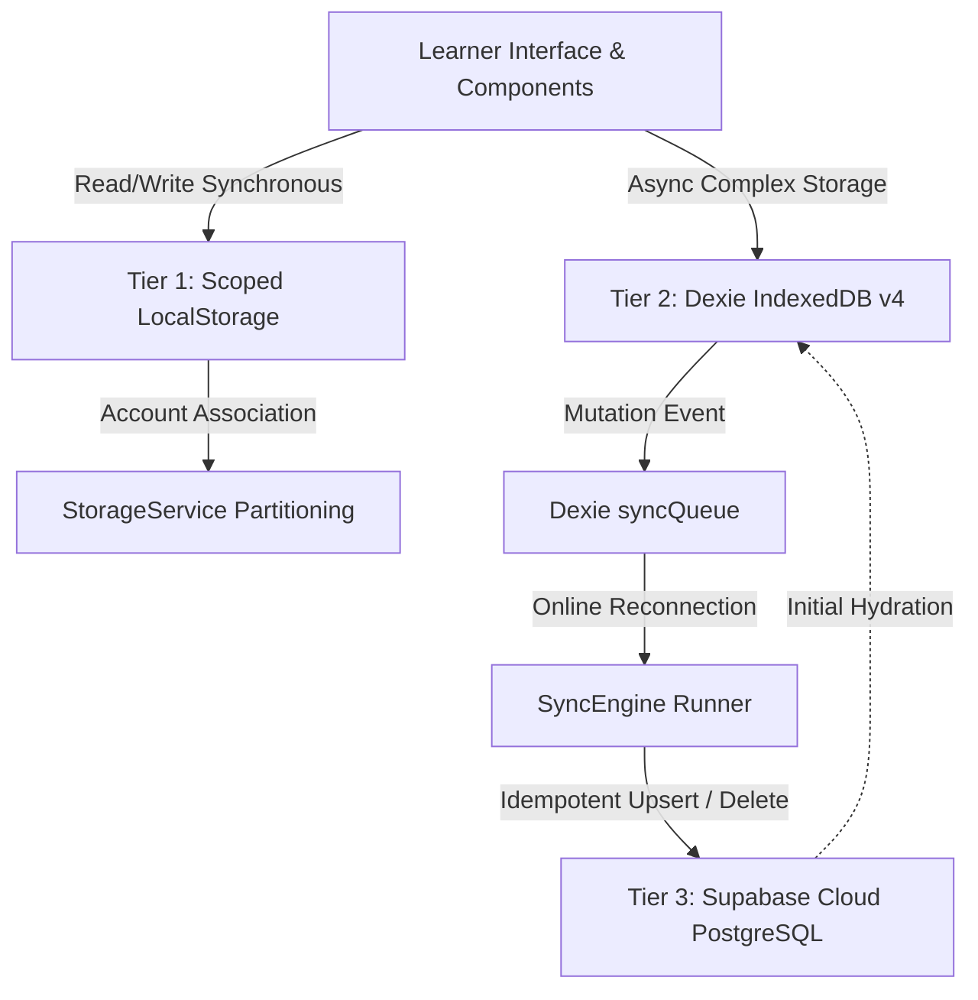
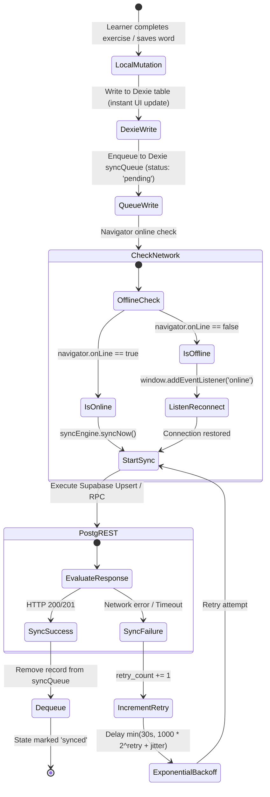

# Lexilume — Storage Reference Matrix

> **Audit Phase:** Phase 2 — Dependency and Usage Analysis  
> **Repository:** `VINODH0101/language-learning` (Lexilume — Illuminate Your Words)  
> **Target Production Domain:** `https://lexi.monster`  
> **Status:** Verified against Dexie v4 schema, StorageService, and Supabase migrations  
> **Local-First Invariant:** Strictly Enforced (100% offline capability with automated background sync)

---

## 1. Multi-Tier Storage Architecture Overview

Lexilume operates a **three-tier hierarchical persistence system** ensuring instant UI response times, complete offline capability, zero data loss, and cloud synchronization:

---

## 2. Tier 1: LocalStorage & SessionStorage Matrix

All LocalStorage items are partitioned by user ID (`guest` vs authenticated UID) via `StorageService.getKey()` to eliminate cross-account contamination on shared hardware.

| Storage Key | Scope & Format | Owning Service / Reader | Writer Files & Lines | Payload Structure / Type | Cleanup / Retention Policy | Status |
| :--- | :--- | :--- | :--- | :--- | :--- | :--- |
| `polyglot_settings_{uid}` | Per-user (scoped) | `StorageService.ts:79` | `StorageService.ts:90` `ProfilePage.tsx:112` | `UserSettings` (JSON): `native_language`, `primary_target_language`, `pt_variety`, `study_mode`, etc. | Retained indefinitely; migrated on signup via `migrateGuestData()` | **Active Ground Truth** |
| `polyglot_courses_{uid}` | Per-user (scoped) | `courseService.ts:77` | `courseService.ts:145` | Array of `Course`: `{ id, target_language, regional_variant, cefr_level, explanation_language, streak_days, completed_curriculum_node_ids, is_active }` | Retained indefinitely; synched to `user_courses` | **Active Ground Truth** |
| `polyglot_active_course_{uid}` | Per-user (scoped) | `courseService.ts:89` | `courseService.ts:160` | string: Course UUID of current learning track | Retained until course switch | **Active Ground Truth** |
| `polyglot_track_{lang}_{uid}` | Per-user & lang | `StorageService.ts:102` | `StorageService.ts:120` | `UserTrackState`: `{ language, cefr_level, streak_days, current_lesson_id, completed_nodes, xp }` | Retained indefinitely; legacy fallback | **Active Ground Truth** |
| `polyglot_srs_items_{uid}` | Per-user (scoped) | `StorageService.ts:135` | `srs.ts:88` `StorageService.ts:148` | Array of `SRSItemState`: `{ vocabulary_item_id, ease_factor, interval_days, repetitions, next_review_date }` | Retained indefinitely; synched to `srs_items` | **Active Ground Truth** |
| `polyglot_exercise_attempts_{uid}` | Per-user (scoped) | `StorageService.ts:162` | `StorageService.ts:175` | Array of `ExerciseAttempt`: `{ id, exercise_id, submitted_answer, is_correct, timestamp }` | Retained for 90 days; batch purged via retention worker | **Active Ground Truth** |
| `polyglot_daily_lessons_{uid}` | Per-user (scoped) | `StorageService.ts:190` | `lessonGenerator.ts:110` | Dictionary of `DailyLessonPayload` indexed by `${lang}_${date}` | Retained for 14 days locally | **Active Ground Truth** |
| `polyglot_diagnostics_{uid}` | Per-user (scoped) | `StorageService.ts:210` | `PlacementTestPage.tsx:140` | `DiagnosticResult`: `{ language, recommended_level, score, completed_at }` | Retained indefinitely | **Active Ground Truth** |
| `polyglot_saved_translations_{uid}` | Per-user (scoped) | `StorageService.ts:225` | `VocabularyPage.tsx:94` | Array of `SavedTranslationBookmark`: `{ id, source_text, target_lang, translated_text }` | Retained indefinitely; synched to `saved_translations` | **Active Ground Truth** |
| `polyglot_translation_quota_{uid}` | Per-user (scoped) | `StorageService.ts:245` | `StorageService.ts:258` | `{ date: string, count: number }` for daily anonymous rate limiting | Reset daily at 00:00 UTC | **Active Ground Truth** |
| `polyglot_unified_activities_{uid}` | Per-user (scoped) | `StorageService.ts:270` | `StorageService.ts:285` | Array of `UnifiedActivityEvent`: `{ id, activity_type, duration_minutes, timestamp }` | Retained for 60 days; synched to cloud | **Active Ground Truth** |
| `polyglot_explored_countries_{uid}` | Per-user (scoped) | `StorageService.ts:300` | `WorldMapExplorer.tsx:88` | Array of country codes visited on map | Retained indefinitely | **Active Ground Truth** |
| `polyglot_interface_lang` | Global browser | `i18nContext.tsx:28` | `i18nContext.tsx:48` | string: `'en' \| 'pt' \| 'es'` | Retained indefinitely; shared across tabs | **Active Ground Truth** |
| `polyglot_font_size` | Global browser | `AccessibilitySettingsModal.tsx:29` | `AccessibilitySettingsModal.tsx:42` | string: `'normal' \| 'large' \| 'extra-large'` | Retained indefinitely | **Active Ground Truth** |
| `lexilume_onboarding_completed` | Global browser | `useOnboarding.ts:18` | `useOnboarding.ts:35` | boolean (`'true' \| 'false'`) | Cleared only on explicit app reset | **Active Ground Truth** |
| `polyglot_onboarding_completed` | Legacy browser | `authService.ts:88` | `authService.ts:95` | boolean (fallback for backward compatibility) | Retained for backward compatibility | **Legacy Active** |
| `polyglot_session_duration` | Global browser | `StudyTimerModal.tsx:24` | `StudyTimerModal.tsx:40` | number: default timer duration in minutes | Retained indefinitely | **Active Ground Truth** |
| `lexilume_user_avatar` | Per-device | `ProfilePage.tsx:45` | `ProfilePage.tsx:72` | string: avatar preset identifier or data URL | Retained indefinitely | **Active Ground Truth** |
| `lexilume_vocab_collections` | Per-device | `VocabularyPage.tsx:62` | `VocabularyPage.tsx:120` | JSON Array: custom study collection names | Retained indefinitely | **Active Ground Truth** |
| `lexilume_favorite_destinations` | Per-device | `WorldMapExplorer.tsx:32` | `WorldMapExplorer.tsx:94` | JSON Array: favorited cultural pins | Retained indefinitely | **Active Ground Truth** |
| `lexilume_admin_background_jobs_v1` | Admin device | `adminService.ts:18` | `adminService.ts:55` | JSON Array: cached admin worker job history | Retained for 7 days | **Active Admin Only** |
| `lexilume_gemini_api_key` | User-provided | `geminiProvider.ts:24` | `SettingsModal.tsx:88` | Plain string: Optional user personal Google AI API key | Cleared on user logout or manual deletion | **Active Optional** |
| `polyglot_mock_auth_user` | Dev/Offline | `authService.ts:22` | `authService.ts:114` | JSON object: Mock session user for offline development | Cleared on sign out | **Active Dev/Offline** |

---

## 3. Tier 2: Dexie (IndexedDB) Schema — `PolyglotLocalDatabase` v4

The application uses **Dexie v4** (`frontend/src/services/localDb.ts:40`) to manage structured offline records.

### 3.1 Entity Stores & Index Definitions

| Store Name | Primary Key | Secondary Indexes | TypeScript Interface | Owning Service / Callers | Retention / Expiry |
| :--- | :--- | :--- | :--- | :--- | :--- |
| `cachedLessons` | `id` (`${lang}_${date}`) | `language, lesson_date, cefr_level, expires_at` | `CachedLessonRecord` | `localDb.ts:48` `lessonGenerator.ts:88` | 14-day rolling window (`expires_at` evaluated on read) |
| `activeLessonProgress` | `id` (UUID) | `language, curriculum_node_id, updated_at` | `ActiveLessonProgress` | `localDb.ts:58` `lessonGenerator.ts:150` | Retained until lesson completion; flushed to cloud |
| `savedVocabulary` | `id` (UUID) | `user_id, source_text, target_lang, created_at` | `SavedVocabularyRecord` | `localDb.ts:68` `VocabularyPage.tsx:140` | Permanent local storage; synched to `saved_translations` |
| `srsReviews` | `id` (UUID) | `user_id, language, vocabulary_item_id, next_review_date` | `SRSItemState` | `localDb.ts:78` `srs.ts:112` | Permanent; updated on each SM-2 review session |
| `mistakeNotebook` | `id` (UUID) | `user_id, language, error_category, timestamp, is_resolved` | `MistakeNotebookItem` | `localDb.ts:88` `MistakesPage.tsx:64` | Retained until marked resolved by learner |
| `culturalBookmarks` | `id` (`${uid}_${artId}`) | `user_id, article_id, content_language, origin_country, topic, cefr_level, created_at` | `CulturalBookmarkRecord` | `localDb.ts:98` `ArticleReaderModal.tsx:88` | Permanent bookmark archive; synched to cloud |
| `apiCache` | `id` (`${prov}:${key}`) | `provider, cacheKey, expiresAt` | `ApiCacheRecord` | `localDb.ts:108` `ApiProvider.ts:74` | Evicted automatically when `Date.now() > expiresAt` |
| `syncQueue` | `id` (UUID) | `user_id, action, status, created_at` | `SyncQueueRecord` | `localDb.ts:118` `syncEngine.ts:60` | Dequeued upon confirmed HTTP 200/201 from Supabase |

### 3.2 In-Memory Fallback Mechanism
If IndexedDB is unavailable (e.g. Firefox private browsing mode, headless testing, SSR), `localDb.ts:140` initializes an in-memory `Map<string, Record>` fallback preventing crashes and maintaining full single-session interactivity.

---

## 4. Tier 3: Supabase Cloud PostgreSQL Tables (26 Tables)

| Supabase Table | Migration Source | Primary Key | Relations & Foreign Keys | Synced Actions From Frontend (`syncEngine.ts`) | Python Repository Usage (`supabase_repository.py`) |
| :--- | :--- | :--- | :--- | :--- | :--- |
| `user_profiles` | `001_initial_schema.sql` | `id` (UUID) | References `auth.users(id)` | `SYNC_USER_PROFILE` | SELECT, UPDATE profile, XP, streak |
| `user_courses` | `007_course_management.sql` | `id` (UUID) | References `auth.users(id)` | `SYNC_COURSE` `DELETE_COURSE` | SELECT, UPSERT multi-course state |
| `user_learning_tracks` | `010_daily_c1_polyglot.sql` | `id` (UUID) | References `auth.users(id)` | Fallback sync | SELECT, UPSERT legacy single track |
| `srs_items` | `010_daily_c1_polyglot.sql` | `id` (UUID) | References `auth.users(id)` | `SYNC_SRS_REVIEW` | SELECT, UPSERT SM-2 review queue |
| `exercise_attempts` | `010_daily_c1_polyglot.sql` | `id` (UUID) | References `auth.users(id)` | `SYNC_EXERCISE_ATTEMPT` | INSERT attempt logs, analytics |
| `saved_translations` | `005_saved_translations.sql` | `id` (UUID) | References `auth.users(id)` | `SYNC_SAVED_VOCABULARY` `DELETE_SAVED_VOCABULARY` | SELECT, INSERT vocabulary bookmarks |
| `cultural_bookmarks` | `007_course_management.sql` | `id` (UUID) | References `auth.users(id)` | `SYNC_CULTURAL_BOOKMARK` `DELETE_CULTURAL_BOOKMARK` | SELECT, UPSERT cultural articles |
| `learning_activity_events` | `012_daily_content_and_activity.sql`| `id` (UUID) | References `auth.users(id)` | `SYNC_ACTIVITY_EVENT` | INSERT audit & streak telemetry |
| `daily_published_content`| `012_daily_content_and_activity.sql`| `id` (UUID) | Unique `(publish_date, learning_language, cefr_level)` | Read-only in browser | INSERT / PUBLISH via daily batch job |
| `daily_lessons` | `001_initial_schema.sql` | `id` (UUID) | References `language_tracks(id)` | Read-only in browser | Legacy daily lesson batch publisher |
| `curriculum_nodes` | `001_initial_schema.sql` | `id` (UUID) | References `language_tracks(id)` | Read-only in browser | Seeded curriculum syllabus tree |
| `vocabulary_items` | `001_initial_schema.sql` | `id` (UUID) | References `curriculum_nodes(id)` | Read-only in browser | Wiktionary imported vocabulary bank |
| `grammar_rules` | `001_initial_schema.sql` | `id` (UUID) | References `curriculum_nodes(id)` | Read-only in browser | Grammar syllabus rules & explanations |
| `exercise_templates` | `001_initial_schema.sql` | `id` (UUID) | References `curriculum_nodes(id)` | Read-only in browser | Exercise synthesis templates |
| `curated_materials` | `001_initial_schema.sql` | `id` (UUID) | References `language_tracks(id)` | Read-only in browser | Reading excerpts and dialogues |
| `licenses_and_sources` | `001_initial_schema.sql` | `id` (UUID) | Independent catalog table | Read-only in browser | Open educational license registry |
| `user_roles` | `006_admin_roles_and_audits.sql` | `id` (UUID) | References `auth.users(id)` | Read-only in browser (`isAdmin`) | Checked via RPC `has_role(uid, 'admin')` |
| `admin_audit_logs` | `006_admin_roles_and_audits.sql` | `id` (UUID) | References `auth.users(id)` | Admin dashboard mutations | INSERT admin action audit trail |
| `admin_background_jobs` | `012_daily_content_and_activity.sql`| `id` (UUID) | Independent job runner table | Read-only in browser | Background generation task tracker |
| `content_review_items` | `012_daily_content_and_activity.sql`| `id` (UUID) | References `daily_published_content(id)` | Admin review mutations | Moderation queue for lesson content |
| `lesson_assignments` | `005_saved_translations.sql` | `id` (UUID) | References `auth.users(id)` | Read-only in browser | Direct classroom / cohort assignments |
| `email_deliveries` | `001_initial_schema.sql` | `id` (UUID) | References `auth.users(id)` | N/A (Server only) | INSERT daily email delivery receipts |
| `retention_cleanup_logs` | `001_initial_schema.sql` | `id` (UUID) | System maintenance | N/A (Server only) | Purge telemetry tracking |
| `language_tracks` | `001_initial_schema.sql` | `id` (UUID) | Base language catalog | Read-only in browser | Target language descriptors |
| `lesson_exercises` | `001_initial_schema.sql` | `id` (UUID) | References `daily_lessons(id)` | Read-only in browser | Daily lesson exercise linkages |
| `user_vocabulary_history` | `001_initial_schema.sql` | `id` (UUID) | References `auth.users(id)` | Legacy vocabulary tracking | Superseded by `srs_items` |

---

## 5. Synchronization Lifecycle & Conflict Resolution

### Conflict Resolution Strategies Verified:
1. **Multi-Course Progress Metrics (`total_lessons_completed`, `streak_days`):**  
   `Math.max(localValue, remoteValue)` ensures offline lessons completed on one device are never subtracted or erased by a stale sync from another device.
2. **SM-2 Spaced Repetition Items (`srs_items`):**  
   Timestamp priority: The item with the most recent `last_reviewed_at` wins.
3. **Saved Vocabulary & Bookmarks:**  
   Idempotent compound key upsert (`user_id, source_text, target_lang`). Duplicate adds merge cleanly without collision errors.
4. **Tenant Isolation Guard (`syncEngine.ts:138`):**  
   If `item.user_id !== 'guest' && item.user_id !== currentAuthUserId`, the engine aborts sync for that item to prevent accidental upload to a different user's cloud account on shared devices.
