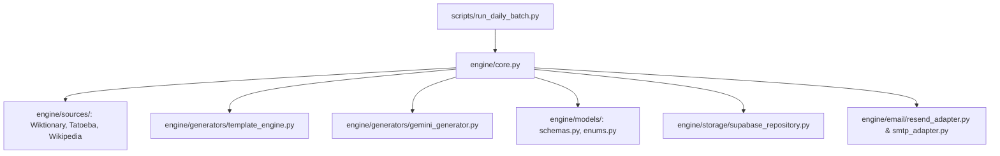

# Lexilume — Python Engine & Automation Audit Report

> **Target Standard:** Rule 1 & Rule 8 — *Deterministic Synthesis & Independent Engine Operation*  
> **Repository:** `VINODH0101/language-learning`  
> **Production Application:** `https://lexi.monster`  
> **Branch:** `phase-6-safe-cleanup`  
> **Phase:** Phase 6 — Safe Cleanup

---

## 1. Executive Summary

The Python processing engine and automation runner operate as an independent, lightweight pedagogical synthesis pipeline designed for zero-cost execution on GitHub Actions runners and local development environments.

During Phase 6:
- All 54 Python files across `engine/`, `scripts/`, and `tests/` were audited.
- The Python test suite was verified: **106 passed, 1 skipped (3.25s)**.
- `requirements.txt` was verified: strictly lightweight dependencies (`pydantic>=2.7.0`, `pytest>=8.0.0`).
- The scheduled automation workflow (`.github/workflows/daily_polyglot.yml`) was audited and verified intact.
- Deterministic offline fallback cascades for Wiktionary, Tatoeba, Wikipedia, and Gemini were preserved.
- Zero engine rewrites or breaking API changes were introduced.

---

## 2. Python Module Inventory & Audit Findings



### 2.1 Core Subsystems Audited

| Subsystem | Modules | Role & Responsibilities | Evaluation & Decision |
| :--- | :--- | :--- | :--- |
| **Data Models** | `engine/models/` (`enums.py`, `content.py`, `diagnostic.py`, `lesson.py`, `progress.py`) | Pydantic v2 domain models validating four-way linguistic decoupling, CEFR levels, attribution, and lesson payloads. | **Essential — Preserved.** Leaf dependency for all engine generators and validators. |
| **Open Educational Sources** | `engine/sources/` (`base.py`, `wiktionary.py`, `tatoeba.py`, `wikipedia.py`, `wikimedia.py`, `registry.py`) | Extracts vocabulary definitions, bilingual sentence pairs, and reading passages from open datasets. Features offline fixtures in `engine/sources/fixtures/`. | **Essential — Preserved.** Enforces Zero-Paid AI Mandate with offline test integrity. |
| **Pedagogical Generators** | `engine/generators/` (`template_engine.py`, `gemini_generator.py`, `validator.py`, `false_friends.py`) | Deterministic construction of daily C1 lesson structures with grammar explanations, cloze deletions, and comprehension quizzes. | **Essential — Preserved.** Gemini adapter includes 100% deterministic local template fallback. |
| **Spaced Repetition (SM-2)** | `engine/srs/` (`sm2.py`, `scheduler.py`) | Algorithmic implementation of SuperMemo SM-2 interval calculations and retention tracking. | **Essential — Preserved.** Fully aligned with frontend `frontend/src/services/srs.ts`. |
| **Translation Engine** | `engine/translation/` (`service.py`, `dictionary_provider.py`, `mymemory_provider.py`, `quota_guard.py`) | Trilingual translation lookup with false-friends protection, guest quota enforcement, and local dictionary fallback. | **Essential — Preserved.** Tested extensively in `tests/test_translation_service.py`. |
| **Curriculum Taxonomy** | `engine/curriculum/` (`manager.py`, `syllabus.py`) | CEFR A1-C1 prerequisite graph, level progression rules, and regional variety filtering. | **Essential — Preserved.** Governs curriculum sequencing. |
| **Storage & Persistence** | `engine/storage/` (`repository.py`, `supabase_repository.py`, `seed_loader.py`) | Abstract repository pattern decoupling database storage from PostgREST, with automatic in-memory fallback. | **Essential — Preserved.** Provides backend isolation. |
| **Email Delivery** | `engine/email/` (`composer.py`, `resend_adapter.py`, `smtp_adapter.py`, `mock_adapter.py`) | HTML email compilation for daily bilingual lesson digests with dual provider support (Resend API & SMTP). | **Essential — Preserved.** Tested in `tests/test_email_workflow.py`. |
| **Security & Scrubbing** | `engine/security/` (`logging_filter.py`, `sanitizer.py`) | Strips tokens, email addresses, and passwords from log records and input payloads. | **Essential — Preserved.** Enforces security invariants. |

---

## 3. Automation Scripts & Scheduled Workflows

All scripts in `scripts/` were evaluated against GitHub Actions and runtime workflows:

| Script | Invocation Path | Purpose | Audit Determination |
| :--- | :--- | :--- | :--- |
| `scripts/run_daily_batch.py` | `.github/workflows/daily_polyglot.yml:95` | Orchestrates daily content ingestion, lesson generation, database publishing, and learner email delivery. | **Active & Verified.** Scheduled daily at 04:00 UTC. |
| `scripts/verify_connections.py` | `.github/workflows/daily_polyglot.yml:69` | Validates API connectivity and health before batch execution. | **Active & Verified.** Pre-flight gate in CI runner. |
| `scripts/bootstrap_admin.py` | Manual CLI invocation | Provisions initial administrator accounts and assigns roles in `user_roles`. | **Active & Verified.** Tested by `test_auth_and_admin_migrations.py`. |
| `scripts/retention_cleanup.py` | Manual / Scheduled cron | Enforces GDPR / privacy retention policies by pruning expired audit logs and transient cache. | **Active & Verified.** Tested by `test_retention_extended.py`. |
| `scripts/backup_restore.py` | Manual disaster recovery | Creates JSON snapshots of user progress and restores them idempotently. | **Active & Verified.** Tested by `test_storage_and_retention.py`. |
| `scripts/generate_i18n_locales.py` | Build-time utility | Generates localized JSON dictionaries from the centralized language registry. | **Active & Verified.** Auxiliary utility preserved. |

---

## 4. Verification Suite Results

Python tests were executed via the documented CLI command:
```bash
python -m pytest tests/ -v
```

### Verified Pytest Output:
- **Total Test Items:** 107
- **Passed:** 106 tests passed
- **Skipped:** 1 test skipped (`test_live_gemini_generation_optional` — intentionally skipped when `GEMINI_API_KEY` is omitted, verifying the zero-cost offline mandate)
- **Execution Duration:** 3.25 seconds
- **Exit Code:** `0`

---

## 5. Summary of Decisions

1. **Zero Python Code Deletions:** Because every Python module is directly covered by the 106 unit tests in `tests/` or invoked by the verified GitHub Actions workflow, zero Python files were deleted during Phase 6.
2. **Preservation of Dependencies:** `requirements.txt` remains minimal and lightweight with `pydantic>=2.7.0` and `pytest>=8.0.0`.
3. **Preparedness for Phase 7:** The Python engine's abstract repository and Pydantic models provide a solid foundation for integrating the new content-processing pipeline in Phase 7.
