# Lexilume — Storage, Persistence & Data Safety Report

> **Target Standard:** Rule 1 & Rule 2 — *Zero Data Loss & Local-First Invariants*  
> **Repository:** `VINODH0101/language-learning`  
> **Production Application:** `https://lexi.monster`  
> **Branch:** `phase-6-safe-cleanup`  
> **Phase:** Phase 6 — Safe Cleanup

---

## 1. Executive Summary

Data persistence and tenant safety represent the highest-risk operational boundaries in Lexilume. The application utilizes a 3-tier persistence architecture:
1. **Scoped LocalStorage:** Fast, synchronous preference and progress key-value storage scoped by authenticated user ID or `'guest'`.
2. **Dexie IndexedDB v4 (`PolyglotLocalDatabase`):** Structured asynchronous offline storage with 8 entity collections.
3. **Supabase PostgreSQL:** Cloud relational persistence governing authenticated user data, content versions, and sync endpoints.

During Phase 6:
- **Zero local database resets were performed.**
- **Zero Dexie store schemas or upgrade handlers were modified.**
- **Zero LocalStorage keys were dropped or cleared.**
- **Zero Supabase queries, RPC calls, or migration files were touched.**
- **All guest migration safety mechanisms were preserved.**

---

## 2. Complete LocalStorage Key Registry & Ownership Audit

All LocalStorage keys across `frontend/src/` were audited for data ownership, tenant isolation, and reader/writer lifecycle:

| Storage Key | Scope & Tenant Rule | Writer | Readers | Data Format | Migration / Lifecycle Policy |
| :--- | :--- | :--- | :--- | :--- | :--- |
| `polyglot_settings_{uid}` | User-Scoped (`uid` or base for guest) | `StorageService.saveSettings()` | `StorageService.getSettings()`, `DashboardView` | JSON (`UserSettings`) | Copied non-destructively on sign-up via `migrateGuestData()`. |
| `polyglot_track_{lang}_{uid}` | User-Scoped | `StorageService.saveTrack()` | `StorageService.getTrack()`, `ProgressPage` | JSON (`UserTrackState`) | Scoped per target language (`pt`, `es`, `en`). |
| `polyglot_srs_items_{uid}` | User-Scoped | `StorageService.saveSRSItems()` | `srs.ts`, `FlashcardDeck`, `ReviewPage` | JSON (`SRSItemState[]`) | Governs SM-2 repetition parameters. Never wiped. |
| `polyglot_exercise_attempts_{uid}` | User-Scoped | `StorageService.recordAttempt()` | `ProgressPage`, `activityService.ts` | JSON (`ExerciseAttempt[]`) | Tracks chronological quiz & cloze results. |
| `polyglot_saved_translations_{uid}` | User-Scoped | `StorageService.saveTranslation()` | `TranslatePage`, `VocabularyPage` | JSON (`SavedTranslationBookmark[]`) | User phrasebook entries. |
| `polyglot_diagnostics_{uid}` | User-Scoped | `StorageService.saveDiagnostic()` | `PlacementTestModal`, `ProgressPage` | JSON (`DiagnosticResult[]`) | Diagnostic placement scores and CEFR determinations. |
| `polyglot_unified_activities_{uid}` | User-Scoped | `StorageService.logActivity()` | `activityService.ts`, `ProgressPage` | JSON (`UnifiedActivityEvent[]`) | Activity log for study time calculation. |
| `polyglot_explored_countries_{uid}` | User-Scoped | `StorageService.markCountryExplored()` | `WorldClock.tsx`, `ProgressPage` | JSON (`string[]`) | Country codes visited in cultural hub. |
| `polyglot_courses_{uid}` | User-Scoped | `courseService.createCourse()` | `courseService.getCourses()` | JSON (`Course[]`) | Multi-course configuration records. |
| `polyglot_active_course_{uid}` | User-Scoped | `courseService.setActiveCourse()` | `courseService.getActiveCourse()` | String (`course_id`) | Active course pointer. |
| `polyglot_mock_auth_user` | Global (Dev/Test only) | `authService.ts` | `authService.ts` | JSON (`UserProfile`) | Session hydration fallback in offline/test environments. |
| `polyglot_session_duration` | Global Preference | `DashboardView.tsx` | `DashboardView.tsx` | String (`'5' \| '10' \| '20'`) | Target daily study session in minutes. |
| `lexilume_vocab_collections` | User-Scoped | `VocabularyExplorer.tsx` | `VocabularyExplorer.tsx` | JSON (`string[]`) | Custom vocabulary collection folder names. |
| `lexilume_onboarding_completed` | Global / Session | `useOnboarding.ts` | `App.tsx` | String (`'true'`) | Flags whether guided welcome modal has been seen. |
| `lexilume_favorite_destinations` | Global Preference | `WorldClock.tsx` | `WorldClock.tsx` | JSON (`string[]`) | Bookmarked timezone / country destinations. |
| `user_gemini_api_key` | User-Controlled Key | `SettingsPage.tsx` | `geminiProvider.ts` | String | Personal user-supplied API key; never transmitted to server. |
| `lexilume_srs_reviews_today_{date}` | Ephemeral Daily | `srs.ts` | `FlashcardDeck.tsx` | String (integer) | Tracks daily reviews completed against daily target. |
| `lexilume_admin_background_jobs_v1` | Admin Workbench | `adminService.ts` | `AdminSystemOperations.tsx` | JSON (`AdminBackgroundJob[]`) | Tracks mock offline admin jobs and bounded retry counts. |

---

## 3. Dexie IndexedDB Store Ownership (`PolyglotLocalDatabase`)

Database name: `'PolyglotLocalDatabase'`. Current production schema version: **Version 4**.

```mermaid
erDiagram
    cachedLessons {
        string id PK "language_date"
        string language
        string lesson_date
        string cefr_level
        string expires_at
    }
    activeLessonProgress {
        string id PK
        string language
        string curriculum_node_id
        string updated_at
    }
    savedVocabulary {
        string id PK
        string user_id
        string source_text
        string target_lang
        string created_at
    }
    srsReviews {
        string id PK
        string user_id
        string language
        string vocabulary_item_id
        string next_review_date
    }
    mistakeNotebook {
        string id PK
        string user_id
        string language
        string error_category
        string timestamp
        boolean is_resolved
    }
    syncQueue {
        string id PK
        string user_id
        string action
        string status
        string created_at
    }
    culturalBookmarks {
        string id PK "user_article"
        string user_id
        string article_id
        string content_language
        string created_at
    }
    apiCache {
        string id PK "provider:key"
        string provider
        string cacheKey
        number expiresAt
    }
```

### Store Schemas & Operational Roles:
1. **`cachedLessons` (Version 1):**
   - *Key:* `id` (`${language}_${lesson_date}`).
   - *Indexes:* `id, language, lesson_date, cefr_level, expires_at`.
   - *Role:* Caches generated daily lessons for offline learning continuity.
2. **`activeLessonProgress` (Version 1):**
   - *Key:* `id`.
   - *Indexes:* `id, language, curriculum_node_id, updated_at`.
   - *Role:* Stores in-progress exercise responses within an active lesson.
3. **`savedVocabulary` (Version 1):**
   - *Key:* `id`.
   - *Indexes:* `id, user_id, source_text, target_lang, created_at`.
   - *Role:* Offline phrasebook of user-bookmarked terms with translation notes.
4. **`srsReviews` (Version 1):**
   - *Key:* `id`.
   - *Indexes:* `id, user_id, language, vocabulary_item_id, next_review_date`.
   - *Role:* SM-2 flashcard scheduling records; queried by `next_review_date <= today`.
5. **`mistakeNotebook` (Version 1):**
   - *Key:* `id`.
   - *Indexes:* `id, user_id, language, error_category, timestamp, is_resolved`.
   - *Role:* Pedagogical log of incorrect exercise attempts for targeted revision.
6. **`syncQueue` (Version 1 & 4):**
   - *Key:* `id`.
   - *Indexes:* `id, user_id, action, status, created_at`.
   - *Role:* Outbox queue of pending offline mutations with exponential backoff retry metadata.
7. **`culturalBookmarks` (Version 2):**
   - *Key:* `id` (`${user_id}_${article_id}`).
   - *Indexes:* `id, user_id, article_id, content_language, origin_country, topic, cefr_level, created_at`.
   - *Role:* Bookmarked cultural reading passages.
8. **`apiCache` (Version 3):**
   - *Key:* `id` (`${provider}:${cacheKey}`).
   - *Indexes:* `id, provider, cacheKey, expiresAt`.
   - *Role:* L2 disk cache for external API responses with TTL expiration.

---

## 4. Offline Mutation Sync Queue Behavior (`syncEngine.ts`)

- **Event Listeners:** `window.addEventListener('online')` and `('offline')` trigger network status changes.
- **Queue Invariant:** Every offline mutation (`SYNC_COURSE`, `SYNC_SRS_REVIEW`, `RECORD_EXERCISE_ATTEMPT`, `SAVE_VOCABULARY`) is committed to `localDb.syncQueue` with `user_id` before network dispatch.
- **Idempotency:** Remote writes use compound key upserts (`upsert({ ... }, { onConflict: '...' })`).
- **Jitter & Backoff:** Retries use full jitter exponential backoff capped at 5 attempts before marking status `'failed'`.
- **Tenant Isolation:** Sync runner filters queue items strictly by current `authService.getState().user.id` so mutations are never pushed under another user's session.

---

## 5. Authentication & Guest Protection

### 5.1 Guest-to-Account Migration Pipeline
When an anonymous guest registers or signs in:
1. `authService.signUp()` or `authService.signIn()` establishes a verified Supabase JWT session.
2. `StorageService.setCurrentUser(user.id)` isolates future LocalStorage calls to the user partition.
3. `StorageService.migrateGuestData(user.id)` copies all un-scoped keys to `${key}_${user.id}`:
   - **Non-destructive guarantee:** Source guest keys are NOT deleted, preventing data loss if migration is interrupted by network failure or tab closure.
4. `localDb.migrateGuestVocabulary(user.id)` re-indexes phrasebook records in Dexie from `'guest'` to `user.id`.
5. `syncEngine.syncNow()` flushes the Dexie `syncQueue` to Supabase.

### 5.2 Session Restoration & Fallback Resilience
- In `frontend/src/services/supabaseClient.ts`:
  - `persistSession: true` automatically stores session tokens in browser storage.
  - If `VITE_SUPABASE_URL` is unconfigured, dummy safe placeholder tokens are used, allowing 100% offline guest usage without throwing network exceptions.

---

## 6. Strict Data & Database Safety Boundaries

During Phase 6 execution, the following boundaries were strictly observed:

| Boundary | Enforcement Action | Verification |
| :--- | :--- | :--- |
| **No SQL against Supabase** | Zero SQL commands executed against remote or local Supabase instances. | Verified in CLI logs. |
| **No Migration Modifications** | Canonical migrations `001` through `014` in `supabase/migrations/` left untouched. | `git status` confirms zero changes to `supabase/migrations/`. |
| **No Table Drops or Truncations** | Production tables remain intact. | Schema baseline tests pass. |
| **No User Data Eviction** | LocalStorage, IndexedDB, and mock user databases preserved. | Storage test suites pass cleanly. |
| **No Premature Version Upgrades** | Dexie database retained at Version 4. Version 5 deferred to Phase 7. | `localDb.ts` constructor unchanged. |
