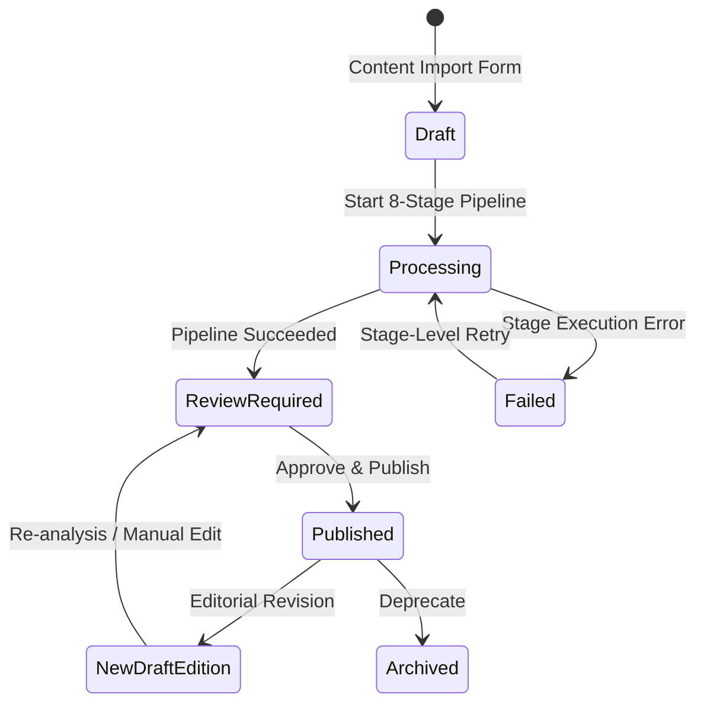

# Lexilume — Admin Workflow Implementation (Phase 7)

> **Repository:** `VINODH0101/language-learning` (Lexilume — Illuminate Your Words)  
> **Production Application:** `https://lexi.monster`  
> **UI Components:** `frontend/src/features/admin/content-studio/`  
> **Phase:** Phase 7 — Core Implementation  
> **Milestone:** Milestone 7.4 — Admin Review & Publication  

---

## 1. Administrative Workflow Overview

The Content Studio gives administrators full operational control over the content lifecycle while preventing unverified AI generation from reaching learners directly:

---

## 2. Component Implementation Details

### 2.1 `ContentImportForm`
- **Pasted Text Area:** Fast, accessible ingestion of authentic prose, conversations, or news articles.
- **Four-Way Linguistic Scoping:** Independent selection of `target_language` (`en`, `pt`, `es`) and `explanation_language` (`en`, `pt`, `es`).
- **Copyright & Rights Declaration:** Enforces rights status (`public_domain`, `original`, `licensed`, `permitted`, `restricted`, `unknown`). If marked `restricted` or `unknown`, the UI surfaces an alert banner indicating that publication will be blocked until rights are cleared.

### 2.2 `PipelineJobMonitor`
- Displays granular status for all 8 stages with elapsed milliseconds and visual status badges.
- Displays error descriptions upon failure.
- Provides a "Retry Stage" button allowing targeted re-execution of failed stages without restarting the entire pipeline.

### 2.3 `ContentReviewEditor`
- **Sentence & Paragraph Review:** Administrators inspect each segmented sentence and can edit or refine individual sentence translations.
- **Vocabulary Inspection:** View and edit extracted headwords, contextual meanings in this sentence, definitions, and explanation language glosses.
- **Grammar Explanation Review:** Review synthesized grammar points and target token spans.
- **Comprehension Activity Editor:** Review and fine-tune generated multiple-choice, true/false, and vocabulary questions.
- **Immutable Version Publishing:** Once approved, the version is marked `is_published = true` and `content_items.current_version_id` is updated.

---

## 3. Strict Version Immutability Invariant

A fundamental principle of the target architecture is that **published editions are immutable**:
1. When an administrator edits a published content item, the system rejects in-place mutation of the active version.
2. Saving changes automatically increments `version_number` and creates a new draft version edition (e.g. `v2`).
3. Historical learner progress and SM-2 flashcard contexts remain permanently linked to the original version edition (`v1`) they studied, preventing broken references.
