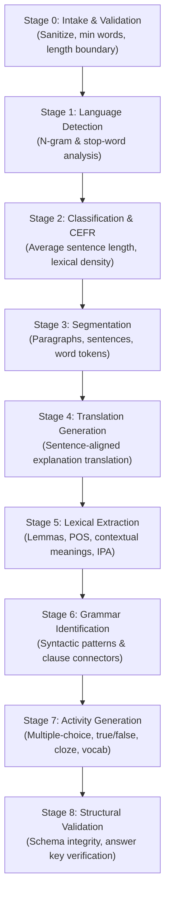

# Lexilume — Content Pipeline Implementation (Phase 7)

> **Repository:** `VINODH0101/language-learning` (Lexilume — Illuminate Your Words)  
> **Production Application:** `https://lexi.monster`  
> **TypeScript Service:** `frontend/src/services/contentPipelineService.ts`  
> **Python Pipeline:** `engine/content_pipeline/pipeline.py`  
> **Phase:** Phase 7 — Core Implementation  
> **Milestone:** Milestone 7.3 — Admin Content Import & Processing  

---

## 1. 8-Stage Processing Pipeline Architecture

The content pipeline ingests raw authentic text and produces an analyzed, structured educational edition bound to an immutable `ContentVersion`.

---

## 2. Granular Stage Specifications

1. **Stage 0: Intake & Validation (`stage_0_intake`):**
   - Strips malicious script tags and unsafe HTML.
   - Enforces minimum threshold of 15 words for viable linguistic analysis.
   - Computes sanitized character and word counts.

2. **Stage 1: Language Detection (`stage_1_detect_lang`):**
   - Deterministic stop-word frequency detection for English, Portuguese, and Spanish.
   - Validates declared target language against observed statistical markers.

3. **Stage 2: Classification & CEFR Estimation (`stage_2_classify`):**
   - Analyzes lexical density, average sentence length, and readability indices.
   - Infers CEFR level (A1 to C1) if not explicitly declared by the administrator.

4. **Stage 3: Paragraph & Sentence Segmentation (`stage_3_segment`):**
   - Splits text into discrete paragraph containers (`p_1`, `p_2`).
   - Identifies sentence boundaries (`s_1`, `s_2`) using regex boundary lookaheads.
   - Tokenizes word tokens and punctuation; tags preliminary Part of Speech (POS).

5. **Stage 4: Translation Generation (`stage_4_translate`):**
   - Maps each target sentence to an aligned translation in the configured `explanation_language`.
   - Utilizes deterministic local fallback dictionaries and open provider cascades without requiring paid LLM APIs.

6. **Stage 5: Lexical Extraction (`stage_5_extract_lexicon`):**
   - Extracts salient vocabulary headwords (up to 8 per text).
   - Generates contextual definitions distinguishing meaning in this sentence from general dictionary definitions.
   - Generates glossary IDs (`g_lemma`) linked directly into sentence token references.

7. **Stage 6: Grammar Identification (`stage_6_extract_grammar`):**
   - Identifies grammatical phenomena (e.g. past simple narrative, present indicative, prepositional phrases).
   - Links grammar points to target token spans.

8. **Stage 7: Activity Generation (`stage_7_generate_activities`):**
   - Synthesizes pedagogical questions:
     - Reading comprehension multiple-choice questions linked to specific reference sentences.
     - True/False questions testing factual extraction.
     - Vocabulary-in-context questions testing nuanced lexical choice.

9. **Stage 8: Structural Validation (`stage_8_validate`):**
   - Verifies that all generated questions contain non-empty correct answers and explanations.
   - Confirms that every token with a `gloss_id` exists in the annotations dictionary.
   - Assembles the final `StructuredPayload` conforming strictly to the canonical domain schema.

---

## 3. Durable State & Stage-Level Retry

- **Persistence:** Every job execution state is recorded in Supabase `content_processing_jobs` and cached locally in Dexie v5 `contentProcessingJobs`.
- **Intermediate Stage Outputs:** The JSON column `stage_outputs` retains the output of each completed stage.
- **Idempotent Retry:** If Stage 5 (Lexical Extraction) fails, the administrator can invoke `retryStage(jobId, 'stage_5_extract_lexicon')`. Upstream outputs (Stages 0–4) are preserved, avoiding redundant language detection or segmentation re-runs.

---

## 4. Verification Evidence

- Python pipeline verified by `tests/test_content_pipeline.py` (2 passed).
- TypeScript service verified by `src/tests/contentCentredPipeline.test.ts` (3 passed).
