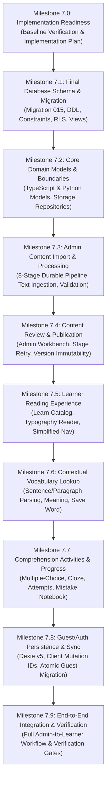

# Lexilume — Phase 7 Implementation Plan: Content-Centred Learning Platform

> **Repository:** `VINODH0101/language-learning` (Lexilume — Illuminate Your Words)  
> **Production URL:** `https://lexi.monster`  
> **Branch:** `phase-7-core-implementation`  
> **Baseline Commit:** `bbf2575` (Phase 6 Completion)  
> **Target Phase:** Phase 7 — Core Implementation  
> **Document Type:** Master Implementation Plan & Architecture Execution Dependency Graph  

---

## 1. Executive Summary & Objective

The primary objective of Phase 7 is to transform Lexilume from fragmented, catalog-centric curriculum pages and daily generated scripts into a **unified, content-centred language-learning platform**. In this model:
1. **Authentic, engaging content** (dialogues, articles, stories, business emails, technical texts, cultural reflections) serves as the primary educational anchor.
2. Content is ingested, analyzed through an **8-stage processing pipeline**, verified and enriched by administrators, and published immutably.
3. Learners engage with published content through a **clean, typography-first reading experience**, interactive **contextual vocabulary lookup**, **comprehension activities**, **personal vocabulary collection with SM-2 spaced repetition**, and a **mistake notebook for error remediation**.
4. Both guest learners (local-first via Dexie IndexedDB and LocalStorage) and authenticated learners (cloud-synced via Supabase PostgreSQL and Row-Level Security) enjoy seamless, idempotent data persistence.

---

## 2. Baseline Verification (Milestone 7.0 Acceptance)

Prior to initiating code mutations, the repository baseline was verified against all automated gates:
- **Git Branch:** Clean working directory branched from `phase-6-safe-cleanup` into `phase-7-core-implementation`.
- **Frontend Test Baseline:** 37 test files, 310 tests passing with 100% success (`vitest run`).
- **Frontend Build Baseline:** `tsc -b && vite build` completed in 5.51s with 0 errors.
- **Python Engine Baseline:** 106 passed, 1 skipped in 3.15s (`pytest tests/ -v`).
- **Database Baseline:** 14 existing migrations (`001` through `014`) in `supabase/migrations/`; canonical reset scripts verified. All Supabase application tables reported zero rows.

---

## 3. Milestone Execution Sequence & Dependency Graph



---

## 4. Code Reuse vs Replacement Matrix

| Subsystem / Concern | Existing Code to Reuse | Code to Replace / Refactor | New Modules to Implement |
| :--- | :--- | :--- | :--- |
| **Database Schema** | Historical migrations `001`-`014` as baseline | Replace fragmented content tables (`daily_published_content`, `curated_materials`) via unified tables | `supabase/migrations/015_content_centred_architecture.sql`, `rollback/015_rollback.sql` |
| **Domain Models** | `engine/models/enums.py`, `frontend/src/lib/languages/languageMatrix.ts` | Fragmented lesson types in `frontend/src/types/index.ts` | `frontend/src/types/contentCentred.ts`, `engine/models/content_centred.py` |
| **Local Storage (Dexie)** | Dexie v4 stores (`cachedLessons`, `syncQueue`, `apiCache`) | Upgrade Dexie to Version 5 | New stores: `cachedContentItems`, `learnerContentProgress`, `userSavedWords`, `userMistakes` |
| **Content Processing** | `frontend/src/services/contentEngine/`, `engine/generators/template_engine.py`, dictionary providers | Monolithic generation scripts | 8-stage pipeline in `frontend/src/services/contentPipelineService.ts` and `engine/content_pipeline/` |
| **Admin Operations** | `authService.isAdmin()`, `AdminAuditLogs.tsx` | Fragmented review items | Unified Content Studio (`AdminContentStudio.tsx`, `ContentEditor.tsx`, `StageMonitor.tsx`) |
| **Learner Navigation** | Header, Logo, Auth Modal, Interface Selector | 11-tab sprawling navigation | 4 primary destinations: Learn, My Words, My Mistakes, Settings (+ Admin) |
| **Learner Reading** | Typography base, Web Speech TTS (`speech.ts`) | Legacy course wrappers | `LearnCatalog.tsx`, `ReaderView.tsx`, `ContextualLookupModal.tsx` |
| **Comprehension** | Cloze and multiple choice heuristics | Hardcoded curriculum node quizzes | `ContentActivities.tsx`, question engine, Mistake notebook recording |
| **Spaced Repetition** | SM-2 calculation engine (`srs.ts`, `sm2.py`) | Disjointed `saved_translations` vs `srs_items` | Unified personal lexicon query and review interface in `MyWordsPage.tsx` |
| **Offline Sync** | `syncEngine.ts` queue worker and retry logic | Ad-hoc payload shapes | Idempotent sync handlers with `client_mutation_id` for content-centred stores |

---

## 5. Target Folder Boundaries

```
frontend/src/
├── app/
│   ├── layouts/AppLayout.tsx          # Simplified 4-tab learner navigation + Admin
│   └── router/                        # Updated routes: learn, words, mistakes, settings, admin + legacy aliases
├── types/
│   └── contentCentred.ts             # Canonical TypeScript definitions
├── services/
│   ├── localDb.ts                     # PolyglotLocalDatabase Version 5
│   ├── contentCentredService.ts       # Unified Content & Progress Service
│   ├── contentPipelineService.ts      # 8-Stage processing pipeline coordinator
│   └── syncEngine.ts                  # Idempotent sync engine with client_mutation_id
├── features/
│   ├── learn/                         # Learner Reading Experience
│   │   ├── LearnCatalog.tsx           # Content explorer & filterable grid
│   │   ├── ReaderView.tsx             # Interactive sentence-level reader
│   │   ├── ContextualLookupModal.tsx  # Word/phrase contextual lookup popover
│   │   └── ContentActivities.tsx      # Version-linked comprehension exercises
│   ├── vocabulary/                    # My Words (Unified Personal Lexicon & SM-2)
│   ├── mistakes/                      # My Mistakes (Remediation Notebook)
│   └── admin/                         # Admin Content Studio
│       ├── ContentImportForm.tsx      # Ingestion & Rights Declaration
│       ├── PipelineJobMonitor.tsx     # Stage execution & retry
│       └── ContentReviewEditor.tsx    # Inspection, correction & version publication
engine/
├── models/
│   └── content_centred.py            # Pydantic models matching target schema
└── content_pipeline/                 # Pipeline stage execution & validation
    ├── pipeline.py                   # Stage coordinator
    └── stages/                       # Individual stage implementations
```

---

## 6. Critical Database Design Risk Mitigations (Phase 5 Risk Register)

Every issue identified in `docs/cleanup/PHASE_5_RISK_REGISTER.md` is strictly resolved in the target schema:

1. **RISK-01 (Cross-Language Lemma Collision):**
   The unique constraint in `user_saved_words` is defined as:
   `CONSTRAINT uq_user_saved_words UNIQUE (user_id, target_language, lemma, part_of_speech, explanation_language)`.
   This guarantees that saving *"radio"* in Spanish does not collide with or corrupt *"radio"* in English or Portuguese.

2. **RISK-02 (SM-2 Scheduling Parameter Retention):**
   `user_saved_words` retains all 8 scheduling parameters: `ease_factor`, `interval_days`, `repetitions`, `lapses`, `last_reviewed_at`, `next_review`, `legacy_srs_item_id`, and `context_sentence`.

3. **RISK-03 (Stable Surrogate Keys for Progress):**
   Progress and mistakes reference immutable UUIDs (`content_item_id`, `content_version_id`, `activity_id`), never localized titles or language strings.

4. **RISK-04 (Safe Backfill & Idempotent Transactions):**
   Given the verified empty state of application tables, backfill runs conditionally. Any backfill procedures use checkpoint tracking and independent transaction bounds.

5. **RISK-05 (Atomic Guest-to-Account Migration):**
   Dexie transactions enclose all guest data migration. `client_mutation_id` ensures network retry idempotency without duplicate cloud writes.

6. **RISK-06 (Compatibility View RLS Invariance):**
   All backward-compatibility views are declared with `WITH (security_invoker = true)` to enforce PostgreSQL Row-Level Security under the caller's context.

---

## 7. Security & Privacy Safeguards

- **Server-Side Authorization:** Admin operations require `public.is_admin()` or verified Supabase JWT claims (`role = 'admin'`). Client-side UI hides controls, but database RLS strictly blocks unauthorized mutations.
- **Tenant Isolation:** All learner queries include `user_id = auth.uid()` via RLS.
- **SSRF & Input Sanitation:** Input text is length-bounded, stripped of executable HTML/scripts, and URL fetching (when active) blocks private RFC1918 IPs and cloud metadata endpoints (`169.254.169.254`).
- **Zero-Paid AI Invariant:** Core translation and processing rely on deterministic local dictionaries and free educational adapters. Gemini is optional with deterministic offline fallback.
- **Secret Hygiene:** No private keys or service roles are exposed to Vite client bundles.

---

## 8. Testing & Verification Gates

At each milestone, the following three test suites must exit with code `0`:
1. `npm --prefix frontend test` (Vitest unit and component tests)
2. `npm --prefix frontend run build` (TypeScript compiler and Vite production bundle)
3. `python -m pytest tests/ -v` (Python engine and schema validation tests)

Any regressions must be resolved immediately before advancing to the subsequent milestone.

---

## 9. Rollback & Contingency Strategy

- **Migration Rollback:** Dedicated reverse script `supabase/migrations/rollback/015_rollback.sql` drops target views, triggers, and tables in reverse dependency order without touching legacy tables.
- **Local Database Rollback:** Dexie v5 keeps v1-v4 stores intact; downgrading local code does not corrupt legacy stores.
- **Route Backwards-Compatibility:** Legacy URL hash routes (`#dashboard`, `#portuguese`, `#spanish`, `#english`, `#practice`, `#progress`) remain functional alongside new routes (`#learn`, `#words`, `#mistakes`).
- **Git Commit Discipline:** Each milestone is committed with a granular, descriptive conventional commit, facilitating git bisect and clean rollbacks if necessary.
