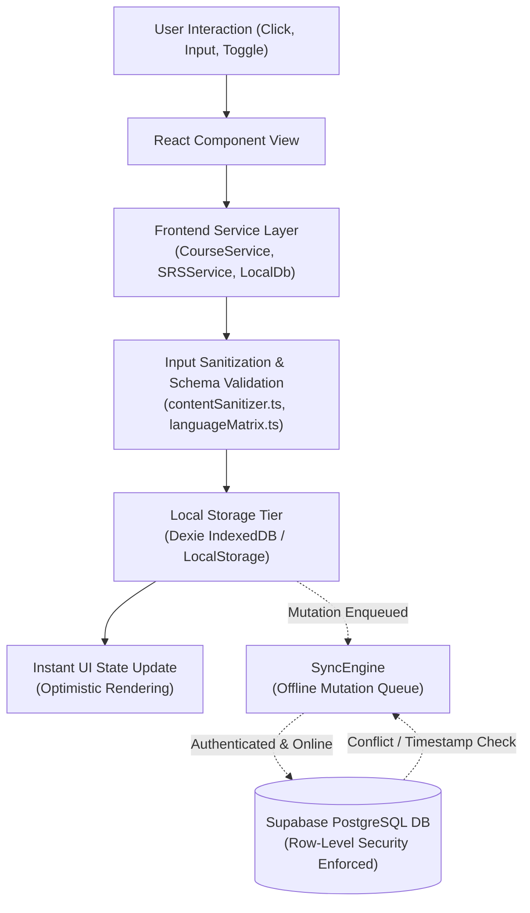

# 03. Data Access and Display Architecture

> **Audit Date:** 2026-10-29  
> **Repository:** `language-learning`  
> **Scope:** End-to-end data lifecycle, transformations, local-first storage, sync queues, and UI rendering pipelines.

---

## 1. Unified Data Flow Pipeline

Every read and write operation follows an explicit local-first lifecycle:

---

## 2. Storage Tiers & Data Boundaries

### 2.1 Browser `localStorage`
Used strictly for small scalar preferences that require synchronous access during initial DOM rendering:

| Key | Type | Description |
| :--- | :--- | :--- |
| `polyglot_interface_lang` | `'en' \| 'pt' \| 'es'` | Controls UI chrome language. |
| `polyglot_theme` | `'light' \| 'dark' \| 'system'` | Controls DOM root theme class. |
| `polyglot_font_size` | `'normal' \| 'large' \| 'xlarge'` | Controls root font scale. |
| `polyglot_active_course_id` | `string` | ID of the currently selected user course. |
| `polyglot_onboarding_completed` | `'true' \| 'false'` | Flag preventing redundant onboarding prompts. |
| `polyglot_guest_track_{lang}` | `JSON` | Lightweight track state fallback for guest learners. |

> [!IMPORTANT]
> No authentication tokens, service role keys, or sensitive user data are ever stored in `localStorage`.

---

### 2.2 In-Browser Database (`Dexie` IndexedDB)
Complex structured datasets, learning progress, and mutation queues are persisted in IndexedDB via `frontend/src/services/localDb.ts` (`PolyglotLocalDatabase`):

| Table Name | Primary Key | Indexes | Purpose |
| :--- | :--- | :--- | :--- |
| `courses` | `id` | `user_id`, `target_lang`, `updated_at` | Enforces multi-course progress isolation. |
| `lessons` | `id` | `course_id`, `delivery_date`, `cefr_level` | Offline lesson caches and study history. |
| `vocabulary_bookmarks` | `id` | `user_id`, `language`, `cefr_level` | User-saved vocabulary items with audio. |
| `saved_translations` | `id` | `user_id`, `source_lang`, `target_lang` | Word translations saved from dictionary lookup. |
| `exercise_attempts` | `id` | `user_id`, `exercise_id`, `is_correct` | Performance history for accuracy metrics. |
| `srs_items` | `id` | `user_id`, `course_id`, `next_review_utc` | Spaced repetition flashcards with SM-2 intervals. |
| `mistake_logs` | `id` | `user_id`, `language`, `error_category` | Mistake notebook registry for targeted drills. |
| `phrasebook` | `id` | `user_id`, `source_lang` | Phrases captured from reading tap-to-translate. |
| `cultural_bookmarks` | `id` | `user_id`, `article_id` | Saved cultural exploration essays. |
| `sync_mutations` | `id` | `status`, `retry_count`, `created_at` | Offline mutation queue with idempotency keys. |

---

## 3. Remote Cloud Synchronization (`SyncEngine.ts`)

### 3.1 Idempotency & Queue Processing
When an authenticated session is active, mutations written to IndexedDB are pushed to Supabase using a transactional queue:
1. **Idempotency Key:** Each mutation generates a unique key:
   $$\text{Key} = \text{operation} + \text{"\_"} + \text{record\_id} + \text{"\_"} + \text{timestamp}$$
2. **Backoff & Retries:** Failed network requests retry with exponential backoff ($2^n \times 500\text{ms}$, capped at 5 attempts).
3. **Status Reporting:** Live indicators update the navigation bar:
   - `synced`: All pending mutations successfully applied to Supabase.
   - `syncing`: Background sync in progress.
   - `offline`: Browser offline; writes safely buffered in IndexedDB.
   - `error`: Repeated network failure; mutation retained for manual retry.

---

## 4. Input Sanitization & Content Security

All external and user-supplied content passes through `frontend/src/lib/security/contentSanitizer.ts`:
- **HTML Sanitization:** Strips script tags, unsafe inline event handlers (`onload`, `onclick`), and dangerous protocols (`javascript:`, `data:`).
- **Safe URLs:** Links to external reading sources (Wikipedia, Tatoeba) are strictly validated against `https://` protocols before rendering clickable elements.
- **Linguistic Character Preservation:** Does not mangle accented characters (`á`, `ç`, `ñ`), IPA phonetic symbols (`[ʁ]`, `[θ]`, `[ɲ]`), or structural syntax punctuation.
