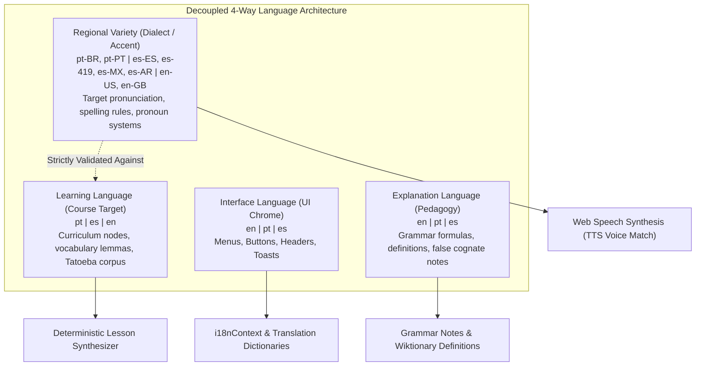

# 05. Multilingual and Translation Consistency Architecture

> **Audit Date:** 2026-10-29  
> **Repository:** `language-learning`  
> **Scope:** Independent 4-dimension language matrix, 9 bidirectional language pairs, regional dialect invariants, and speech synthesis locale resolution.

---

## 1. The Four Decoupled Linguistic Dimensions

The application strictly separates four distinct linguistic dimensions across both frontend and backend layers:



---

## 2. Dimension Definitions & System Invariants

### 2.1 Interface Language (`interface_language`)
- **Supported:** `en` (English), `pt` (Portuguese), `es` (Spanish).
- **Scope:** Navigation bar, button labels, settings controls, toast messages, and modal headers.
- **Invariant:** Modifying the interface language never modifies active course progress, target study lexis, or speech synthesis audio.

### 2.2 Learning Language (`learning_language` / `target_language`)
- **Supported:** `pt` (Portuguese), `es` (Spanish), `en` (English).
- **Scope:** The language the learner is acquiring. Controls curriculum progression (A1 through C1), Tatoeba sentence queries, and SM-2 flashcard intervals.

### 2.3 Explanation Language (`explanation_language`)
- **Supported:** `en`, `pt`, `es`.
- **Scope:** The pedagogical instruction language used for grammar explanations, definitions, distractor feedback, and false-friend alerts.
- **Invariant:** Selectable per course. Native Portuguese speakers learning Spanish can read explanations in Portuguese or English without affecting Spanish target lexis.

### 2.4 Regional Variety (`regional_variety` / `regional_variant`)
- **Supported Dialects:**
  - **Portuguese (`pt`)**: `pt-BR` (Brazilian), `pt-PT` (European), `all` (Neutral).
  - **Spanish (`es`)**: `es-ES` (Peninsular), `es-419` / `es-MX` (Latin American), `es-AR` (Rioplatense), `all` (Neutral).
  - **English (`en`)**: `en-US` (American), `en-GB` (British), `all` (Neutral).
- **Strict Invariant:** Dialectal varieties are never free-floating. Attempting to assign `pt-BR` to English or `es-ES` to Portuguese is rejected by backend Pydantic validation and auto-normalized by frontend `enforceRegionalVariety`.

---

## 3. The 9 Bidirectional Target/Explanation Combinations

All 9 permutations are fully supported and tested across both frontend and backend engines:

| Combination | Target Language | Explanation Language | Pedagogical Persona & Use Case |
| :--- | :--- | :--- | :--- |
| **EN → PT** | English (`en`) | Portuguese (`pt`) | Native Portuguese speaker acquiring advanced English. |
| **EN → ES** | English (`en`) | Spanish (`es`) | Native Spanish speaker acquiring advanced English. |
| **EN → EN** | English (`en`) | English (`en`) | Monolingual immersion English lexis and grammar. |
| **PT → EN** | Portuguese (`pt`) | English (`en`) | Anglophone learner acquiring Brazilian or European Portuguese. |
| **PT → ES** | Portuguese (`pt`) | Spanish (`es`) | Hispanophone learner acquiring Portuguese with false cognate alerts. |
| **PT → PT** | Portuguese (`pt`) | Portuguese (`pt`) | Monolingual Portuguese advanced immersion. |
| **ES → EN** | Spanish (`es`) | English (`en`) | Anglophone learner acquiring Spanish. |
| **ES → PT** | Spanish (`es`) | Portuguese (`pt`) | Lusophone learner acquiring Spanish with contrastive syntax notes. |
| **ES → ES** | Spanish (`es`) | Spanish (`es`) | Monolingual Spanish C1 immersion. |

---

## 4. Speech Synthesis Locale Scoping

In `frontend/src/services/speech.ts`, audio synthesis strictly isolates voice queries to target learning language and regional variety:
```typescript
const voiceKey = `${language}_${variety}`;
// e.g. 'pt_pt-BR' selects Brazilian voice, 'pt_pt-PT' selects European Portuguese voice
```
The user's interface language and explanation language are completely excluded from voice matching, guaranteeing authentic target pronunciation.

---

## 5. Automated Validation & Test Evidence

- **Frontend Vitest (`src/tests/languageDecoupling.test.ts`):** 17 tests verifying 9 matrix combinations, regional dialect validation, speech audio scoping, and multi-course updates.
- **Backend Pytest (`tests/test_language_separation.py`):** 5 tests verifying enum scoping, fallback normalization, and Pydantic `ValidationError` on mismatched varieties.
